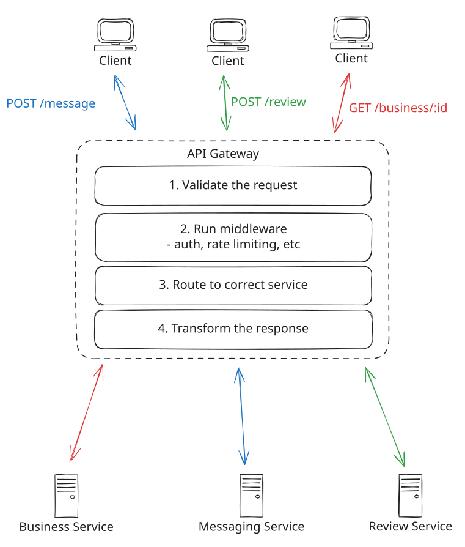

# API Gateway

An API gateway is a shared public entry point that routes API requests to the right backend service. It gives clients a stable API while internal service addresses, replicas, and deployments change.

## Follow one request

1. **Validate the request.** Check required headers, body size, and basic shape. Reject malformed requests close to the client.
2. **Apply shared policies.** Verify credentials, enforce quotas, and attach a request or trace ID. A service can still enforce authorization on the resources it owns.
3. **Resolve the route.** Match on method and path, and use headers or other request properties when needed. For example, `GET /v1/catalog/items/42` routes to the Catalog service and `POST /v1/orders` routes to Orders.
4. **Call the upstream.** Resolve a healthy endpoint from service discovery or an upstream load balancer, forward authenticated context, and apply a deadline. A gateway can translate an HTTP/JSON route to a gRPC method when the public and internal protocols differ.
5. **Return the response.** Map errors or transform the payload if the public contract calls for it. Cache eligible responses with a key that includes all inputs that change the response, such as locale, representation, and authorization scope when relevant.

TLS termination, CORS, throttling, and request logging are common gateway policies. Order ownership, inventory checks, and payment decisions belong with the services that own those rules. [API design](../api-design/README.md)

## Scale and fail over

A regional load balancer spreads inbound requests across stateless gateway instances. The gateway then routes to the target service, where it or another load balancer selects a healthy instance. Multiple regions can run the same public routes. GeoDNS or a global load balancer steers users toward a healthy region, subject to where the data and backends can serve those requests. Distribute versioned route and policy configuration, and measure latency, errors, and timeouts per route and upstream. [Load balancing](../networking-fundamentals/13-load-balancing.md) · [Regionalization](../networking-fundamentals/14-regionalization.md)

Gateway instances can share a rate-limit store such as [Redis](redis.md) when quotas apply across instances. A strict global quota needs coordination or explicitly allocated regional budgets. Local limits reduce coordination latency and can allow a combined burst across regions.

Managed options include Amazon API Gateway and Azure API Management. Self-managed options include Kong Gateway and Envoy Gateway. In a product interview, keep the gateway discussion tied to the requirements. A single backend with straightforward routing may only need a load balancer or reverse proxy.

## Interview practice

### Where would a gateway go in an e-commerce API and what would you route through it?

> I'd expose one public host. The gateway authenticates requests, applies client quotas, routes `/catalog/*` to Catalog, and routes `/orders/*` to Orders. Orders receives the authenticated identity and checks whether the user is allowed to view or modify that order. Service discovery keeps private backend addresses out of the public contract.

### Is the gateway the same as a load balancer?

> There are two decisions in the request path. A load balancer in front chooses a healthy gateway instance. The gateway chooses which service owns the API route, then it or an upstream load balancer chooses a healthy replica of that service. A single product can implement both functions.

### Would you cache search results and order details at the gateway?

> I can cache public catalog search results if the cache key includes the query, filters, sort, locale, and any other variation, with a TTL that matches the product's freshness target. I'd bypass a shared response cache for private order details unless the cache is explicitly scoped to identity and access policy. The Orders service must enforce authorization on the underlying resource.

### What if an upstream service is slow or a region fails?

> I'd set a deadline and bound per-upstream concurrency so slow requests to one service do not exhaust the entire gateway. I retry idempotent operations only within the original deadline and a retry budget. An order creation needs an idempotency key and backend deduplication before automated retry is safe. For a region outage, global routing sends requests to another healthy region that can actually serve that route's reads or writes.

## Source

[API Gateway · Hello Interview](https://www.hellointerview.com/learn/system-design/deep-dives/api-gateway)
