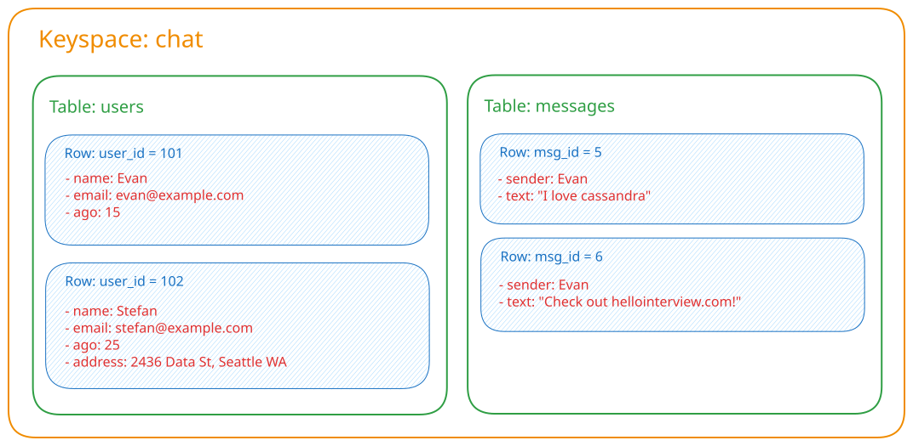
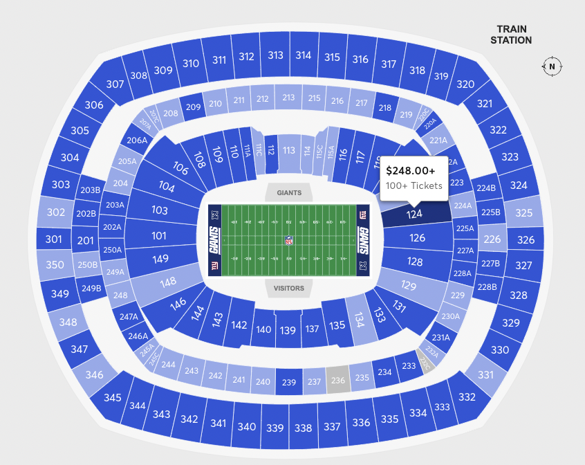
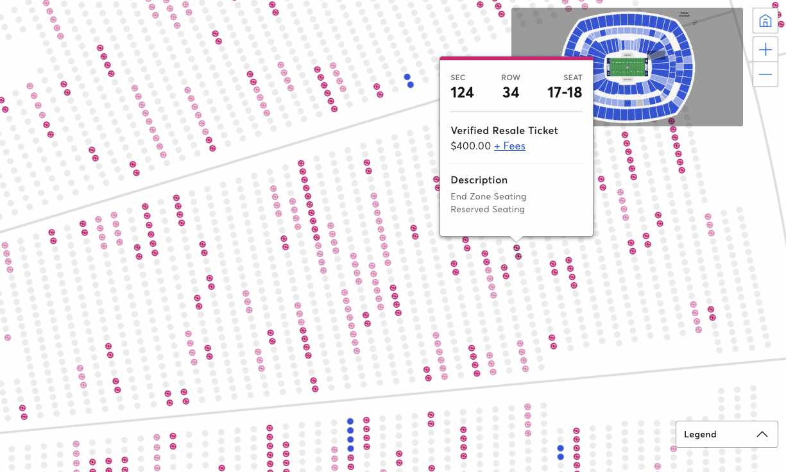
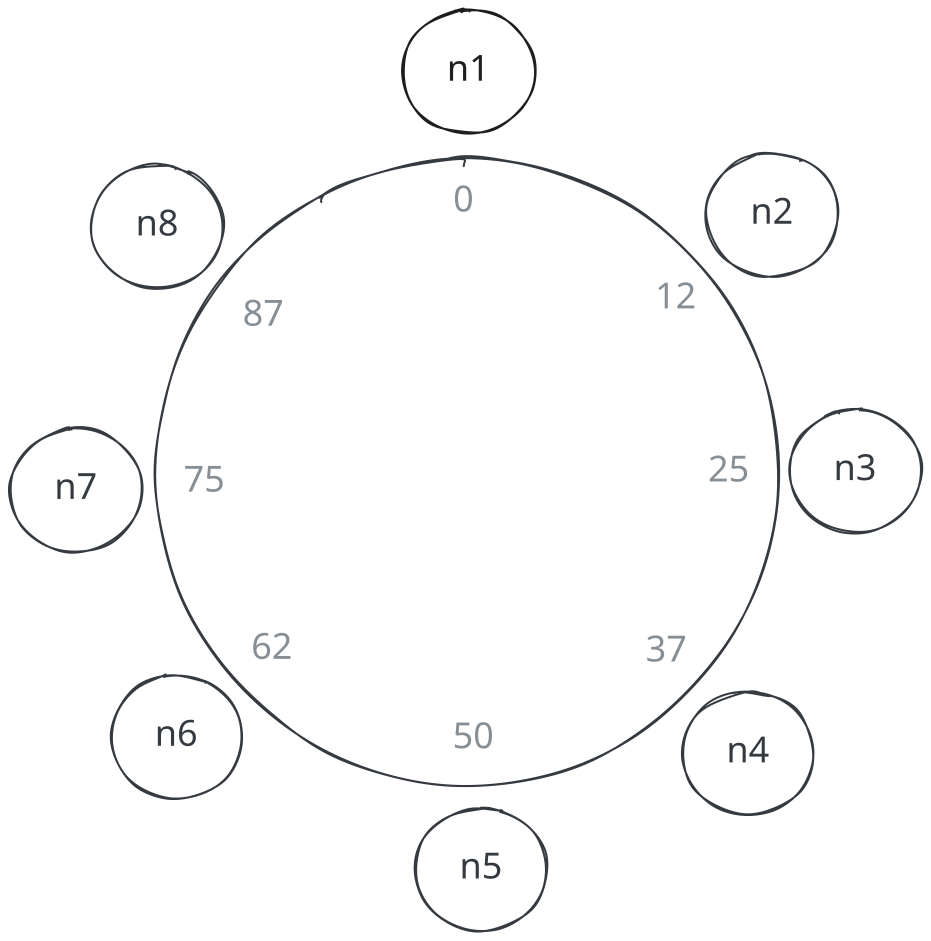
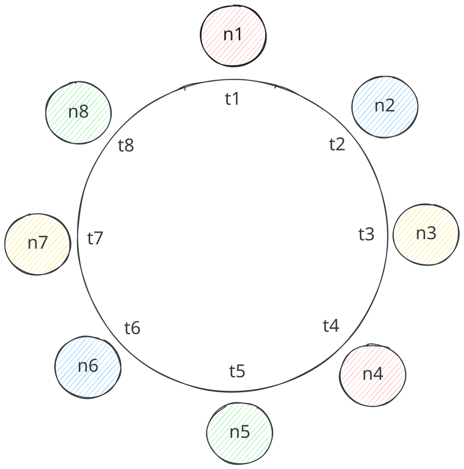
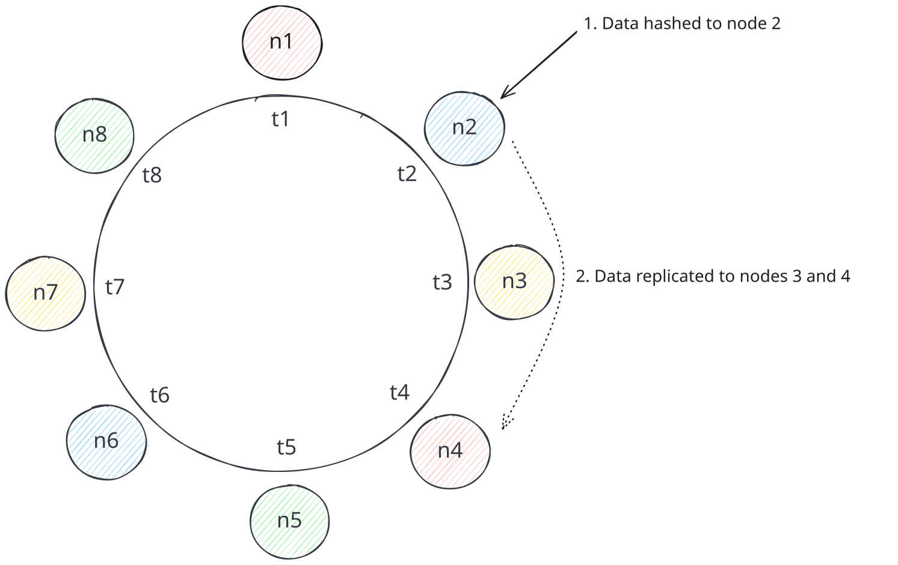
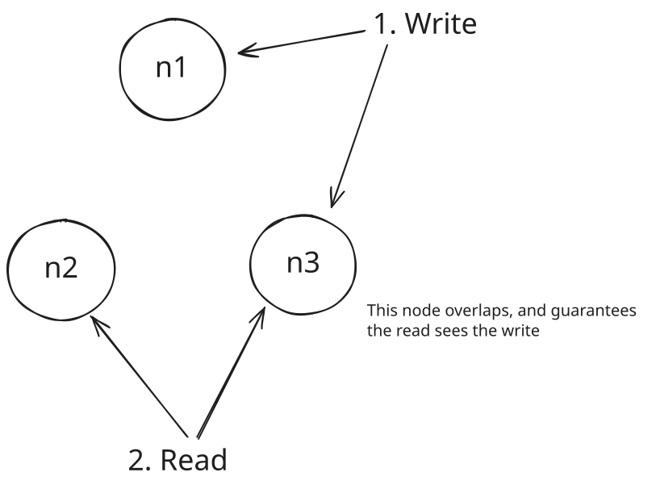
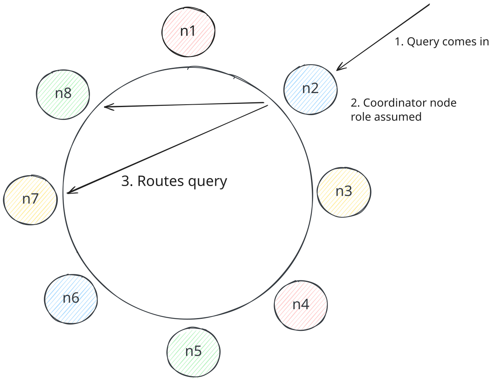
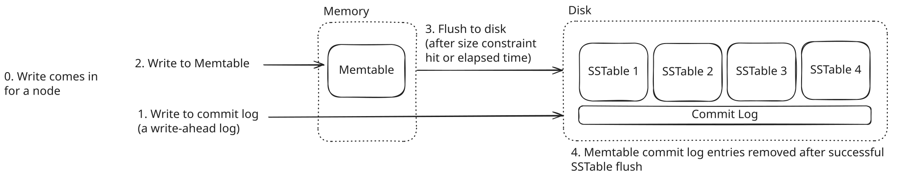
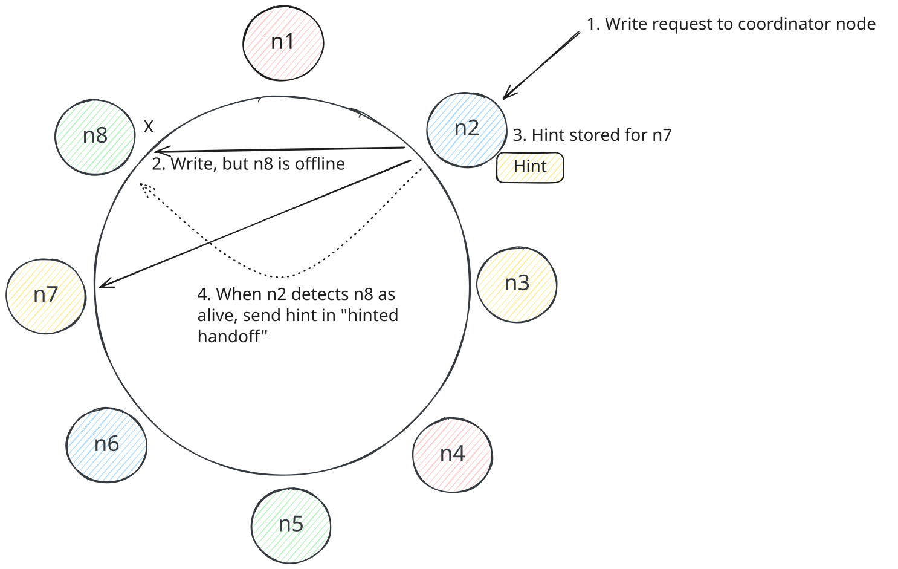

# Cassandra

Apache Cassandra is a distributed wide-column database suited to high write volumes and predictable queries by partition key. It puts the schema design in the application team's hands, including which rows share a partition, how they are ordered, and which queries get their own tables.

## Model the queries first

A keyspace defines replication for its tables. A table's primary key contains a **partition key**, which determines placement, and optional **clustering columns**, which identify and order rows within that partition. A query that supplies the partition key and reads a bounded clustering range matches Cassandra's storage layout.



A chat service that reads recent messages by channel can model messages like this.

```sql
CREATE TABLE messages_by_channel (
    channel_id bigint,
    day_bucket date,
    message_id bigint,
    sender_id bigint,
    body text,
    PRIMARY KEY ((channel_id, day_bucket), message_id)
) WITH CLUSTERING ORDER BY (message_id DESC);
```

Use a unique time-sortable message ID. The current day is the first partition to read for the latest messages, and the cursor carries the bucket and message position to continue into earlier days. Time bucketing bounds partition growth. One busy channel can still overwhelm its current bucket. If needed, split that bucket by a write shard and merge sorted reads.

For ticket browsing, a venue overview and a section view have different access patterns. Store section summaries by `event_id` with `section_id` as the clustering key. Store seats by `(event_id, section_id)` with `seat_id` as the clustering key. The client can read one partition for the venue overview and another for a selected section. Use precomputed, potentially stale summaries for browsing and an authoritative reservation write at checkout.





## Placement, replication, and consistency

Cassandra hashes a partition key into a token. Nodes own token ranges, and virtual nodes let a physical node own multiple ranges on the ring. Rebalancing changes ownership of affected ranges. `NetworkTopologyStrategy` defines the replication factor per data center and accounts for rack topology when selecting replica nodes. [Consistent hashing](../consistent-hashing/README.md) · [Cassandra Dynamo architecture](https://cassandra.apache.org/doc/latest/cassandra/architecture/dynamo.html)







Any node can be the coordinator for a request. It routes work to the appropriate replicas and waits for the selected consistency level. Writes normally go to all replicas, while the consistency level controls how many responses the coordinator requires before returning. With a local replication factor of three, `LOCAL_QUORUM` needs two local replicas. Using two for both reads and writes creates overlap for successfully completed operations in that data center. For a compare-and-set invariant under concurrent writes, use lightweight transactions (LWT) or an authoritative transactional store. Quorum reads and writes alone do not implement compare-and-set.





## Write path, reads, and repair

A replica appends to its commit log and updates a memory-resident memtable. Flushing creates immutable SSTables on disk. Reads can reconcile versions across memtables and relevant SSTables. Bloom filters reduce unnecessary reads by ruling out some SSTables for a partition key. Compaction combines SSTables and reclaims eligible tombstones. Heavy deletes or poorly chosen TTLs can leave many tombstones for reads to scan until compaction can remove them.



Nodes exchange cluster state through gossip and detect unreachable peers. For a temporary outage, a coordinator can store hints for a missing replica and deliver them when it returns. A quorum write still needs enough replica acknowledgments. The write-only `ANY` consistency level can acknowledge a stored hint. Anti-entropy repair reconciles differences that hints alone may miss. Token ownership stays in place during a temporary outage.



Cassandra tables commonly duplicate data to serve known access patterns and avoid expensive fan-out. Storage-Attached Indexing (SAI) can serve some secondary access patterns. Check query cost under your partition distribution and load before relying on it for a critical endpoint. Designs centered on joins, ad hoc queries, or multi-row business invariants often fit a relational store.

## Interview practice

### How would you store messages so a user can open a channel and scroll back?

> I'd partition by `(channel_id, day_bucket)` and cluster by descending time-sortable message ID. The app reads the latest buckets and pages within each bucket. I'd choose bucket size from the busiest channel's write rate and expected row size. If a busy channel still overwhelms a current bucket, I'd add a bounded write shard and merge ordered results, accepting more queries for each read.

### How should a ticketing system model a venue map?

> I'd keep one read table for section summaries keyed by event, and another for seats keyed by event and section. The page loads a small number of cached or precomputed section totals first. Selecting a section reads its seats without scanning the venue. At checkout I reserve a specific seat through a conditional write in the authoritative reservation store.

### With replication factor three, do reads and writes still work if one replica fails?

> With all three replicas local and `LOCAL_QUORUM` for both operations, the remaining two can satisfy the request. If a second replica is unreachable, quorum operations fail. A browsing path might choose a lower read consistency level if stale data is acceptable. I specify the required consistency per operation and keep reservations on a path that enforces their invariant.

### Why can Cassandra serve many writes and still struggle with some reads?

> The typical write updates a memtable and appends to a commit log. Reading may touch several SSTables and merge versions or skip many tombstones. I'd bound partition size, use clustering ranges that match queries, and check compaction backlog and tombstone-heavy reads before changing hardware.

### How would you prevent two clients from claiming the same username?

> I'd store one row per normalized username and use an LWT such as `INSERT ... IF NOT EXISTS` to claim it. A normal read followed by a quorum write has a race because two clients can both see the name as available. If claiming a name must be atomic with several related changes, I'd model that invariant in a transactional store.

## Sources

- [Cassandra · Hello Interview](https://www.hellointerview.com/learn/system-design/deep-dives/cassandra)
- [Cassandra practice quiz · Hello Interview](https://www.hellointerview.com/learn/system-design/deep-dives/cassandra#quiz-cassandra)
