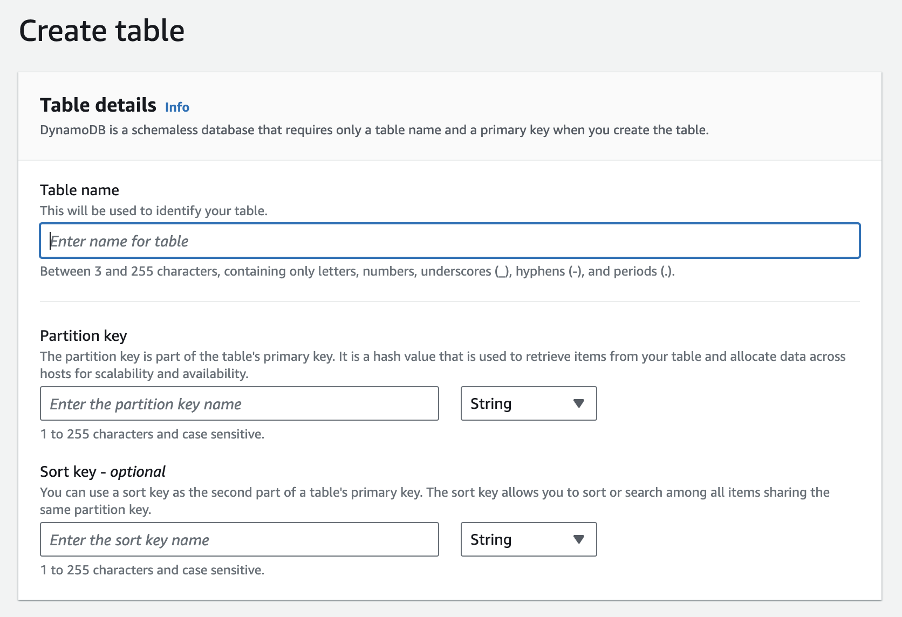
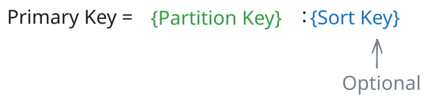
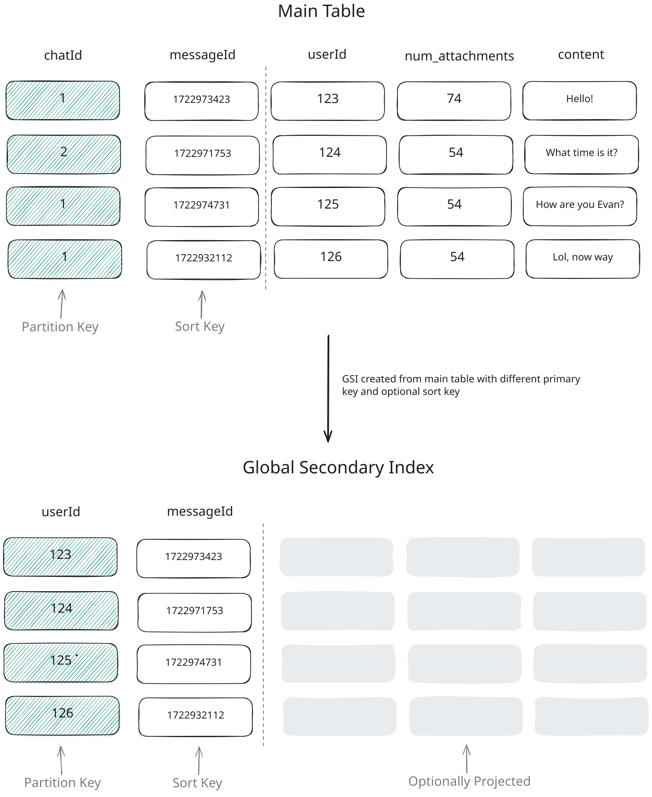
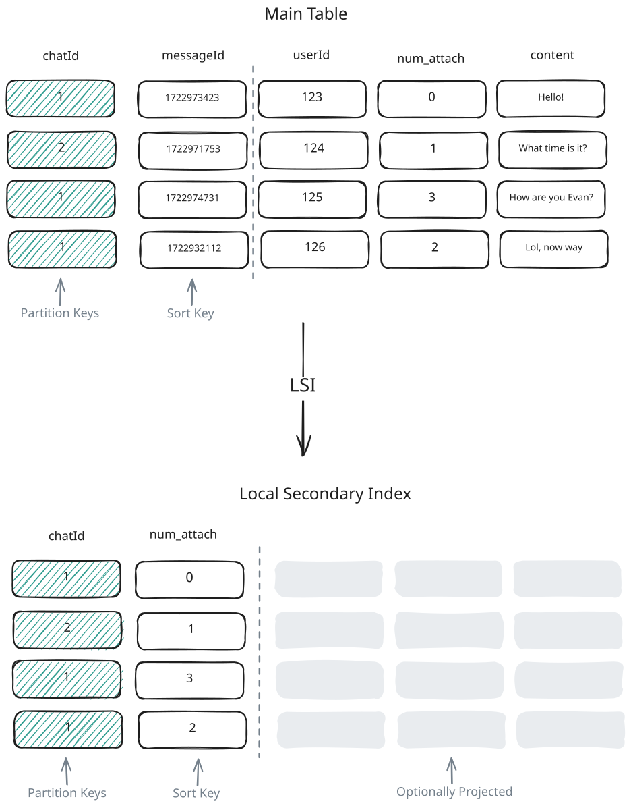
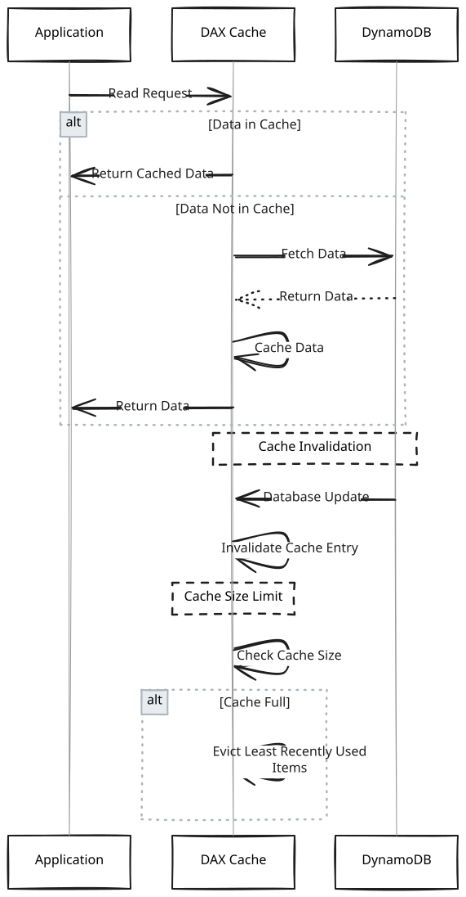

# DynamoDB

Amazon DynamoDB is a managed key-value and document database. It fits high-throughput workloads with known access patterns, such as retrieving recent chat messages or looking up orders by customer. Choose the keys and read consistency from the API's access patterns and the business rules each path must enforce.

## Items, keys, and queries

A table holds items with a shared key schema. Other attributes can vary by item. A single-attribute primary key uses a partition key. A composite primary key adds a sort key, and the pair uniquely identifies an item. DynamoDB hashes the partition key for physical placement and maintains sort key order within an item collection.

| Operation | How to use it |
| --- | --- |
| `GetItem` | Supply the item's full primary key. |
| `Query` | Supply equality on the partition key and optionally a sort-key condition such as `BETWEEN` or `begins_with`. Paginate with `LastEvaluatedKey`. |
| `Scan` | Read through the table or index for offline or infrequent work that needs broad coverage. |
| `UpdateItem` with a condition | Change a record only when an invariant holds, such as checking a version or testing whether a seat is available. |
| `TransactWriteItems` | Apply related writes atomically within the same account and Region, up to 100 distinct items and the transaction size limit. |

For a chat timeline, use `chat_id` as the partition key and a time-sortable `message_id` as the sort key. A query fetches recent messages in reverse order and can continue with the last evaluated key. Filters apply after DynamoDB reads the matched items, and a projection on a base-table read reduces the returned payload while read capacity is still based on the item sizes read. Separate frequently accessed small fields from large blobs or independent collections. DynamoDB's item size limit is 400 KB. [Query API](https://docs.aws.amazon.com/amazondynamodb/latest/APIReference/API_Query.html) · [DynamoDB constraints](https://docs.aws.amazon.com/amazondynamodb/latest/developerguide/Constraints.html)

## Secondary indexes

A **global secondary index (GSI)** can use a different partition key and sort key from the base table. For all messages sent by a given user, use `sender_id` as the GSI partition key and `message_id` as its sort key. Index changes propagate asynchronously, and GSI reads are eventually consistent. A GSI can be added later and consumes write capacity for maintaining indexed items. A hot or throttled GSI can backpressure writes to the base table.

A **local secondary index (LSI)** keeps the base partition key and uses another sort key, such as an attachment count within each chat. It can support strong reads, shares the base table's capacity, and must be defined at table creation. A table with an LSI has a 10 GB limit per item collection, including the base items and index projections. [Secondary indexes](https://docs.aws.amazon.com/amazondynamodb/latest/developerguide/SecondaryIndexes.html)

## Consistency, replication, and capacity

### Strong reads and the CAP theorem

For a single-Region table, a **strongly consistent read** returns the item's latest committed value as of some instant between the start and end of the read. It reflects all writes that succeeded before the read began, even if a different client made them. This guarantee is called **linearizability**. Base-table and local secondary index (LSI) reads default to eventual consistency. Set `ConsistentRead=true` on an eligible request to ask for a strong read. Global secondary index (GSI) reads are always eventually consistent. [DynamoDB read consistency](https://docs.aws.amazon.com/amazondynamodb/latest/developerguide/HowItWorks.ReadConsistency.html)

Suppose Alice reserves a seat and DynamoDB confirms the change from `AVAILABLE` to `BOOKED`. Bob then reads the same item. With no later update, a strong `GetItem` returns `BOOKED`. An eventually consistent read can briefly return `AVAILABLE` from a replica that has yet to receive the update.

Now suppose a network split isolates one of three replicas before it receives the booking. The two connected replicas can form a **quorum** (a majority) and commit the write. Bob's strong read can still succeed if it reaches a replica authorized to serve the latest value. If the service cannot establish the current value, it must wait or fail the read to preserve **consistency**, sacrificing **availability** for that request. [CAP theorem](../cap-theorem/README.md) · [DynamoDB replication](https://www.hellointerview.com/learn/system-design/deep-dives/dynamodb)

Use a conditional write to reserve the seat. Two buyers can both read `AVAILABLE` before either writes. A condition on `UpdateItem` checks that the seat is still available as part of the write, so only one reservation succeeds.

### Regional and cross-Region replication

DynamoDB replicates across Availability Zones within a Region. Global Tables extend replication across Regions. The default multi-Region eventual consistency mode (MREC) replicates asynchronously and uses last-writer-wins conflict resolution for concurrent updates to the same item. A strong local read in MREC still cannot see a remote write that has yet to arrive. Multi-Region strong consistency (MRSC) synchronously replicates writes and supports strong cross-Region reads, with region and feature constraints. State which mode your design assumes, especially when concurrent writes in different Regions affect correctness. [Global Tables consistency modes](https://docs.aws.amazon.com/amazondynamodb/latest/developerguide/V2globaltables_HowItWorks.html)

### Capacity

On-demand capacity charges for used requests. Provisioned capacity sets a throughput budget that can use auto scaling. One WCU supports one standard write per second up to 1 KB. One RCU supports one strongly consistent read per second up to 4 KB or two eventually consistent reads per second of that size. Larger operations round up, and transactions and indexes add capacity consumption. A physical partition is designed to deliver up to 1,000 WCUs and 3,000 RCUs per second. Adaptive capacity can help with uneven load, but one hot item can still exceed what its partition can serve. [DynamoDB partition-key design](https://docs.aws.amazon.com/amazondynamodb/latest/developerguide/bp-partition-key-design.html)

## DAX and DynamoDB Streams

**DynamoDB Accelerator (DAX)** is an optional, managed **in-memory cache layer** in front of DynamoDB. It serves frequently requested items and query results from memory for eventually consistent reads. Strong reads pass through to DynamoDB. Direct writes to DynamoDB can leave cached items stale until expiry. Writes through DAX update its item cache, while existing query results can remain cached until their own TTL. [How DAX works](https://docs.aws.amazon.com/amazondynamodb/latest/developerguide/DAX.concepts.html)

**DynamoDB Streams** provides **near-real-time change data capture (CDC)** for a table. It records item inserts, updates, and deletes, preserves the order of changes to each item, and retains change records for up to 24 hours. [DynamoDB Streams](https://docs.aws.amazon.com/amazondynamodb/latest/developerguide/Streams.html)

You can configure AWS Lambda to read the stream and invoke a function in batches. For example, when a product record changes, the function can update its [Elasticsearch](elasticsearch.md) index entry, invalidate cached product data, or replicate the change to a downstream data store. Lambda can retry a batch, so make writes idempotent and monitor processing lag against the stream's retention window. [Using AWS Lambda with DynamoDB](https://docs.aws.amazon.com/lambda/latest/dg/with-ddb.html)

## Interview practice

### How would you model a chat timeline and a list of every message sent by one user?

> The base table uses `chat_id` and a time-sortable `message_id`, so the timeline is a reverse-ordered query for one chat. A GSI keyed by `sender_id` and sorted by `message_id` serves the user view. I project the fields that view needs and budget for index writes. I also tell the product team that newly sent messages can appear in the user view after a short delay.

### How do you book the last ticket safely if two buyers arrive together?

> I update the seat item with a condition that its status is available. One update can succeed, and the other receives a conditional-check failure. If I also create a reservation item, I can put both changes in one transaction. With MREC Global Tables, I'd route reservations for that event to its owning Region so two Regions do not independently grant the same seat before replication catches up.

### A viral video has 20,000 view-count updates per second. Is on-demand capacity enough?

> I'd avoid one item per video as the write target for every increment. At 1 KB or less per standard write, 20,000 writes per second consume about 20,000 WCUs per second, giving a theoretical minimum of 20 fully utilized physical partitions. I'd distribute counter updates over many independently hashed keys, leave headroom because several buckets can land on one partition, and sum or periodically materialize the totals. If an increment can be replayed, I'd deduplicate it or aggregate unique events upstream.

### When would you choose an LSI instead of a GSI?

> I'd use an LSI for another ordering within the existing partition key, particularly if I need strong reads for that access path and can plan it at table creation. I'd account for the 10 GB item collection limit. For a lookup that groups items by a different attribute, I'd use a GSI and account for eventual consistency and additional writes.

### How would you keep product search in sync with DynamoDB?

> I'd process stream records into an Elasticsearch index using stable product IDs and source versions so a retry or older event cannot overwrite the latest document. I handle deletes explicitly and track lag. If the consumer falls behind the stream retention window, I rebuild from the table and capture concurrent updates before cutting over to the new index. Checkout reads and updates the authoritative item.

## Source

[DynamoDB · Hello Interview](https://www.hellointerview.com/learn/system-design/deep-dives/dynamodb)
