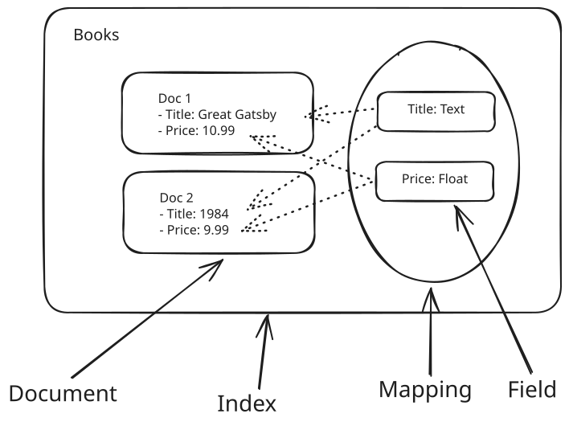
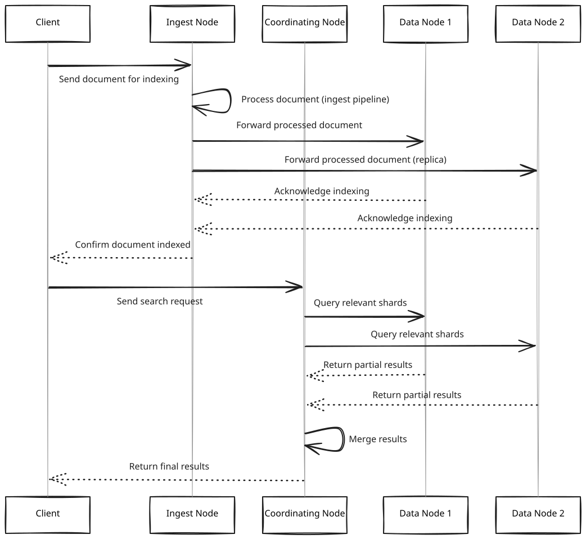
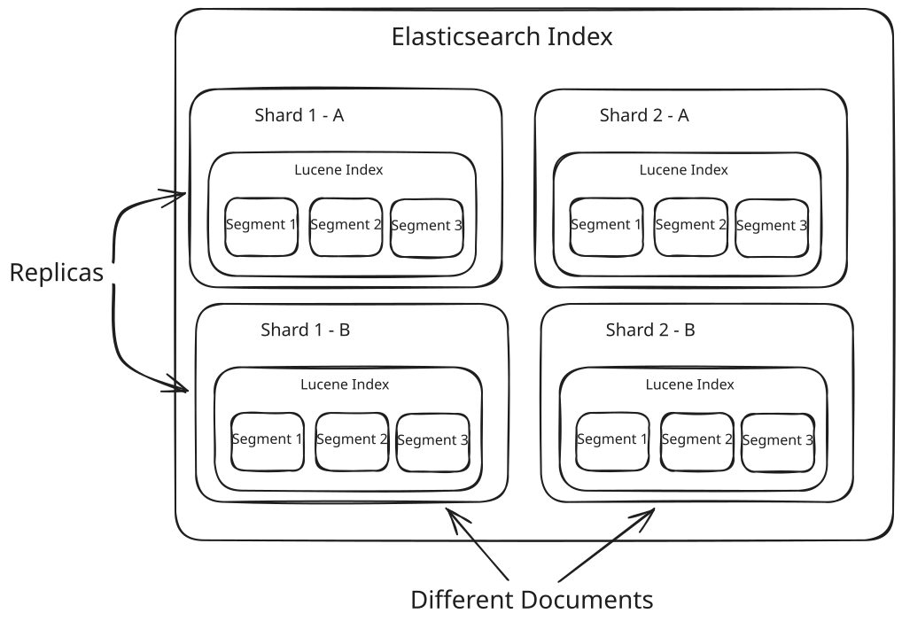
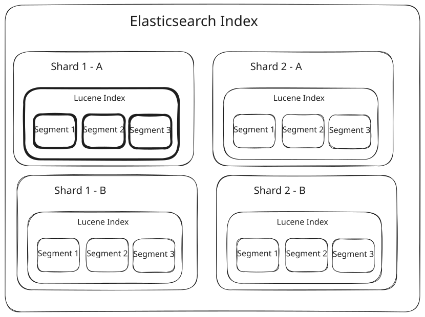
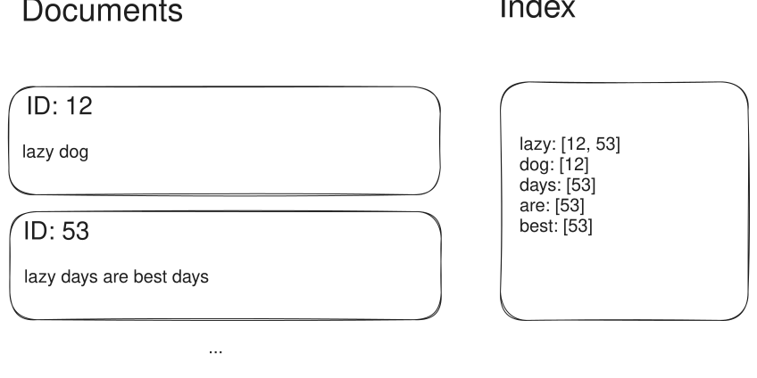

# Elasticsearch

Elasticsearch is a distributed search engine built on Apache Lucene. It fits queries that combine full-text relevance, filters, geospatial matching, sorting, or aggregations. A common design keeps authoritative records in a database and maintains Elasticsearch as a searchable projection.

## Documents, mappings, and search

An index groups JSON documents. The mapping defines how fields are indexed and how they can be queried. For example, a marketplace document can have `title` as `text` for relevance, `category_id` as `keyword` for exact filtering, `price` as a number for range filtering and sorting, and `location` as a `geo_point`. A multi-field can index the same value as both `text` and `keyword`.

| Query requirement | Elasticsearch feature |
| --- | --- |
| Match search terms in a title or description | A `match` query analyzes the input. BM25 is the default text similarity for ranking matching documents. |
| Filter by category or availability | Use a `term` query on an exact field in `bool.filter` so the condition does not affect relevance. |
| Find businesses within 5 km | Map coordinates as `geo_point` and apply a `geo_distance` filter. Lucene's spatial index prunes candidate points. Use `geo_shape` for polygons such as delivery areas. |
| Count results by category or sort by price | Use a terms aggregation on a `keyword` field or sort on the numeric price field. Doc values support these access patterns. |
| Match conditions on the same element of an array | Use a `nested` mapping and nested query. Denormalize fields that you commonly read together and account for the reindexing work when they change. |

For shallow pages, `from` and `size` are simple. Deep offsets force each shard to collect candidates for the skipped results as well. For forward pagination, pass the last hit's sort values to `search_after` with a stable sort and a unique tiebreaker. Pair it with a point in time (PIT) when the result set must stay stable across requests. Carry the latest PIT ID and sort values in the application cursor, and keep the PIT open only as long as needed. [Paginate search results](https://www.elastic.co/guide/en/elasticsearch/reference/current/paginate-search-results.html)

## Cluster architecture and search execution

The elected master manages cluster state and shard allocation. Data nodes hold shard copies. Ingest nodes can transform documents before indexing. Any node receiving a search request can coordinate it by scattering the query to one copy of each relevant shard, merging results, and fetching the final hits.

An index can have multiple primary shards. A document routes to a primary shard, which applies the write and replicates it. Replicas provide failover and can absorb search traffic. More shards improve distribution when there is enough data and work to spread, while extra fan-out and shard overhead can hurt searches. Routing by tenant can reduce fan-out for tenant-scoped searches when tenant traffic is sufficiently balanced.

## Lucene segments and freshness

A Lucene shard contains immutable segments. Indexing adds documents to new segments, an update adds a new version and marks the old one deleted, and merges consolidate segments and reclaim deleted records. A refresh opens new segments to search, so a successful write can precede its visibility in search. A selective `refresh=wait_for` can wait for normal refresh visibility. Forcing a refresh on every write can produce small segments and raise merge cost. [Refresh parameter](https://www.elastic.co/guide/en/elasticsearch/reference/current/docs-refresh.html)

An inverted index maps a term to the documents that contain it, with information Lucene can use for relevance or phrase matching. Doc values organize supported fields by document in a column-oriented layout for sorting and aggregations. This gives search and analytics different ways to access the same indexed data.

## Keep a search projection in sync

Capture committed changes from the database via change data capture (CDC) or a transactional outbox, then bulk-index documents using stable IDs. Preserve per-record order or use source versions so that an older event cannot overwrite a newer projection. Handle deletes explicitly and monitor the time from database commit to search visibility. An index can be rebuilt from a source snapshot and updates captured during the backfill, then swapped in through an alias.

## Interview practice

### How would you design search for restaurants by keyword, distance, and price?

> I'd keep the business record in the database and index a document with searchable name and description, an exact category, numeric price, and a geopoint. A text query ranks candidates while category, price, and radius filters narrow the results. If a business edits its profile, CDC updates the search document. I can read the authoritative record on the business details page if the search index is still catching up.

### How would you paginate through a million matching documents?

> I'd use `search_after` with a deterministic sort and a PIT to keep pages stable as documents change. The cursor records the latest PIT ID and last hit's sort tuple. With an offset of 100,000 and a page size of 20, each relevant shard can have to collect up to 100,020 candidates. A cursor keeps each page's candidate set smaller and trades random page jumps for efficient forward iteration.

### An item was updated successfully but search still shows the old value. Where would you look?

> I'd measure the pipeline in stages. The CDC consumer may be behind, the bulk request may have failed for that item, or the indexed version may be waiting for refresh. I'd retry item-level failures with stable document IDs and guard against older events. When a workflow specifically needs search visibility immediately after one index write, I'd consider `refresh=wait_for` there.

### Why can more shards make search slower?

> The coordinator sends work to every relevant shard, waits for results, and merges them. More shards can raise parallelism, but they also add network work, memory use, and exposure to the slowest shard. I'd measure per-shard latency and coordinator load, then use a shard count sized for the index and consider targeted routing if the query includes a balanced tenant key.

### How would you migrate a mapping without dropping updates?

> I'd create a new versioned index, backfill from an authoritative snapshot, and record the CDC boundary so writes and deletes during the backfill are applied to the new index. I'd use record versions to guard against stale backfill writes, validate representative searches and lag, and switch the read alias atomically once the new index is ready.

## Sources

- [Elasticsearch · Hello Interview](https://www.hellointerview.com/learn/system-design/deep-dives/elasticsearch)
- [Elasticsearch practice quiz · Hello Interview](https://www.hellointerview.com/learn/system-design/deep-dives/elasticsearch#quiz-elasticsearch)
