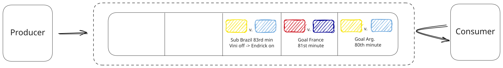
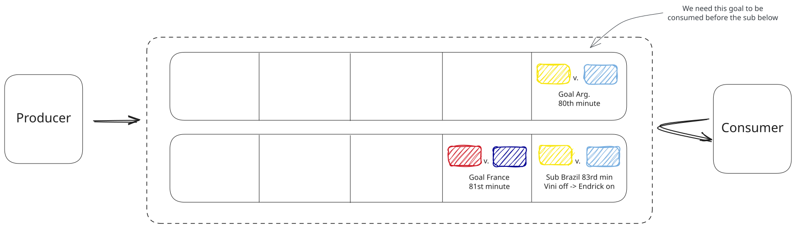
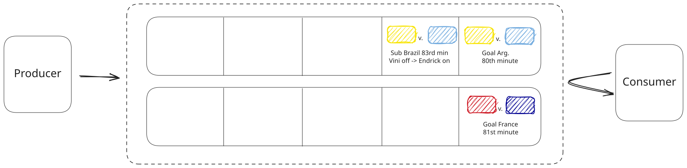
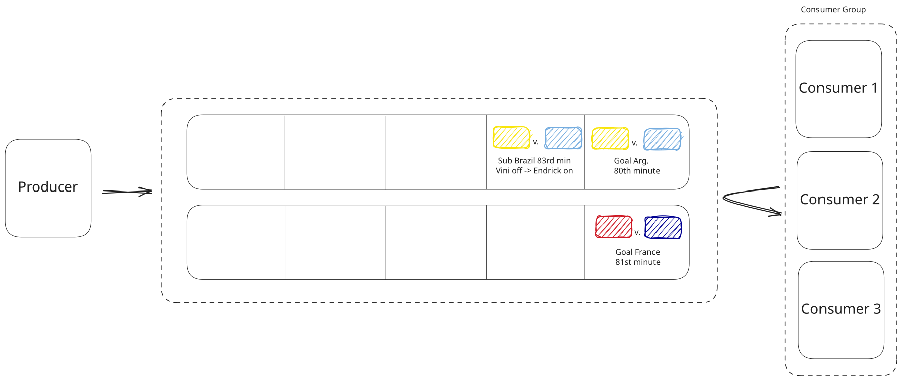
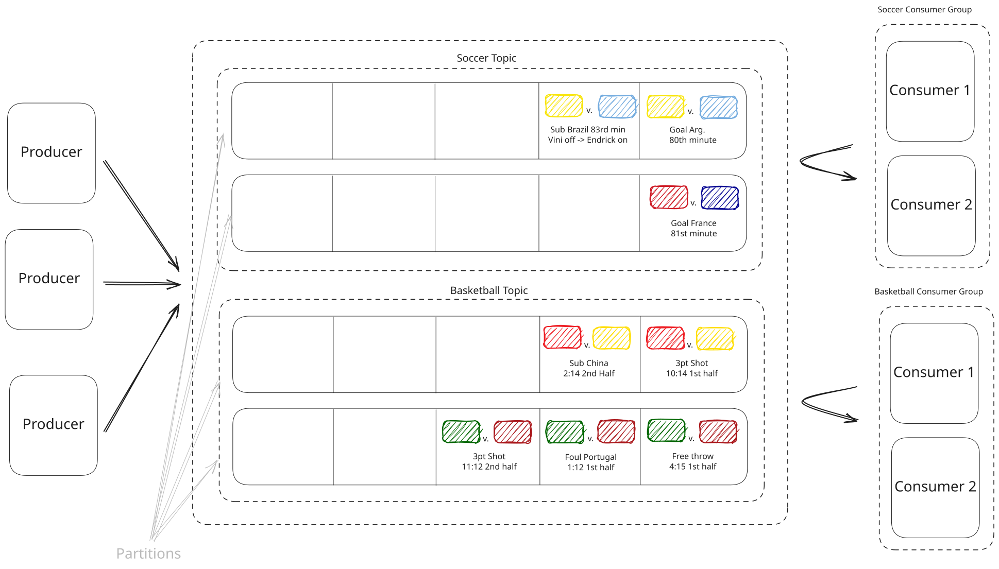
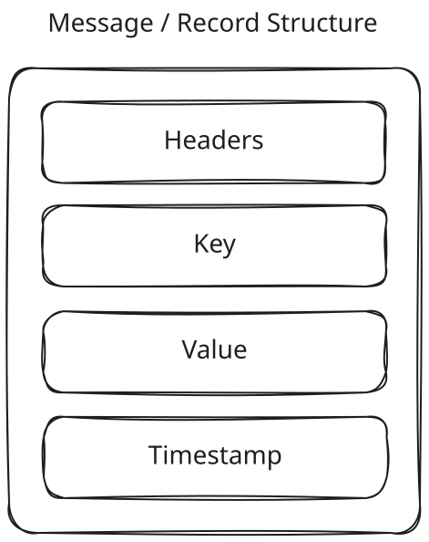
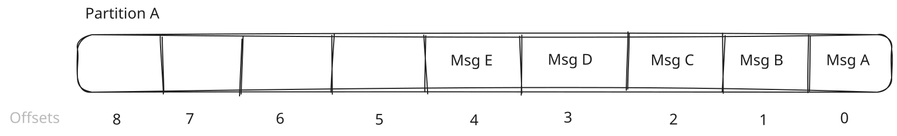
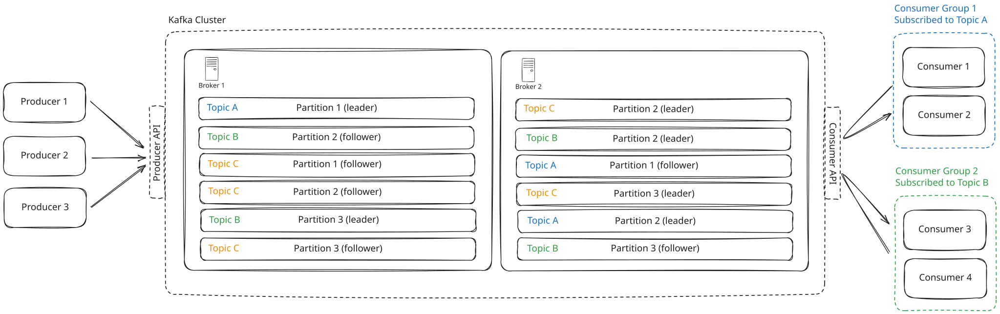
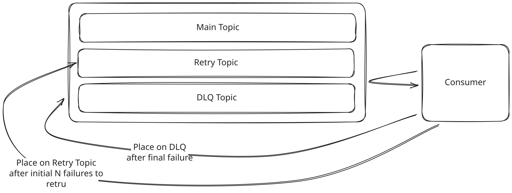

# Kafka

Kafka is a distributed, replicated event log. Use it when producers and consumers need to run independently, different consumers need their own view of the same events, or a consumer needs to replay earlier events. The core design decision is which events must be ordered together.

## From one queue to partitioned topics

The deep dive starts with a sports site that updates live match scores. One producer-to-consumer path is easy to follow at low volume. Randomly spreading events across queues can separate the start of a match from its first goal. Partitioning by `match_id` preserves one append order per match while different matches can be processed in parallel.

With a standard consumer group, each partition is assigned to at most one member of the group at a time. One scoreboard group shares the work, and a separate analytics group can read the same records independently. Topics group related partitions and let applications subscribe to the event streams they need.

## Produce, replicate, and consume

1. A producer sends a record with a key, payload, timestamp, and optional headers. The producer chooses a partition, typically by hashing a key when supplied, and contacts that partition's leader. Each partition is an append-only log. Offsets define record order within the partition.
2. The partition leader appends the record and followers replicate it. With replication factor 3, `acks=all`, and `min.insync.replicas=2`, a write is acknowledged by all current in-sync replicas while at least two are participating. If too few replicas are in sync, writes using `acks=all` fail. An eligible in-sync follower can take over after a leader failure.
3. Consumers poll for records and commit the next offset to read after persisting their results. After a restart or rebalance, processing resumes from the committed position. A crash between a side effect and the offset commit can cause the record to be processed again.

With commit-after-processing, design for at-least-once processing. An idempotent producer deduplicates the producer's retries. For a Kafka-to-Kafka pipeline, transactions can commit output records and input offsets together, with downstream consumers using `read_committed`. A write to an external database or payment API still needs idempotency or coordination with that destination. [Kafka design and delivery semantics](https://kafka.apache.org/documentation/#semantics)

## Retries, retention, and capacity

An inline retry can preserve partition order but blocks later work on that partition. Retry topics isolate delayed failures and can let later records overtake the failed one. Use bounded retries and send exhausted records to a dead-letter topic with their original event IDs and failure metadata. Acknowledge the source only after the retry handoff is durable.

Retention is independent of consumer offsets. A time or size policy removes old segments, while log compaction preserves the latest retained value per key over time and uses tombstones for deletions. Choose a retention window that covers expected outage recovery and replay. Keep large files in object storage and send a reference in Kafka. Batching and compression improve throughput at a cost in latency or CPU. Track traffic by partition, consumer lag, replica health, and disk capacity.

Adding consumers helps until every partition in the group has an owner. Adding brokers helps once partitions are distributed over them. With common hash partitioners, increasing a topic's partition count can remap future records for existing keys, so plan a cutover when preserving order across the change matters. [Asynchronous processing](../../05-Asychronous/asynchronous-processing.md)

## Interview practice

### How would you choose the partition key for a live scoreboard?

> I'd key match events by `match_id` so events for one match enter the same partition. The consumer processes that partition in order, while distinct matches can run in parallel. If multiple producers can report events for a match, I'd include a source sequence number because Kafka preserves arrival order within the partition. I wouldn't use timestamps alone to infer the authoritative match order.

### A popular ad overwhelms one Kafka partition. What would you change?

> If the requirement is an aggregate count and clicks can arrive in any order, I'd publish with a key such as `ad_id:bucket`, where the bucket is derived from a high-cardinality field like the event ID. Consumers aggregate counts per bucket and a second stage sums them by ad and time window. If the business needs order for each user, I'd choose a user-derived bucket so that related events stay together. Strict order for the entire ad would retain a single serialized path.

### A consumer writes to Postgres, then crashes before committing its offset. What happens?

> Kafka can deliver the record again. I'd give the event a stable ID and record that ID in the same transaction as the database change. On retry, the duplicate ID makes the update a no-op. After the database commits, the consumer commits the next offset. I would advance it only past a contiguous range of completed records for that partition.

### What happens if the Kafka leader and one follower go down?

> With three replicas and a minimum ISR of two, an in-sync follower can take over after the first failure. If there's only one in-sync replica left, writes using `acks=all` stop until the ISR recovers to two. Producers retry within a bounded policy or retain work durably upstream. I choose those settings when avoiding loss of acknowledged events is more important than accepting writes through that outage.

### How much storage would 20,000 events per second require for one day of replay?

> At 1.5 KB per event, ingest is about 30 MB/s. One day is about 2.6 TB of logical events and roughly 7.8 TB at replication factor 3 before compression and overhead. I'd reserve disk headroom for bursts and recovery and verify that producers and consumers can maintain their rates with the chosen record size, batching, and number of partitions.

## Source

[Kafka · Hello Interview](https://www.hellointerview.com/learn/system-design/deep-dives/kafka)
