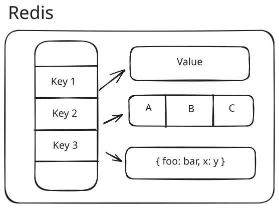
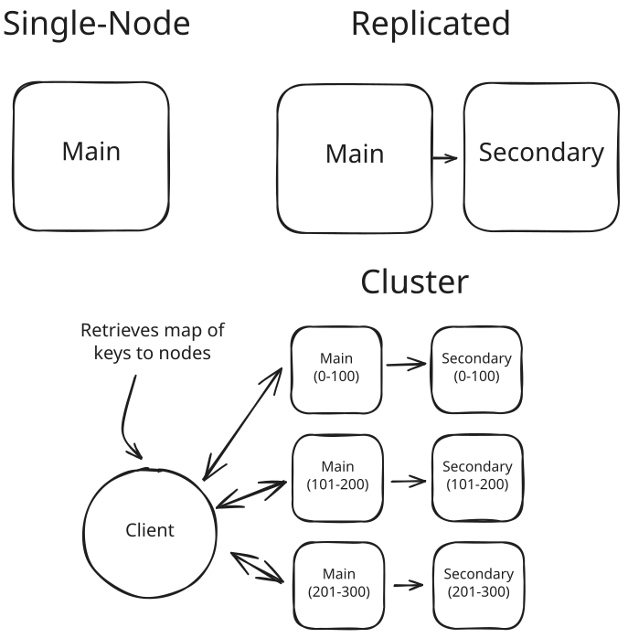
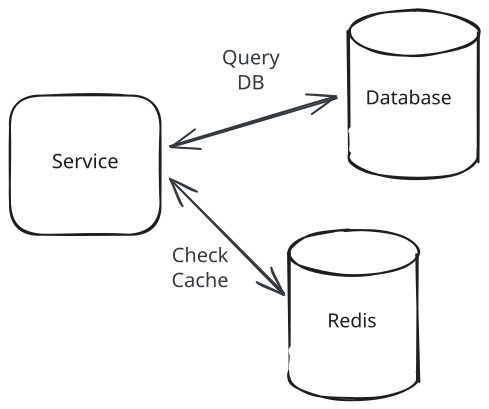
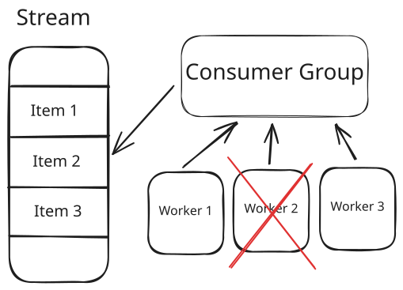
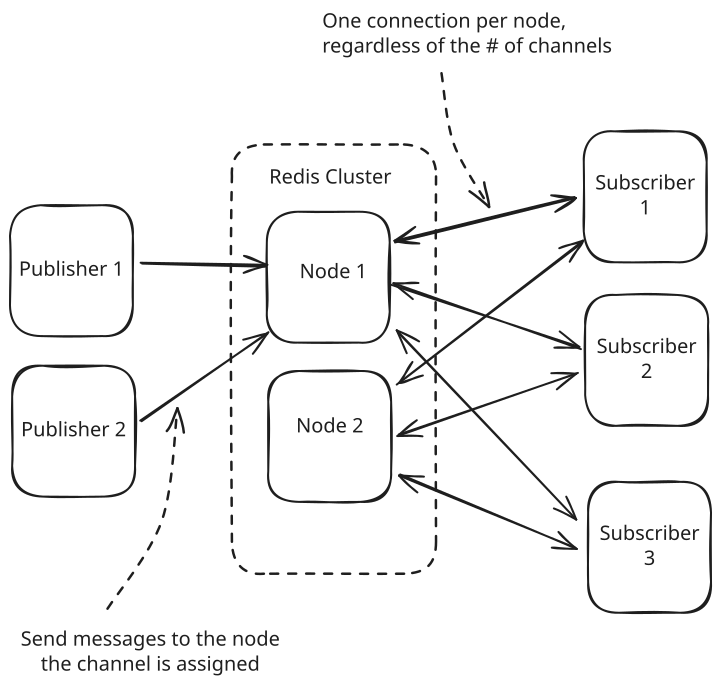
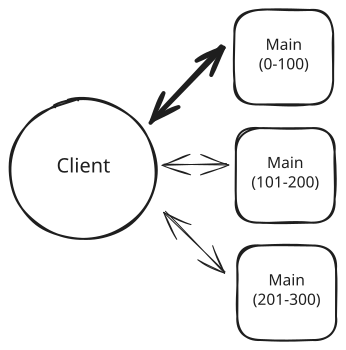

# Redis

Redis is an in-memory data structure store used for caches, counters, rankings, live fan-out, and modest work queues. In an interview, name the key, the data structure, and the state your system can rebuild after a failure.

## Data structures and deployment

A Redis key is a string. Its value can be a string, hash, set, list, sorted set, stream, or geospatial index. Use strings for cached objects and counters, hashes for updating individual fields, sets for membership, and sorted sets for ranking. Individual commands execute atomically on a node. Use a short Lua script when several commands need to make one decision. Long commands and scripts can delay other clients.



A standalone Redis node handles the full workload. A primary with a replica adds failover and can serve reads from the replica when the client opts in. Redis Cluster partitions keys into 16,384 fixed hash slots, spreads their ownership across primaries, and can replicate each primary. Cluster-aware clients cache the slot map and follow redirects such as `MOVED`. Multi-key commands generally need all keys in one slot. A shared hash tag, as in `{match:42}:scores` and `{match:42}:metadata`, colocates related keys at the cost of concentrating their traffic.



The RDB persistence mode takes periodic snapshots. A crash can lose changes since the last usable snapshot. AOF logs writes and its fsync policy determines how much recent data a local crash can lose. Replication is asynchronous, so a failover can lose writes that the old primary acknowledged. Size for RAM, value size, network bandwidth, and the cost of your commands. Benchmark the actual command mix under your latency target. [Redis persistence](https://redis.io/docs/latest/operate/oss_and_stack/management/persistence/) · [Redis Cluster specification](https://redis.io/docs/latest/operate/oss_and_stack/reference/cluster-spec/)

## Cache, leaderboard, rate limit, and proximity search



With cache-aside, the service reads Redis first, fetches from its database on a miss, and fills Redis with a TTL. Invalidate after committing a database update and choose a TTL from the freshness requirement. If concurrent misses can overwhelm the database, coalesce fetches and stagger expirations. Redis can evict entries before their TTL under a suitable memory policy, so every read path needs a miss strategy. [Caching](../caching/README.md)

| Use case | Redis operations | Design consideration |
| --- | --- | --- |
| Leaderboard | `ZADD` sets a player's score, `ZINCRBY` increments it, and `ZRANGE ... REV WITHSCORES` reads the leaders | A global sorted set is one key. Split by independent groups or shards if one primary cannot handle the updates. |
| Fixed-window rate limit | Increment a key such as `rl:user:42:window:100` and set expiry on the first increment in the same script | A caller can use its full allowance on both sides of a window boundary. A token bucket bounds bursts and refills continuously. |
| Sliding-window rate limit | In one script, drop old entries, count the remaining requests, and insert a unique request ID with its timestamp | Memory grows with the number of retained requests per active caller. |
| Nearby locations | `GEOADD` stores coordinates and `GEOSEARCH` finds nearby members | A city-wide index can be a hot key. With spatial buckets, query neighboring buckets that intersect the search radius. |

## Distributed locks in Redis

A distributed lock coordinates workers running on different servers. Suppose Alice and Bob both ask to book seat 42, and their requests reach different servers. A lock in one server's memory is visible only to that server. Both servers can ask the same Redis instance for a lock named `lock:seat:42`.

### Acquire, use, and release the lock

```text
SET lock:seat:42 alice-req-7f93 NX PX 30000
```

1. **Acquire.** `NX` means Redis sets the key only if it does not already exist. Redis checks and sets it in one operation, so only one of the two requests succeeds while the key is present. The winner gets `OK`. The other request can return a busy response or retry after a short delay within its deadline.
2. **Do the work.** `PX 30000` makes the key expire after 30,000 milliseconds, or 30 seconds. A lock with a time limit is called a **lease**. If Alice's server crashes, Bob can try again once the key expires. The Redis timer controls how long a worker holds the lock. A customer's seat hold has its own expiry in the booking system.
3. **Release.** The value `alice-req-7f93` stands for a unique random token generated for this acquisition. When Alice's server finishes, it asks Redis to delete the key only if the value still matches its token. The comparison and deletion must happen in one operation. With separate `GET` and `DEL` calls, the key could expire and Bob could acquire it between the two calls. Redis 8.4 and later support `DELEX lock:seat:42 IFEQ alice-req-7f93`. Earlier versions can do the same with a short Lua script. [Redis distributed locks](https://redis.io/docs/latest/develop/clients/patterns/distributed-locks/)

### What if the first worker wakes up late?

| Time | What happens |
| --- | --- |
| 0 seconds | Alice's server acquires the lock, then stalls before writing the booking. |
| 30 seconds | Alice's lease expires. Bob's server acquires the same lock with a new token. |
| 32 seconds | Alice's server resumes. Its old token cannot delete Bob's lock, but Alice's server can still try to update the database. |

Expiration removes the Redis key. It cannot stop a worker that is still running. A similar overlap can happen if the Redis primary grants a lock and crashes before its replica receives the key. The promoted replica may then grant the same lock to Bob.

### Make the database decide who gets the seat

Put the availability check inside the database write so the check and update happen together. For a one-row reservation, it can look like this.

```sql
UPDATE seats
SET status = 'reserved', reserved_by = 'alice'
WHERE seat_id = 42 AND status = 'available'
```

If both servers try, at most one changes the row from `available` to `reserved`. The other sees zero rows updated and returns that the seat is unavailable. The same conditional write works even if Redis is unavailable. Use a transaction if the booking must also create a reservation record with the seat update.

For a resource that must reject an older worker's write after a newer worker has written, a **fencing token** is a number that increases with each grant. If the resource has already accepted token 102, it rejects a later request carrying 101. The resource being written to must check that number. The random Redis token used to release the lock serves a different purpose.

A Redis lock can save duplicate work, such as several servers trying to refill the same cache entry. For seat booking, the conditional database write keeps two buyers from reserving the same seat.

## Streams and Pub/Sub

Use Streams when workers need to catch up. `XADD` appends an entry, `XREADGROUP` delivers work within a consumer group, and `XACK` acknowledges it after processing. A replacement worker can claim stale pending entries with `XAUTOCLAIM`. Each group maintains its own progress. Set retention with replay and pending work in mind, and deduplicate side effects when work is claimed again.



Use Pub/Sub for online subscribers that can tolerate missed messages, such as notifying WebSocket servers that a chat has changed. Its at-most-once delivery leaves disconnected clients to catch up from a durable message store. Sharded Pub/Sub uses `SPUBLISH` and `SSUBSCRIBE` to restrict propagation to the channel's shard. [Redis Streams](https://redis.io/docs/latest/develop/data-types/streams/) · [Redis Pub/Sub](https://redis.io/docs/latest/develop/pubsub/)



## Hot keys



For a read-hot product, local caching, replica reads with acceptable lag, or copies in different slots can spread traffic. Copies require extra invalidation or writes. A write-hot counter can be split by user or event hash and summed on read. An invariant that requires one exact value needs an authoritative write path that can handle the load.

## Interview practice

### How would you implement a leaderboard that receives 200,000 score updates per second?

> I'd keep authoritative scores in a durable store if they need to survive Redis loss. I'd start with one sorted set per game or competition. For a single overloaded global board, I'd assign each player to one of several sorted sets by player ID. To read the exact top 100 at a stable point in time, I'd fetch the top 100 from each shard and merge them with a shared tie-breaker. An exact global rank for one player needs more work, such as counting how many entries precede that player on each shard. Independent shard reads can see different update times.

### How do you enforce 100 requests per minute across many API servers?

> Each gateway uses the same Redis key for the caller and window. A script increments the counter, sets expiry on the first increment, and returns the decision atomically. I return `429` after the limit. If bursts across minute boundaries are unacceptable, I switch to a token bucket or sliding-window design. I also specify the outage behavior. Sensitive routes may reject requests when the limiter is unavailable, while a public read route could fall back to a bounded local limit.

### Can you use a Redis lock to keep two users from booking the same seat?

> I'd place a short Redis lease in front of the reservation path if it reduces duplicate work. The seat row still changes from available to reserved through a conditional write. If one worker pauses beyond the lease or the Redis primary fails, two workers can both believe they have the lease. Only one conditional write succeeds.

### Would you use Redis Pub/Sub or Streams for chat?

> I store the message durably first and use Pub/Sub to notify online gateway instances. A reconnecting client fetches messages after its last message ID. For a background indexing or notification worker that must recover unprocessed work, I'd choose Streams for a modest workload or [Kafka](kafka.md) when I need longer replay and independent high-throughput consumers. I'd acknowledge after writing the result and make repeated delivery safe.

### What happens when a million requests arrive just as a hot cache entry expires?

> I'd coalesce misses so one request per coordination scope refreshes the value, use TTL jitter to spread expiry across keys, and cap fallback concurrency to protect the database. If freshness allows, I can serve the last value during refresh. Once the key is warm, a short local TTL or opted-in replica reads can reduce load on its primary.

## Source

[Redis · Hello Interview](https://www.hellointerview.com/learn/system-design/deep-dives/redis)
