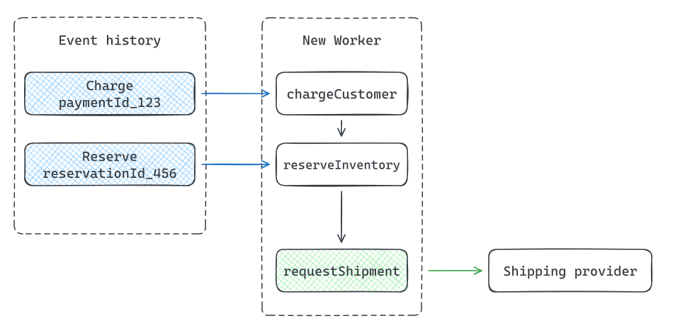
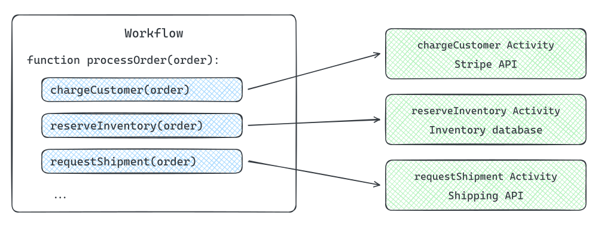
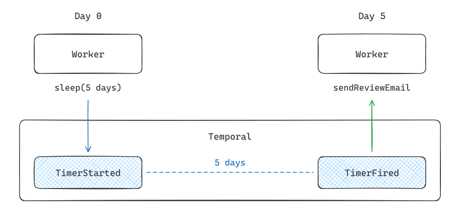
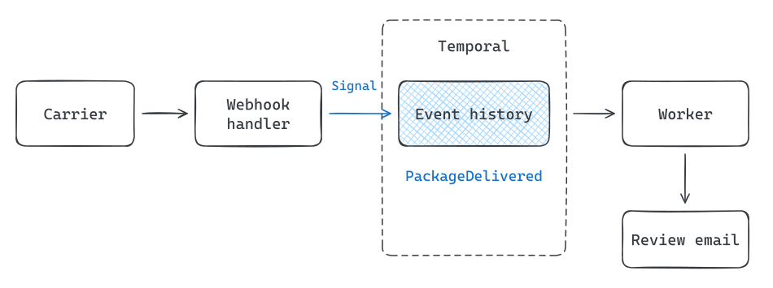
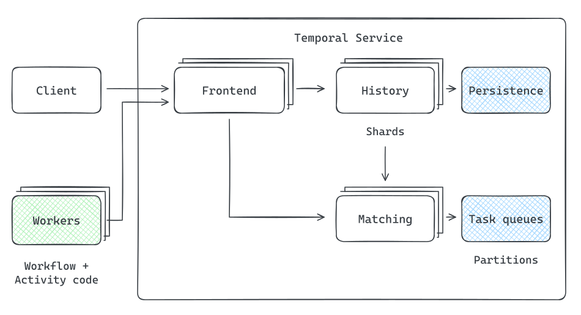
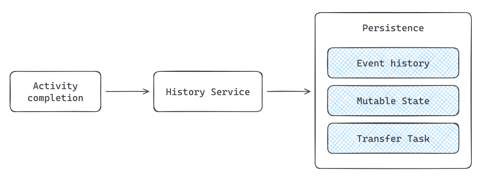
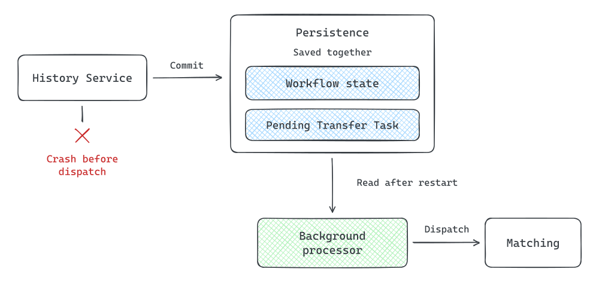
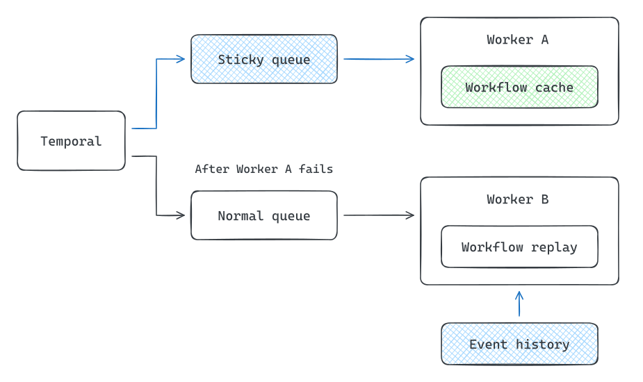
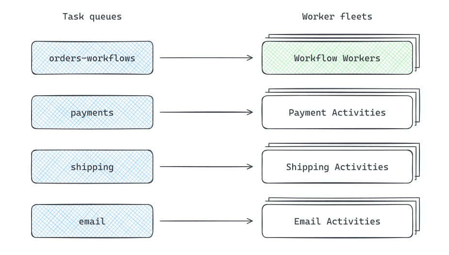

# Temporal

Temporal coordinates long-running application workflows through crashes, retries, and waits. It fits processes with dependent steps, such as charging an order, reserving inventory, arranging delivery, and sending a follow-up after delivery.

## Workflows, Activities, and replay

A **Workflow** contains orchestration logic. An **Activity** does work that can interact with other systems, such as writing inventory or charging a card. Temporal stores a durable Event History for each Workflow Execution. When a worker needs to rebuild Workflow state, it replays the Workflow code against that history and returns recorded results for completed Activities.

Workflow code must make the same decisions for the same history. Read logical time from the SDK and run database calls and network I/O in Activities. Changes to Workflow code must remain replay-compatible for running executions or use the SDK's versioning mechanisms. Activities may execute again if a worker completes an external operation and crashes before reporting success. Use a business idempotency key or a durable record of the operation at the system performing the side effect. [Temporal Workflows](https://docs.temporal.io/workflows) · [Temporal Activities](https://docs.temporal.io/activities)

## Durable waits and external input

A durable timer records when to wake a Workflow. A worker can do other work during the wait, and Temporal schedules another Workflow Task when the timer fires. For an approval, delivery, or ride acceptance, an incoming request can send a **Signal** to a running Workflow. The Signal becomes part of its history, and Workflow logic can wait for it or a deadline. A **Query** reads Workflow state. An **Update** can change Workflow state and return a result to the caller.

## Services, queues, and state

- **Frontend** accepts requests from clients and workers. **History** maintains the durable Workflow state and transitions. **Matching** delivers Workflow Tasks and Activity Tasks through Task Queues.
- **Application workers** poll Task Queues and execute your code. Workflow Tasks run or replay orchestration code to determine what happens next. Activity Tasks execute the actual operation. Separate queues can give payments or other expensive work independent capacity and concurrency limits.
- Temporal stores Event History and a Mutable State summary. A durable Transfer Task records follow-up dispatch work alongside the state transition, so a crash after the commit can be recovered without forgetting to schedule the next task.
- Sticky execution can route later Workflow Tasks to the worker holding cached Workflow state. If that worker fails, another worker can replay the history. Keep large payloads in durable storage and pass references. For a Workflow that repeats indefinitely, Continue-As-New can carry forward relevant state in a new run with fresh history.

## Where it fits

Use Temporal when the application would otherwise maintain a durable state machine with retries, timeouts, and external events. An independent email or thumbnail job can be served by a queue and a worker. An analytics pipeline that continuously consumes high-volume events fits [Kafka](kafka.md). One system can use Kafka to deliver events and Temporal to track a long-running business process triggered by those events.

## Interview practice

### A worker crashes after charging a card. Does the replacement charge it again?

> If Temporal recorded the completed Activity, replay returns the recorded payment result. If the payment provider accepted the charge but the worker died before reporting completion, the Activity can be attempted again. I'd use a stable payment idempotency key tied to the order and charge operation so the provider returns the existing result. I'd also record the payment reference for reconciliation.

### How would you implement a ride offer that waits ten seconds for a reply?

> The Workflow offers the ride to one driver through an Activity, then waits for an acceptance Signal or a durable ten-second timer. The Signal includes the offer ID so the Workflow can ignore a late response to an expired offer. A conditional update in the assignment store enforces the winning driver and prevents double assignment. A decline or timeout advances to the next candidate.

### What happens if a code deployment changes the branching logic of a Workflow that is already running?

> A new branch can make replay try to schedule a different command from the one in history. I'd keep old executions on compatible code or use the SDK's versioning mechanisms so past histories still replay correctly. I'd replay representative histories before deployment and check changes to the order of Activities and timers.

### How would you handle inventory running out after a payment succeeds?

> For a retryable inventory failure, I'd define an Activity retry policy and a timeout. If the inventory service confirms the item is unavailable, the Workflow follows a business-defined compensation path, such as voiding the authorization or refunding the charge. I make the compensating Activity idempotent and surface repeated failures for reconciliation.

### Would you use Temporal for both video transcoding and live analytics?

> I'd use one Workflow per upload to split the file, schedule segment transcodes in parallel, wait for completion, and assemble the result. I'd pass object-storage references to the Activities and scale the transcode queue separately. I'd use Kafka and stream processing for continuous viewing events, where replayable throughput and independent consumers matter more than the lifecycle of one upload.

## Source

[Temporal · Hello Interview](https://www.hellointerview.com/learn/system-design/deep-dives/temporal)
