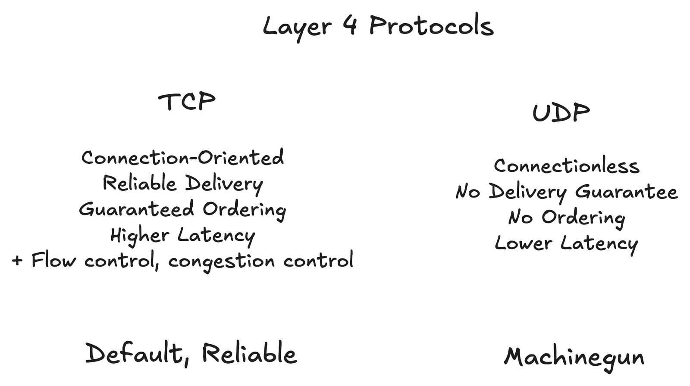

# Transmission Control Protocol (TCP)

TCP provides a bidirectional, reliable, in-order byte stream between endpoints. HTTPS with HTTP/1.1 or HTTP/2, many database connections, and conventional WebSockets use TCP. A connection is commonly identified by its source IP and port and destination IP and port.

## Connection lifecycle

1. The client sends a `SYN` with its initial sequence number.
2. The server replies with `SYN-ACK` to acknowledge the client's sequence number and advertise its own.
3. The client sends an `ACK`. A conventional new connection takes roughly one network round trip from the client's perspective before it can start sending application data, with TLS setup adding its own exchange when used.

An orderly shutdown uses `FIN` in each direction. A `RST` aborts the connection. Persistent connections and connection pools amortize handshakes, while servers and intermediaries still need enough resources for their active connections.

## Reliability, flow control, and congestion control

- **Reliability and ordering.** TCP sequence numbers track positions in the byte stream. Acknowledgments and retransmission help recover missing data. Later bytes may already be at the receiver, but the application waits for a gap to be filled before reading past it.
- **Flow control.** The receiver advertises a window so the sender can limit how much data it has outstanding relative to available receive capacity.
- **Congestion control.** The sender adjusts its sending rate using a congestion window and network feedback. This limits how much traffic the network has to carry during congestion.
- **Framing.** Two writes can arrive in one read, and one write can span several reads. The application protocol defines boundaries with lengths, delimiters, or its own framing.

TCP acknowledgments report transport-level receipt. An application-level acknowledgment can express stronger semantics, such as completion of a database write. If a connection drops after a request was sent, the caller may need to query the operation's status or retry with an idempotency key. [TCP specification](https://www.rfc-editor.org/rfc/rfc9293.html) · [Timeouts and Retries](15-timeouts-retries-backoff-and-jitter.md)

## Design example

A document upload benefits from reliable, ordered delivery. For a large file, give each upload a durable ID and record which chunks have been committed. If TCP reconnects halfway through the upload, the client can ask for the missing chunks and continue from the last recorded progress.
