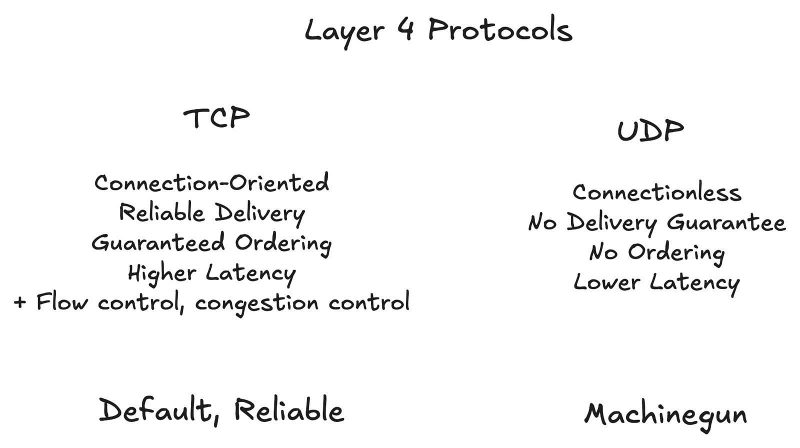

# User Datagram Protocol (UDP)

UDP sends independent, message-oriented datagrams. It preserves the boundaries of each delivered datagram and supplies source and destination ports. UDP itself has no connection handshake, retransmission, in-order delivery, or congestion control.

## What the application controls

| Concern | Application choice |
| --- | --- |
| Loss | Ignore stale updates, retransmit important data, or use forward error correction |
| Ordering | Use sequence numbers or timestamps to detect duplicates, gaps, and late arrivals |
| Rate | Pace sends and apply congestion control appropriate to the protocol |
| Packet size | Keep datagrams within a size supported by the path so IP fragmentation is less likely |
| Reachability | Plan for firewalls or NATs that restrict UDP, and support a fallback where the product requires it |

UDP removes the transport handshake and leaves delivery policy to the application or the protocol above it. Observed latency still depends on network conditions, congestion control, buffering, and any recovery the implementation adds. A socket API can associate a UDP socket with a remote endpoint locally while UDP continues to send datagrams independently. [UDP specification](https://www.rfc-editor.org/rfc/rfc768.html) · [UDP Usage Guidelines](https://www.rfc-editor.org/rfc/rfc8085.html)

## Design example

In a live audio call, packets have timestamps and short playback deadlines. The receiver can absorb minor timing variation with a jitter buffer. If a packet misses its playback deadline, concealing the gap can keep the call moving. A file transfer has different requirements because every byte must eventually arrive intact. QUIC uses UDP and adds its own reliability and congestion control for streams. [QUIC](05-quic.md) · [WebRTC](12-webrtc.md)
