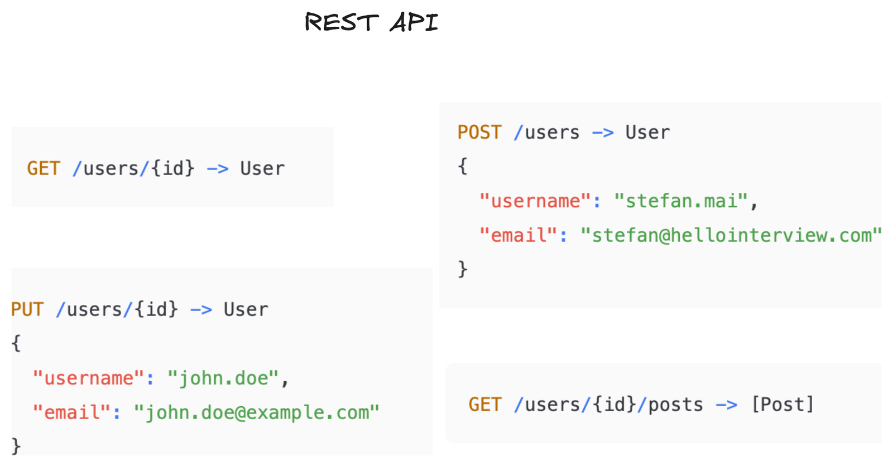

# REST APIs

Representational State Transfer (REST) is an architectural style built around resources, a uniform interface, stateless interactions, cacheability, and layered components. A REST-style HTTP API uses resource identifiers such as `/orders/ord_123` and uses HTTP methods and status codes to communicate intent. Many production APIs use these conventions without implementing every REST constraint, such as hypermedia links that expose available transitions.

## Design the resource and its lifecycle

| Operation | Request | Typical response |
| --- | --- | --- |
| Create an order | `POST /orders` | `201 Created` with a `Location` header |
| Read an order | `GET /orders/ord_123` | `200 OK` with a representation |
| Update fields | `PATCH /orders/ord_123` | `200 OK` or `204 No Content` |
| List recent orders | `GET /orders?limit=20&cursor=...` | A page of results and a cursor for the next page |
| Start an export | `POST /exports` | `202 Accepted` and a reference to the job status |

Stateless interactions mean each request carries the information needed to understand it, including authorization and resource identity. Durable orders and authorization records can still live on the server. A stable resource identifier lets clients bookmark a status URL and lets operational tools trace a request to a concrete object. [Fielding's REST dissertation chapter](https://roy.gbiv.com/pubs/dissertation/rest_arch_style.htm)

## Handle scale and concurrent writes

- **Pagination.** Use a stable sort, such as creation time plus order ID, and an opaque cursor that identifies the last position. Mutable data can still cause changes across pages. When clients need a consistent point-in-time view, use snapshot semantics or a suitable cutoff.
- **Concurrent updates.** Use a strong `ETag` and require `If-Match` for updates that must avoid lost writes. If a second client submits an older version, return `412 Precondition Failed` and let it fetch the latest state before merging.
- **Idempotent creation.** Let clients send an idempotency key for a write they may need to retry. Scope it to the caller and operation, bind it to the request parameters, and store the outcome alongside the write or in a recoverable workflow. Two requests arriving with the same key must coordinate before either can produce a duplicate effect.
- **Compatibility.** Favor additive changes, document field behavior, and plan a version transition when a breaking change is unavoidable.

## Design example

A document service accepts an export request and returns a job URL. Clients can read the job state over HTTP or subscribe to progress with SSE. Once the job succeeds, its representation can contain a link to the completed export. The client can reconnect or poll by job ID without duplicating work. [Server-Sent Events](10-server-sent-events.md)

For a complete example that includes request parameters, errors, and access control, see the ticket-booking contract in [API Design](../api-design/README.md).
