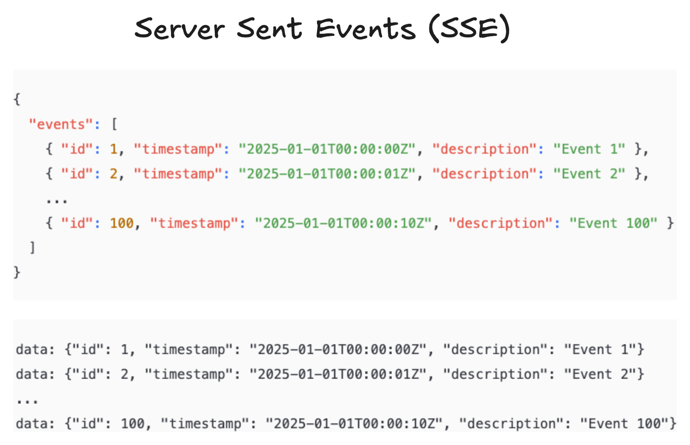

# Server-Sent Events (SSE)

Server-Sent Events (SSE) let a server send a stream of UTF-8 text events over one open HTTP response. The browser can handle events as they arrive, which works for generated text, stock quotes, notifications, and job progress. The response stream carries events from server to client. Client actions travel in HTTP requests.



## Event format and reconnection

The server returns `Content-Type: text/event-stream` and flushes events as they become available. A blank line ends each event.

```text
id: 104
event: progress
data: {"jobId":"job_42","percent":65}

id: 105
event: completed
data: {"jobId":"job_42","percent":100}

```

- **Event IDs.** On automatic reconnection, the browser can send its last event ID in the `Last-Event-ID` header. The server needs a retained event log or another way to reconstruct what the client missed. If the cursor has expired, send a fresh snapshot and restart from its cursor.
- **Delivery.** Design event handlers to tolerate duplicate or stale events, especially when reconnect and replay overlap. Sequence numbers or state versions can make progress updates converge.
- **Connection health.** Send periodic comment lines such as `: heartbeat` before idle timeouts expire. Ensure intermediaries flush the response as events arrive and account for any maximum stream lifetime.
- **Browser constraints.** Native `EventSource` opens a GET and has no option for arbitrary request headers. Same-origin cookies are one authentication option. Plan cross-origin credentials and CORS where applicable. [HTML specification on server-sent events](https://html.spec.whatwg.org/multipage/server-sent-events.html)

## Design example — Stream generated text from a model API

In a chat app, the user sends a prompt once and the UI displays the reply as it is generated. The app backend calls the model provider with streaming enabled and forwards visible text deltas to the browser. A **text delta** is a fragment to append to the current response. A delta can contain part of a word or several words. Model token boundaries, SSE event boundaries, and network read boundaries are separate.

1. **Submit the prompt.** The browser sends `POST /api/chat` with a conversation ID and the prompt. The backend authenticates the user, authorizes conversation access, and calls the model provider using its server-side API key.
2. **Forward incremental output.** The backend responds with `Content-Type: text/event-stream`. As the model produces visible text, the backend writes and flushes a `delta` event. For example, a streaming OpenAI Responses API call uses `stream: true` and emits visible text through `response.output_text.delta` events. [OpenAI streaming responses](https://developers.openai.com/api/docs/guides/streaming-responses)
3. **Render in the browser.** The client reads the response incrementally, decodes UTF-8, and parses complete SSE events. One read can contain several events or part of one event, so the parser retains incomplete input until the next read. Append each text delta to the same message in order. Use an SSE parser that handles stream boundaries and multiline `data:` fields. [Using Fetch and streaming response bodies](https://developer.mozilla.org/en-US/docs/Web/API/Fetch_API/Using_Fetch)
4. **Finish or recover.** The backend sends an explicit `done` event after provider completion. If generation fails after the HTTP response starts, it can send a `generation_error` event and end the stream where the connection is still writable. If the connection closes before either event, the UI can mark the message as interrupted. If the browser cancels a request-scoped generation, propagate cancellation upstream where supported.

An application-defined event stream for the reply might look like this.

```text
event: delta
data: {"messageId":"msg_42","text":"Server"}

event: delta
data: {"messageId":"msg_42","text":"-Sent Events"}

event: delta
data: {"messageId":"msg_42","text":" stream text."}

event: done
data: {"messageId":"msg_42"}

```

The browser appends the three deltas to display `Server-Sent Events stream text.` The `done` event tells it to mark the reply complete.

### Choose how the browser connects

| Design | Browser behavior | When it fits |
| --- | --- | --- |
| One streaming POST | Send the prompt with `fetch()` and parse the SSE-framed response body. The app handles cancellation and any retry or recovery | A chat turn can run within one request and the UI can report an interrupted reply |
| Create a generation, then subscribe | POST the prompt and receive a generation ID. Open `EventSource` on an authorized GET such as `/api/generations/gen_42/events` | Generation should survive disconnects or be resumed from another connection |

For resumable generation, keep the worker independent of the subscriber connection and store numbered events or periodic text snapshots. On reconnect, replay the events after the last seen ID or send the latest snapshot and its cursor. If the creation request times out, reuse an idempotency key before starting another generation to avoid duplicate work or charges. Close the browser's `EventSource` when the generation reaches a terminal event so it does not reconnect after a normal close. [Timeouts and Retries](15-timeouts-retries-backoff-and-jitter.md)

Configure proxies to pass events through promptly, set idle timeouts and heartbeat intervals together, and bound buffering for slow clients. Track time to first visible text, stream duration, and interruption rate. A server that generates quickly can still feel slow if an intermediary buffers the response.

## Design example — Report background job progress

A browser submits a video job with `POST /jobs`, reads its current state with `GET /jobs/job_42`, and subscribes to `GET /jobs/job_42/events`. Workers publish progress to a shared log or update a durable job record. Any authorized stream server can recover from a supplied cursor or return the latest job state. With many viewers, size the service for open connections, heartbeat traffic, fan-out, and slow clients. HTTP/2 multiplexing can reduce pressure from HTTP/1.1 connection limits.
