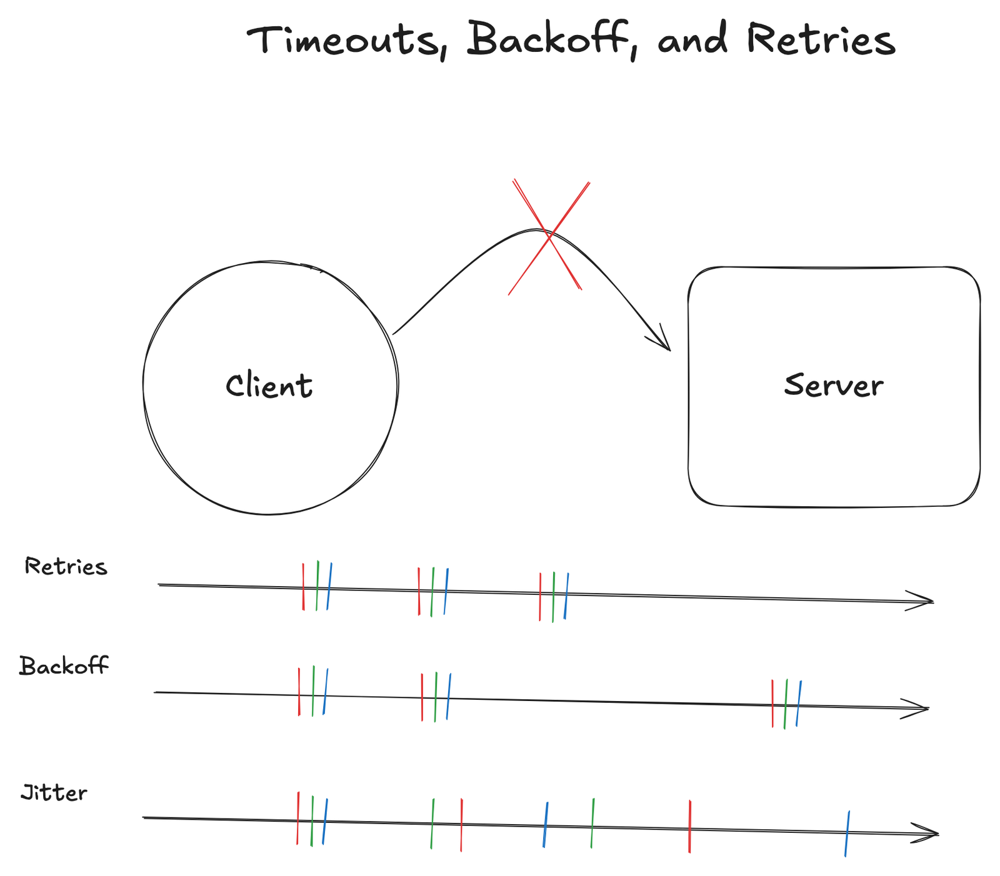

# Timeouts, Retries, Backoff, and Jitter

A **timeout** bounds how long an attempt waits. A **deadline** bounds how long the overall operation can take. A **retry** starts a new attempt after a failure. **Backoff** spaces attempts out, and **jitter** randomizes that spacing so many clients recovering from the same event retry at different times.

## Golden answer

> Set a timeout for each attempt. For transient failures, use capped exponential backoff with jitter when the operation is safe to retry. Limit the total number of attempts and keep them within an end-to-end deadline.

## Budget the complete request

Set an end-to-end deadline and pass the remaining time to downstream calls. Account for connection setup, request transmission, queueing, response time, and retry waits. Some client libraries expose separate timeouts for DNS, connecting, TLS, or reading, so confirm what the chosen configuration covers. Use production latency distributions and an acceptable false-timeout rate to select values. Cancel work when practical as the remaining budget expires.

Timeouts can leave an ambiguous outcome. For example, a payment provider may complete a charge just before the caller stops waiting. A retry can safely refer to the same logical charge when the provider supports a durable idempotency key. Record or reconcile the result before telling the user the charge failed. [Stripe payment design case](../../07-Internal-Consistency-System/design-payment-stripe.md)

## Decide when to retry

- **Transient failure.** Retry eligible connection failures or temporary responses such as `429` or `503` when the operation is safe to repeat and the deadline allows it. Respect `Retry-After` when present, and stop or defer the work if that wait exceeds the remaining budget.
- **Permanent failure.** Validation errors or missing permissions generally require new input or authorization before another attempt can succeed.
- **Retry ownership.** Give one layer primary responsibility for retries on a call path. Three layers making up to three attempts each can trigger up to 27 attempts at the deepest dependency for one logical request.
- **Load protection.** Bound attempts per request and consider a shared retry budget, such as a token bucket. Once the budget is exhausted, surface the failure without increasing downstream load.

## Apply capped exponential backoff with full jitter

For zero-based retry index `i`, compute `limit = min(cap, base × 2^i)` and sample the delay uniformly from zero to `limit`. With a 50 ms base and 200 ms cap, the first four retry windows are 0–50 ms, 0–100 ms, 0–200 ms, and 0–200 ms. The cap bounds a single wait. The deadline and attempt limit bound the whole operation. Before another attempt, check that the remaining time covers the wait and enough time for useful work. [Exponential Backoff and Jitter](https://aws.amazon.com/blogs/architecture/exponential-backoff-and-jitter/) · [Timeouts, retries, and backoff with jitter](https://aws.amazon.com/builders-library/timeouts-retries-and-backoff-with-jitter/)

## Design example

An order service allocates 700 ms to a retryable lookup. It allows up to three attempts of at most 150 ms each, with the first two waits sampled from 0–50 ms and 0–100 ms. That uses at most 600 ms for attempt and backoff budgets, leaving 100 ms for overhead and any remaining processing covered by the deadline. Stop early if the remaining budget or observed failure warrants it. Track first-attempt errors, attempts per operation, retry success, and deadline exhaustion.
