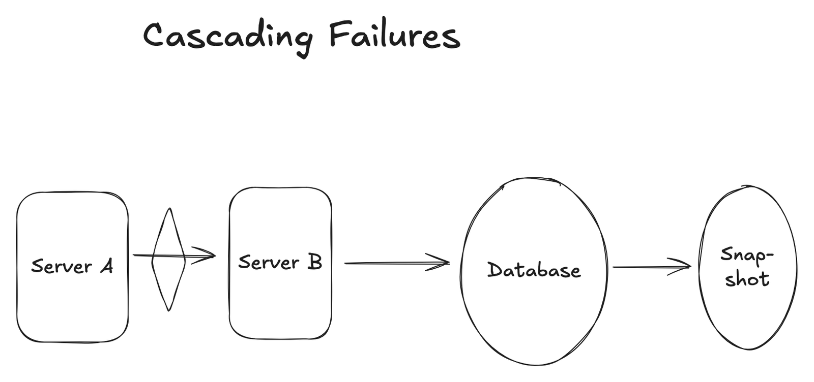
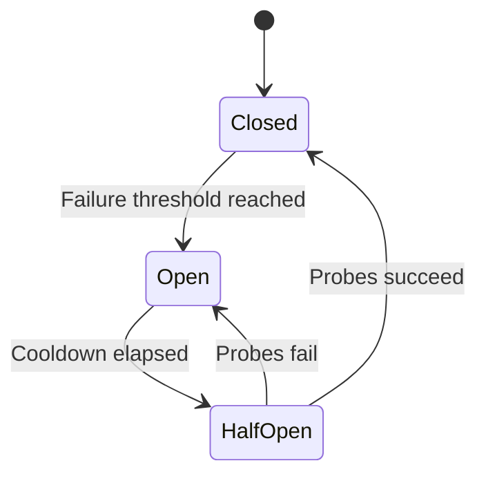

# Circuit Breakers and Cascading Failures

A circuit breaker sits on the calling side of a dependency and tracks recent failures or slow calls. When the dependency appears unhealthy, the breaker temporarily rejects new calls and later lets a limited number of probes test recovery. Fast rejection can release threads, connections, and request capacity that would otherwise stay occupied while callers wait.

## How a cascade starts

A service receives 200 requests per second and calls an inventory service for each one. At an average call time of 100 ms, the average in-flight demand is around 20 calls. If the same rate sustained a two-second call time, the corresponding demand would rise to around 400 calls. A pool that supports 100 calls can saturate, after which work queues or requests fail. Callers may retry, adding traffic just as the inventory service has less usable capacity. Unrelated endpoints can also slow down when they share the same workers or connection pool. [Google SRE on cascading failures](https://sre.google/sre-book/addressing-cascading-failures/)

## Breaker states

| State | How it handles new calls | When it changes state |
| --- | --- | --- |
| Closed | Calls flow through. The breaker records outcomes | Open when failure or slow-call thresholds are met over a window with enough samples |
| Open | Calls fail fast or use a defined fallback | After a cooldown, allow a limited probe budget in half-open |
| Half-open | A small number of calls test recovery | Close after enough successful probes. Reopen if the dependency remains unhealthy |

Count signals that indicate dependency health, such as connection errors, timeouts, and selected server errors. Ordinary validation failures usually do not count. Scope breakers to the failure domain you can act on, such as a dependency in a particular region or a costly operation. A small sample minimum avoids opening on one unlucky call, but a large minimum can delay detection for low-volume traffic. When many clients run local breakers, bound and stagger recovery traffic so they do not all probe simultaneously. [Circuit Breaker pattern](https://learn.microsoft.com/en-us/azure/architecture/patterns/circuit-breaker)

## Design example

Suppose an optional recommendation service's breaker opens when at least half of the last 20 calls failed and all 20 completed within a 30-second window. Product pages render without recommendations while the circuit is open. After a cooldown, the breaker permits two test calls and can close if both succeed. Tune these illustrative thresholds to the call volume, recovery time, and cost of fallback.

A mandatory dependency such as payment authorization needs an explicit unavailable or pending state when the outcome is uncertain. Combine breakers with deadlines to bound individual waits, concurrency limits to contain the number of calls already in flight, and bounded retries with jitter for eligible transient failures. Monitor state transitions, rejected calls, fallbacks, and recovery probe outcomes.
