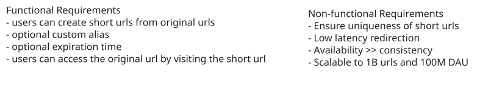
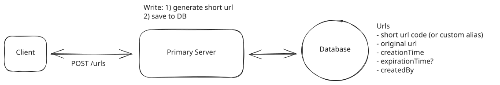
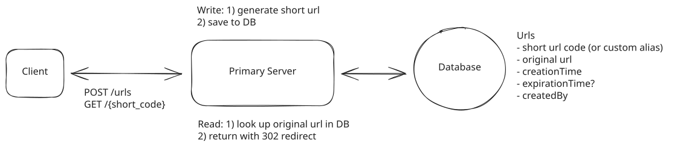
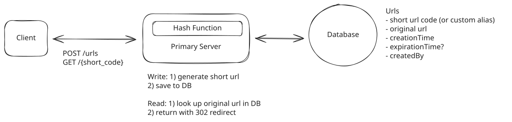
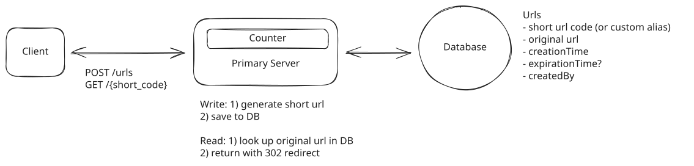
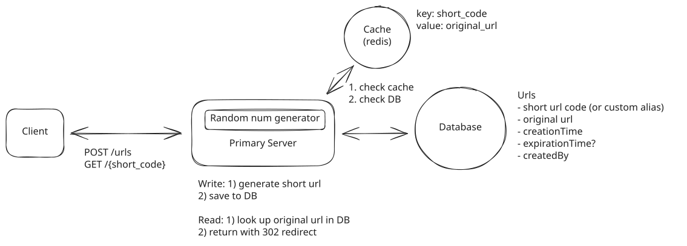
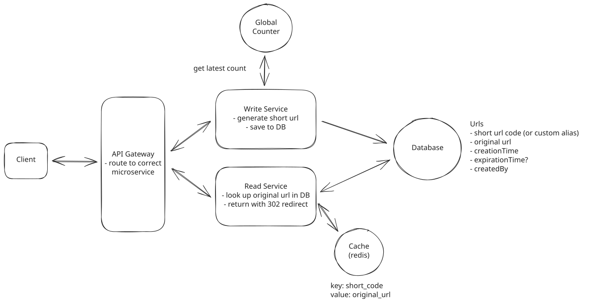

# Design a URL Shortener (Bitly)

- Walkthrough and diagrams by Evan King. [Hello Interview — Bitly](https://www.hellointerview.com/learn/system-design/problem-breakdowns/bitly)
- **Access pattern:** `short_code → original_url`. Use a primary-key index for the exact lookup and a Redis cache to absorb repeated redirects.

## 1. Requirements

- **Create:** Shorten a long URL. Accept an optional custom alias and expiration time.
- **Redirect:** Visiting the short URL opens the original URL.
- **Uniqueness:** Each short code maps to exactly one destination. Several codes may point to the same URL.
- **Targets:** Redirect in under **100 ms**, aim for **99.99% availability**, and support **1 billion mappings** and **100 million daily active users**.
- **Consistency:** Favor redirect availability where short-lived staleness is acceptable. Enforce uniqueness on writes and honor expiration on reads.
- **Out of scope:** Accounts and authentication, click analytics, spam detection, and malicious URL filtering.

## 2. Entities, Data Model, and API

- **Original URL:** The full destination.
- **Short URL:** A code or custom alias at a domain the service owns.
- **User:** The creator, represented by an optional `created_by` field in this case.
- **Mapping:** `urls(short_code PRIMARY KEY, long_url, created_at, expires_at?, created_by?)`. Store a custom alias in `short_code`, so the redirect uses the same lookup.
- **Create:** `POST /urls` with `long_url` and optional `custom_alias` and `expiration_date`. Return `short_url`.
- **Redirect:** `GET /{short_code}` returns `302 Found` with a `Location` header. Return `404 Not Found` for an unknown code and `410 Gone` for a known expired code.

## 3. High-Level Design

### Create a short URL

1. Validate the long URL, alias, and expiration time.
2. Use the custom alias if supplied. Otherwise, generate a code.
3. Insert the mapping. Let the database primary key enforce uniqueness under concurrent writes.
4. Return the short URL after the database commits.

- **Alias conflicts:** Return `409 Conflict` when an alias is already claimed. Reserve a prefix for generated codes, or use distinct namespaces that the redirect path can distinguish.
- **Deduplication:** Allow separate codes for a destination when callers want different aliases or expiration dates. Deduplication saves storage when sharing a mapping is acceptable.

### Redirect to the original URL

1. Look up the short code and check its expiration.
2. Return `302 Found` with the original URL in `Location`. The browser follows it.
3. For an expired mapping, return `410 Gone`. If a cleanup job removes expired rows, keep a tombstone only if the API needs to distinguish expired codes from unknown ones.

- **301:** Permanent redirect. Browsers may reuse it and bypass the shortener on later visits.
- **302:** Temporary redirect. Use explicit cache headers such as `Cache-Control: no-store` when the browser should consult the shortener each time. That keeps link changes and expiration under server control and leaves room for click tracking later.

## 4. Generate Unique Short Codes

- **Avoid taking the URL prefix.** URLs on the same site commonly begin with the same characters.
- **Base62 alphabet:** `a–z`, `A–Z`, and `0–9`. It keeps codes compact and avoids `+` and `/`.

### Option A — Hash and truncate

- **Flow:** Hash the URL with SHA-256, encode the result in Base62, and take a short portion of the output. Eight characters give about **218 trillion** possible codes.
- **Determinism:** The same input produces the same candidate. Add a nonce when the same destination needs separate codes. Use a keyed hash when unpredictability is a requirement.
- **Collision handling:** For roughly uniform candidates, the next attempt collides with probability about `used_codes / code_space`. Insert under the unique constraint and retry with a fresh nonce on conflict. Bound retries, for example to 3–5 attempts.
- **Trade-off:** Longer codes reduce collisions. Shorter codes are easier to share and make collision retries more likely.

### Option B — Atomic counter and Base62

- **Flow:** Redis `INCR` atomically returns a new integer. Base62-encode it and insert the mapping.
- **Capacity:** A counter near 1 billion needs six Base62 characters. Six characters cover about **56.8 billion** values, and seven cover about **3.52 trillion**.
- **Trade-off:** A shared counter coordinates writers, and sequential codes are easy to enumerate. If unpredictability matters, consider randomly generated codes with uniqueness checks.
- **Database guard:** Keep the unique constraint for aliases and for counter values that may be reissued after a failover.

## 5. Keep Redirects Fast

### Primary-key index

- **Index:** A PostgreSQL B-tree primary key on `short_code` provides an indexed lookup and enforces uniqueness.
- **Why add a cache:** Every redirect that reaches the database consumes query capacity, even when the index makes each lookup fast.

### Redis cache

- **Cache hit:** Read `short_code → original_url` from Redis and return the redirect.
- **Cache miss:** Read PostgreSQL, check expiration, cache the valid mapping, and return the redirect.
- **TTL:** Use the shorter of the normal cache TTL and the link’s remaining lifetime. Invalidate cached entries on edits or deletions if those operations are supported.
- **Operations:** Use an eviction policy such as LRU when memory is limited. Expect more database reads during cache warmup or a cache outage.
- **Code generation:** The cache sketch shows a random generator. The final design below uses the shared counter. The cache lookup works with either approach.

### CDN and edge redirects

- **Flow:** Cache popular mappings at CDN points of presence. An edge function can return the redirect close to the user.
- **Trade-off:** Fewer origin requests and shorter network trips, with added cost, purge coordination, monitoring, and runtime limits.
- **Expiration:** Bound edge cache lifetime by the link’s expiration, too. Edge mapping caches and browser redirect caching can use different policies.

## 6. Capacity and Scaling

- **Read-heavy workload:** The walkthrough gives `1,000:1` as an illustrative read/write ratio.
- **Redirects:** `100M DAU × 5 redirects/day = 500M/day ≈ 5.8K/s` on average. The walkthrough’s `100×` peak assumption gives about **580K/s**.
- **Creates:** `100K/day ≈ 1.2/s` on average under the walkthrough’s separate write estimate.
- **Storage:** `1B rows × 500 bytes ≈ 500 GB` of mapping data before indexes, replicas, and backups.
- **Database:** Start with PostgreSQL. Use replication and failover for availability, and backups for recovery. Consider sharding when a single primary’s measured limits justify it.
- **Services:** Scale redirect and creation workers independently so the read-heavy workload can use more instances.
- **Counter batching:** Reserve blocks with `INCRBY counter 1000`. If Redis returns `U`, the worker owns `U - 999` through `U`. Issue codes locally until the block is exhausted. Unused IDs can be skipped.
- **Counter failover:** Redis Sentinel or Redis Cluster can promote a replica. With asynchronous replication, promotion can roll the counter back and reissue previously allocated IDs. The database rejects duplicates. Retry with a fresh allocation and recover the counter beyond any outstanding reservations.
- **Multi-region:** Give regions disjoint ranges and allocate locally. Serve reads through regional caches. Coordinate claims for custom aliases so two regions cannot both accept the same alias.

## 7. Final Architecture

- **Write path:** Client → API Gateway → Write Service → reserve an ID from the shared counter → insert the mapping in PostgreSQL → return the short URL. A custom alias skips counter allocation.
- **Read path:** Client → API Gateway → Read Service → Redis cache → PostgreSQL on a miss → `302` redirect.
- **Responsibilities:** PostgreSQL owns durable mappings and uniqueness. The counter allocates IDs. Redis caches hot mappings. An optional CDN moves popular redirects closer to users.

## 8. Interview Emphasis

- **Mid-level:** Trace both API flows, explain the `302` and the primary-key index, and give one way to generate unique codes.
- **Senior:** Compare hash collisions with counter coordination. Explain cache TTL and invalidation, justify the database, and scale the read and write services independently.
- **Staff+:** Discuss regional counter allocation, Redis failover, enumerable codes, custom alias collisions, and expiration cleanup.
