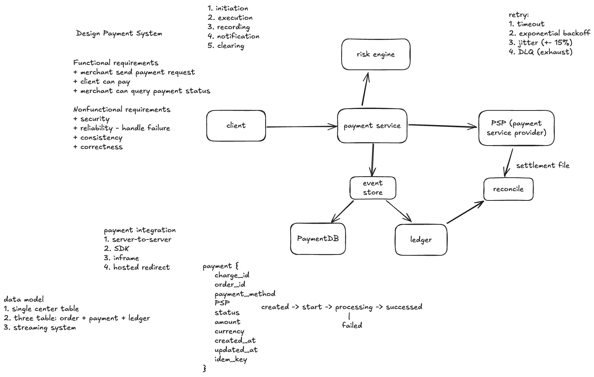

# Stripe: Design a Payment System

Design a card payment collection system (pay-in) for merchants that use Stripe. A merchant creates a payment request, the customer pays, and the merchant can query the status or receive a notification. The system must keep the order, payment state, and ledger consistent through client retries, payment service provider (PSP) timeouts, and asynchronous callbacks.

The sketch covers initiation, execution, recording, notification, and clearing, along with integration options such as server-to-server APIs, SDKs, iframes, and hosted redirects. This design uses Stripe Checkout or Elements to collect card details, a relational database to store payment state, and a transactional outbox to dispatch background work and notifications.

## 1. What do the PSP, card networks, and banks do?

An online card authorization usually travels from the customer through the merchant, the PSP and acquiring side, and the card network to the issuing bank. The authorization response travels back along the same path. **Visa and Mastercard** route authorization requests and responses and support clearing and settlement. The **issuing bank** decides whether to approve a payment based on available funds or credit and its risk checks. The **acquiring side** connects the merchant to the card network and receives settlement funds under its arrangements with the merchant. Authorization, capture, clearing, and settlement are separate stages. Participating financial institutions settle the funds under the card network's rules. [Stripe's guide to card networks](https://stripe.com/en-ca/resources/more/how-do-credit-card-networks-work)

Banks use different interfaces and protocols, follow regional rules, and often upgrade on long cycles. A **payment service provider (PSP)** gives merchants a common interface for card acceptance, authentication, risk controls, status queries, callbacks, and reconciliation. Stripe provides online card acceptance in this design. Float Financial illustrates how a platform can package underlying financial services into products such as corporate cards, expense management, and bill payments for Canadian businesses. [Stripe's guide to PSPs](https://stripe.com/en-ca/resources/more/payment-service-providers) · [Float Financial](https://floatfinancial.com/)

## 2. Payment flow and consistency boundaries

1. **Initiate.** The merchant backend verifies order ownership, amount, and currency, then obtains a reusable local `payment_attempt_id`. The customer enters card details on a PSP-hosted page or in a PSP-provided component. The payment service stores a reference to the PSP object. The risk engine can block a payment before capture.
2. **Execute.** The payment service submits the operation to the PSP. The issuing bank can approve or decline the payment, and the customer may need to complete 3D Secure authentication. With automatic capture, the order becomes eligible for fulfillment once capture succeeds. With manual capture, record `authorized` first and update the order after confirming capture.
3. **Record.** API responses, PSP webhooks, and recovery jobs use the same state update logic. In one local transaction, lock the payment record, check the state transition, update the payment and order, append the balanced ledger entries, and write a notification to the outbox. A unique posting identifier ensures that repeated processing of the same financial operation returns the existing result.
4. **Notify.** After the transaction commits, a notification worker delivers the merchant webhook. The status endpoint uses `payment_attempt_id` to read the committed payment state. To guarantee immediate visibility after acceptance, read from the primary database or use a path that guarantees read-your-writes consistency.
5. **Clear and reconcile.** The PSP supplies transaction, fee, and settlement records. Match those records to the internal ledger using the PSP transaction reference, amount, and currency. Resolve differences through corrective actions or manual review. Funds may still be awaiting settlement when the PSP confirms capture.

The basic local state flow is `created → processing → succeeded / failed`, with additional states such as `requires_action`, `authorized`, and `canceled` as needed. A network timeout leaves the payment in `processing` while its outcome is unknown. Record a subsequent refund or reversal as a separate financial operation with its own ledger entries. Map PSP results to valid local state transitions so a stale event cannot overwrite a confirmed outcome. [Stripe Payment Intents](https://docs.stripe.com/payments/payment-intents) · [Stripe Webhooks](https://docs.stripe.com/webhooks)

### Why separate Order and Payment?

| Table | Responsibility | Example fields |
| --- | --- | --- |
| `order` | Tracks the business order from awaiting payment through fulfillment or cancellation. | `order_id`, `merchant_id`, `amount_minor`, `currency`, `status` |
| `payment` | Tracks payment attempts and subsequent financial operations. An order can have multiple attempts, and refunds or reversals can reference the original payment. | `payment_id`, `order_id`, `operation_type`, `parent_payment_id`, `status`, `amount_minor`, `currency`, PSP references, idempotency keys, timestamps |
| `ledger` | Stores append-only accounting entries. Post debits and credits to accounts for each confirmed financial operation and balance them within each currency. | `journal_id`, `operation_id`, `account_id`, `side`, `amount_minor`, `currency` |

These are the three core business tables. The outbox and webhook deduplication records support delivery and recovery. For an order that may be paid only once, lock the order or enforce an equivalent uniqueness constraint when creating or retrying a payment so two attempts cannot both capture funds. Open a new attempt only after confirming that the previous one captured no funds and can no longer complete a capture.

### How much of pay-in and payout should the design cover?

Stripe can credit the payment to the merchant's Stripe balance first. Once the funds are available, Stripe can pay them out to the merchant's bank account according to the merchant's region, account configuration, and automatic or manual payout settings. Funds availability and payout frequency are separate. A single merchant API request can trigger several stages. The number of card network messages depends on how authorization, capture, authentication, and exceptions are handled. A standard payout typically uses a bank transfer.

For a system design interview, focus the deep dive on **pay-in authorization, capture, ledger posting, and reconciliation**. Describe the payout boundary as `merchant balance → payout → merchant bank account`. If the prompt calls for Stripe Connect payment splitting, also cover balance ownership, transfers to multiple parties, payout failures, and reversals. [Stripe Payouts](https://docs.stripe.com/payouts) · [Stripe Connect Transfers](https://docs.stripe.com/connect/separate-charges-and-transfers)

## 3. Q&A — Who generates the idempotency key?

**The client can generate a request ID.** Generate and save one `request_id` for a checkout submission before the first request. Reuse it on a double-click or network retry. The backend enforces uniqueness within the merchant's scope and returns the existing local payment attempt. Generating a fresh UUID for each click gives a double-click two valid request IDs. Disabling the submit button improves the experience, and server-side order constraints cover distinct keys from page reloads, different devices, or concurrent submissions.

**The server assigns a stable key to each PSP write operation.** Once the order and amount are known and the server is ready to create a PaymentIntent or submit a capture, persist the key before the first PSP call or derive it deterministically from a stored identifier, such as `attempt_id`, and the operation type. For example, `create-intent:{attempt_id}` and `capture:{payment_id}` identify separate operations. Each retry of the same operation uses the same key and parameters. The client request ID protects the client-to-server call, and the PSP key protects the server-to-Stripe call. [Stripe Idempotent Requests](https://docs.stripe.com/api/idempotent_requests)

**Can the server generate the key before the customer enters card details?** Yes. Once the amount is known, the server can create a Stripe PaymentIntent and let the customer supply a payment method and confirm through a Stripe component. The server can also wait until the customer starts payment to reduce the number of records that stay in `created`. Expire attempts that remain unsubmitted, release temporary resources, and retain records that affected funds or still require investigation. Abandoned checkouts are useful for conversion analysis. [Stripe Payment Intents](https://docs.stripe.com/payments/payment-intents)

## 4. Q&A — At high QPS, how do you choose between Outbox and Kafka-first?

Asynchronous processing can acknowledge requests quickly, absorb short bursts, and let workers control how many requests reach the PSP and how quickly they send them. Sustained payment throughput still depends on PSP request quotas, concurrency limits, the number of API calls per payment, and internal write capacity. If the system receives 500 payments per second and can process 100 per second, the backlog grows by about 800 payments in two seconds. Sustained load above capacity requires throttling incoming requests or increasing downstream capacity. [Stripe Rate Limits](https://docs.stripe.com/rate-limits)

| Design | When to return `202 Accepted` | Status queries and recovery |
| --- | --- | --- |
| **A. Database with a transactional outbox** | Write the payment record and execution command in a single database transaction. Return `payment_attempt_id` after commit. | The database is authoritative for workflow and merchant queries, and the payment is queryable when the merchant receives `202`. A relay can poll the outbox or use change data capture (CDC) to publish to Kafka, where a consumer calls Stripe. For a single consumer service, a worker can read directly from a database-backed queue. |
| **B. Kafka first** | Return `request_id` and `received` once Kafka durably acknowledges the command under the required replication settings. | Kafka holds the durable record of accepted commands. The consumer creates or finds the payment record idempotently before calling Stripe. Until that database write succeeds, the API must define how callers can check `received` or document the delay. An immediate status lookup typically requires a separate way to query the receipt. |

**Use A as the baseline when merchants need immediate status queries.** The transaction commits the command with the payment record, so the relay can publish it even if the API process crashes. A relay can crash after Kafka acknowledges a message and before it marks the outbox row as sent, so consumers still deduplicate by `operation_id`. A polling relay, CDC, or a worker that consumes a database-backed queue are viable ways to dispatch work. [Transactional Outbox](https://microservices.io/patterns/data/transactional-outbox.html)

**B can use Kafka as a durable command queue.** If the database write fails, preserve the ability to replay the command. Commit the offset only after saving a recoverable record of the work. If the consumer commits before calling the PSP, it needs a durable database task and a recovery worker. If it commits after processing, a crash can still cause a replay, so reuse the payment record and PSP idempotency key. Kafka can hold the commands while the database holds the results. If the full history of payment state and decisions is authoritative in Kafka, design how to rebuild the resulting status views and how long to retain the events.

### How does the system recover from a network interruption?

- **Stripe call times out.** Keep the payment in `processing` and record the operation for follow-up. Query the PSP object if its ID is known, or use a verified webhook to confirm the outcome. If retrying within the idempotency window, reuse the original key and parameters. If the window expires and the outcome is still unknown, reconcile Stripe records with internal references before deciding whether to attempt a new charge.
- **Duplicate or out-of-order callbacks arrive.** Verify the Stripe signature, persist a deduplication record, and validate the state transition. Fetch the latest state from Stripe if needed. Webhooks, synchronous responses, and recovery workers can race, so enforce a database constraint that allows each financial operation to post only once. [Stripe Webhooks](https://docs.stripe.com/webhooks)
- **Scheduled recovery and reconciliation.** Recovery jobs scan for database records that have been waiting for execution or confirmation too long. Use request timeouts, exponential backoff with jitter, and the applicable backoff guidance for PSP rate limits. Route exhausted retries to a dead-letter queue (DLQ) or manual review. Financial reconciliation checks transaction and settlement records separately. With Kafka-first, also monitor consumer lag and processing failures, since a database scan can only see commands that have already landed.

Suppose Stripe captures the payment successfully and the worker times out before updating the database. The merchant temporarily sees `processing`. A Stripe webhook or a recovery query confirms the same capture, and the payment service uses the same financial operation ID to update the order and ledger. If both paths arrive together, only one can insert the ledger entries.

## 5. Q&A — What determines whether to respond synchronously or asynchronously?

| Consideration | Synchronous response or brief wait | Asynchronous acceptance |
| --- | --- | --- |
| Customer experience | The customer is at checkout and wants an immediate result or needs to complete 3D Secure. | The customer can accept `pending` and get the final result by querying status or receiving a notification. |
| Business requirements | The merchant needs a quick answer before shipping or enabling service. | The merchant can accept the order now and wait for confirmed capture before fulfillment. |
| Capacity and latency | Traffic is steady, and PSP tail latency and internal capacity fit the request budget. | A sale or traffic spike needs buffering. Workers stay within PSP rate and concurrency limits, and queue wait time is bounded. |

A common approach is to persist the payment intent, then give the PSP a short window to return a result or the next authentication step. If the outcome is still unconfirmed, return a queryable `processing` status and let webhooks and recovery jobs resolve it. For the merchant, `202 Accepted` means the system received the request, `succeeded` means capture is confirmed, and the later payout has its own status.
