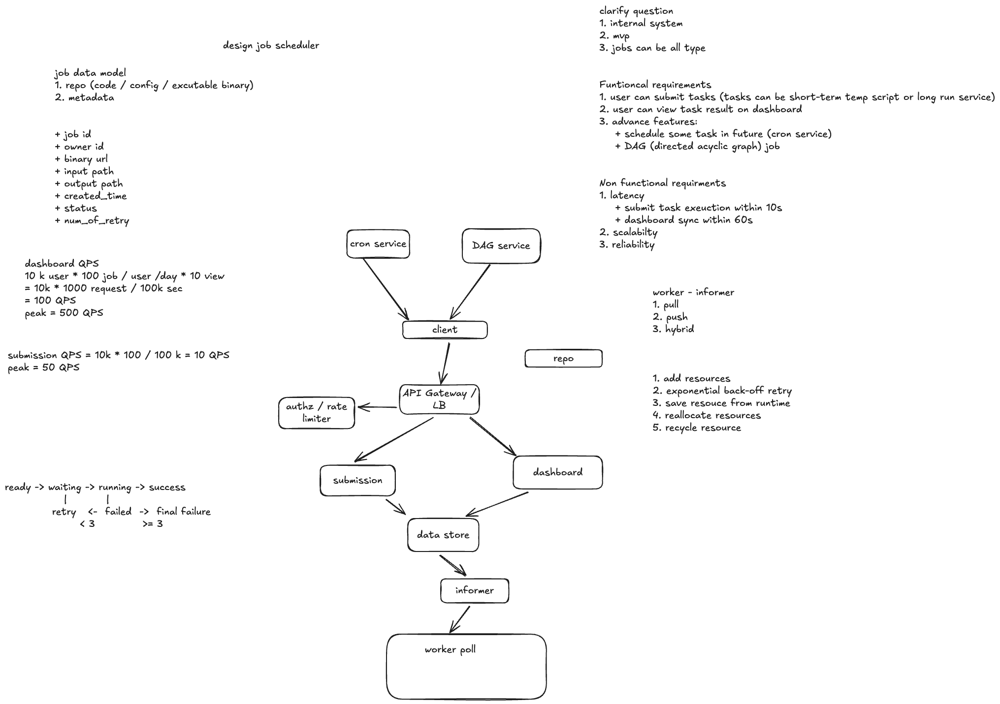

# 案例分析：设计任务调度系统（Design Job Scheduler）

> 根据你提供的手绘设计图整理。图中的数字和组件是这个案例的假设；下面把主流程、数据与调度策略串起来，并标出实现时需要明确的边界。

## 1. 范围与需求

这是一个**内部任务系统的 MVP**：用户提交任务并在 Dashboard 查看运行结果。任务可能是短时间运行的脚本，也可能是长时间运行的服务。定时执行（Cron）和任务依赖（DAG）在图中属于进阶功能，可以在基本提交与执行链路稳定后加入。

**功能需求**

- 提交代码、配置或可执行产物，以及输入位置、所需资源和运行参数。
- 查看任务状态、日志、输出位置及失败原因。
- 进阶：按指定时间或 Cron 表达式触发任务；按 DAG 中的依赖关系启动后继任务。

**非功能需求**：可扩展、可靠；图中给出的延迟目标是任务提交后 **10 秒内进入执行流程**，Dashboard **60 秒内反映最新状态**。这里需要进一步定义“进入执行”是已持久化并排队，还是 Worker 真正开始运行；后者受资源供给、队列积压和并发配额影响，必须单独做容量保障。

## 2. 架构与主流程

1. **提交**：Client 经 API Gateway / LB 进入 Submission 服务；鉴权和限流在入口完成。Submission 验证任务定义，将作业元数据写入 Data Store。代码、可执行文件、输入和输出放在 Repo／对象存储，数据库只保存版本与路径等引用。
2. **生成待执行实例**：一次直接提交、一次 Cron 触发或一个 DAG 节点就绪，都创建一个独立的 `job_run`。Cron 与 DAG 服务是触发来源，应走同一套持久化与去重逻辑，避免各自实现不一致的执行链路。
3. **通知 Worker**：Data Store 中出现就绪任务后，Informer 通过轮询、变更通知或消息队列发现新任务并通知 Worker。图中的 `worker poll` 表示 Worker 主动领取任务；Informer 可用于唤醒，实际领取仍要原子更新任务所有权，防止多个 Worker 同时运行同一实例。
4. **执行与回报**：Worker 获取运行租约、拉取指定版本的产物与输入，申请资源并执行，定期心跳。运行中写入状态、日志和输出位置，结束后释放资源。Dashboard 从 Data Store 读取状态，也可通过推送或轮询获得更新。
5. **故障处理**：Worker 失败或租约到期后，系统判断是否重试。重试采用指数退避；超过上限进入最终失败状态。任务可能被重复启动，因此任务本身应尽量幂等，或使用业务幂等键保护外部副作用。

图中的 `Dashboard → Data Store` 表示查询状态，不应由 Dashboard 直接修改执行状态。执行状态应由 Submission、调度器和 Worker 按明确的状态转换写入。

## 3. 复习：API Gateway 和 Informer 分别做什么？

### API Gateway：用户请求的入口

图中 `Client → API Gateway / LB → Submission / Dashboard` 是**控制面**路径。用户提交任务或查询结果时先访问 Gateway；它验证身份与访问凭证、按用户或团队限流，并根据请求路径把流量送到 Submission 或 Dashboard 服务。例如 `POST /jobs` 转给 Submission，`GET /jobs/{id}` 转给 Dashboard API。Gateway 还可以统一处理 TLS、请求大小限制、超时和访问日志。

图中把 Gateway 与 LB 写在一起，但两者关注点不同：**负载均衡器（LB）**把请求分配给多个健康的服务实例；**API Gateway**理解 API 路由与入口策略。一个产品可以同时提供两类能力。Gateway 做通用身份校验后，Submission 和 Dashboard 仍须检查用户是否有权操作或查看具体任务。Gateway 不决定任务在哪个 Worker 上运行，也不负责执行任务。

### Informer：把待运行任务的变化告诉 Worker

图中 `Data Store → Informer → worker poll` 是**执行调度**路径。Informer 的职责是发现 `ready` 或到期可重试的 `job_run`，让 Worker 尽快知道“现在有任务可以领取”。这里的 Informer 是图中自定义组件的名称，不必对应某个特定产品。

- **纯拉取（Poll）**：Worker 定期查询可领取任务。实现简单、通知不会单点丢失，但轮询间隔带来启动延迟，频繁查询增加存储负载。
- **纯推送（Push）**：Informer 主动把任务发给 Worker。响应快，但要处理 Worker 离线、通知丢失、重复通知及负载分配。
- **混合方式（Hybrid）**：Informer 发出“有新任务”的提示，Worker 收到提示后主动领取；Worker 同时保留低频轮询作兜底。可用队列或可靠事件通知承载提示。

**关键边界**：通知不等于领取成功。多个 Worker 可能同时收到提示，必须用数据库条件更新、队列 ACK／可见性超时，或租约机制，确保同一时刻只有一个有效 Worker 持有任务。Informer 故障或通知丢失时，任务仍留在持久化存储中，Worker 的兜底扫描可以重新发现它。

可以记成一句话：**API Gateway 管“用户请求怎么进系统”，Informer 管“待执行任务怎么被 Worker 发现”。**

## 4. 数据模型与状态

| 对象 | 关键字段 | 作用 |
| --- | --- | --- |
| `job_definitions` | `job_id`、`owner_id`、`name`、`artifact_uri`、`artifact_version`、`config`、`input_path`、`output_path`、`resource_request`、`created_at` | 保存用户提交的任务定义；产物固定版本，保证重试可复现。 |
| `job_runs` | `run_id`、`job_id`、`trigger_type`、`scheduled_at`、`status`、`retry_count`、`max_retries`、`worker_id`、`lease_until`、`started_at`、`finished_at` | 每次执行独立记录，Cron 和 DAG 不覆盖原任务定义。 |
| `job_attempts` | `run_id`、`attempt_no`、`status`、`error`、`log_uri`、`resource_usage` | 记录每次尝试，便于排查和计算实际资源消耗。 |

图中的 `job_id`、`owner_id`、`binary_url`、`input_path`、`output_path`、创建时间、状态与重试次数，分别落在任务定义、运行实例和尝试记录中。不要只在一条记录上反复覆盖状态，否则无法区分“同一任务的多次定时运行”和“同一次运行的多次重试”。

简化状态机：`ready → waiting → running → success`；执行失败后进入 `retry_waiting`，在重试次数未达上限时回到 `waiting`，否则进入 `final_failure`。图中的“少于 3 次重试／达到 3 次最终失败”可以作为默认策略，但要明确**初次运行是否计入次数**；这里建议 `max_retries = 3` 表示初次运行之后最多再试 3 次。取消任务可单独加入 `cancelling / cancelled` 状态。

## 5. 容量估算与延迟

图中的估算假设：`10,000` 名用户，每人每天提交 `100` 个任务，每个任务平均产生 `10` 次 Dashboard 查看；一天按约 `100,000` 秒粗略计算。

| 请求 | 计算 | 平均值 | 图中峰值假设 |
| --- | --- | --- | --- |
| 提交 | `10,000 × 100 ÷ 100,000` | 约 `10 QPS` | `50 QPS` |
| Dashboard 查看 | `10,000 × 100 × 10 ÷ 100,000` | 约 `100 QPS` | `500 QPS` |

这是**请求量**估算，不是 Worker 容量。Worker 数量还取决于任务平均运行时长、CPU／内存需求、长任务比例与目标排队时间。例如平均每个任务运行 60 秒、提交平均 10 QPS 时，稳态约有 `10 × 60 = 600` 个并发运行实例，尚未计入峰值与重试。Dashboard 的 60 秒更新目标可以通过数据库轮询或事件推送实现，并监控状态写入到页面可见的实际延迟。

## 6. 调度、资源与可靠性

- **Worker 领取方式**：纯轮询实现简单，但轮询间隔会增加启动延迟和数据库负载；纯推送延迟低，但 Worker 离线和重复通知需要额外处理。混合方式是通知 Worker 有新任务，再由 Worker 原子领取并建立租约。
- **资源分配**：按任务声明的 CPU、内存等需求选择可用 Worker；记录运行时实际用量，供后续调整配额。失败、取消和租约过期时回收资源，防止资源被长期占用。长时间运行的服务需要健康检查、停止及重启策略，不能只依赖短任务的完成信号。
- **重试**：对临时故障采用带上限的指数退避；配置错误或确定性代码错误通常不应盲目重试。每次尝试保留独立日志与错误。Worker 心跳停止后，租约过期使任务重新可领取；旧 Worker 若恢复，应凭租约版本或 fencing token 阻止其覆盖新尝试的状态。
- **Cron**：持久化下次触发时间，并为每个计划时间点生成唯一的 `run_id`／去重键。明确时区、夏令时、漏触发补偿，以及前一次运行未结束时是跳过、排队还是并行。
- **DAG**：只在所有必要前驱节点成功后，将后继节点标记为就绪；持久化依赖关系和每个节点状态。还要定义前驱失败时是停止整个工作流、跳过后继，还是执行补偿任务。
- **可观测性与权限**：跟踪提交到开始运行的排队时间、运行时长、失败率、重试率、租约过期和 Dashboard 状态延迟；按 `owner_id` 控制任务、日志与输出的访问。执行用户代码时限制权限、网络和资源。

## 7. 核心总结

Job Scheduler 可以拆成**提交与元数据存储、触发与调度、Worker 执行、结果展示**四段。任务定义、每次运行和每次重试要分别建模；Cron 与 DAG 只负责决定“何时生成可运行实例”，最终仍走统一的领取、租约、执行与状态更新链路。系统可靠性的关键是**原子领取、心跳与租约、有限重试、资源回收和幂等处理**。请求 QPS 只能估计 API 压力，Worker 规模必须结合任务时长与资源需求单独计算。
