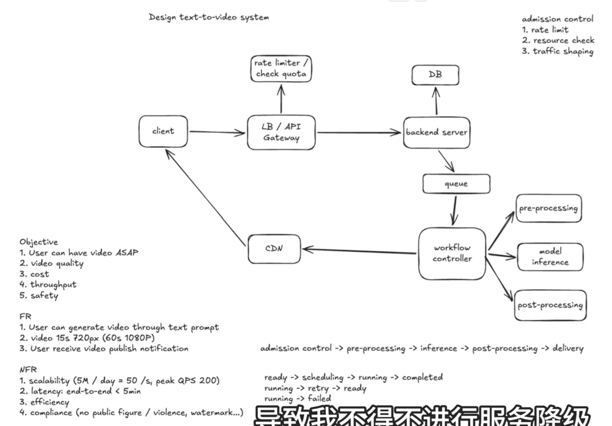
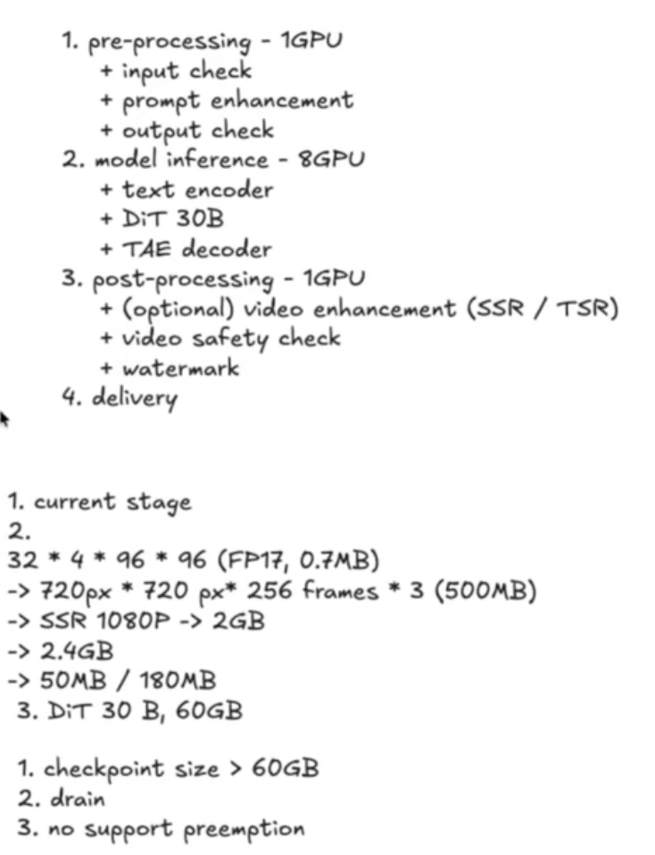
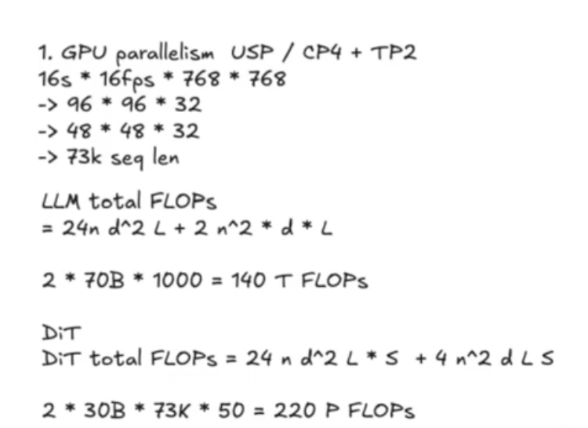

# Design a Text-to-Video Generation Platform

A client submits a text prompt and video settings, receives a job ID, then polls for status or gets a completion webhook. The baseline output is a 15-second, 720p video. A higher-quality profile supports up to 60 seconds at 1080p. The standard job has an end-to-end target of under five minutes, including time in the queue. Start with one region, multiple availability zones, and pretrained models.

## 1. Architecture and request flow

1. **Accept the request.** The API gateway authenticates the client and enforces tenant rate limits. The backend checks quota and estimates GPU work from the requested model, duration, and resolution. It can return `429` when the tenant exceeds its quota or the queue lacks room to meet the latency target. Reserve capacity across job classes so long renders cannot crowd out short ones.
2. **Save and enqueue the job.** The backend writes the job and a transactional outbox record together, pinning the model and runtime versions. Once the transaction commits, it returns `202 Accepted` and a job ID. An outbox relay publishes to a durable queue and retries failed publishes. Within a tenant, reusing an idempotency key with the same request returns the existing job. Reusing it with different parameters returns `409 Conflict`.
3. **Run the workflow.** The controller claims a job with a time-limited lease and a monotonically increasing fencing token. It schedules preprocessing, inference, and postprocessing in order. Workers renew the lease by heartbeat and save intermediate artifacts under an attempt-specific key. Progress and output commits require the current token and a valid lease.
4. **Publish the result.** After the final video is durable in object storage and passes integrity and safety checks, the controller records the asset reference, marks the job `completed`, and writes a status event in one database transaction. The API reads status from that database. A separate webhook service delivers the committed event, while clients download the video from the CDN.

### DNS for the API and CDN

| Hostname | DNS target | What happens after resolution |
| --- | --- | --- |
| `api.example.com` | Public address of the regional load balancer or managed API gateway | The client connects over HTTPS to submit a job, poll status, or request its content URL. The ingress routes the HTTP request to a healthy backend. |
| `media.example.com` | CDN distribution hostname, typically via a CNAME | The client follows the API's short-lived signed URL and connects to a CDN edge. The CDN validates the signature and expiry before serving a cached object or fetching it from the private object storage origin. |

The DNS resolver caches the address according to its TTL, so changing a record takes time to reach clients. Depending on the CDN, DNS can steer clients to an edge address, or DNS can return an anycast address and let network routing select the point of presence. The signed URL's expiry is independent of the DNS TTL. Outbound webhook workers also resolve registered callback hostnames and check resolved destinations against the service's egress policy before connecting. [CDN routing deep dive](<../Layered Architecture/Cloudflare-Design-CDN.md>)

## 2. GPU execution pipeline

| Stage | Example allocation | Work |
| --- | --- | --- |
| Preprocessing | 1 GPU | Check the input, optionally enhance the prompt, and check the enhanced prompt. Run cheap validation before admitting the job. |
| Model inference | 8 GPUs | A text encoder produces conditioning embeddings. The Diffusion Transformer (DiT) denoises the video latent, and the decoder turns it into video frames. |
| Postprocessing | 1 GPU | Optionally increase spatial resolution or frame rate, run final safety checks, add a watermark, and encode the video and preview. |
| Delivery | Object storage and CDN | Verify the encoded file's checksum, persist it, then make the completed asset available to authorized clients. |

The **1 → 8 → 1** allocation applies to successive stages. Release each allocation when its stage finishes, so encoding and delivery do not hold an eight-GPU group. Persist stage status and artifact references so a retry can resume from the last usable stage. A `32 × 4 × 96 × 96` latent tensor takes about **2.36 MB** at 16 bits per element. A raw RGB8 buffer for 256 frames at `720 × 720` takes about **398 MB**. Decode and upscale workers need memory and I/O headroom for those larger buffers, even when the encoded output is much smaller.

A 30B-parameter model has about **60 GB** of weights at 16 bits, before activations and runtime overhead. Load weights when workers warm up and reuse them across jobs. During planned maintenance, drain workers by stopping new assignments and allowing active jobs to finish. If adding mid-inference preemption, measure the cost of saving and restoring the latent, denoising step, and sampler state against the cost of restarting the stage.

## 3. API and job state

| Endpoint | Behavior |
| --- | --- |
| `POST /generations` | Accepts a prompt, output settings, an `Idempotency-Key`, and an optional `webhook_endpoint_id`. Returns `202` and the job ID after the database commit. |
| `GET /generations/{job_id}` | Returns status, a monotonic `status_version`, the current stage, and an error code on terminal failure. |
| `GET /generations/{job_id}/content` | Checks ownership, completion, and retention, then returns a `302` redirect to a short-lived signed CDN URL. |
| `POST /webhook-endpoints` | Registers and verifies an HTTPS callback URL for signed status notifications. |

The internal path is `ready → scheduling → running → completed`. The API reports `queued` before the first attempt and `in_progress` during execution and automatic retries. Retryable failures use bounded backoff before another attempt. Permanent failures and exhausted attempts end in `failed`. Acknowledge the queue message after persisting a terminal state or scheduling a durable retry. With 30-day asset retention, a job can remain `completed` after its video expires.

## 4. Failure recovery

| Failure | Recovery |
| --- | --- |
| The backend committed the job but publishing failed | The relay retries the outbox record. A reconciler finds jobs that have remained queued without a live attempt. The controller uses a conditional claim to handle duplicate messages. |
| A worker loses its lease and later finishes | A new attempt gets a higher fencing token. The old worker's status and output commits are rejected, and its unreferenced artifacts can be garbage-collected. |
| A worker crashes after uploading the result | Uncommitted objects remain private and eligible for cleanup. If the database already recorded completion, a redelivered queue message is acknowledged without running inference again. |
| A webhook fails, arrives twice, or arrives out of order | Deliver at least once with a stable `event_id`, a signature, and bounded backoff with jitter. Receivers deduplicate by event ID and use `status_version` to detect stale events. Exhausted deliveries go to a dead-letter queue for inspection and replay. |

## 5. Capacity and scheduling

The sketch assumes **5 million jobs per day**, about **58 jobs/s** on average, with a **200 jobs/s** peak. For the example allocation, one job consumes roughly `preprocessing seconds + 8 × inference seconds + postprocessing seconds` in GPU-seconds. Estimate this per output profile and track queue age, queued GPU-seconds, and available eight-GPU groups. A cluster can have eight free GPUs in aggregate and still be unable to schedule a job that needs all eight on the same high-bandwidth fabric.

At 50 MB per successfully encoded job, 5 million jobs would add about **250 TB/day**. At 180 MB per job, the same volume would add about **900 TB/day**. Use the actual success rate and output mix for storage estimates, then add previews, replicas, and temporary artifacts.

## 6. Showoff time — GPU parallelism and FLOPs

**Derive the token count.** A 16-second clip at 16 fps has 256 frames. With `768 × 768` frames and an assumed 8× compression along time, height, and width, the latent grid is `32 × 96 × 96`. Applying spatial `2 × 2` patches gives `32 × 48 × 48 = 73,728` video tokens per denoising step.

**Shard the long sequence and the model.** The sketch lists Unified Sequence Parallelism (USP) and gives **CP4 + TP2** as an eight-GPU layout. Four-way context parallelism partitions the sequence into **18,432 token positions per context shard**, reducing per-rank activation pressure. Global attention still needs key and value information from the other context shards. Two-way tensor parallelism splits large layer operations and their weights across two GPUs for each context shard. Collectives exchange the partial results.

**Optimize for the fabric and the workload.** Allocate the eight ranks together on a high-bandwidth interconnect and overlap communication with computation where the attention implementation supports it. Profile peak GPU memory, collective overhead, p95 inference latency, and GPU-seconds per completed video across output profiles. Tune context and tensor parallelism for each profile. If a smaller profile fits and meets its latency target on fewer GPUs, use the recovered capacity for independent jobs. Replicate inference groups to raise throughput.

**Estimate the compute.** A rough count for dense weight matrix multiplies is `2 × parameters × tokens`. That gives **140 TFLOPs** for a 70B LLM processing 1,000 tokens. For a 30B DiT processing 73,728 video tokens over 50 denoising steps, it gives **about 221 PFLOPs**. If the model uses full bidirectional attention, the attention score and value products add roughly `4n²dLS` FLOPs for sequence length `n`, hidden width `d`, `L` layers, and `S` steps. Use the model's actual attention pattern for capacity estimates and measured wall-clock time to account for communication and utilization.

Related case studies include [Job Scheduler](design-job-scheduler.md) and [Multi-Tenant Webhooks](design-webhook.md).
