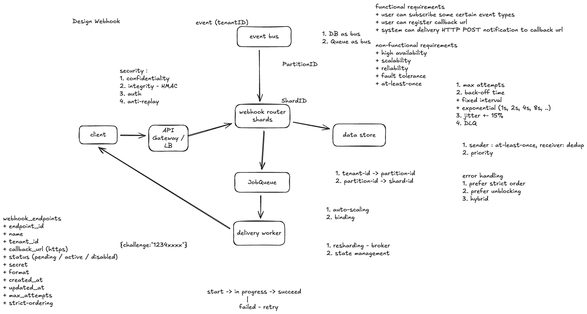

# 案例分析：设计多租户 Webhook 系统（Design Webhook）

> 根据你提供的手绘架构图整理。图中的术语和候选方案是案例素材；下文将它们组织成可落地的设计，并补充必要的实现边界。

## 1. 需求与目标

**功能需求**

- 租户注册 HTTPS 回调地址（Callback URL），并订阅指定事件类型。
- 平台在事件发生后，向匹配的回调地址发送 HTTP `POST` 通知。
- 租户可以查看端点状态和投递结果，调整重试次数与顺序策略。

**非功能需求**：高可用、可扩展、可靠、故障容忍，以及至少一次投递（At-least-once Delivery）。同一通知可能重复到达，接收方需要按 `delivery_id` 或 `event_id` 去重。对于同一事件发往多个端点的情况，`delivery_id` 表示某次端点投递，`event_id` 表示原始业务事件。

## 2. 架构与主流程

1. **注册端点**：租户通过 API 提交 HTTPS URL、订阅事件和配置。系统将端点设为 `pending`，发起一次挑战验证；对方按约定返回挑战值后设为 `active`。验证失败或主动停用则为 `disabled`。挑战请求本身也是出站 HTTP 请求，必须遵守后文的 URL 安全限制。
2. **接收事件**：业务服务把含 `event_id`、`tenant_id`、事件类型和时间戳的事件发布到 Event Bus。事件总线可由数据库 Outbox + 发布器、消息队列或事件流实现；若事件与业务数据需原子产生，优先考虑 Outbox，避免业务提交成功而事件丢失。
3. **路由并持久化任务**：Router 根据 `tenant_id`、事件类型和端点订阅，查找 `active` 端点，为每个匹配端点创建一个投递任务。用 `(event_id, endpoint_id)` 唯一约束避免路由器重读事件时重复建任务。只有任务已经可靠写入队列／存储后，才确认上游事件。
4. **异步投递**：Worker 从 Job Queue 取任务，向租户的 Callback URL 发送签名 `POST`。收到约定的 `2xx` 响应后记录成功并确认任务；超时、网络错误或可重试状态码则按策略重新入队。成功的 HTTP 响应只表示接收端确认收到请求，不保证对方业务已处理完成。
5. **失败收尾**：超过重试上限的任务进入 DLQ，并保留失败原因供排查、告警和人工重放。重放沿用原投递身份，接收方仍可去重。

**为什么分两层消息设施？** Event Bus 负责接收业务事件并决定哪些订阅需要通知；Job Queue 负责缓冲具体的 HTTP 投递任务、重试与 Worker 扩容。图中“DB as bus / Queue as bus”是候选实现，不意味着普通业务表天然具备消息确认、重放和并发消费能力。选数据库方案时应明确 Outbox、轮询／CDC、租约及失败恢复机制。

## 3. 数据模型

| 对象 | 建议字段 | 用途 |
| --- | --- | --- |
| `webhook_endpoints` | `endpoint_id`、`tenant_id`、`name`、`callback_url`、`status`（`pending / active / disabled`）、`secret_ref`、`format`、`max_attempts`、`strict_ordering`、`created_at`、`updated_at` | 保存租户端点配置；密钥存放在专用密钥服务，表中保存引用。 |
| `webhook_subscriptions` | `endpoint_id`、`event_type` | 一个端点可订阅多个事件类型。 |
| `webhook_deliveries` | `delivery_id`、`event_id`、`endpoint_id`、`status`、`attempt_count`、`next_attempt_at`、`last_error`、`created_at`、`updated_at` | 跟踪每个事件对每个端点的投递；对 `(event_id, endpoint_id)` 建唯一约束。 |

投递状态可表示为 `pending → in_progress → succeeded`，失败时从 `in_progress → pending` 等待重试，最终转为 `dead_lettered`。Worker 崩溃时，队列的可见性超时或租约到期应允许任务再次被领取。状态更新和消息 ACK 的先后可能造成重复投递，因此仍需幂等设计。

## 4. 分区、扩容与顺序

- **租户到分区**：可按 `tenant_id` 做稳定哈希，得到 `partition_id`；再将分区映射到 `shard_id`。这样扩容时可以移动分区，而不必逐个迁移租户。热租户可以独立分区或设置单租户并发、速率上限，避免挤占其他租户。
- **Worker 扩容**：根据队列积压、最老任务等待时间、投递延迟和失败率扩缩容；还要限制出站并发，避免压垮回调服务。
- **优先级**：如果不同租户或任务有服务等级，可采用独立队列或调度配额。单一优先级队列可能使低优先级任务长期饥饿。
- **顺序选择**：需要严格顺序时，按 `endpoint_id` 或更细的业务键串行投递，前一个任务失败会阻塞后续任务。若优先保证吞吐，可允许后续任务先投递，并要求接收方按事件版本处理乱序。折中方案是对需要顺序的端点启用串行通道，其余端点并行。
- **重新分片**：迁移分区时记录所有权与消费位置，先停止旧 Worker 接新任务，再切换新 Worker；用租约或 fencing token 防止两个 Worker 同时处理同一分区。即使如此，切换期间仍应按重复投递处理。

## 5. 重试与错误处理

- **重试上限**：每个端点配置 `max_attempts`，同时设置总投递有效期，防止任务无限滞留。
- **退避**：固定间隔简单；指数退避例如 `1s、2s、4s、8s…`，应设置上限，并加入随机抖动（Jitter），如在计算出的延迟附近随机浮动，避免大量任务同时重试。
- **错误分类**：网络超时、`429` 和多数 `5xx` 通常可重试，尊重合理的 `Retry-After`；多数 `4xx` 属于配置或请求问题，应记录并快速结束或暂停端点。具体分类按接收方契约调整。
- **死信队列**：到达上限后记录请求标识、响应状态和最后错误，供告警与人工修复。重放前确认端点配置和密钥仍有效。

## 6. 安全

1. **保密与访问控制**：只允许 HTTPS；管理 API 校验租户身份及其端点所有权。密钥加密存储、定期轮换，不写入日志。
2. **完整性与来源认证**：对时间戳、`delivery_id` 和原始请求体计算 HMAC 签名；接收方使用共享密钥验证签名。签名同时证明持有密钥并检测内容篡改。
3. **防重放**：接收方检查时间戳容许窗口，并对 `delivery_id` 去重；重试可以复用投递身份，但每次请求需重新生成时间戳与签名。
4. **出站 URL 防护**：注册和每次投递都要防 SSRF：拒绝内网、环回和云元数据地址；检查 DNS 解析后的实际连接目标，谨慎处理重定向，并限制请求大小与超时。

## 7. 核心总结

Webhook 是**业务事件驱动的异步 HTTP 投递**：业务系统发布事件，路由层按订阅生成任务，Worker 独立向租户端点发送通知。Event Bus 解耦事件生产与订阅匹配，Job Queue 缓冲慢端点并承载重试。可靠性的关键是**持久化后再确认、至少一次投递、接收端去重、有限退避重试和 DLQ**。多租户场景还必须处理热租户隔离；严格顺序会降低并行度，应按端点或业务键选择。
