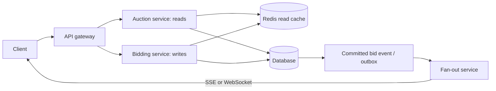
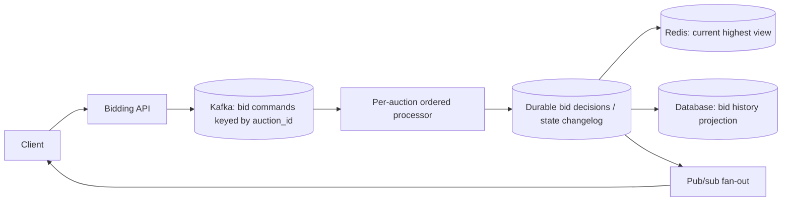

# Design an Online Auction System (Meta Interview)

## Requirements and core invariant

- **Functional:** users can view an auction and its current highest bid, place bids, and view their own bid history. The system closes an auction and determines one winner.
- **Non-functional:** low bid latency, high availability, fault tolerance, and scalability. **Correctness is strongest at bid acceptance:** an accepted bid must be durable, above the current winning amount (and any minimum increment), and placed before the auction closes.
- A celebrity item such as **Messi's jersey** can make one `auction_id` a hot key. Sharding by auction ID spreads *different* auctions, but cannot spread the decision for one auction across independent writers without coordination.

## Baseline: database owns the decision

The auction table contains `auction_id`, `item_id`, `status`, `start_at`, `end_at`, `max_bid_amount`, `max_bidder_id`, and `version`. A bid record contains `bid_id`, `auction_id`, `user_id`, `amount`, `currency`, `created_at`, and `status`. Use an idempotency key per client bid request so a retry cannot create a second bid. The current highest amount and the accepted bid record must change in the **same transaction**.

For the baseline, route bids for an auction to one database shard. A conditional update checks that the auction is open, the deadline has not passed, the amount clears the current maximum and increment, and the version still matches. If it updates one row, insert the accepted bid in the same transaction; otherwise reread and return a rejection or retry a genuine version conflict. This makes the database the **source of truth (权威状态)**. Use the database clock for the close check, with one explicit policy for bids racing the close event.

## Q&A: Redis fast reject versus fast allow

**Question:** If Redis holds the current highest bid, isn't rejecting lower bids and allowing higher bids one operation? How are “fast reject” and “fast allow” different?

**Answer:** The difference is what **allow** means and who changes the authoritative maximum.

| Strategy | A bid below Redis's maximum | A bid above Redis's maximum | Authority |
| --- | --- | --- | --- |
| **Fast reject (soft gate / 软门禁)** | Reject early when safe. | **Pass to the database**; it can still lose a race or fail the closing-time check. | Database commits the accepted bid, then refreshes or invalidates Redis. |
| **Fast allow (hard gate / 硬门禁)** | Reject. | **Accept in an atomic Redis operation** that advances the maximum; database persistence follows. | Redis is making the live decision, so durability and recovery must be designed around it. |

Fast reject is safe only if the cached maximum is **never higher than the authoritative committed maximum** and bidding is monotonic. A stale, lower cache value merely sends extra bids to the database. Update Redis only from committed results; invalidate it when auction rules or state change. Redis alone cannot decide whether a higher bid is valid if the auction has closed or another bid has already committed in the database.

**Follow-up:** Is fast reject write-through, and fast allow write-behind?

**Mostly as an analogy, but they are different dimensions.** With fast reject, a cache miss may use **read-through**, and a synchronous cache update after the database commit resembles **write-through**. A later refresh or invalidation is closer to **cache-aside**. With fast allow, persisting an accepted Redis decision later resembles **write-behind**. These labels describe *cache maintenance*; the key design choice is still **where the final bid decision is made**. A Redis-first system must not acknowledge an accepted bid that can disappear after a Redis failure. A durable log or equivalent write must be part of its acceptance contract.

## Why cache, and what it can do

If roughly **90% of activity is browsing**, caching auction pages and highest-bid views can remove many read requests from the database. The database's own buffer pool reduces disk reads, but queries still consume database CPU and connections. An external cache such as Redis can reduce that read QPS further and serve hot auctions quickly. Cache values can be slightly stale for viewing; the bid acceptance path cannot trust them as the final answer in the baseline design.

The cache can also perform **fast reject admission control** for bids that are definitely too low. This reduces needless database writes, but every potentially winning bid still reaches the database. Avoid presenting a cache hit as proof that a bid was accepted.

## Hot auction: locks, contention, and admission control

- **Optimistic locking:** Assume conflicts are uncommon. Read `version`, then use a conditional update such as `UPDATE ... WHERE auction_id = ? AND version = ?`. A failed update indicates a race; reread and retry with a bound, or tell the bidder their amount is no longer high enough. It avoids waiting on a lock when auctions are quiet.
- **Pessimistic locking:** Assume conflicts will happen. Start a transaction, lock the auction row with `SELECT ... FOR UPDATE`, check the maximum and deadline, update it, insert the bid, then commit. This serializes bidders but they may wait, time out, or queue behind a hot row.
- **Adaptive approach:** Start with optimistic locking. If a hot auction causes excessive retries, switch that auction to a serialized writer or a pessimistic path. Measure conflict rate and queue latency before switching; a lock makes outcomes stable but does not create unlimited throughput.
- **Admission control:** Per-user rate limits, bot protection, and rejecting obviously low bids reduce wasted work. A bounded queue protects the database during a burst; overload should return a clear retry response rather than silently lose bids.

## Stream-processing option for extreme hot spots

If one auction overwhelms the database's bid-write path, move **decision processing** to an ordered stream. This replaces the synchronous database decision for that auction, not the database's entire role in storing auction details and serving history.

Kafka partitions all commands for one `auction_id` into the same ordered stream. A processor checks the current state, auction deadline, and minimum increment, then records an **accepted or rejected decision**. A bid response says “accepted” only after that decision is durable; merely appending a bid *request* is not acceptance. Keep processor state recoverable with a durable changelog/snapshot, and commit consumed offsets consistently with produced decisions. Redis is a fast projection of the latest accepted state, not the only durable copy. If Redis fails, rebuild it from a snapshot plus later Kafka events. An offset is **per partition**, not one global bid order.

This path adds queue delay and operational complexity. One hot auction still has a **single ordered decision bottleneck**; Kafka protects and buffers it rather than making its invariant parallel. At moderate bid QPS, a sharded database with conditional writes is simpler and often sufficient. Kafka replay and database projections also need idempotent processing so retries do not duplicate accepted bids or history rows.

## Fan-out: keeping viewers current

After an accepted bid commits, publish an event with `auction_id`, new maximum, and a monotonically increasing auction version. Pub/sub distributes it to servers holding viewer connections. Notifications are **hints**: clients reconnect, request the latest state, and ignore old or duplicate versions. A slow viewer should not block bid acceptance.

| Method | Fit for auction updates | Cost |
| --- | --- | --- |
| Polling | Simple, tolerates delayed updates. | Repeated requests even when nothing changes. |
| Long polling | Client holds an HTTP request until a change or timeout, then reconnects. | Fewer empty responses, but many waiting connections and reconnects for a popular auction. |
| SSE | One-way server-to-client stream over HTTP; bids still use ordinary requests. | Good default for live highest-bid updates; manage reconnects and fan-out. |
| WebSocket | Persistent bidirectional connection. | Useful for richer real-time interaction; more connection and protocol state to operate. |

Hundreds of viewers are not automatically too many for long polling. At large fan-out or high update frequency, SSE or WebSocket reduces repeated request setup, but all three need capacity for concurrent connections. The authoritative bid result remains the response from the decision path, not a broadcast update.
