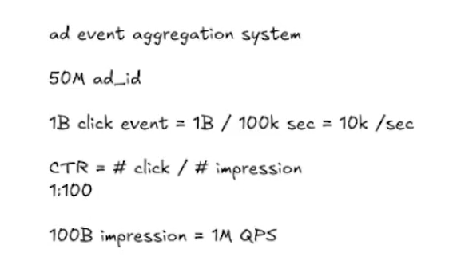
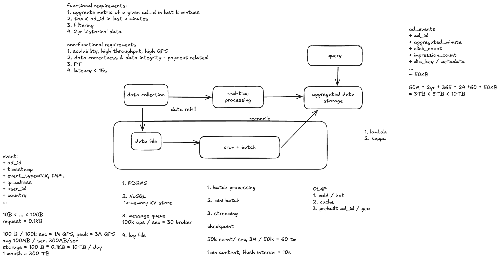

# Case Study: Ad Event Aggregation System

这份笔记汇总两张手绘图，并修正其中容易混淆的时间语义和容量估算。原图是讨论草稿；下面的解释和计算以文中明确写出的假设为准。

## 原始截图与需求



*图二：广告数、点击和曝光的规模假设。图中没有明确写统计周期；下文在估算每日数据量时假设这些是每天的数量。*



*图一：实时处理、历史批处理、聚合存储与查询。图中的 checkpoint、1-minute context 和 flush interval 应分别理解，右侧的聚合存储量也需要重算。*

功能需求：查询某个 `ad_id` 过去 K 分钟的点击数、曝光数等指标；查询过去 N 分钟的 Top K 广告；支持按地区等维度筛选；保留两年历史。非功能需求包括高吞吐、可扩展、计费相关的正确性与完整性，以及约 15 秒的数据可见延迟目标。这里的“15 秒”应定义为事件产生到查询可见的端到端延迟，并约定统计分位数和峰值流量。

## 规模估算：区分事件量、事件速率和存储量

图二列出 `50M ad_id`、`1B click events`、`100B impression events`，点击率 `CTR = clicks / impressions = 1%`。图中用 `100k seconds` 作分母，得到约 `10k clicks/s` 和 `1M impressions/s`。但 100,000 秒约为 27.8 小时；如果这些是**每天**的事件量，应使用 86,400 秒：

| 指标 | 每天总量的假设 | 平均速率 |
| --- | ---: | ---: |
| 点击 | 10 亿 | 约 11.6k/s |
| 曝光 | 1000 亿 | 约 1.16M/s |
| 合计 | 1010 亿 | 约 1.17M/s |

实际设计还要为峰值、重试、突发和地区分布留容量。图一的 `50k events/s` 与以上全站输入速率不一致；若它代表单个处理任务或分区的吞吐，需要标明作用范围。`3M / 50k = 60s` 只表示处理 300 万条事件所需的时间，**不能推导出 checkpoint 必须每 60 秒执行一次**。

若平均每个原始事件约 100 bytes，每天约有 `101B × 100 bytes = 10.1 TB` 原始载荷；两年约 `7.37 PB`。这都不含复制、索引、协议开销，也不考虑压缩或不同事件大小。是否保留两年原始事件，需要与“两年可查询聚合结果”的需求分别决定。

## 数据流与分钟聚合

```text
广告客户端/服务端
    → 采集层（校验、补充 event_id 和时间戳）
    → 持久化事件日志（按可扩展的键分区）
       ├→ 流处理 → 分钟聚合 → OLAP 聚合存储 → 查询 API
       └→ 原始事件归档 → 定期批处理重算 → 对账/修正聚合结果
```

原始事件至少包括 `event_id`、`ad_id`、`event_time`、`event_type`（click 或 impression）和需要筛选的维度，如 `country`；其他可选字段包括 `user_id`、IP 地址或相关元数据。应分别记录事件发生时间与采集时间，以观察传输延迟。计费口径还要定义什么算有效点击和有效曝光。

流处理按**事件时间**把事件归入 1 分钟的桶。例如 `(ad_id=123, minute=14:32)` 保存 14:32:00 至 14:32:59 的点击数、曝光数。若支持按国家筛选，可再用 `(minute, ad_id, country)` 作为聚合键。查询过去 K 分钟时，对对应分钟桶求和；CTR 应由求和后的 `click_count / impression_count` 计算，而不是简单平均各分钟 CTR。Top K 可以基于所选时间范围的计数排名，但跨广告的全局 Top K 需要额外索引、预计算或分层求 Top K，不能只靠查询单个 `ad_id` 的键。

### 1 分钟窗口、flush 与 checkpoint 是三个设置

| 设置 | 草图中的数值 | 作用 |
| --- | --- | --- |
| Aggregation window（聚合窗口） | 1 分钟 | 每个结果覆盖的事件时间范围；“每分钟聚合”主要指这个。 |
| Flush interval（写出间隔） | 10 秒 | 定期把当前累计值写到查询存储；同一个分钟桶可以被多次更新。 |
| Checkpoint interval（检查点间隔） | 图中未明确给出；可举例为 1 分钟 | 保存流处理状态及输入位置，用于故障恢复；不定义统计桶，也不要求等到检查点才输出。 |

10 秒 flush 只是 15 秒可见延迟目标的一部分；采集、排队、处理、写入和查询存储刷新都要计入。若业务需要“每分钟完整的最终值”，还要设定 watermark／允许迟到时长。延迟到达的事件可更新旧分钟桶，超过修正期限的事件交给对账流程处理。写出应采用幂等 upsert、事务或带版本的替换，避免重试把计数重复累加。对于计费，还需要稳定 `event_id` 去重和可审计的原始记录。

## Aggregated data storage：OLAP、冷热分层与预聚合

**OLAP**（Online Analytical Processing，联机分析处理）是面向分析查询的存储和计算方式：按时间、广告、地区等维度筛选、分组、求和及排序。它适合查询历史趋势和排名。这里的聚合存储可保存分钟级计数，而不是每次查询都扫描全部原始事件。

**Hot data** 是最近、访问频繁且对延迟敏感的聚合数据，可放在快速存储并配合缓存。**Cold data** 是较旧、访问较少的数据，可放在更便宜的存储中，保留较粗粒度聚合，或按需查询。SSD 是存储介质，不是 cold 的定义：冷数据可以放在 SSD，但长期历史也常放在对象存储等更低成本的介质。冷热界线取决于查询频率、延迟要求和成本。

**Prebuilt aggregates / materialized views（预聚合视图）**按常用查询键预先计算，例如 `(minute, ad_id)` 和 `(minute, ad_id, country)`，也可以为常见地区或时间范围维护排名。它们提升查询速度，但每增加一个维度组合，都会增加存储和更新成本；不能无条件为所有维度组合建视图。`50M ad_id` 是广告总数，不代表每个广告在每分钟都产生事件，应只存实际出现的组合，并按活跃度和时间进行容量估算。

这些计数也能作为广告收费的输入：CPM 依据有效曝光，CPC 依据有效点击。但预聚合视图本身不能保证账单正确；计费还需去重、无效流量过滤、迟到事件修正和原始事件与聚合结果的对账。

### 修正图一的聚合存储估算

如果极端假设 5000 万个广告**每分钟都有一行**、保留两年、每行 50 KB，则行数为 `50M × 2 × 365 × 24 × 60 = 52.56 万亿`，总量约 **2.63 EB**，不是图中的 3 TB。即使每行仅 50 bytes，这个稠密假设仍约 **2.63 PB**。实际容量应从活跃广告、非空分钟、预建维度组合和真实行大小估算，再计入索引、复制与压缩。

## Lambda 与 Kappa

图一采用的是 **Lambda architecture**：流处理（speed layer）先生成低延迟结果；批处理（batch layer）读取保留的原始事件，定期重新计算并修正实时结果。你记不起来的另一条路径就是 **batch processing／批处理**。它适合历史回填、算法修正和计费对账，但两条路径必须使用相同的指标定义，并明确批处理结果如何覆盖实时结果，避免重复计数或旧结果覆盖新结果。

**Kappa architecture** 主要使用一套流处理计算逻辑。需要重算时，从保留的事件日志重放到新的结果版本，验证后切换查询。因此“只依赖 streaming data processing”大体正确，但仍依赖足够长的原始事件保留期、可重放能力和可靠的结果切换。两者的更多比较见 [Big Data Processing](big-data-processing.md#lambda-and-kappa-architectures)。
