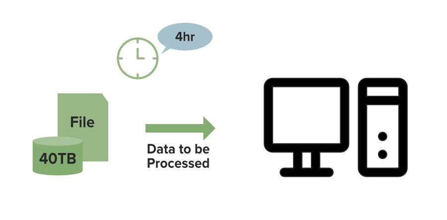
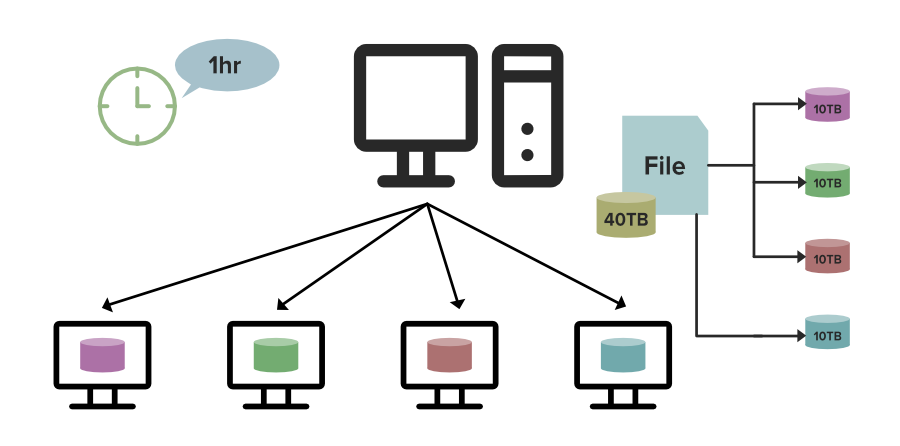
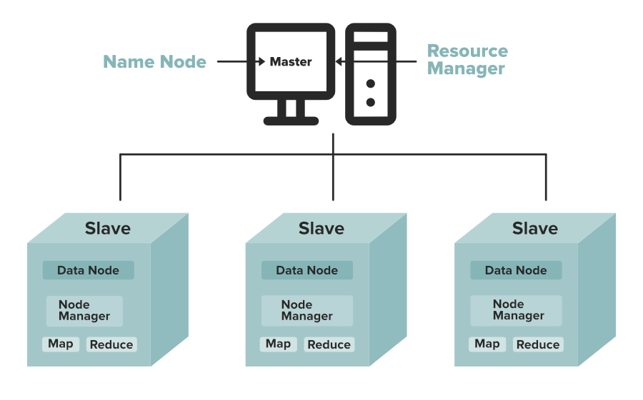

# Hadoop HDFS：分布式存储与数据本地性

HDFS（Hadoop Distributed File System）把大文件切成多个 **block（数据块）**，分散存放在集群机器上，并通过副本等机制应对机器故障。它提供的是**分布式文件存储**；MapReduce 或 Spark 才负责计算，YARN 可以负责资源调度。

## 为什么要分布式存储？

*图 1：示意单机处理 40 TB 数据需要 4 小时。时间只是例子，不是 HDFS 的性能保证。*

单机的磁盘容量、磁盘吞吐和计算资源都有上限。分布式系统可以把数据与任务分给多台机器，让它们并行工作。

*图 2：40 TB 逻辑数据平均分成四份，每台处理约 10 TB；理想情况下处理时间从 4 小时降至约 1 小时。*

这个 `4 ÷ 4 = 1 小时` 的估算假设任务能完全并行、机器能力相同，且忽略调度、网络传输与结果汇总。若 HDFS 使用 **3 副本**，40 TB 逻辑数据约需 120 TB 原始磁盘容量，四台机器平均约占 30 TB，而不是每台只占 10 TB；实际占用还受元数据、文件格式及存储策略影响。HDFS 也可以使用纠删码等方式降低存储开销。

## HDFS 的两个主要角色

| 组件 | 职责 |
| --- | --- |
| **NameNode** | 管理文件目录、权限、文件到数据块的映射等元数据，并依据 DataNode 的报告维护块位置信息；不保存文件的实际内容。 |
| **DataNode** | 在本地磁盘保存实际数据块，响应读写请求，并向 NameNode 发送心跳和块报告。 |

**DataNode 不是一个 block，也不是 NameNode 的副本。**它是一台保存许多 block 的机器（或其上的服务）。例如，一个文件分成 `B1`、`B2` 两个 block，副本数设为 3，那么每个 block 都在三台不同的 DataNode 上各存一份；同一台 DataNode 也可以同时保存 `B1`、`B2` 和其他文件的 block。NameNode 只记录这些 block 在哪里，通常没有固定的“主 block 副本”。这里的“主节点”指元数据管理角色，不表示 NameNode 保存完整文件再让 DataNode 复制。

客户端先向 NameNode 查询数据块的位置，再与 DataNode 直接传输文件内容。写入时，DataNode 按副本放置策略将数据复制到其他节点。NameNode 故障会影响整个文件系统的访问，因此生产环境通常配置 NameNode 高可用；“有副本”并不等于任何故障下都不会丢数据。

*图 3 把三套组件画在了一起：NameNode/DataNode 属于 HDFS；ResourceManager/NodeManager 属于 YARN；Map/Reduce 属于计算任务。图上的 Master/Slave 是旧式称呼，理解职责时应按具体组件区分。*

## 工作方式与适用场景

- **大块、顺序读写：** HDFS 适合大文件和高吞吐批量扫描。常见 block 大小为 128 MB，但可配置；大量小文件会给 NameNode 的元数据管理带来压力。
- **数据本地性：** 调度计算任务时，尽量让任务在持有数据块的机器或附近运行，减少跨网络读取；是否能做到取决于资源和调度情况。
- **容错：** 副本可跨机器或机架放置。DataNode 失联后，系统可利用现存副本恢复所需副本数，但恢复期间仍存在风险。
- **写入模型：** 主要面向一次写入、多次读取；支持追加，但不适合频繁随机地修改文件中间内容，也不适合低延迟的在线点查。

一句话记忆：**HDFS 管“文件块放在哪、如何可靠读取”；YARN 管“任务用哪些资源”；MapReduce 管“如何并行处理数据”。**

本文根据用户提供的 HDFS 文字材料与三张示意图整理；图中的耗时与容量是教学假设，并非测量结果。相关处理模型见 [Big Data Processing](big-data-processing.md)。
