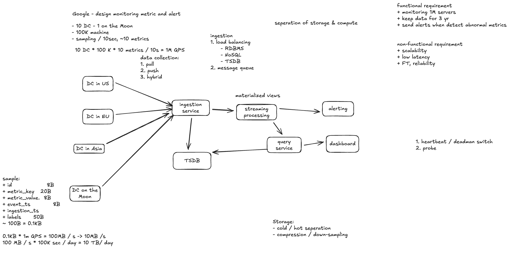
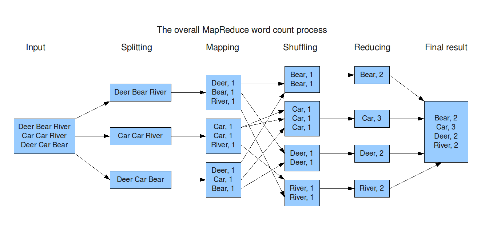
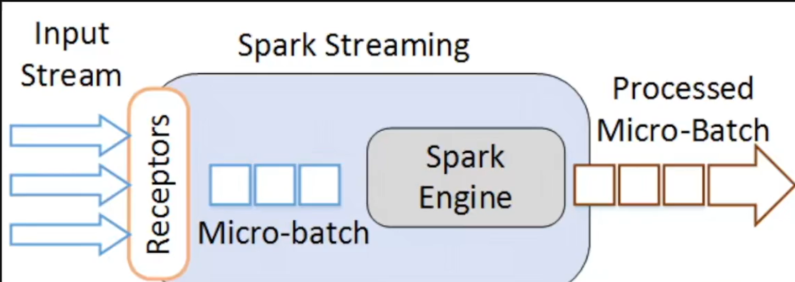
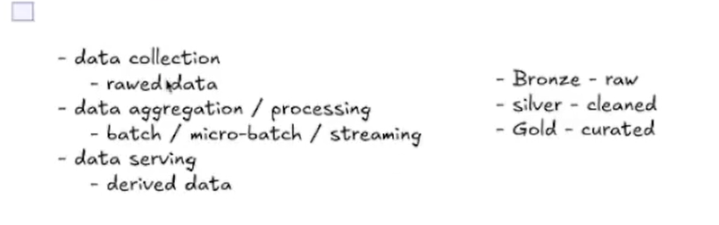

# Case Study: Monitoring and Alert System

Design a system that collects machine metrics across data centers, serves dashboards, and sends alerts when something goes wrong. **DC means data center.** The monitoring system must also detect when its own components silently stop working.

## Requirements and Scale

| Assumption | Value |
| --- | --- |
| Data centers | 10 |
| Machines per DC | 100,000 |
| Total machines | 1 million |
| Sampling interval | Every 10 seconds |
| Metrics per machine per sample | 20 |
| Historical retention | 3 years, using storage tiers and downsampling |

Examples include CPU utilization, memory usage, disk I/O, network traffic, and service error counts. Dashboards need recent and historical queries; alerts need low latency, reliable delivery, and clear handling of missing data.

```text
Samples per second = 10 DCs × 100,000 machines × 20 metrics / 10 seconds
                   = 2 million metric samples/second
```

This is the sample rate, not necessarily the HTTP request rate. If an agent sends all 20 metrics in one request every 10 seconds, ingestion receives roughly **100,000 requests/second** globally, before retries and collector-side batching.

At an illustrative **100 bytes per sample**, the raw payload is about **200 MB/s**, **17.28 TB/day**, or **18.9 PB over three years** before compression, replication, indexes, and protocol overhead. The actual size depends heavily on encoding and labels. Keeping every raw sample for three years is expensive, so retain recent detail and older aggregates according to business needs.



*The original sketch uses 10 metrics; this case uses the updated requirement of 20 metrics. Its storage estimates therefore do not apply directly.*

## Architecture and Data Flow

```text
Machine agents → Regional collectors → Durable event log
                                           ├→ Stream processor → Alert evaluator → Notifications
                                           ├→ TSDB writers → Time-series database ← Query API ← Dashboard
                                           └→ Object storage → Historical batch jobs
```

Deploy collectors and processing near each DC to reduce cross-region traffic and keep collection running through WAN outages. A global query layer can combine regional results. Separate ingestion, computation, and storage so each can scale independently.

1. **Collect:** Agents sample metrics and attach a machine ID, metric name, event timestamp, value, and bounded labels such as DC and service. A hybrid model can use local pull-based collection and push batches upstream. Stagger collection times to avoid synchronized bursts.
2. **Buffer durably:** Collectors validate and batch records into a partitioned log such as Kafka. Use bounded local disk buffers during outages, with an explicit policy for what happens when buffers fill. Acknowledging after a durable write allows downstream consumers to catch up independently.
3. **Process:** Consumers compute rolling averages, rates, and other derived metrics. Partition by a stable series key for per-series state; use staged aggregation for fleet-wide metrics to avoid hot partitions.
4. **Store and serve:** Write recent samples and aggregates to a time-series database (TSDB). The query API enforces time-range and result-size limits so expensive dashboard queries do not starve ingestion or alerting.

An event timestamp records when the metric was sampled; an ingestion timestamp records when it arrived. Their difference helps reveal delayed delivery. Retries can produce duplicates, so use a stable series key and sample timestamp for deduplication where appropriate.

## Processing: MapReduce, Spark, and Streaming

### MapReduce Refresher

MapReduce splits a large historical dataset across workers:

1. **Map:** Turn input records into key-value pairs.
2. **Shuffle:** Group records with the same key, transferring data across workers as needed.
3. **Reduce:** Aggregate each group and write the output.

For word count, the mapper emits `(word, 1)` and the reducer sums each word's counts. In this monitoring system, a mapper could emit `((machine, minute), (cpu_value, 1))`; the reducer adds values and counts to calculate a per-minute average. Keep sums and counts when combining partial averages so the result remains correctly weighted.



**The latency problem:** Hadoop MapReduce materializes intermediate map output on local disk, and chained jobs commonly write and reread results through distributed storage. Disk I/O, shuffle traffic, and job startup make repeated batch jobs unsuitable for urgent alerts. MapReduce remains useful for historical recomputation and large offline reports.

### What Spark Improves

Spark executes a graph of operations and can cache reused datasets in memory, reducing repeated disk reads and writes between computations. This helps iterative analysis and multi-step processing. It still uses disk for spill, shuffle storage, checkpoints, and durable output; insufficient memory and large shuffles can remain bottlenecks.

Spark Structured Streaming commonly processes incoming records in **micro-batches**. For example, a job could update dashboard aggregates every 5 seconds. Its actual latency includes waiting for the trigger, computation, backlog, and the downstream write—not just the trigger interval.



*This illustration shows the older receiver-based Spark Streaming model. Structured Streaming commonly uses sources such as Kafka directly, while retaining the micro-batch idea.*

For alerts with tight latency requirements, use a continuous stream processor such as Flink or Kafka Streams. A micro-batch job can also work when the measured delay meets the alert target. With 10-second sampling, a fault can already wait almost 10 seconds before the next sample; processing cannot remove that detection delay.

Use batch or Spark jobs for historical rollups, backfills, and reconciliation. If these jobs independently recompute and correct the same live results, the system follows a **Lambda** pattern. If historical corrections replay the event log through the same stream logic, it follows a **Kappa** pattern. See [Fundamentals: Big Data Processing](big-data-processing.md) for the comparison.

## Storage: Why a Time-Series Database?

A TSDB is a strong candidate because metrics are timestamped, append-heavy, and commonly queried over time ranges. Time partitioning, batched writes, specialized compression, and retention policies make this workload efficient. It is still necessary to benchmark the chosen database at the expected ingestion rate and series count.

- **Hot data:** Keep recent detailed samples in the TSDB for fast dashboard queries and incident investigation.
- **Warm data:** Keep coarser rollups, such as one-minute or five-minute summaries, for longer periods.
- **Cold data:** Store compressed historical data in object storage when long-term retention or batch recomputation requires it.

Downsampling discards detail: an average can hide a brief CPU spike. Retain useful summaries such as count, sum, min, and max. For percentiles, retain mergeable histograms or sketches rather than averaging percentiles.

**Watch label cardinality.** One million machines × 20 metrics already gives about 20 million baseline series if each machine has a distinct series for each metric. Unbounded labels such as request IDs or user IDs can multiply this dramatically, increasing index size, memory usage, and query cost.

The data layers can be described as **Bronze** (raw events), **Silver** (validated and deduplicated data), and **Gold** (curated aggregates). These describe data quality and purpose; they are separate from hot/warm/cold storage temperature.



## Alerting and Silent Failures

A rule might say, “CPU utilization exceeds 90% for three minutes.” Evaluate sustained windows to reduce noise, deduplicate repeated alerts, group related incidents, and retry notifications with escalation. Define how late samples and missing data affect each rule: **no data must not automatically mean healthy**.

The dangerous case is a **silent failure**: the collector, rule evaluator, or notification system dies, and nobody receives an alert. Protect against it in two complementary ways:

| Mechanism | What it checks | Example |
| --- | --- | --- |
| Heartbeat / dead man's switch | A component is still reporting on schedule | An external watchdog alerts when the alert evaluator's heartbeat stops |
| Synthetic probe | The complete path actually works | Inject a known test metric, trigger a test rule, and verify its notification reaches a test receiver within a deadline |

Run the watchdog and probes in a separate failure domain with an independent notification route. Otherwise, the same outage could disable both the monitoring system and its self-monitoring. Heartbeats alone are insufficient: a process may still be alive while its Kafka consumer is stuck or its notification credentials have expired.

Track ingestion lag, time since the last sample, consumer backlog, processing delay, TSDB write failures, and notification success. Use machine inventory and discovery to determine which machines should be reporting. A broad loss of samples from one DC may indicate a collector or network outage, so group that incident rather than paging separately for every missing machine.

The core design is a durable regional ingestion pipeline, fast incremental processing for alerts, a TSDB for recent queries, and tiered historical storage—with an independent check that the alerting path itself is working.
