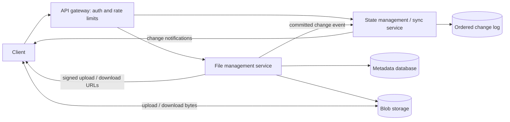

# Design Dropbox / Google Drive (File Sharing Platform)

## Requirements and scale

- **Functional:** upload and download files, sync changes across devices, share files, and handle concurrent edits.
- **Non-functional:** high availability and durable storage; support large files and resumable transfers. A 20-second target is reasonable for *change notification or sync initiation*, not for downloading every file regardless of size. Metadata writes need strong concurrency control even if device synchronization is eventually consistent.
- **Capacity assumption:** 100 million users, 20% daily active users (DAU) = **20 million DAU**. If each active user performs 10 file actions per day, that is 200 million actions/day, or about **2,315 actions/s** on average. At a 5× peak factor, plan for roughly **12,000 actions/s**. This is a starting estimate: each action may generate multiple API calls, chunk transfers, and sync notifications. Size blob bandwidth and storage separately from metadata QPS.

## High-level design

File management owns the authoritative file metadata and versions. Blob storage holds file bytes. State management tells devices *which files changed*; the client then fetches the latest metadata from file management and downloads the bytes from blob storage.

### Core data model

| Record | Important fields |
| --- | --- |
| File metadata | `file_id`, `owner_id`, `path/name`, `mime_type`, `size`, `current_version_id`, `manifest_id` or `object_key`, timestamps, `status`, sharing permissions |
| File version / manifest | `version_id`, ordered `(chunk_key, size, SHA-256)` entries or one whole-file `object_key`, whole-file checksum, creation time |
| Chunk/object | `object_key`, size, checksum, storage status, creation time, deletion eligibility |
| Change event | monotonically increasing `sequence`, `file_id`, `version_id`, operation, timestamp |

Signed URLs are short-lived access credentials generated for a request. Avoid storing them as durable metadata; store stable object keys instead.

## Q&A: file-level URL versus chunk URL

**Question:** What is the difference between `metadata.access_url` and `chunk.url`? Does blob storage hold whole files or chunks, and how does a client download them?

**Answer:** The key distinction is **logical versus physical granularity (粒度)**. A file is the unit exposed to users and APIs; a chunk is an optional unit of transfer and storage. This is similar to a local filesystem exposing a file path while managing its contents in blocks or extents. A URL specifies a way to access a resource; a file path is only an analogy, not the same kind of address.

- **Whole-file objects:** File management resolves the current `object_key` and returns a signed file `access_url`. The client downloads one object. This is simple and works well for small files and read-heavy workloads, though editing a large object may require uploading it again.
- **Chunked objects:** File management resolves a version's manifest, then returns short-lived signed `chunk.url` values (or a batch of them). The client downloads chunks in parallel, verifies their checksums, and assembles them in manifest order. This supports resumable transfer and reuse of unchanged chunks, at the cost of more requests, manifest management, and garbage collection.

For an initial design, use a **10 MB threshold as a tuning assumption**: store smaller files as whole objects and larger files as chunks. The best threshold depends on actual file sizes, edit patterns, and object-store request costs. Large files are not automatically cheaper to *modify*: chunking helps only when the changed chunks can be identified and reused.

## Upload path

1. The client asks file management to start an upload, providing the target file, expected base version, size, and optional checksums. The service authenticates the request, checks permissions and quotas, and creates an upload session.
2. For a large file, the client splits it into numbered chunks and uploads several in parallel. The service gives it **presigned URLs** so bytes go directly to blob storage instead of through application servers. Failed chunks can be retried without restarting the whole file.
3. The client submits the ordered chunk list and checksums to complete the upload. File management verifies that every object exists and matches the expected size and checksum, then atomically commits a new manifest and file version with a compare-and-swap check on the base version. Uncommitted chunks remain temporary and can be cleaned up later.
4. After the metadata commit, the service emits a change event. Other devices learn about the new version through the sync service.

**Integrity checks:** MD5 is a 128-bit digest that produces the same value for identical bytes with high probability and can detect accidental corruption. It is not collision-resistant enough for security-sensitive validation or long-term content addressing. Prefer **SHA-256** for each chunk and for the assembled file; verify the whole-file hash after reassembly. Object-store multipart `ETag` values are not necessarily MD5 hashes. A checksum verifies bytes, while the version check protects against concurrent updates; they solve different problems.

**Compression:** Compressing before upload can reduce bandwidth for text or other compressible content. JPEG, MP4, ZIP, and many PDFs are already compressed, so compression often gives little benefit and costs CPU. Record the encoding in metadata and verify checksums against a clearly defined representation (compressed or original bytes). Compression is an optional transfer optimization, not a replacement for chunking or integrity checks.

## Download and device synchronization

The sync connection exists so a device learns that a **remote file changed** without repeatedly listing every folder. A notification carries a file ID and version or log sequence, not the file bytes. The client fetches authoritative metadata from file management, obtains a fresh signed whole-file or chunk URL, and downloads raw bytes **directly from blob storage**. This keeps bulk traffic off application servers. It resembles a bypass of the API tier, but *Direct Server Return (DSR)* is specifically a load-balancer networking pattern, so “direct-to-object-storage download” is the clearer term here.

### Pull and push: who initiates the notification?

| Method | How it works | Good fit |
| --- | --- | --- |
| Periodic polling (pull) | Client asks for changes since its last sequence at intervals. | Simple clients; slower updates are acceptable. |
| Long polling (client-initiated pull) | Client requests changes; server holds the request until an event or timeout, then client reconnects. | Near-real-time sync with ordinary HTTP infrastructure. |
| Server-Sent Events, SSE (server push) | Client opens one HTTP stream; server sends one-way change events on it. Client writes still use normal HTTP requests. | Browser or desktop notifications that flow mainly server → client. |
| WebSocket (bidirectional) | Client and server keep a persistent two-way connection. | Interactive collaboration or frequent messages in both directions. |

For ordinary file sync, **long polling or SSE** is usually sufficient. WebSocket is justified when the product also needs rich real-time collaboration. Regardless of transport, the client persists a cursor and asks for missed events after reconnecting; notifications can be duplicated or missed during disconnects.

## Conflicts: two devices upload the same file

Both devices read version `v1` and edit offline. Device A commits `v2`. Device B's upload declares `v1` as its base, so its conditional metadata update fails rather than silently overwriting A.

- **Keep both (recommended for personal files):** save B's upload as a conflict copy or separate version, notify the user, and allow manual merge. This avoids losing either edit.
- **Last writer wins:** simple, but can hide a user's changes. Use only where that behavior is acceptable and version history can recover the overwritten content.
- **Merge:** possible for supported document formats, but general binary files cannot be merged safely.

The blob upload can finish before the conflict is detected. That is fine: keep its chunks only if the user chooses to retain the conflict copy; otherwise garbage-collect them after a grace period.

## Change log, rollback, and consistency

Each committed file change gets a monotonically increasing **log sequence**. A device stores its last applied **offset (游标)** and asks for events after that offset. State management can serve a snapshot plus subsequent events when the requested offset is too old.

Rewinding a cursor helps *read or reconstruct* older state while the log and required file versions are retained. A user-visible rollback should create a **new current version** from an older version, rather than move the global log backward. This keeps other devices' history monotonic. Retention can support a product tier: for example, 3 days of restore history for free users and 30 days for subscribers.

A naive design commits metadata and separately sends a delta to state management. A crash between those steps can **lose the notification**. Use a transactional outbox or change-data capture from the metadata database so the event is durably tied to the file commit; consumers process events idempotently. Periodic **full reconciliation (全量同步)** compares state management's snapshot with authoritative file metadata and repairs missed or corrupt entries. It is a safety net, not the primary event-delivery mechanism. The trade-off is extra snapshot, replay, and retention machinery.

## Deletion, deduplication, and storage tiers

- **Tombstones (删除标记):** Mark a deleted file/version in metadata and emit a delete event so offline devices do not resurrect it during sync. Keep the tombstone through the sync and restore retention window. Later, garbage-collect chunks that no retained version references; apply a grace period so in-flight uploads and downloads are safe.
- **Deduplication (去重):** Hash content with SHA-256 and reuse an existing object when bytes match, usually within a tenant or security boundary. Maintain references from manifests to shared chunks and delete an object only when no retained version uses it. A hash match should not reveal another user's file existence or bypass access control.
- **Hot/cold storage (冷热分层):** Keep frequently accessed objects in a hot tier and move old versions or rarely accessed files to cheaper cold storage. Cold retrieval may take longer or cost more, so choose the tier from access patterns and the restore-time promise, not just file age.
