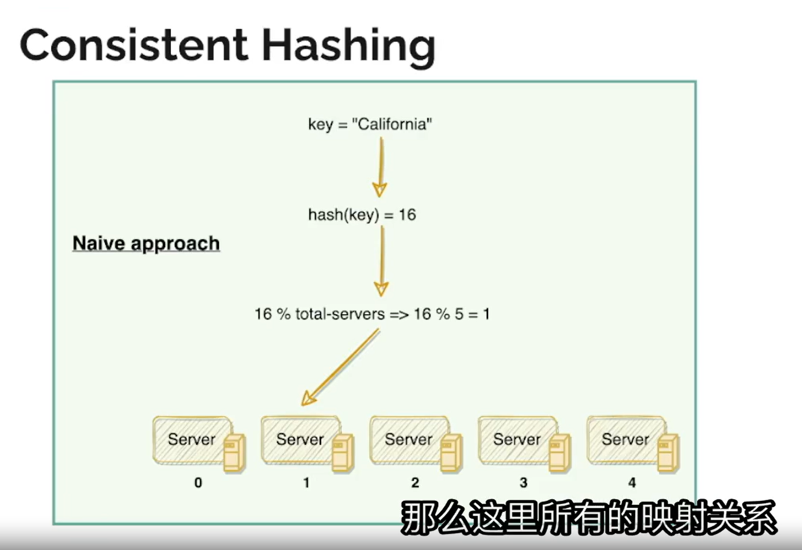
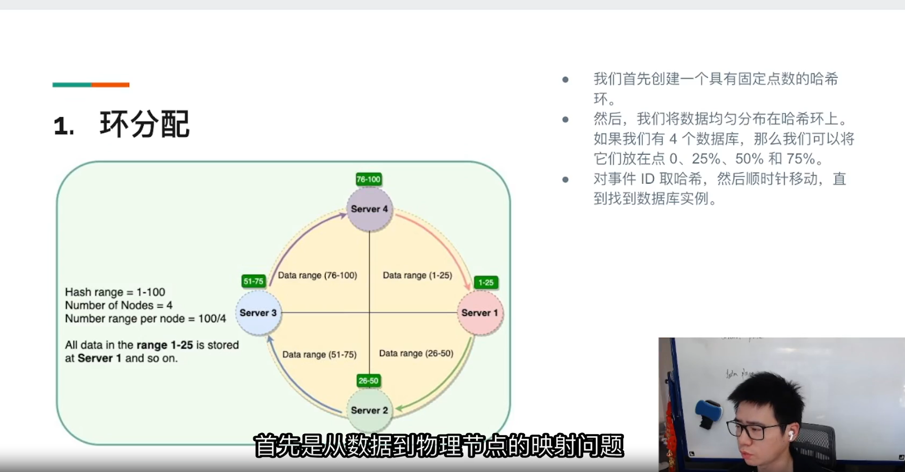
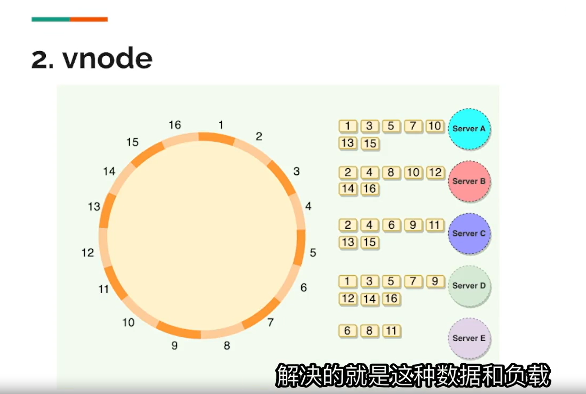
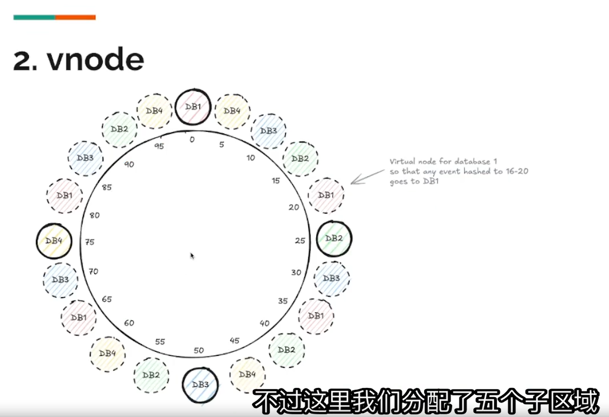

# 一致性哈希：服务器数量变化时如何减少数据迁移

> 本文根据提供的四张截图整理。图中的数字是示意，不代表实际系统只能使用 100 个哈希值或固定数量的服务器。这里讨论的是 IM 系统中按用户 ID、会话 ID 等 key 把数据映射到内部存储服务器的问题。

## 1. 问题：`hash(key) % N` 为什么不利于扩缩容？

最直接的方法是对 key 求哈希，再对服务器数 `N` 取模：`server_index = hash(key) % N`。截图中 `hash("California") = 16`，五台服务器时 `16 % 5 = 1`，因此落到 Server 1。

**问题出在 `N` 是映射公式的一部分。** 当内部服务器从 5 台变成 6 台时，同一个 key 的哈希值仍是 16，但 `16 % 6 = 4`。很多 key 的目标服务器都会变化。系统不仅要重新计算映射，还必须把实际数据迁到新的目标，否则按新公式读取时会找不到旧数据。

对于大量消息或会话记录，这会引发大规模网络传输、磁盘读写和迁移期间的读写一致性问题。目标是：**增减服务器时，尽量只改变一小部分 key 的归属。**

## 2. 方法一：哈希环（Ring）

把哈希值空间首尾相接，想象成一个环。服务器各有一个**固定的环上位置（token）**；对 key 求哈希后，从该位置沿顺时针方向走，遇到的第一台服务器就是它的归属节点。截图用 0、25、50、75 附近的四个位置说明：每台服务器负责它前一个节点之后、到自己为止的一段区间。

关键是**已有服务器的位置在扩缩容时保持不变**。例如在 token 0 与 25 之间新增一个 token 10，原来属于 25 的 `(0, 10]` 区间改由新服务器负责；其余区间的归属不变。删除 token 25 时，它负责的区间转给顺时针方向的下一个节点。

**好处**

- **减少迁移**：新增一台服务器时，只需搬迁它从后继节点接管的区间；不会因为服务器总数变化而重算所有 key 的目标。
- **路由稳定**：未受影响区间的 key 继续留在原服务器，缓存命中和读写路径更稳定。
- **定位直接**：拿到 key 的哈希位置后，在有序 token 列表中寻找顺时针第一个节点即可。

**限制**：如果每台物理服务器只有一个 token，区间大小可能很不均匀；一台服务器可能承担很大范围，另一台只承担很小范围。即使截图用四个均匀位置，实际新增服务器时也不能每次重新把所有旧节点等距摆放，否则又会导致大量区间改变。解决负载不均的问题，可以使用虚拟节点。

## 3. 方法二：虚拟节点（Virtual Nodes / Vnodes）

虚拟节点是在同一个环上为**每台物理服务器放置多个 token**。例如用 `hash(server_id + vnode_id)` 为 Server A 生成多个位置。key 仍按顺时针找到第一个 token，再通过该 token 找到背后的物理服务器。截图 3 展示一台服务器拥有多个分散的位置；截图 4 展示不同数据库的虚拟节点交错分布在同一个环上。

新增物理服务器时，为它放入一组新的虚拟节点。每个新 token 从自己的顺时针后继节点接管一小段区间，因此迁移来源可以分散在多台旧服务器上。移除服务器时，它的多个区间也分散交给各自的后继节点。

**好处**

- **负载更均匀**：一台服务器负责多个分散的区间，较少受到单个大区间的随机波动影响。
- **迁移压力更分散**：新增服务器时，从多台旧服务器各搬一部分数据，而不是让一台旧服务器承担全部迁出流量。
- **可做容量权重**：容量更大的服务器可以配置更多 token，从而获得更大的平均哈希空间份额。
- **保持最小范围变更**：旧 token 不变时，只有新 token 接管的区间换主人；不需要像取模法那样大范围重映射。

虚拟节点增加了 token 数量，也增加了路由表、成员变更和迁移管理的成本。它只能改善**哈希空间的统计分布**；如果某些 key 本身特别热，仍可能需要热点拆分、缓存或单独限流。

## 4. 两种方法与取模法对比

| 方案 | 服务器变化时哪些 key 换主人 | 主要好处 | 主要代价 |
| --- | --- | --- | --- |
| `hash(key) % N` | `N` 改变后，很多 key 的目标会变化 | 实现简单 | 扩缩容会触发大量数据迁移 |
| 哈希环：每台服务器一个 token | 新增／删除节点附近的一段区间 | 大幅减少迁移，路由稳定 | 区间可能不均，负载倾斜 |
| 哈希环 + 虚拟节点 | 多个分散的小区间 | 降低负载倾斜，迁移来源／去向更分散，可加权 | 路由表与迁移管理更复杂 |

## 5. 真正迁移数据时还要做什么？

一致性哈希只**计算归属**，不会自动搬运数据。扩缩容时仍需一个明确的迁移流程：

1. 生成带版本号的新 token 布局，计算哪些区间改变了归属。
2. 从旧服务器复制受影响区间的数据到新服务器；迁移期间继续处理新增写入，避免漏数据。
3. 校验数据和写入进度，切换读写路由到新布局。所有路由节点应使用一致的布局版本，防止同一个 key 被送到不同服务器。
4. 确认切换完成后清理旧副本，并在迁移失败时支持重试或回滚。

IM 场景尤其要留意会话消息的顺序与副本：哈希决定**分片归属**，不等于消息顺序、数据复制或故障恢复已经解决。还需要独立设计同一会话的排序、持久化确认和副本故障切换。

## 6. 复习要点

**取模法的问题**是服务器数进入映射公式，数量变化会让大量 key 换目标。**哈希环**让旧节点位置保持不变，新增或删除节点只影响邻近区间。**虚拟节点**把每台物理服务器拆成多个环上位置，在保留局部迁移优势的同时改善负载均衡，并把迁移压力分散到多台服务器。无论采用哪种方法，数据复制、路由切换和读写一致性都需要另外实现。
