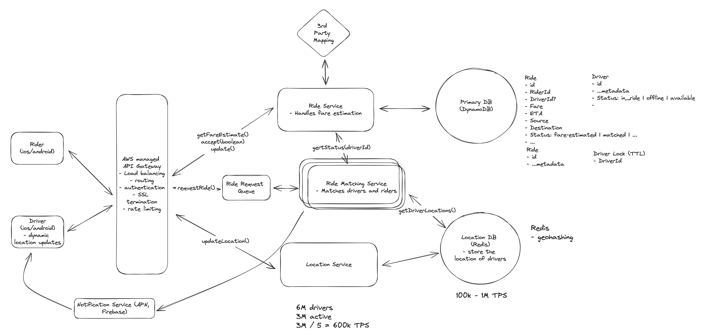
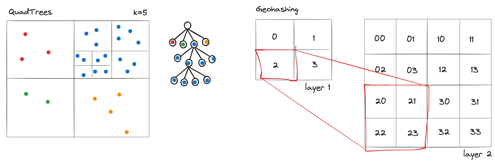

# Design Uber: Real-Time Ride Matching

A rider enters a pickup point and a destination, gets a fare estimate, then requests a ride. The system finds nearby available drivers and offers the ride to one of them. After a driver accepts, both apps see the assignment and follow the trip through pickup and drop-off.

This interview design uses the supplied sketch and its scale assumptions. [Open the full-resolution sketch](images/design-uber-sketch.png)

## 1. Requirements and scale

- **Rider.** Get a fare estimate, request a ride from that estimate, and see the match result and trip progress.
- **Driver.** Publish location while online, accept or decline an offer, navigate to pickup and drop-off, and update trip milestones.
- **Latency.** Aim to assign a driver or return a clear outcome within about one minute. That budget includes queue time, candidate search, and time for drivers to respond.
- **Consistency.** A ride has at most one assigned driver, and a driver has at most one active ride. The baseline also allows at most one live offer per ride and per driver. Driver coordinates can be slightly stale when searching for candidates.
- **Availability.** Keep ride status and GPS ingestion usable if matching is overloaded. If the assignment store is unavailable, pause new assignments until the system can reserve drivers safely.

Focus on on-demand rides with one vehicle class. Scheduled rides, ratings, payments, and fare optimization can be discussed separately if the interview calls for them.

| Workload | Interview assumption and impact |
| --- | --- |
| Driver location updates | 6 million registered drivers, 3 million online at a busy moment, and one update every 5 seconds give about **600,000 updates per second globally**. This is before retries, index updates, and replication. |
| Matching load | Size it from peak ride requests per metro and searches or offers per request. For example, 1,000 ride requests per second with up to 3 candidate searches each can generate up to 3,000 searches per second in that metro. |
| Hotspots | A stadium or airport can concentrate riders and drivers in a few neighboring cells. Global averages hide local queue pressure, index load, and contention for the same drivers. |

## 2. Architecture and request flow

1. **Quote a fare.** The API gateway authenticates and routes requests and applies rate limits. The ride service calls a mapping provider for route distance and travel time, then returns a quote with an ID and expiry. Keep the inputs and quoted amount with the quote so ride creation can validate what the rider accepted.
2. **Accept the ride request.** The ride service validates the quote, then writes the ride in `searching` and a dispatch command in one DynamoDB transaction. Return `202 Accepted` and the `ride_id` after commit. An outbox relay sends the command to the ride request queue. Workers tolerate repeated delivery and use the stored ride state to decide what work remains.
3. **Ingest driver locations separately.** The driver app sends location and freshness information to the location service, which updates a regional Redis geospatial index. Keep assignment and availability in DynamoDB so location writes do not compete with assignment transactions on the same records.
4. **Match and notify.** A matching worker queries Redis for nearby candidates, ranks a shortlist by estimated pickup time, and reserves a driver in DynamoDB before sending an offer. The notification service uses APNs or FCM to alert the driver. Acceptance commits the assignment, and the service publishes the new ride state to both apps.
5. **Track the trip.** The driver app reports pickup and drop-off. The ride service checks that the driver owns the ride and that each transition is valid. The rider sees near-real-time status and driver position over an authenticated live connection while the app is active. On reconnect, the app fetches a fresh ride snapshot. A push notification can prompt that fetch when the app is in the background.

The sketch shows the gateway feeding a ride request queue directly. Writing the ride and its dispatch command first adds an immediately readable ride record and lets the relay recover if the API process crashes after commit. [Stripe case study on the transactional outbox](<../Internal-Consistency-System/design-payment-stripe.md#4-qa--at-high-qps-how-do-you-choose-between-outbox-and-kafka-first>)

### Core entities

| Entity | Example fields and role |
| --- | --- |
| `Rider` | `rider_id` and account metadata |
| `Ride` | `ride_id`, `rider_id`, `quote_id`, pickup, destination, state, `current_offer_id`, optional `driver_id`, and `match_deadline` |
| `Driver` | `driver_id`, dispatch state (`offline`, `available`, `offered`, `on_trip`), `current_offer_id`, and optional `active_ride_id` |
| `Offer` | `offer_id`, `ride_id`, `driver_id`, state, and `expires_at`. The offer ID lets the server reject a response to an earlier offer. |
| `DriverLocation` | `driver_id`, latitude, longitude, update sequence, and timestamp. Redis uses this for proximity search and trip tracking. |

### Example APIs

| Endpoint | Contract |
| --- | --- |
| `POST /fare-estimates` | Accepts pickup and destination. Returns `quote_id`, estimate, currency, and expiry. |
| `POST /rides` | Accepts `quote_id` and an idempotency key scoped to the rider. Returns `202 Accepted` and a `ride_id`. Repeating the same submission returns the same ride. |
| `GET /rides/{ride_id}` | Returns the current ride state and the assignment when available to the authenticated participant. |
| `POST /drivers/me/location` | Accepts coordinates, a timestamp, and an update sequence for the authenticated driver. |
| `GET /drivers/me/current-offer` | Returns the authenticated driver's current unexpired offer, if one exists. |
| `PATCH /offers/{offer_id}` | Accepts `accept` or `decline` from the driver who received the offer. Returns the committed outcome. |
| `PATCH /rides/{ride_id}/status` | Records pickup or drop-off from the assigned driver and checks the current ride state. |

## 3. Finding nearby drivers

| Approach | How it finds candidates | What it costs |
| --- | --- | --- |
| **Geohash** | Encodes a point as a string whose prefixes represent progressively smaller rectangular cells. In the sketch's simplified grid, cell `2` contains `20`, `21`, `22`, and `23`. Search every cell that intersects the area, merge results, and filter by distance. | Nearby points across a cell boundary can have different prefixes. Cell dimensions on the ground vary with latitude, and driver density can make some cells much busier than others. |
| **Quadtree** | Recursively splits a region into four quadrants. In the sketch, dense quadrants split when they exceed `k = 5` points. A radius or bounding-box query visits only overlapping branches. | Splitting adapts to density, but moving drivers create continuous insertions, removals, and possible rebalancing. A distributed implementation also needs to route queries across shard boundaries. |

**Baseline.** Use regional Redis geospatial sorted sets with `GEOADD` to update positions and `GEOSEARCH` to get a shortlist by radius. A small metro can start with one key. For hot metros, split the index into geographic keys, query every key intersecting the search area, and deduplicate driver IDs. If a driver changes cells, old and new entries may coexist briefly. Use the latest version to skip old entries and clean them up asynchronously. [Redis GEOSEARCH](https://redis.io/docs/latest/commands/geosearch/)

**Freshness and ranking.** Record a server-side last-seen time and reject out-of-order updates within a driver's current online session using the sequence number. Exclude old positions at query time and remove stale members with a cleanup job. Use straight-line distance to shortlist candidates, then ask the routing provider for pickup ETAs for the best few. A driver across a river may be geographically close and still take longer to reach the pickup. Verify that the selected driver is still available in the assignment transaction.

## 4. Matching without double-booking

The sketch offers a ride to one driver at a time and waits about ten seconds for a response. Store that wait as an offer deadline and schedule a follow-up so other rides can keep using the worker. An accepted offer advances the ride from `searching` to `matched`. Pickup and drop-off then advance it to `in_progress` and `completed`.

| Step | Conditional write in DynamoDB |
| --- | --- |
| **Reserve and offer** | In one transaction, require a `searching` ride within its match deadline, no `current_offer_id`, and an `available` driver. Create the offer with an expiry capped by the ride deadline, set the same `current_offer_id` on the ride and driver, set the driver to `offered`, and persist an outbox event for notification. A competing worker can try another candidate if the driver was already claimed. |
| **Accept** | Verify the responding driver and condition the transaction on an open offer within its deadline, a `searching` ride, an `offered` driver, and both matching `current_offer_id` values. Mark the offer accepted, set the ride to `matched`, and set the driver to `on_trip` with `active_ride_id`. Clear the offer pointers and persist the match event in the same transaction. Retrying the same accepted offer returns its recorded outcome. |
| **Decline or expire** | Close the offer and clear the reservation only if both records still reference that offer. Persist the next dispatch command if the ride is still eligible and time remains. |
| **Finish or cancel** | Before pickup, cancellation closes an outstanding offer or releases the assigned driver in the same transaction. At drop-off, mark the ride complete and clear the driver's active assignment only if it still refers to that ride. |

**Example race.** Two matching workers both get driver D from Redis. The first transaction changes D from `available` to `offered` for offer A. The second transaction fails its availability condition. If A expires and D receives offer B, a late acceptance for A fails the current-offer checks and leaves B intact. Those checks also keep a delayed expiry worker from releasing a newer reservation. Use `expires_at` in the transition logic and a scheduled job to free expired offers. DynamoDB TTL can clean up old records later. [DynamoDB transactions](https://docs.aws.amazon.com/amazondynamodb/latest/developerguide/transaction-apis.html) · [DynamoDB TTL](https://docs.aws.amazon.com/amazondynamodb/latest/developerguide/TTL.html)

## 5. Handling bursts and delays

- **Partition work by market.** Route ride requests by pickup metro and scale matching workers against queue age and expected wait time. Each driver's assignment state needs one write owner across adjacent markets. Nearby index queries can span cells or market boundaries while reservations still target the same authoritative driver record.
- **Budget the search and offer time together.** Four sequential ten-second offer windows consume about 40 seconds before queueing and spatial queries. Push delivery also uses part of each offer window. Pass the original match deadline through retries. Once it expires, condition the `no_driver_found` transition on the ride still being `searching` and release any open offer in the same transaction. Widen the search when early attempts find few eligible drivers and time remains.
- **Protect dispatch from GPS spikes.** Scale location ingestion separately. Under pressure, coalesce pending GPS updates per driver to the newest position. Keep ride creation, acceptance, and trip milestones on their durable paths. Monitor match latency, queue age, rejected reservations, and stale location rates by metro.
- **Recover from delayed delivery.** Persist each offer before sending push and make notifications retryable by offer ID. The driver app can fetch its current offer on reconnect. If a worker crashes after a state transition, the outbox can still publish the committed result. A periodic sweep can find overdue offers and rides whose follow-up work was delayed.
