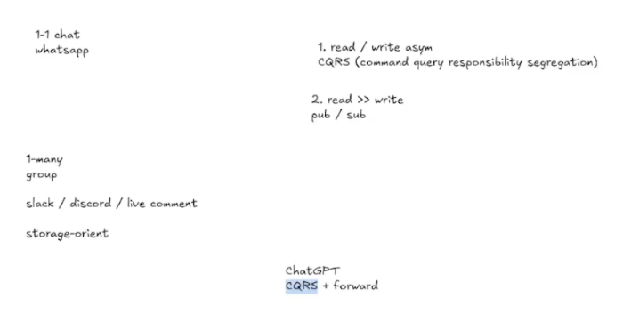

# IM System Design Review

即时通讯系统设计复习：从 WhatsApp 一对一聊天、Slack 群聊，到类 ChatGPT 的流式对话，围绕**读写不对称、消息分发和持久化**选择架构。

## 复习草图



## 1. 先判断消息发给谁，再判断如何存、如何读

| 场景 | 消息流向 | 主要难点 | 设计主线 |
| --- | --- | --- | --- |
| **1–1 Chat：WhatsApp** | 一名用户向另一名用户发送消息；多设备可能需要额外分发。 | 在线连接定位、跨服务器投递、心跳、离线补拉和 ACK。 | Session Registry + Router / Forward；按需要拆分读写与引入消息设施。 |
| **1–Many：Slack / Discord / 直播评论** | 一条 Channel 消息送给多名在线订阅者。 | Fan-out、频道内顺序、热频道、历史读取和故障恢复。 | CQRS + 按 Channel 组织的 Pub/Sub + Gateway 分层投递。 |
| **类 ChatGPT 流式对话** | 用户提交一次生成请求，服务端持续向对应会话输出响应片段。 | 生成任务生命周期、首片段延迟、流式转发、取消与断线恢复。 | CQRS + 面向具体会话的 Forward；按需求使用 SSE 或 WebSocket。 |

这里是面试中的架构抽象，并非这些产品实际内部实现的声明。直播评论与团队协作群聊的保留要求也可能不同，不能直接套用同一套可靠性与存储策略。

## 2. Read / Write Asymmetry：读写不对称为什么引出 CQRS？

草图中的 `read / write asym` 指 **Asymmetry（不对称）**：读和写在流量、访问模式、延迟目标和处理逻辑上可能不同。

- **写入**：接收发送／编辑／删除命令，校验权限、去重、排序并可靠记录。
- **历史读取**：按会话或频道分页查询，适合缓存、索引和读副本。
- **实时接收**：连接在持续等待新消息，需要推送、订阅和背压机制。

**CQRS（Command Query Responsibility Segregation）将命令与查询职责分开**，让写路径和查询路径独立优化。它不等于读写异步，也不要求从一开始就拆成两个服务或两套数据库；如果采用异步更新的读模型，才需要进一步处理投影延迟和读后写一致性。

```text
Command：发送消息 → 校验／去重 → 消息存储或权威事件日志
Query：  读取历史 → 查询服务 → 缓存／读模型／消息存储
```

## 3. Read ≫ Write：为什么群聊需要 Pub/Sub？

一对一聊天中，一条消息通常只有一个主要接收方；群聊中，同一条消息可能被成百上千名用户接收。假设每秒写入 `W` 条消息，平均每条向 `F` 名在线用户投递，则客户端投递量约为：

```text
实时投递次数／秒 ≈ W × F
客户端下行载荷／秒 ≈ W × F × 平均消息大小
```

因此，草图中的 **Read ≫ Write** 在这里主要体现为“一次写入、多次接收”，不一定意味着数据库每秒执行了同样多的读取。历史消息查询还需要单独估算。

**Pub/Sub（Publish / Subscribe）让发送方按主题发布消息，由订阅关系决定接收方。** Channel 可以作为逻辑 Topic，先分发到有相关订阅者的 Gateway，再由 Gateway 向本机客户端展开投递：

```text
一条 Channel 消息 → Channel Server / Pub/Sub
                       ├→ Gateway A → 本机订阅客户端
                       └→ Gateway B → 本机订阅客户端
```

这减少了写入端对所有接收连接的直接管理，也能复用服务器间传输，但不会消除最终的 `W × F` 客户端投递成本。热门频道仍需要分片、批量分发、慢消费者隔离和背压；单个频道的严格排序也可能成为瓶颈。

**CQRS 解决读写职责的组织，Pub/Sub 解决按订阅关系多播分发。** 两者相互配合；实时推送不替代历史 Query，采用 Pub/Sub 也不自动获得消息持久化、离线重放或客户端送达确认。

## 4. Storage-oriented：消息存储是恢复与历史读取的基础

Slack 一类协作聊天通常需要长期保存、搜索和分页读取消息，不能只把消息当作转发完即消失的网络数据。

| 存储方向 | 适用考虑 | 需要处理的代价 |
| --- | --- | --- |
| **分片关系型数据库** | 分片内事务、关系查询与权限关联。 | Channel 热点、跨分片操作、历史数据分桶。 |
| **Cassandra 等 NoSQL** | 按频道／时间桶高吞吐写入和历史分页。 | 分区大小、热分区、查询合并与一致性配置。 |
| **事件日志 + 读模型** | 追加写入、缓冲、重放，并向多个下游分发。 | 投影延迟、读模型维护、事件演进和恢复成本。 |

按时间 Bucketing 可以控制历史分区大小，但不一定分散当前写热点；增加写分桶则需要处理多桶读取与顺序合并。Kafka 可以充当持久化事件日志；Redis Pub/Sub 则主要是实时通知，不能作为历史存储替代品。

可靠投递的共同原则是：**先可靠记录，客户端确认收到后再推进投递游标；未确认的消息允许重试并去重。** 清理离线待投递记录与删除完整聊天历史是不同的操作；对于允许丢弃旧评论的直播场景，需要另外明确降级策略。

## 5. 类 ChatGPT 对话：为什么可以概括为 CQRS + Forward？

与大群聊相比，典型的一对一 AI 对话不需要把每个响应片段广播给整个 Channel 的成员，而是把某个生成任务的输出流，送到对应用户／会话的连接上。

```text
Command：用户提交 Prompt → 认证／配额校验 → 创建生成任务
输出流： 模型 Worker → 响应流转发层 → SSE / WebSocket → 对应客户端
Query：  用户读取历史 → 查询持久化的会话与消息
```

这里的 **Forward** 描述按 `request_id / conversation_id / session_id` 将响应流路由到目标连接。一次命令可能产生大量连续输出片段，但这是同一条响应流的多次输出，与“同一条群消息多播给大量用户”是不同的放大方式；需要分别估算生成吞吐、输出速率与连接数。

SSE 适合“HTTP 提交命令 + 服务端单向流式输出”，WebSocket 则适合在连接内双向交互。取消生成应绑定任务身份和权限；客户端断线后，是取消任务还是允许后台继续，需要由产品语义决定。

如果要求断线恢复，就需要保存任务状态、响应进度或带序号的输出事件，重连后从已确认位置继续，不能只依赖一条存活连接。如果还要支持多个标签页／设备或共享会话同时观看，同样可以引入 Pub/Sub；CQRS + Forward 是基础场景的概括，不是排除 Pub/Sub 的规则。

## 6. 面试复习检查表

1. **消息关系**：1–1、1–Many，还是一条生成请求对应一条持续输出流？在线接收方和设备有多少？
2. **容量模型**：分别估算并发连接、写入消息速率、平均大小、Fan-out 和日均存储量，区分峰值与平均值。
3. **客户端通道**：WebSocket、SSE 或 Long Polling；说明心跳、重连、地域接入和慢连接处理。
4. **路由与状态**：用户／会话连接在哪里，频道归谁管理，Gateway 如何订阅，节点失效后如何重建？
5. **可靠性与顺序**：幂等键、消息 ID、会话／频道序号、ACK、补拉游标；不能只靠同步时钟保证顺序。
6. **存储与扩容**：明确权威记录、历史查询方式、分片键、Bucketing、热点隔离，以及读模型的延迟。
7. **恢复**：区分消息记录、缓存与实时订阅；热频道可温备，冷频道可按需加载，切换时避免双主和消息缺口。

## 相关案例

- [WhatsApp: Design 1-1 Chat](whatsapp-design-1-1-chat.md)：连接定位、服务端转发、心跳、离线消息与顺序。
- [Slack: Design Group Chat](slack-design-group-chat.md)：CQRS + Pub/Sub、Channel / Gateway、存储分片与故障恢复。
- [一致性哈希](consistent-hashing.md)：服务器或分片数量变化时如何减少映射迁移。
