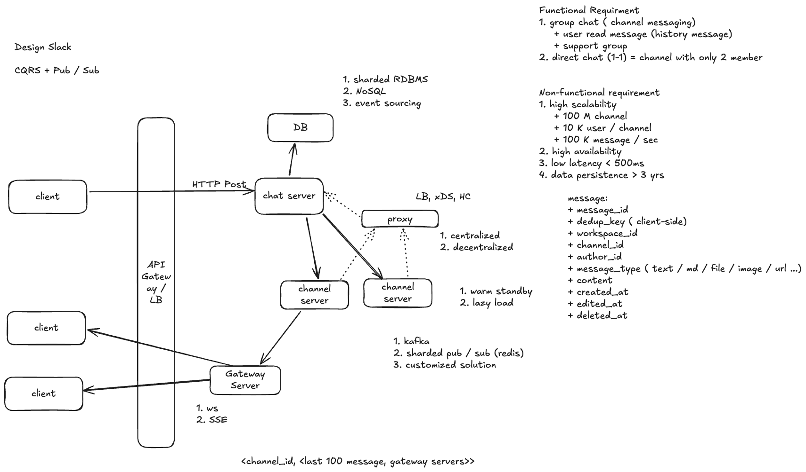

# Slack: Design Group Chat

经典系统设计面试题：设计 Slack 的群聊与 Channel Messaging，支持历史消息读取，并将一对一聊天视为只有两名成员的 Channel。

## 设计草图



草图围绕 **CQRS + Pub/Sub** 展开：客户端通过 HTTP POST 发送消息，Chat Server 负责写入数据库并触发消息分发，Channel Server 维护频道的分发状态，再由 Gateway Server 通过 WebSocket 等长连接向在线客户端推送消息。

## 从一对一聊天到以 Channel 为主的群聊

与 [WhatsApp: Design 1-1 Chat](whatsapp-design-1-1-chat.md) 相比，这个案例更像网络聊天室：**用户围绕 Channel 交流，一条消息通常需要分发给多个成员**。一对一聊天也可以建模为只有两名成员的 Channel，但群聊的主要难点是频道内顺序、大规模 Fan-out、历史消息读取与热点隔离。

草图的规模假设为：100M 个 Channel、单个 Channel 最多约 10K 名成员，全系统峰值约 **100K messages/s（10 万条／秒）**，在线投递延迟目标小于 500 ms，消息持久化超过 3 年。频道数、单频道成员上限和全系统峰值是不同维度，不能直接相乘得出同时在线规模。

消息记录包括 `message_id`、客户端生成的 `dedup_key`、`workspace_id`、`channel_id`、`author_id`、`message_type`、`content`，以及创建、编辑、删除时间等。通常 **content 是消息大小的主要部分**；文本、Markdown 与链接可能直接保存，文件和图片等大内容宜放到对象存储，消息中保存引用和必要元数据。

如果仅为容量估算假设平均每条消息 1 KB，则峰值原始写入载荷约为 `100K/s × 1 KB = 100 MB/s`。群聊下行还要乘以实际在线投递人数，并计算副本与协议开销。3 年存储量应按日均消息数、平均大小、保留与复制策略计算，不能直接把峰值当成全天平均。

## 标准解法：CQRS + Pub/Sub

本题采用的设计主线是 **CQRS + Pub/Sub**：CQRS 拆分消息的写入与查询职责，Pub/Sub 负责将新消息实时分发给频道订阅者。两者解决不同的问题，可以组合使用；这是一种常见的面试设计，并不表示 Slack 的实际实现只能采用这一种架构。

课堂上可以把它记为“写走 Command，实时读走 Pub/Sub”。更准确地说，Pub/Sub 是**实时接收新消息的推送路径**；读取历史消息、分页与断线补拉仍然是 Query，不是所有读取都通过 Pub/Sub 完成。

### CQRS：命令与查询职责分离

**CQRS = Command Query Responsibility Segregation（命令与查询职责分离）**，即将“改变系统状态的操作”和“读取系统状态的操作”分开设计。

| 类型 | 在群聊中的例子 | 主要关注点 |
| --- | --- | --- |
| **Command（命令／写入）** | 发送消息、编辑消息、删除消息 | 身份与频道权限校验、幂等去重、会话内排序、可靠持久化 |
| **Query（查询／读取）** | 打开频道、分页读取历史消息、断线后补拉消息 | 按频道和游标快速读取、缓存、分页、读扩容 |

结合草图，可以把两条路径理解为：

```text
写入：Client → HTTP POST → Chat Server / Command Handler → 消息存储
读取：Client → 历史消息 API / Query Handler → 读模型或缓存 → 返回历史消息
```

写入端可以按 `workspace_id + channel_id` 校验发送权限，按客户端生成的 `dedup_key` 防止重试产生重复消息，再记录消息与频道内序号。读取端则按 `channel_id + cursor` 分页查询，必要时缓存最近 100 条消息；草图中 Channel Server 的“last 100 messages”可作为这种缓存，但历史查询的具体服务边界仍需明确。

**CQRS 不要求一开始就使用两套数据库，也不要求读写必须是两个微服务。** 起步时可以在同一服务、同一数据库中拆分读写处理逻辑；规模扩大后，再分别扩容写入服务与查询服务，或建立独立的读模型。如果读模型通过异步事件更新，就需要接受短暂的最终一致性，并处理发送成功后立即查询可能暂时看不到消息的情况。

### Pub/Sub：按频道发布与订阅消息

**Pub/Sub = Publish / Subscribe（发布／订阅）**。发送方将消息发布到一个主题，消息基础设施根据订阅关系，将其分发给相关订阅者；发送方不需要逐个定位所有客户端。

在本题中，**Channel 可以作为逻辑 Topic**，Channel Server 负责该频道的消息分发，Gateway Server 代表本机在线客户端订阅频道：

```text
写入成功的频道消息
    → 发布到对应 Channel 的分发通道
    → Channel Server / Pub/Sub 分片
    → 订阅该 Channel 的 Gateway 1、Gateway 2、……
    → 各 Gateway 通过 WebSocket / SSE 推送给本机订阅该频道的客户端
```

例如一个频道有 1 万名成员，当前在线并订阅实时推送的用户分布在 20 台 Gateway 上，可以先向这 20 台 Gateway 各分发一份消息，再由它们向本机相关客户端展开投递。这样 Chat Server 无需逐一维护这 1 万名成员的实时连接位置；总的客户端投递成本仍随在线订阅者数量增长。

频道成员关系决定谁有权访问消息，实时订阅关系决定当前要向哪些连接推送，两者需要区分。订阅与投递都必须校验权限；用户离线或实时通知丢失时，通过 Query 路径从持久化存储补拉。逻辑 Topic 也不意味着必须为每个 Channel 创建一个物理 Kafka Topic，可以将大量 Channel 按哈希映射到有限的物理分区。

### 两者如何组合成完整链路？

1. **接收 Command**：客户端发送消息，服务端校验身份、频道权限和幂等键。
2. **可靠写入**：确定频道内消息顺序，将消息持久化后确认命令成功；这个确认表示服务端已接收，不代表所有成员已收到。
3. **发布消息事件**：通过事务 Outbox、CDC 或其他可靠发布机制，将已提交的消息交给 Pub/Sub，避免数据库写入成功、发布却失败而漏掉实时通知。
4. **实时分发**：Channel Server 将消息分发到相关 Gateway，再推送给在线订阅者。重试可能导致重复投递，需要按 `message_id` 去重；要求频道内有序时，同一频道应使用一致的排序与分区策略。
5. **执行 Query**：用户打开频道或断线重连时，按游标读取历史消息，再与实时推送按消息 ID 和序号合并，补齐遗漏。

因此，**CQRS 让“写消息”和“查消息”可以分别优化，Pub/Sub 让“一条频道消息发给多名在线用户”可以分层扩展**。只接收到实时推送不能替代历史消息存储，而把读写逻辑分开也不会自动完成实时消息分发。

草图中的 **Event Sourcing（事件溯源）** 是另一个可选概念：它以事件序列作为权威记录，并通过重放构建状态。CQRS 可以直接使用普通消息表，Pub/Sub 也可以只负责分发已提交消息，二者都不要求采用 Event Sourcing。

## 消息写入与存储：三种候选方案

草图列出的 Sharded RDBMS、NoSQL 和 Event Sourcing 是存储与写入设计的候选方向，既可分别选择，也可组合，但需要明确哪一份数据是权威记录。

| 方案 | 设计方式与优点 | 代价与注意事项 |
| --- | --- | --- |
| **Sharded RDBMS** | 按 `workspace_id + channel_id` 选择分片，消息按频道序号／消息 ID 建索引；便于关系查询、权限关联与分片内事务。 | 大频道可能形成写热点；跨分片事务与查询更复杂，需要分桶、迁移和容量治理。 |
| **NoSQL：Cassandra** | 根据按频道顺序分页的访问模式建模，分区间分散写入，适合高吞吐、水平扩展和长时间消息存储。 | 不能只靠增加节点解决单个热分区；需要控制分区大小，并考虑一致性级别、TTL、删除产生的 Tombstone 与 Compaction。 |
| **Event Sourcing：Kafka 事件日志** | 命令转成事件追加到分区日志，下游分别构建历史读模型、实时分发、搜索等；可顺序写入、缓冲与重放。 | 读取通常需要额外的投影、索引和数据库；投影可能落后，热点 key 仍会集中到一个分区；事件演进、长期保留和恢复更复杂。 |

### Channel ID 分片与 Bucketing

按 Channel ID 分片可以让同一频道的数据聚集，便于历史读取和有序处理，但会遇到两种不同的问题：

- **数据越来越大**：按时间或消息数量分桶，例如 `(workspace_id, channel_id, day_bucket)`，防止一个频道的全部历史永久堆积在单个分区中。查询跨越桶边界时，需要读取多个桶并合并分页结果。
- **当前写入过热**：时间分桶不能分散“当前这个桶”的写流量。可以为热频道增加 `write_bucket`，按消息 ID 哈希将写入打散到多个桶，或将其迁到专用分片；代价是读取需要多路合并，严格频道顺序仍需要统一序号或排序机制。

因此，**Bucketing 解决什么问题取决于桶的划分方式**，不能把时间分桶直接等同于解决实时写热点。为热门频道分配独立资源可隔离其他频道，但不会自动消除该频道的串行排序瓶颈。

### Kafka Event Sourcing：写简单了，读为什么变复杂？

如果把 Kafka 日志作为权威事件记录，写入可以采用：

```text
Command → 校验／去重 → Kafka 持久化提交事件
                             ├→ 历史读模型消费者 → Query Database
                             ├→ 实时分发消费者 → Channel Server → Gateway
                             └→ 搜索／分析等其他消费者
```

不同下游使用独立 Consumer Group，才能各自获得事件流；同一消费组内则由消费者分摊分区。Kafka 可以在下游暂时变慢时缓冲消息，但积压越大，投影与实时分发延迟越高，还要管理保留期和磁盘容量。

这里的难点不是“Kafka 完全不能保证一致性”：它可以在配置正确的情况下提供持久化、分区内有序和特定范围的事务语义。**真正需要注意的是，日志提交与下游读模型更新之间存在异步间隔，端到端不会自动获得强一致的读后写体验。** 可让客户端暂存已确认消息，或携带写入位置，等查询端追上对应位置后再返回结果。

此外，Kafka 日志不适合直接执行“按频道任意分页、查编辑后的最新内容”等查询，需要消费者维护可查询的状态。使用同一个 `channel_id` 作为 key 可保序，但热频道也会集中到同一分区。若 Kafka 只承担分发而消息表才是权威存储，则属于数据库写入加事件发布，不必称作 Event Sourcing；若它是权威记录，就要规划满足保留要求的日志／归档和可恢复的快照。

## Gateway：地域接入与实时客户端连接

每个用户将发送指令交给 Chat Server；消息提交后，经频道分发层送到相关 Gateway，再由 Gateway 与其他客户端保持的实时连接推送出去。发送命令的 Chat Server 不需要持有所有接收者的客户端连接。

Gateway 可按地域部署，让客户端接入网络距离较近的节点，降低接入延迟；跨地域频道的消息仍需经过服务端网络传递。每个 Gateway 只维护本机连接及其订阅关系，并向上游登记“本机哪些连接订阅了哪些 Channel”。

| 客户端通道 | 在本题中的定位 |
| --- | --- |
| **WebSocket** | 主要方案，支持双向实时通信；即使消息命令继续使用 HTTP POST，也可通过它推送消息、ACK、输入状态等。需要心跳、断线重连与背压。 |
| **Long Polling** | WebSocket 持续不可用时的 fallback；按游标等待并获取新消息，超时后重新请求。 |
| **SSE（Server-Sent Events）** | 另一种可行方案，提供服务端到客户端的单向事件流；客户端发送消息仍走 HTTP POST。适合“HTTP 写入 + 单向推送”，但若希望在一条连接上双向交换多种事件，WebSocket 更直接。不能仅因 SSE 单向就判断它不流行或不适合聊天。 |

Gateway 断开时，客户端在其他节点重连并重新订阅，再根据游标补拉。用户成员资格变化或离开频道时，也要撤销对应订阅，避免继续向无权访问的连接推送。

## 写入口校验与 Channel Server 的职责

可以将关键词拦截、敏感词匹配等内容校验放到独立的写入口／内容校验组件中，由 Chat Server 在发布前调用或编排。这样发送、编辑等写入路径可以复用统一规则，规则也能独立更新和扩容；需要拦截的消息应先通过校验，再进入对用户可见的发布流程，避免先推送后拦截。

这个入口同时执行身份与频道权限校验、大小限制、速率限制和幂等去重。若消息采用端到端加密，服务端无法直接匹配明文内容，必须另外定义可行的校验方式。

**Chat Server / Command Handler 与 Channel Server 的职责仍应分清**：前者处理用户写指令和校验，后者拥有某一组 Channel 的实时状态、顺序与分发。二者可以同进程部署，也可以拆开；单独拆出校验入口并不会自动把它变成 Channel Server。

## Proxy：寻址、负载均衡与健康检查

Chat Server 在访问 Channel Server 前，可以通过 Proxy 处理以下职责：

- **Service Discovery / Endpoint Discovery**：发现 Channel Server 的地址、所属区域、权重，以及频道／分片的当前归属。Endpoint 是具体可连接的 IP、端口等。
- **Load Balancing（LB）**：对可互换的副本选择目标，结合权重、负载和地域分配请求。
- **Health Check（HC）与故障隔离**：识别不健康节点，停止向其建立新请求，并结合超时、熔断和受控重试处理故障。

对有状态的 Channel Server，不能把同一频道的消息随意轮询到任意机器。必须先确定 `channel_id → shard / owner`，再访问当前有效的所有者；只有状态可共享或具有明确副本协议的目标，才适合直接做副本负载均衡。重试也要使用幂等键，避免一次发送产生重复消息。

### Centralized 与 Decentralized Proxy

这里比较的是**消息数据路径上的代理部署方式**，不是是否存在一个统一的配置来源。

| 方式 | 部署方式 | 优点 | 代价 |
| --- | --- | --- | --- |
| **Centralized Proxy** | 所有 Chat Server 通过一个逻辑集中的代理服务访问 Channel Server；代理服务本身可多实例部署。 | 路由策略、日志和升级集中管理，业务客户端较简单。 | 所有请求汇聚到这一层，可能形成共享瓶颈和较大的故障影响范围；需要独立扩容并保证高可用。 |
| **Decentralized Proxy** | 每台调用方机器／Pod 配本地代理（如 Sidecar），或在客户端库中执行路由。 | 转发与连接池分散到各调用方，随调用方一起扩容；本地代理故障通常只影响局部调用方。 | 代理数量更多，消耗更多资源；配置更新、可观测性、连接池与健康检查流量更难统一治理，路由信息可能短暂不一致。 |

**本题可优先考虑分散的数据平面，但并非 decentralized 在所有场景下都更好。** 群聊消息吞吐大、调用方多时，它可以减少集中代理层的流量汇聚，并缩小故障影响范围。各本地代理可以通过集中且高可用的控制平面获取端点与路由，例如 Envoy 的 xDS / EDS；“数据平面分散”与“控制平面集中”可以同时成立。

Channel Server 宕机时，本地代理可发现故障并在新 owner／副本就绪后切换目标；新增节点时，也可以通过更新端点和归属映射接入容量。**故障后的状态恢复、频道所有权切换与重分片仍由 Channel Server 的协调机制完成，Proxy 本身不负责恢复消息和订阅。** 集中代理集群也能做到摘除故障节点与扩容，分散代理的优势主要是数据路径、独立扩容方式和故障隔离范围。

## Pub/Sub 实现与 Channel Server 的内存状态

草图中的 Kafka、Redis Sharded Pub/Sub 和自研方案是频道分发的候选实现，其持久化与投递语义不同：

| 实现 | 优点 | 需要补充的能力 |
| --- | --- | --- |
| **Kafka** | 持久化日志、分区内有序、消费位置与重放，便于缓冲和下游扩展。 | 不能让不同 Gateway 在同一消费组里竞争同一条消息，否则只有一方收到；可由分发消费者读取一次后，再向所有相关 Gateway 投递。大量逻辑频道也不宜简单映射成同等数量的物理 Topic。 |
| **Redis 7 Sharded Pub/Sub** | 用 `SPUBLISH`、`SSUBSCRIBE` 等命令，按 shard channel 所属 hash slot 路由，将消息传播限制在相应分片内，便于增加分片扩容。 | 仍是 at-most-once 实时通知，不保存可重放的历史，订阅者断线期间可能漏消息；必须依靠独立存储、游标和补拉恢复。单个热 channel 也不会自动跨多个分片均摊。 |
| **自研 Channel Server** | 可按业务定制频道所有权、批量分发、缓存与 Gateway 订阅管理。 | 要自行处理扩容、背压、断线重订阅、故障恢复、去重和顺序保证。 |

截图中的状态可以在 **Channel Server 的应用内存**中用 Map 表示：

```text
channel_id → {
    last_100_messages: 最近 100 条消息的有界缓存,
    gateway_servers: 当前有本机在线订阅者的下游 Gateway 集合
}
```

这里的 `gateway_servers` 表示“哪些下游 Gateway 与这个 Channel 存在实时订阅关系”，不是频道的全部用户列表。某个 Gateway 上有第一个客户端订阅该频道时，向上游登记；最后一个订阅连接离开时取消登记。Gateway 内部再维护 `channel_id → 本机客户端连接集合`，把收到的一份消息展开成多份客户端投递。

这个 Map 是应用设计，**不是 Redis Sharded Pub/Sub 内置的最近 100 条消息缓存**。最近消息需要应用缓存或其他存储维护；Redis Pub/Sub 只管理发布订阅与转发，不自动保留历史消息。若系统有 100M 个频道，应只加载活跃频道状态并设置空闲回收，避免每个频道都常驻 100 条消息；按每条 1 KB 估算，全部预加载就约为 10 TB，且尚未包括对象、索引和 Gateway 集合开销。

## Channel Server 宕机：Warm Standby 与 Lazy Load

以下两种方式是在不同恢复速度与资源成本之间取舍，也可以组合使用。频道历史消息必须有独立于进程内存的可靠记录。

| 方案 | 恢复方式 | 优点 | 代价 |
| --- | --- | --- | --- |
| **Warm Standby（温备）** | 预先运行备用实例，持续或周期性跟进事件、快照与缓存状态；主节点失效后接管频道。 | 状态已预热，切换较快、首次请求延迟较低，适合活跃或重要频道。 | 需要额外机器和复制开销；温备可能落后，切换时仍要补齐消息并恢复订阅。 |
| **Lazy Load（按需加载）** | 新 owner 接到该频道第一条请求／订阅时，才从持久化存储加载最近消息、游标等状态，并重建实时订阅关系。 | 不必为大量冷频道预留完整内存，运行成本较低。 | 冷启动延迟较高；故障后大量频道同时恢复可能产生数据库惊群，需要限流、合并同频道加载与预热。 |

典型恢复流程是：发现故障 → 通过租约／Leader 选举等机制确定新 owner → 更新路由 → 预热或按需加载 → Gateway 重订阅并按游标补齐遗漏 → 恢复实时分发。用 epoch／fencing token 阻止恢复后的旧 owner 继续写入，避免双主。

`last_100_messages` 可以从持久化消息记录重建；`gateway_servers` 则应通过 Gateway 重注册、订阅租约续期等方式重建，不能只靠重放聊天消息推断哪些连接仍然在线。恢复时还要衔接补拉高水位与新实时消息，并按消息 ID 去重。实践中可以对热频道采用 Warm Standby，对长尾冷频道采用 Lazy Load。

## Q & A

### Question

我看到主流的文章基本就是两种方法：

1. **Dispatcher**：消息在不同 Gateway Server 之间转发，再推送给用户。
2. **Pub/Sub**。

请问这两种说法是一个技术吗？一开始我的理解是，Pub/Sub 可以解决转发问题，实现 Dispatcher。但是网上也有说，Dispatcher 和 Pub/Sub 是两种不同的架构，所以我很困惑。谢谢！

### Answer

我觉得就是同一种东西，但是大家用了不同的术语。他们的高层抽象都是把一条 Channel 消息送到很多订阅者。

这里面有两个部分：**1. 路由寻址，2. 投递**。从描述上看：

- **Dispatcher** 靠发现服务（本质可能是哈希表或者哈希环）做路由，再自己开发 Broker 做投递。
- **Pub/Sub** 靠订阅关系（大概率是哈希表）做路由，然后靠数据系统自身的 Broker 做投递。

我认为这些都是 Pub/Sub。**Pub/Sub 不是特定的产品，是一种交互模式：主题寻址 + 生产消费解耦 + 多播语义。** 没有必要强行区别成 Dispatcher 和 Pub/Sub。

### 补充说明：组件职责与交互模式

上述回答讨论的是群聊中的频道消息分发：如果 Dispatcher 按 Channel 的订阅关系，把消息分发给相关 Gateway 和订阅用户，就可以将它看作 Pub/Sub 的一种实现。Dispatcher 描述“谁负责路由与分发”，Pub/Sub 描述“消息如何通过主题和订阅关系传播”，两者可以同时出现在同一套架构中；Dispatcher 既可以直接转发，也可以使用现成的 Pub/Sub Broker，不必自行开发 Broker。

不过，Dispatcher 这个名称本身并不保证 Pub/Sub 语义：如果它只把消息点对点转发给一个指定接收者，就不能仅凭名称认定它是发布订阅。服务发现、订阅关系以及哈希表／哈希环也属于不同职责和实现选择，实际设计需要明确 `channel_id → 订阅该频道的 Gateway 集合`，再由各 Gateway 找到本机订阅该频道的客户端连接，完成分发。

## 参考资料

- [Redis 官方：Pub/Sub 投递语义与 Redis 7 Sharded Pub/Sub](https://redis.io/docs/latest/develop/pubsub/)
- [Envoy 官方：Service Discovery 与 Endpoint Discovery Service](https://www.envoyproxy.io/docs/envoy/latest/intro/arch_overview/upstream/service_discovery)
- [Envoy 官方：动态配置与 xDS](https://www.envoyproxy.io/docs/envoy/latest/intro/arch_overview/operations/dynamic_configuration)
