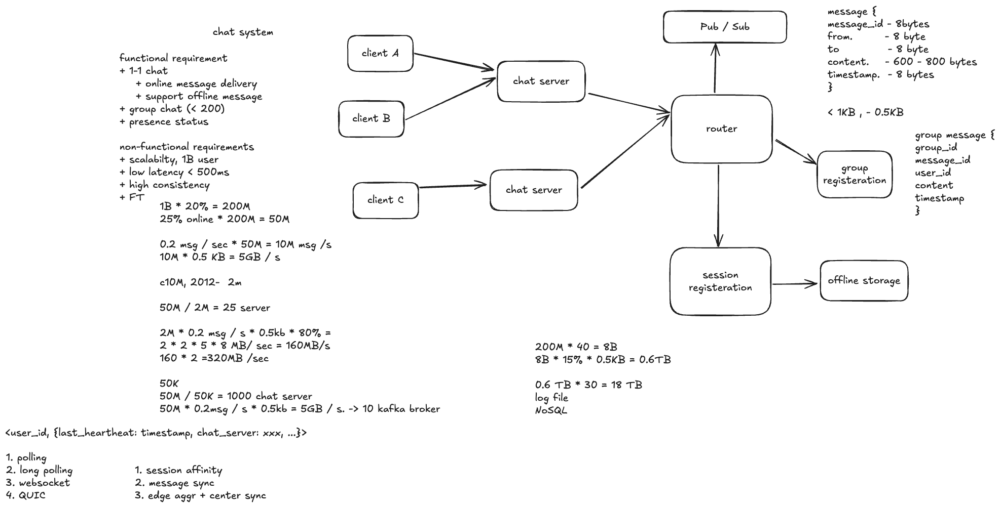

# WhatsApp: Design 1-1 Chat

经典系统设计面试题：设计 WhatsApp 的一对一聊天系统，支持在线消息投递与离线消息同步。

## 设计草图



草图包含需求、容量估算、Chat Server、消息路由、Pub/Sub、会话注册和离线存储；群聊与在线状态可作为后续扩展讨论。

## 题目重点

这道题的核心是解决 **Server Side 和 Client Side 的消息投递（Message Delivery）问题**：

- **Server Side**：服务端如何接收并持久化消息、定位接收方所在的 Chat Server，以及完成跨服务器路由、在线投递和离线消息保存。
- **Client Side**：客户端如何发送消息、确认服务端已接收，接收消息后回传 ACK，以及在断线重连时重试发送、拉取未收到的消息并去重。

需要区分“服务端已接收”和“接收方客户端已收到”这两个状态；消息已读则是更进一步的状态。

## 容量估算：活跃用户与同时在线用户

草图中的两步计算采用以下面试假设：

| 指标 | 假设与计算 | 结果 |
| --- | --- | --- |
| 总用户数 | 注册用户规模为 1B | 10 亿用户 |
| 活跃用户数 | 总用户的 20%：`1B × 20% = 200M` | 2 亿活跃用户；这里按日活跃用户（DAU）估算 |
| 同时在线用户数 | 活跃用户中约 25% 同时在线：`200M × 25% = 50M` | 5,000 万并发在线用户 |

这里的 **25% 是活跃用户中同时在线的比例**，分母是 2 亿活跃用户。因此，5,000 万表示同时在线人数，可作为估算长连接数量与 Chat Server 容量的起点；如果一个用户有多个设备同时在线，实际连接数还需要乘以平均在线设备数。上述比例是本题的容量估算假设，并非 WhatsApp 的实际运营数据。

### 消息大小与消息吞吐量

**单位说明**：`M = million = 10⁶`，`B = billion = 10⁹`。`50M users` 表示 5,000 万用户，`10M msg/s` 则表示每秒 1,000 万条消息；M 是数量级，具体单位由后面的 users 或 msg/s 决定。以下 KB、GB、TB 使用十进制单位。

草图中的消息结构为：

| 字段 | 大小 |
| --- | --- |
| `message_id` | 8 bytes |
| `from` | 8 bytes |
| `to` | 8 bytes |
| `content` | 600–800 bytes |
| `timestamp` | 8 bytes |

固定字段合计 `4 × 8 = 32 bytes`，加上正文后约为 **632–832 bytes**，尚未计算序列化、加密与协议开销。草图后续计算使用 **平均每条消息 0.5 KB**，应将它视为另一项简化假设，例如实际平均正文更短；如果正文平均确实为 600–800 bytes，就需要相应上调消息大小，不能直接沿用 0.5 KB。

沿用草图的 0.5 KB 假设，并假设在估算的高负载时段，每个在线用户平均每秒发送 0.2 条消息：

```text
消息吞吐量 = 50M users × 0.2 msg/(user·s) = 10M msg/s
消息载荷带宽 = 10M msg/s × 0.5 KB/msg = 5 GB/s
```

这里每条发送消息只计一次，`5 GB/s` 是载荷流量。客户端上行、服务端转发、客户端下行、存储复制、ACK 和协议头等，需要按实际链路分别核算。

### 单机并发连接：为什么会算出 25 台 Chat Server？

草图引用了课堂提到的 **2012 年前后单机约 2M 并发连接**的案例，用来说明单机可以维持百万级连接。这个背景与 **C10M** 的高并发讨论相关：C10M 指千万级并发连接的挑战，不能把它本身等同于“单机 200 万连接”的性能保证。

如果本题暂按每台 Chat Server 可承载 2M 连接、每个在线用户一条连接估算：

```text
Chat Server 数量 = 50M connections ÷ 2M connections/server = 25 台
```

在只有 25 台服务器的假设下，即使两两直连，也只有 `25 × 24 ÷ 2 = 300` 对服务器通信关系。因此，**O(N²) 的连接拓扑未必立刻成为主要瓶颈，服务端直接转发是值得考虑的方案**，是否引入 Broker 应结合实际吞吐和可靠性需求判断。

不过，**25 台只是按连接数算出的理论下限**。维持 2M 条低活跃连接，与在这些连接上持续处理大量消息是不同的负载。按上面的发送速率，每台还需要承受：

```text
2M users × 0.2 msg/(user·s) = 400K msg/s
400K msg/s × 0.5 KB/msg = 200 MB/s 的客户端上行载荷
```

如果进一步假设其中 80% 需要跨服务器转发，则每台平均产生约 `200 × 80% = 160 MB/s` 的转发出站流量；在均匀分布下，另有约 160 MB/s 的转发入站流量，收发合计约 320 MB/s。这还不包括客户端下行等其他链路。实际机器数量需要同时满足连接数、CPU、内存、TLS、网卡和消息处理吞吐，并预留故障与流量峰值容量。

例如，如果实测每台只能稳定承载 50K 条目标业务负载下的连接，则连接数估算就变成 `50M ÷ 50K = 1,000 台`。草图中的 25 台和 1,000 台对应不同的单机容量假设，应通过目标负载压测选择。

### 离线消息存储估算

草图右下角采用另一组按天计算的假设：每个日活用户每天发送 40 条消息，其中 15% 需要离线保存，平均消息大小仍按 0.5 KB，保存 30 天：

```text
每天消息数 = 200M users × 40 msg/(user·day) = 8B msg/day
每天新增离线消息 = 8B × 15% = 1.2B msg/day
每天离线消息载荷 = 1.2B × 0.5 KB = 0.6 TB/day
30 天离线消息载荷 = 0.6 TB/day × 30 days = 18 TB
```

18 TB 仅是离线消息的原始载荷估算，索引、元数据、复制和存储开销另计；完整聊天历史也需要另算。可采用追加日志或按接收方／会话分区的 NoSQL 存储，支持离线消息补拉与保留期清理。

这组 `8B msg/day` 折算全天平均约为 **92.6K msg/s**，与前面的 `10M msg/s` 相差约 108 倍。因此两者不能同时作为全天平均负载：前者用于日均存储估算，后者只能作为另设的短时高负载场景，面试时需要确认这个峰均比是否合理，再统一容量规划口径。

## 通信模型（Communication Models）

客户端与服务端之间可以考虑以下四种通信模型：

| 模型 | 工作方式 | 优点与代价 | 在本题中的定位 |
| --- | --- | --- | --- |
| **Polling（短轮询）** | 客户端定期发送 HTTP 请求，询问是否有新消息；服务端立即返回结果。 | 实现简单，但没有新消息时也会不断请求；轮询间隔越短，开销越大，间隔越长，消息延迟越高。 | 适合解释最基础的方案，实时聊天通常不会优先采用。 |
| **Long Polling（长轮询）** | 客户端发起 HTTP 请求；如果没有新消息，服务端暂时挂起请求，直到有消息或超时才返回，客户端随后立即发起下一次请求。 | 比短轮询更及时、空请求更少，但仍有重复建立请求的开销，也需要处理挂起请求的超时与重连。客户端发送消息可使用独立的 HTTP 请求。 | 作为 WebSocket 不可用时的 **fallback（降级方案）**。 |
| **WebSocket** | 客户端与服务端建立持久的双向连接，双方都可以随时发送消息。 | 适合低延迟聊天，减少反复请求的开销；需要维护连接、心跳、断线重连，以及用户到连接所在服务器的映射。 | 本题比较理想的首选方案。 |
| **QUIC** | 基于 UDP、集成 TLS 的传输协议，支持多路流与连接迁移；聊天应用需要在其上定义应用协议，也可以使用基于 HTTP/3 的 WebTransport。 | 不同流之间不会因某个流丢包而产生传输层的队头阻塞；连接迁移有助于应对移动网络切换，但实现、部署与兼容性处理更复杂。 | 更进阶的选项（Advanced Option），可用于深入讨论移动网络与传输优化。 |

**推荐方案：WebSocket 为主，Long Polling 作为 fallback。** 客户端优先建立 WebSocket；如果运行环境不支持，或网络／代理持续阻止连接建立，则降级到 Long Polling。短暂断线先进行带退避的重连，避免每次网络抖动都切换通信模型。

两种通道应复用相同的消息 ID、ACK、重试与去重规则，以及断线后的同步游标。切换通道时根据游标补拉消息，避免遗漏；对于可能重复收到的消息，按消息 ID 去重。WebSocket 和 QUIC 提供的传输能力仍需要配合应用层机制，才能确认消息已持久化或已送达接收方客户端。

## 同一 Chat Server 上的一对一聊天

草图中，**Client A 和 Client B 连接到同一台 Chat Server**。当 A、B 进行一对一聊天时，如果连接分配策略允许，可以让两人的连接落在同一台服务器上，使实时投递走本机转发路径：

```text
Client A → Chat Server 1 → Client B
```

Chat Server 1 同时持有 A、B 的连接，可以通过本机连接表找到 B，直接向 B 推送消息，省去跨 Chat Server 的网络跳转和路由开销，从而降低消息投递延迟。这就是图中将 A、B 画在同一台 Chat Server 上的原因；消息的持久化与送达 ACK 仍然需要保留。

如果两人连接在不同的服务器上，则通过 Router 查询 Session Registry，定位 B 所在的服务器，再进行跨服务器投递：

```text
Client A → Chat Server 1 → Router / 服务端消息通道 → Chat Server 2 → Client B
```

**同机连接是一种尽可能采用的延迟优化，跨服务器投递仍是必须支持的基本能力。** 一个用户通常会与多个人聊天，无法保证每一对聊天双方始终位于同一台服务器；连接分配还需要考虑用户所在地域、服务器负载、容量和故障恢复。已有的 WebSocket 连接也不会因为用户切换聊天对象而自动迁移到另一台服务器。

## Session Affinity：让连接稳定落在同一台服务器

**Session Affinity（会话亲和性，也叫 Sticky Session）** 是指同一个客户端会话的请求尽量交给同一台 Chat Server，让服务器能够复用本机的连接和会话状态。例如 A 的 WebSocket 由 Server 1 维护，后续向 A 投递消息，就需要找到 Server 1 上的这条连接。

WebSocket 建立后，这条连接本身就固定在某台服务器上；Affinity 主要涉及初始连接分配、重连，以及 Long Polling 的连续请求。可以通过负载均衡器的 Cookie、会话标识或按用户做稳定哈希来实现；服务器故障或负载过高时，仍需要允许重新分配，并更新 Session Registry。

**Session Affinity 与“把聊天双方放在同一台服务器”是两个相关但不同的选择**：前者让同一个客户端会话稳定地连接某台服务器，后者是在连接分配时尽量让通信双方同机，以减少跨服务器消息投递。仅仅启用 Sticky Session，不会自动把 A 和 B 分到同一台服务器。

Affinity 可以减少会话状态查找与迁移，但分配不均可能使某台服务器过热。它也不意味着只把消息和状态保存在本机：服务器故障后，客户端需要能够在其他服务器重连并恢复未完成的消息同步。

## Message Sync：扩容后的跨服务器消息投递

当一台 Chat Server 无法承载所有连接或消息流量时，可以增加 Chat Server，把用户连接与消息处理负载分散出去。这时 A、B 可能连接到不同的服务器，需要通过 Router 完成消息路由：

```text
Client A → Server 1 → Router → Server 2 → Client B
                         ↓
                 Session Registry
                 查询 B 当前连接的位置
```

这里的 **Message Sync** 指跨服务器传递消息，让不同服务器上的客户端最终得到同一份会话记录；断线客户端则通过持久化消息和同步游标补齐遗漏。Router 查询 `user_id → chat_server / session_id`，把消息发往接收方当前所在的服务器；如果路由过期、目标服务器不可达或接收方不在线，就依靠持久化消息和重试／补拉恢复。

这个方案的收益是通过增加服务器分摊连接数和消息处理压力。代价是增加了网络跳转、路由查询和序列化开销，投递延迟也会增加。Router 本身也需要多实例部署，Session Registry 需要分片和必要的缓存，避免所有流量集中到一个路由节点上。仅增加 Chat Server，并不会自动把已有长连接从热点机器迁走；还需要调整新连接分配，必要时安排受控重连。

### 双方同时发送：如何保证消息顺序？

假设 A 经 Server 1 发送 `m1`，B 同时经 Server 2 发送 `m2`。网络延迟和服务器时钟偏差，可能让两端以不同顺序收到消息。**服务器时钟同步有助于时间展示和排障，但仅靠 NTP 或客户端时间戳，无法保证一致的会话顺序。**

如果本题要求双方最终看到相同的会话顺序，可以按以下方式实现：

1. 两个方向的消息使用同一个稳定的 `conversation_id`。
2. 按 `conversation_id` 路由到同一个排序分片，由该分片的单一有效写入者为消息分配递增的 `conversation_seq`，并可靠记录。
3. 再把已排序的消息投递给双方；客户端按序号合并，发现序号缺口时补拉，并按 `message_id` 去重。本地刚发送的消息可以先显示为 pending，收到服务端序号后再归位。

分片故障切换时，要通过 Leader 选举、租约与 fencing 等机制维持唯一有效的序号分配者，并从持久化位置继续。对真正并发、没有因果先后的两条消息，由服务端确定一个稳定顺序即可；无需为所有用户建立全局消息顺序。如果需求只要求每个发送者内部有序，也可以采用更弱的顺序保证，减少协调开销。

## 用 Pub/Sub 解耦服务器，再通过分片与多队列扩容

如果让 N 台 Chat Server 两两建立直接通信关系，最坏情况下会有 `N × (N - 1) / 2` 对服务器连接关系，规模为 **O(N²)**。服务器越多，连接管理、服务发现和故障处理越复杂；这描述的是服务器间的连接拓扑，并不表示每条消息都必须转发 N² 次。

可以引入 Pub/Sub，让 Chat Server 通过消息基础设施发布和订阅，减少应用服务器之间的两两直连：

```text
Client A → Server 1 → Router / Publisher → Pub/Sub 分片 → Server 2 → Client B
```

一种投递方式是为每台 Chat Server 设置逻辑投递通道，例如 `delivery.server-2`。Router 查到 B 在 Server 2 后，向该通道发布消息，Server 2 消费后找到 B 的本机连接进行推送；同一会话的有序消息应先经过前述排序分片。多设备用户可能对应多个目标服务器，需要分别投递，不能让所有目标服务器在同一个竞争消费组里只抢到其中一份。

**Pub/Sub 解决的是通信解耦和缓冲问题，消息仍然经过 Broker 转发，也仍有网络与排队延迟。** 同机聊天可以保留本地投递路径；跨服务器聊天通过 Broker 传递。对于可靠性，可以选持久化消息流／队列，也可以先保存消息、再把 Pub/Sub 当作实时通知通道。采用后者时，需要可靠的发布重试或 Outbox 等机制，并允许客户端从持久化存储补拉，避免一次通知丢失就造成消息永久遗漏。

### Pub/Sub 的热点与多队列分片

如果所有消息都进入一个 Broker、一个分区或一条串行队列，Pub/Sub 本身就可能成为热点。需要分清两种分片目标：

| 分片位置 | 分片方式 | 作用与限制 |
| --- | --- | --- |
| 会话排序与消息写入 | `hash(conversation_id) → partition`，不同分区分布在多个 Broker / Worker 上 | 分摊不同会话的负载；同一会话的两个发送方向进入同一分区，并由消费者按会话串行处理，才能维持约定的顺序。 |
| 在线投递队列 | 按目标 Chat Server、用户或用户桶划分多个逻辑队列，并分布到多个物理分区 | 分摊不同接收方的投递流量，隔离慢消费者；逻辑队列很多，也需要确认底层 Broker 与分区容量确实分散。 |

**多队列不能简单地把同一会话的消息随机打散。** 随机分配会破坏顺序；如果拆成多个队列，就需要额外的序号和合并排序。单个热会话也不会因为增加其他分区就自动变快：可以将它迁到独立分区、批量处理、限流或隔离资源，但严格顺序下仍受该会话串行处理能力限制。

扩容时关注各分区吞吐、队列积压、最老消息等待时间，以及各 Chat Server 的连接数和发送压力。对慢消费者设置有界缓冲与背压，必要时断开并让客户端重连补拉，避免一条慢连接持续占用内存。增加分区或迁移会话时，还要协调旧分区的消费进度与所有权，避免迁移期间两个处理者同时写入或投递乱序。

## 第三个方案：用户在边缘亲和，跨服务器走服务端转发

结合单机连接数与消息吞吐的估算，可以选择 **Edge Affinity + Server-side Forwarding（边缘亲和 + 服务端转发）**：用户优先连接网络距离较近的边缘 Chat Server，并在该节点保持会话亲和；通信双方位于不同节点时，由服务端网络完成跨节点投递。

```text
Client A ←WebSocket→ 就近 Edge Chat Server A
                            ↓
                  服务端路由与跨节点转发
                            ↓
Client B ←WebSocket→ 就近 Edge Chat Server B
```

这里的边缘节点是维护聊天长连接的接入服务器，并非只缓存静态资源的 CDN。可以通过地域感知的流量调度选择低延迟接入区域，再在区域内根据负载分配具体的 Chat Server，并在 Session Registry 中登记用户所在节点。

这个方案优先降低客户端到接入节点的网络延迟，也便于复用稳定的长连接。A、B 不必为了同机聊天而连接到离自己很远的服务器；两人都在同一节点时可以本地投递，不同节点时则使用服务端转发。按 25 台的假设，服务器间的通信关系规模可能可控，因此直接转发可以作为候选；若节点数量、流量或缓冲与重放需求增加，也可以沿用分片 Pub/Sub。边缘亲和是接入策略，直接转发与 Pub/Sub 是服务端传输方式，可以组合使用。

这仍然需要承担跨节点、甚至跨地域传输的延迟，并处理路由过期、消息排序、持久化、ACK 和断线恢复；边缘亲和也可能产生区域热点，需要在接入延迟与节点负载之间权衡。全球部署还受各区域最小冗余和容灾要求约束，不能把“全球总共 25 台”直接当作最终部署方案。

## 心跳与在线状态追踪（Heartbeat & Presence）

草图中的记录用来追踪用户连接是否仍然存活，以及连接所在的 Chat Server：

```text
<user_id, {last_heartbeat: timestamp, chat_server: xxx, ...}>
```

- **`last_heartbeat`**：服务端最近一次收到该连接有效心跳的时间，用于判断用户是否仍在线。
- **`chat_server`**：维护该用户连接的服务器标识，用于将消息路由到对应的 Chat Server，再通过已有连接投递给客户端。

客户端与 Chat Server 定期进行心跳交互，例如每 30 秒一次。可以使用 WebSocket Ping/Pong，也可以定义应用层 heartbeat；服务端根据实际收到的响应更新存活时间。仅仅由服务端发出 Ping，并不能说明客户端仍然在线。

在线状态与会话注册可以放在共享的 Session Registry 中，例如 Redis，并设置过期时间（TTL）。收到有效心跳后刷新 `last_heartbeat` 和 TTL；如果连续多个心跳周期没有收到响应，例如超过 90 秒，就将该会话视为离线，并使其路由记录失效。上述时间只是示例，需要结合移动端耗电、网络抖动和状态更新延迟调整；也可以在 Chat Server 本地维护心跳，再合并刷新共享记录，减少写入压力。

**在线状态是根据近期心跳推断的，存在检测延迟。** 网络突然断开时，用户可能在超时前仍显示在线，因此不能仅凭在线标记认定消息已送达：消息仍需可靠保存，并以接收方客户端的 ACK 确认送达；未确认的消息通过重试或重连后的同步补齐。

如果支持多设备，应按 `(user_id, device_id / session_id)` 分别维护连接记录，任一有效会话在线即可将用户标记为在线。用户重连后，旧连接的超时或断开回调只能清理匹配的旧 `session_id`，避免误删新连接的在线记录。这里的“在线”表示连接可达，不代表用户正在查看聊天窗口。

## Offline Message：上线注册、补拉消息与清理

草图中的 `Session Registration → Offline Storage` 表示：**用户每次上线或重连时，先注册当前会话，再检查并补拉尚未送达的离线消息。** 前面 `0.6 TB/day × 30 days = 18 TB` 估算的就是这一部分离线消息载荷。

### 接收方离线时

发送方发来消息后，服务端先可靠保存消息。如果通过 Session Registry 找不到接收方的有效会话，就将消息保留为该用户的待投递消息，等待其上线。即使接收方显示在线，只要尚未确认送达，也不能仅凭在线状态清理消息；连接可能在投递过程中断开。

Offline Storage 可以是专用的离线消息表／队列，也可以是持久化消息库配合待投递索引与 ACK 游标，不一定需要复制出另一份完整消息正文。

### 用户上线或重连时

```text
客户端上线／重连
    → 认证并建立连接
    → Session Registration：登记 user_id、session_id、chat_server 等
    → 服务端检查 Offline Storage，或客户端携带同步游标发起补拉
    → 按批次读取并投递尚未确认的消息
    → 客户端收到并可靠保存，返回消息／批次 ACK
    → 服务端推进确认游标，清理对应的离线待投递记录
```

1. **注册会话**：把当前用户连接在哪台 Chat Server、对应的 `session_id` 和存活信息登记到 Session Registry。这里是注册在线会话，用户每次上线都需要执行，不是重新注册账号。
2. **检查并补拉**：根据接收方 `user_id` 和上次已确认的同步游标读取待投递消息；消息较多时分页或分批发送，避免一次加载过多数据。
3. **确认接收**：客户端可靠保存消息后回传 ACK。服务端只推进连续已确认的位置，或显式记录已确认的消息集合，不能因为收到了较大序号的 ACK 就跳过中间尚未收到的消息。
4. **清理离线记录**：确认后即可删除相应的离线待投递记录，或先标记完成再异步回收。如果 ACK 丢失或连接中断，未确认消息保留并允许重投，客户端按 `message_id` 去重。

所以“先读，读完就删”应理解为 **读出并投递 → 客户端确认收到并保存 → 清理离线待投递记录**。不能在服务端刚从存储读出来时就删除；这里也不需要等用户打开聊天窗口产生“已读回执”，送达 ACK 与已读是两个状态。

### 补拉与实时消息的衔接

用户补拉期间仍可能收到新消息，需要用同一套消息 ID、会话序号和同步游标合并历史补拉与实时推送。例如先确定补拉的高水位，再补齐该位置之前的消息，并缓存或合并期间到达的实时消息；遇到序号缺口继续补拉。在线／离线状态变化时，仍以消息持久化和 ACK 为准，避免在“刚上线”或“刚断线”的交界处漏消息。

草图中的 **30 天可以作为未确认离线消息的最长保留期**；已经确认送达的消息可提前清理，超期未送达的消息则按产品策略过期，因此 18 TB 是按完整保留 30 天、不考虑提前清理得到的载荷估算。清理离线待投递记录不等于删除独立保存的聊天历史。如果支持多设备，还要明确按用户还是按设备确认；需要各设备独立补拉时，不能因其中一个设备 ACK 就删除其他设备仍需读取的数据。

## 往期 Q&A

### 1. Router 具体是一个什么 component？是一个 microservice 吗？

**Answer：** Router 负责根据消息的接收方，对消息进行转发。它是一个逻辑层，不一定对应一个独立的 microservice；实践中，路由逻辑至少需要分两步：

1. **判断是否可以直接本机转发**：接收方的连接如果就在当前 Chat Server 上，通过本机连接表找到连接并投递。
2. **接收方不在本机时，查找目标服务器**：Router 查询 Session Registry，找到接收端连接的 Chat Server，再通过服务端直连或 Pub/Sub 通道转发。

本机判断可以直接放在 Chat Server 内；跨服务器的路由逻辑可以作为共享模块，也可以独立部署为服务，具体取决于规模与运维需求。这两步是逻辑职责，不代表必须部署两个独立服务。

### 2. 怎么保证聊天的两个人看到的消息是相同的 order，尤其是两个人的 WebSocket 在不同的 server 上？

**Answer：** 我们需要 **per-conversation ordering（会话内有序）**。实际上要的是这段会话的所有消息，最后都汇聚到同一个地方排号。无论使用一个 channel 还是某个 Chat Server，本质上都是让同一会话的消息抵达同一个排序分片，然后利用 **commit 顺序**确定先后。

例如 A、B 分别连接 Server 1、Server 2，两边的消息最终都按同一个 `conversation_id` 进入排序分片，提交后获得统一的 `conversation_seq`，再投递给双方。仅仅使用同名 channel 并不足以保证顺序，底层还需要有明确的串行提交机制；客户端也要按序号合并、去重和补拉，才能最终展示相同的顺序。

同时要注意，这里的保证范围是**这段会话内部的一致顺序**。消息发给服务器时，可能已经因为客户端排队、重试或不同网络路径而以不同于实际发送先后的顺序抵达。服务端可以确定一个双方最终一致的提交顺序，但不能仅凭到达时间还原不同客户端的真实发送先后。若还要求同一发送者的发送顺序或明确的因果关系得到保留，需要额外携带发送序号或因果依赖，并在服务端处理缺口与重试。
