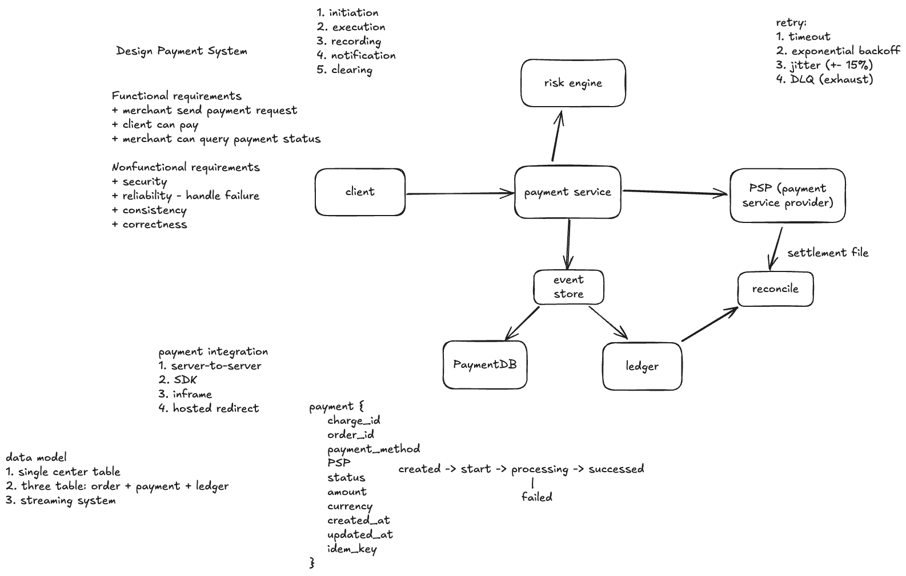

# Stripe: Design a Payment System

以商家接入 Stripe 的卡支付为例，设计一个收款（pay-in）系统。商家创建收款请求，客户完成支付，商家可以查询状态并接收结果通知。核心问题是如何在客户端重试、PSP 超时和异步回调下，维持订单、支付状态和资金账目的内部一致性。

原图列出了发起、执行、记账、通知和清算五个环节，以及服务端 API、SDK、iframe、托管跳转等接入方式。下文采用 Stripe Checkout 或 Elements 收集卡信息，使用关系型数据库保存支付状态，并通过 transactional outbox 驱动后台任务和通知。

## 1. PSP、卡组织与银行各做什么？

在线卡支付通常经过 `客户 → 商家 → PSP / 收单侧 → Visa 或 Mastercard → 发卡银行`，授权结果沿原路径返回。**Visa 和 Mastercard** 运营卡网络，转送授权请求和响应，并支持清算及结算。**发卡行**根据余额、信用额度与风控决定是否批准。**收单侧**代表商家接入卡网络，并按相应安排接收结算资金。授权、扣款提交（capture）、清算和结算是不同阶段，实际资金结算由参与机构按卡网络规则完成。[Stripe 卡网络指南](https://stripe.com/en-ca/resources/more/how-do-credit-card-networks-work)

银行接口、协议和地区规则各不相同，升级周期也往往较长。**支付服务提供商（PSP）**把收单接入、认证、风控、状态查询、回调和对账整合成商家可以使用的一套接口。Stripe 是本文的线上收单 PSP 示例。Float Financial 也是把底层金融能力包装成产品的平台，在加拿大主要提供企业卡、费用管理和账单支付。本例使用 Stripe 的商家卡收单接口。[Stripe PSP 指南](https://stripe.com/en-ca/resources/more/payment-service-providers) · [Float Financial](https://floatfinancial.com/)

## 2. 支付流程与一致性边界

1. **发起。** 商家后端校验订单归属、金额及币种，获得一个可复用的本地 `payment_attempt_id`。客户在 PSP 托管的页面或组件填写卡信息，业务服务保存 PSP 对象引用。风控可以在发起扣款前拦截交易。
2. **执行。** 支付服务提交 PSP 操作。发卡行可能批准、拒绝或要求客户完成 3D Secure。自动扣款场景中，订单在确认扣款成功后进入可履约状态。手动扣款场景中，先保存 `authorized`，确认 capture 成功后再更新订单。
3. **记账。** API 响应、PSP webhook 和恢复任务共用同一套状态更新逻辑。在一笔本地事务里锁定支付记录、校验状态转换、更新订单和支付状态、追加相应的平衡分录，并写入通知 outbox。为同一笔资金操作设置唯一入账标识，重复调用只会看到已有结果。
4. **通知。** 事务提交后，通知 worker 发送商家 webhook。查询端点可用 `payment_attempt_id` 读取已提交的支付状态。若承诺创建成功后立刻查得到，查询要从主库或提供读己之写保证的路径读取。
5. **清算与对账。** PSP 提供交易、费用和结算记录。按 PSP 交易引用、金额和币种核对内部账本，把差异交给补偿或人工处理。PSP 确认 capture 成功时，资金仍可能等待结算。

以上流程的本地状态可表示为 `created → processing → succeeded / failed`，并按需细分出 `requires_action`、`authorized`、`canceled` 等状态。网络超时保留在待确认的 `processing` 状态。先收钱、后退款或撤销时，为新的资金操作保留独立记录和分录。将 PSP 状态映射成本系统允许的状态转换，避免迟到的旧事件覆盖已确认的结果。[Stripe Payment Intents](https://docs.stripe.com/payments/payment-intents) · [Stripe Webhooks](https://docs.stripe.com/webhooks)

### Order 和 Payment 为什么拆开？

| 表 | 负责什么 | 典型字段 |
| --- | --- | --- |
| `order` | 业务订单生命周期，例如待支付、可履约、已取消 | `order_id`、`merchant_id`、`amount_minor`、`currency`、`status` |
| `payment` | 支付尝试与后续资金操作。一张订单可以有多次支付尝试，退款或撤销可以引用原始付款 | `payment_id`、`order_id`、`operation_type`、`parent_payment_id`、`status`、`amount_minor`、`currency`、PSP 引用、幂等键、时间戳 |
| `ledger` | 追加会计分录。每笔已确认的资金操作按账户记录借贷，按币种平衡 | `journal_id`、`operation_id`、`account_id`、`side`、`amount_minor`、`currency` |

这是三张核心业务表。Outbox、webhook 去重记录等属于交付和恢复所需的基础设施。对于只允许成功支付一次的订单，创建或重试时要锁定订单或使用等价的唯一约束，防止同一订单同时发起两笔可能成功的扣款。只有确认上一笔未扣款且已无法继续完成扣款，才允许创建新的支付尝试。

### Pay-in 和 Pay-out 要讲到哪一层？

Stripe 可能先将收款记入商家的 Stripe balance，资金可用后再按商户所在国家或地区、账户安排和自动或手动 payout 设置打款到商户银行。资金可用时间和打款频率是两个变量。一次面向商家的 API 请求可以牵涉多个阶段，卡网络请求数量取决于授权、capture、认证和异常处理的实际流程。普通 payout 通常走银行转账流程。

面试中可以明确把 **pay-in 的授权、扣款、记账与对账**作为 deep dive。交代 `商家余额 → payout → 商家银行账户` 的边界即可。若题目要求展开 Stripe Connect 分账，再单独讨论平台与商家的余额归属、多方转账以及 payout 失败和回退。[Stripe Payouts](https://docs.stripe.com/payouts) · [Stripe Connect Transfers](https://docs.stripe.com/connect/separate-charges-and-transfers)

## 3. Q&A：幂等键应该由谁生成？

**客户端可以生成。** 客户端可以为一次提交生成一个 `request_id`，在发起第一次请求前保存下来。双击或网络重试都必须复用这个值，后端在商户范围内对它做唯一约束，并返回同一笔本地支付尝试。若每次点击都生成新的 UUID，双击就会带来两个合法请求。禁用按钮改善体验，服务端的订单并发约束还能覆盖刷新、跨设备或并发提交产生不同键的情况。

**服务端给 PSP 写操作分配稳定的幂等键。** 当订单及金额已经确定、服务端准备创建 PaymentIntent 或提交扣款指令时，在第一次调用 PSP 之前生成并持久化键，或从已持久化的 `attempt_id` 和操作类型确定性生成。比如 `create-intent:{attempt_id}` 和 `capture:{payment_id}` 各自对应一次操作。相同操作的所有重试都使用相同参数和键。客户端的 `request_id` 与服务端给 Stripe 的键分别覆盖两次可能丢失响应的网络调用。[Stripe Idempotent Requests](https://docs.stripe.com/api/idempotent_requests)

**还没填卡号时能生成吗？** 可以。Stripe PaymentIntent 可以在订单金额确定时创建，再由客户用 Stripe 组件提交支付方式并确认。也可以在用户明确开始支付时才创建本地记录，以减少停在 `created` 的数据。可以把长期未提交的尝试标为已过期，释放临时资源，同时保留有资金影响或仍需核查的记录。放弃结账是有效的业务状态，可以用于漏斗分析。[Stripe Payment Intents](https://docs.stripe.com/payments/payment-intents)

## 4. Q&A：高 QPS 用异步，Outbox 和 Kafka-first 怎么选？

异步可以快速确认收件、吸收短时流量峰值，并用 worker 控制发给 PSP 的并发和速率。持续完成吞吐仍受 PSP 的请求配额、并发限制、每笔支付需要的 API 操作数，以及内部写入能力约束。比如每秒进入 500 笔、下游每秒只能处理 100 笔，两秒后会积压约 800 笔。若流量持续高于处理能力，需要限制入口流量或提高下游配额。[Stripe Rate Limits](https://docs.stripe.com/rate-limits)

| 方案 | 何时返回 `202 Accepted` | 状态查询与恢复 |
| --- | --- | --- |
| **A. 先写 DB 和 outbox** | 在一笔本地事务里写入支付记录和执行命令，提交成功后返回 `payment_attempt_id`。 | DB 是支付工作流和商家查询的权威来源，收到 `202` 后即可查询。Relay 可以轮询 outbox 或用 CDC 发布到 Kafka，consumer 取到后调用 Stripe。没有跨服务消息分发需求时，worker 也可以直接消费 DB 队列。 |
| **B. 先写 Kafka** | 命令按所需的复制和确认策略持久发布后，返回 `request_id` 和 `received`。 | Kafka 是已接收命令的持久记录。Consumer 幂等地建立 DB 支付记录，再调用 Stripe。落库前查询存在可见性窗口，API 需要定义 `received` 如何查询，或接受延迟可见并在接口里说明。如果产品需要立即查询，通常还要补一层收件状态。 |

**A 更适合本文的基线。** 商家收到确认后需要马上有可查询的记录。A 用一次本地事务解决“支付已落库，但发送任务前进程崩溃”的问题。Relay 在 Kafka 已确认后、标记 outbox 已发送前可能崩溃，因此 consumer 仍要以 `operation_id` 幂等。轮询服务、CDC 和直接消费 DB 队列都是可行实现，无需假设定时 cron 是唯一选择。[Transactional Outbox](https://microservices.io/patterns/data/transactional-outbox.html)

**B 可以用作持久命令队列。** DB 写失败时保留可重放性，consumer 成功写入可恢复的处理记录后才提交 offset。若 offset 在 PSP 调用前提交，DB 中必须有持久化任务和恢复 worker 接手。若等处理结束再提交，崩溃后重放消息仍要复用原有的支付记录和 PSP 幂等键。Kafka-first 可以只把命令放在 Kafka，再以 DB 保存处理结果。若把支付状态和决策的完整历史也放在日志里作为权威来源，才需要额外设计可重建的状态投影以及相应的保留策略。

### 网络抖动如何恢复？

- **调用 Stripe 超时。** 保留 `processing` 并记录待核查操作。已知 PSP 对象 ID 时查询该对象，或使用已验证的 webhook 确认结果。需要重试同一操作且在幂等键有效期内时，复用原键及参数。超过有效期仍未知时，结合外部记录和内部引用对账，确认结果后再决定是否尝试新扣款。
- **收到重复或乱序回调。** 校验 Stripe 签名，持久化去重记录，并校验状态转换。必要时从 Stripe 查询对象当前状态。Webhook、同步响应和恢复 worker 可能并发到达，由数据库约束保证同一资金操作只入账一次。[Stripe Webhooks](https://docs.stripe.com/webhooks)
- **定期扫内部积压和外部账单。** 恢复任务扫描长时间待执行或待确认的 DB 记录，按超时、指数退避和 jitter 调度，处理 PSP 限流时遵循适用的退避要求。重试耗尽后进入 DLQ 或人工复核。财务对账另外核对交易和结算明细。在 B 中还要监控 Kafka consumer lag 和处理失败，因为尚未落库的命令无法通过扫 DB 找到。

例如 Stripe 已成功扣款，worker 却在写回 DB 前超时，商家暂时查到 `processing`。Stripe webhook 或恢复查询确认同一笔扣款后，支付服务用同一个资金操作 ID 更新订单和账本。如果 webhook 与恢复任务同时到达，只有一方会新增分录。

## 5. Q&A：同步还是异步，主要看什么？

| 考量 | 同步或短时间等待 | 异步接受 |
| --- | --- | --- |
| 客户体验 | 客户正在结账，希望马上获知结果或完成 3D Secure。 | 客户能接受 `pending`，之后通过查询或通知拿结果。 |
| 业务约束 | 需要快速知道能否发货或开通服务。 | 可以先受理订单，等确认 capture 成功后再履约。 |
| 容量与延迟 | 平稳流量、PSP 尾延迟和本地资源能满足请求预算。 | 大促或突发流量需要削峰，后台按 PSP 配额和并发限制发请求，并限制排队时间。 |

常见组合是先持久化支付意图，在有限的响应预算内尝试拿到结果或给出下一步认证操作。PSP 尚未确认时，返回可查询的 `processing`，由 webhook 和恢复任务补齐最终状态。对商家，`202 Accepted` 表示系统已接单，`succeeded` 表示扣款已确认，后续 payout 则有自己的状态。
