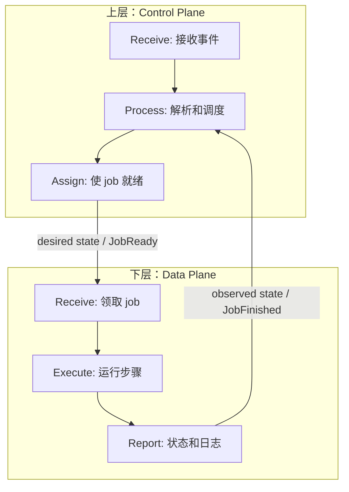
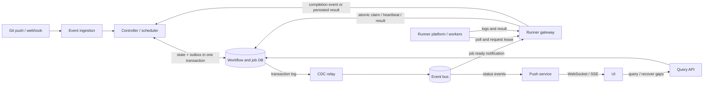

# 设计多租户 CI/CD 系统：GitHub Actions 风格案例

这份笔记逐项解释草图中的需求、容量估算、数据模型、组件和箭头。系统的目标是：代码仓库收到 Git push 后，根据该提交对应的 workflow YAML 创建一次运行，按 job 依赖调度执行，并让用户持续查看日志和状态。

> 这是一个用于系统设计讨论的简化模型，不代表 GitHub Actions 的实际内部实现。草图中的 `Giuhub` 是文件名中的原拼写；下文使用标准名称 GitHub Actions。

## 1. 需求和边界

### 功能需求

1. **提交代码触发 workflow**：仓库事件进入系统；系统校验事件、定位仓库和提交，并读取该提交版本的 YAML。不能简单读取默认分支的最新 YAML，否则执行的可能不是用户提交时定义的工作流。
2. **接收并执行每个 job**：解析 YAML 后得到有向无环图（DAG）。只有依赖满足、条件表达式为真且配额允许的 job 才能进入待运行队列。一个 workflow run 可以包含多个 job，一个 job 可以有多个执行 attempt。
3. **查看运行状态和输出**：用户能查询 workflow run/job 的状态，实时接收状态变更，并按 job/attempt 查看日志。实时推送断开时仍可通过查询 API 补齐状态。

### 非功能需求

* **可扩展性**：事件入口、调度器、消息总线、runner gateway 和 runner 池分别扩容；按 tenant/repo 分区和限流。
* **低调度延迟**：事件到首个 job 开始应尽量接近实时；这不是说构建本身必须瞬间完成。需要分别测量事件接收、入库、排队、领取和启动延迟。
* **可靠性**：事件至少一次投递、状态持久化、幂等创建、租约超时回收和可重试的 job attempt。对于有外部副作用的部署步骤，平台不能保证严格的“恰好一次”；步骤自身还要使用幂等键或部署锁。
* **控制面与数据面解耦**：控制面决定运行什么、何时运行、分配到哪里；数据面领取 job、执行步骤、上传日志并回报结果。控制面短暂不可用时，已启动的 job 可以继续执行，但新的调度和状态收敛会延迟。

## 核心答题框架：上下两层

设计 CI/CD、任务调度、托管计算这类系统时，可以先把架构讲成**上层控制面（Control Plane）**和**下层数据面（Data Plane）**。上层负责做决定，下层负责执行并反馈；这是职责分层，并不要求两层一定部署在同一组机器的物理上下位置。

| 层 | 草图中的三个动作 | 在本案例中具体做什么 | 主要组件 |
| --- | --- | --- | --- |
| **上层：控制面** | **Receive（接收）** | 接收并校验 Git 事件，识别 tenant、repo、commit 和触发规则。 | Event ingestion |
| | **Process（处理）** | 读取该 commit 的 workflow YAML，展开 job DAG，检查依赖、权限、配额和重试策略。 | Controller、状态数据库 |
| | **Assign（分配）** | 把可运行 job 置为 `queued`，发布就绪通知，并决定可用 runner 的类型、标签和并发额度；最终由 gateway 发放具体租约。 | Controller、outbox/event bus、runner gateway |
| **下层：数据面** | **Receive（接收）** | runner 通过 gateway 拉取并领取一个已获准执行的 job，得到租约和执行所需的短期凭据。 | Runner gateway、runner |
| | **Execute（执行）** | 在隔离环境中检出固定 commit，执行构建、测试或部署步骤。 | Runner platform（VM/容器） |
| | **Report（回报）** | 上传日志、心跳和结果；更新持久化状态，让控制面推进后续 job，并让 UI 展示进度。 | Runner、runner gateway、状态/日志存储 |

面试中可以先用这六个动词说明职责，再展开下一节的组件图。**控制面下发期望状态，数据面回报实际状态**，两层之间形成反馈回路。Event bus 和数据库是跨层协作的基础设施；不能简单地把图中每个框硬归到某一层。`Assign` 也不等于把 job 直接推给某台 runner：控制面决定 job 可运行和匹配规则，gateway 在 runner 请求时通过原子租约完成具体分配。

## 2. 粗略容量估算

草图写的 `1B / 100k sec = 10K QPS` 在算术上成立：**10 亿事件 / 10 万秒 = 1 万事件/秒**，10 万秒约为 27.8 小时；草图假设峰值约 **5 万事件/秒**。这些是输入假设，不能直接当作真实业务规模。

要区分几种吞吐：原始 Git 事件、匹配到的 workflow run、展开后的 job、状态变更、日志字节量。若平均每次运行有 5 个 job，且每个 job 有多次状态变更，内部写入和消息量就会明显高于入口事件 QPS。容量规划还要考虑突发 push、重试、日志存储、并发 runner 数、单租户配额和区域分布。

## 3. 整体流程

`Controller → Event bus` 在草图中表示“发布调度结果”；如果使用事务性 outbox 和 CDC，实际可靠路径是 **Controller → DB 中的业务状态及 outbox → CDC relay → Event bus**。浏览器通过查询 API 读取数据库，而不是直连数据库。

## 4. 逐项解释草图中的组件和箭头

| 草图位置 | 作用 | 关键设计点 |
| --- | --- | --- |
| `user event` | Git push、PR 或手动触发等源事件。本案例主要讨论 push。 | 事件要带 tenant、repo、commit SHA、事件类型、源事件 ID；验签并去重。 |
| `event ingestion` | 接收 webhook，验证签名和权限，持久化或可靠排队，再尽快响应源端。 | 高峰时限流和背压；按源事件 ID 去重，避免 webhook 重投创建重复 run。 |
| `controller` | 控制面核心：读取 YAML、展开 DAG、评估依赖和策略、推进状态、决定哪些 job 可运行。 | 多实例调度时通过事务/CAS 避免重复推进；耗时工作异步化。 |
| `data store` | workflow run、job、依赖、attempt、租约、outbox 等的事实源。 | 支持事务、唯一约束、按 tenant/run 查询；不要把消息总线当作唯一状态源。 |
| `event bus` | 异步传播“job 已就绪”“job 已完成”“状态已改变”等事件。 | 通常至少一次投递；消费者必须幂等；按 run_id 或 job_id 选择分区键以保序。 |
| `runner gateway` | 数据面入口：给 runner 提供领取 job、续租、心跳、回报结果的接口；也可消费就绪事件以加快响应。 | **真正的领取必须在 DB 中原子完成**，仅收到 bus 消息不等于拥有 job。 |
| `runner platform` | 执行 worker 的池与运行环境，可能是 VM、容器或两者组合。 | 隔离租户、限制资源、注入短期凭据、清理工作空间；不可信代码宜用更强隔离。 |
| `push` | 消费状态事件，向浏览器推送 workflow/job 的变化。 | WebSocket 或 SSE；连接断开后通过查询 API 补齐，推送只是通知。 |
| `UI` | 展示 DAG、状态、排队原因、运行时长和日志。 | 对用户显示最终状态时以持久化状态为准。 |

### 箭头逐条说明

1. **用户事件 → Event ingestion**：Git 服务发送 webhook；入口验签、去重并记录事件。这里的 `event` 是源事件，不是内部 job-ready 消息。
2. **Event ingestion → Controller**：把有效事件交给控制面。可以通过持久队列异步传递，避免 YAML 解析和调度堵住 webhook 请求。
3. **Controller ↔ Data store**：创建 workflow run/job/dependency，读取前置 job 状态，更新调度决策。状态变更要带版本号或条件更新。
4. **Controller → Event bus**：逻辑上发布调度事件；若要避免 DB 提交成功但发布失败，应改为同一事务写 outbox，再由 CDC 发布。
5. **Data store → CDC relay → Event bus**：CDC 订阅数据库事务日志（例如 MySQL binlog 或 PostgreSQL WAL），提取已提交的 outbox 行并发布。CDC 是 **Change Data Capture，变更数据捕获**；它不是 runner gateway，也不是“把 bus 变成 gateway”的步骤。
6. **Event bus → Runner gateway**：gateway 消费 `JobReady` 通知，更新可领取队列或唤醒长轮询。消息可能重复或乱序；gateway 必须再核实 job 的当前状态并原子领取。
7. **Runner platform → Runner gateway（pull + lease）**：空闲 runner 主动请求工作。gateway 按容量、标签、租户配额匹配 job，并在 DB 中用条件更新将 `queued` 改为 `leased`，写入 runner、attempt、租约期限，返回临时执行令牌。
8. **Runner platform → Runner gateway（心跳、结果、日志）**：runner 续租并上报阶段状态；日志通常分块上传到对象存储，DB 只存索引/URL。完成时用 attempt ID 和 lease token 防止过期 runner 覆盖新 attempt 的结果。
9. **Runner gateway → Controller**：持久化结果后，通知控制面推进 DAG，释放依赖它的后续 job。也可以让 controller 消费 `JobFinished` 事件；关键是状态持久化和可重放。
10. **Event bus → Push → UI**：状态事件触发实时通知。用户刷新页面时，查询 API 读取 DB 中的当前状态；不能只靠推送构造唯一真相。

## 5. CDC 在哪里？为什么需要它？

草图容易把 `Controller → Event bus → Runner gateway` 画成一条直接发布链。问题是 controller 要同时做两件事：**更新 DB 状态** 和 **发布消息**。如果先提交 DB 再发消息，进程可能在两步之间崩溃，job 已是 `queued` 却永远没人收到通知；反过来先发消息再提交 DB，gateway 可能看见尚未存在的 job。

**事务性 outbox + CDC** 把这个双写问题变成可恢复的链路：

1. Controller 在**同一个数据库事务**中写 `job.status = queued` 和一条 `outbox(JobReady, job_id, event_id, version)`。
2. 提交成功后，CDC relay 从数据库提交日志读取 outbox 变更，发布到 event bus。
3. Runner gateway 消费 `JobReady`，记录或尝试领取；成功处理后再确认消息。
4. Relay、broker 或 gateway 重试可能造成重复消息，所以用 `event_id`、`job_id`、`version` 做幂等检查。另有后台扫描器查找长期 `queued` 且未被领取的 job，修复漏通知或消费者故障。

因此，**CDC 只负责“数据库已提交的变更 → event bus”这一段**；**“event bus → runner gateway”是普通的消息消费**。也可以不用 CDC，改用轮询 outbox 表的 publisher；关键机制是事务性 outbox，而不是 CDC 这个具体工具。

## 6. 数据模型：解释草图中的每个字段

### `workflow_run`

| 字段 | 含义 |
| --- | --- |
| `run_id` | 一次 workflow 运行的全局唯一 ID，用于聚合所有 job 和 UI 查询。 |
| `tenant_id` | 租户边界，用于鉴权、配额、分区和成本归属。 |
| `repo_id` | 仓库 ID；和 commit SHA 一起确定代码与配置来源。 |
| `commit_sha` | 触发运行的提交版本；检出代码和读取 workflow 定义都应绑定它。 |
| `event_type` | 触发类型枚举，例如 `push`、`pull_request`、`manual`。 |
| `status` | 整体状态，如 `queued / running / succeeded / failed / timed_out`；实际实现还应考虑 `cancelled` 和 `skipped`。 |
| `created_at` | 创建时间，用于排队时长、排序和清理策略。 |

建议额外保存 `source_event_id`（去重）、workflow 文件路径/版本、开始/结束时间，以及触发者身份。整体状态由各 job 的终态和 workflow 规则推导或事务性更新。

### `job`

| 字段 | 含义 |
| --- | --- |
| `job_id` | job 实例 ID；同一 YAML 中的 job 在不同 run 中有不同 ID。 |
| `workflow_run_id` | 所属运行；草图中的 `workflow_run_id` 对应 `run_id`。 |
| `name` | YAML 中的 job 名称，供 UI 展示。 |
| `assigned_runner_id` | 当前领取该 job 的 runner；未领取时为空。租约过期重试时会变化。 |
| `status` | `blocked / queued / leased / running / succeeded / failed / timed_out / cancelled / skipped` 等；`blocked` 表示等待依赖。 |
| `dependency` | 草图中的概念字段；实际通常放在单独的依赖表，以表示多个前置 job。 |
| `updated_at` | 最近一次状态更新时间；用于诊断卡住的 job。 |
| `lease_expires_at` | 当前租约失效时间；超时后可回收重试，但要防止旧 runner 再写结果。 |
| `storage_url` | 日志/产物位置；一般还需区分日志索引、artifact 元数据和保留期。 |

建议将每次执行记录在 `job_attempt(attempt_id, job_id, runner_id, lease_token, status, started_at, finished_at)`。这样重试不会覆盖之前的日志和失败原因。

### `dependency`

| 字段 | 含义 |
| --- | --- |
| `run_id` | 依赖所属的 workflow run。 |
| `from_job_id` | 前置 job。 |
| `to_job_id` | 必须等待它的后续 job。 |

例如 `build → test → deploy` 需要两条边。Controller 在前置 job 成功后检查后续 job 的**所有**依赖和条件；失败时根据 workflow 语义决定跳过、失败或继续。入库前应检测 DAG 是否有环。可用唯一键 `(run_id, from_job_id, to_job_id)` 防止重复边。

## 7. 调度与执行的状态回路

1. **接收**：源事件被验证和去重，创建 run。控制面解析当前 commit 的 YAML，生成 job 和依赖。
2. **决策**：无依赖或依赖已满足的 job 进入 `queued`；其余保持 `blocked`。调度器检查租户并发限制、runner 标签和区域要求。
3. **通知**：状态和 outbox 同事务提交；CDC 或 outbox publisher 把 `JobReady` 发布到 bus。
4. **领取**：runner 经 gateway 拉取工作；gateway 原子发租约。多个 runner 同时请求时只能有一个成功。
5. **执行与观察**：runner 在隔离环境中检出固定 commit、运行步骤、续租并上传日志。gateway 持久化观察到的状态。
6. **收敛**：job 结束后 controller 更新 run、解锁依赖 job；超时扫描器回收过期租约，并决定重试或终止。

这对应控制回路 `Observe → Decide → Act → Converge`：runner 报告 **observed state**，controller 根据 workflow 定义和策略决定 **desired state**。消息可以重复，状态回路仍应收敛到正确结果。

## 8. 存储和运行环境的取舍

* **分片关系型数据库**：事务和唯一约束适合 run/job/依赖/outbox；以 tenant 或 run 为分片边界，避免一个运行跨多个分片做事务。跨分片聚合查询需要额外索引或读模型。
* **NewSQL**：如果确实需要跨区域或跨分片事务，可考虑；代价是写延迟、成本和运维复杂度，不能仅因为“规模大”就选它。
* **NoSQL + streaming**：适合高吞吐状态投影或日志索引，但 DAG 依赖、原子领取和事务性 outbox 仍需明确一致性方案。草图里的两种存储方向是备选，不必同时使用。
* **Event bus**：解耦调度、runner 通知和 UI 更新，提供缓冲与重放。它不替代数据库里的租约和最终状态。
* **VM 或容器**：容器启动快、密度高；VM 隔离通常更强、启动和资源开销更大。执行来自不同租户的不可信代码时，安全边界优先，可采用每 job VM 或 microVM，并在其中运行容器。

## 9. 关键故障场景

* **Controller 提交状态后崩溃**：outbox 已一起提交，CDC 恢复后继续发布。
* **CDC 或 bus 延迟**：job 保留在 DB 的 `queued` 状态；积压指标报警，扫描器补偿通知。
* **消息重复**：gateway 根据版本和租约条件拒绝重复领取；push 可以重复，但 UI 从 DB 补齐。
* **Runner 失联**：租约到期，系统启动新 attempt；旧 attempt 的 lease token 失效。
* **Runner 完成但结果回报丢失**：gateway 接受幂等重报；若租约已过期，需要按 attempt 状态判断，避免两个 runner 的结果互相覆盖。
* **UI 推送断开**：重新连接后按事件序号或更新时间查询缺失的状态和日志。
* **单租户突发大量任务**：配额、并发上限和公平调度防止占满共享 runner 池。

## 10. 一句话回答 CDC 疑问

这里的 CDC 指 **Change Data Capture**：它读取数据库已提交的 outbox 变更并发布到 event bus；runner gateway **消费 event bus 的通知**，再通过数据库中的原子租约把 job 分给 runner。CDC 不负责从 event bus 到 gateway 的传输。
