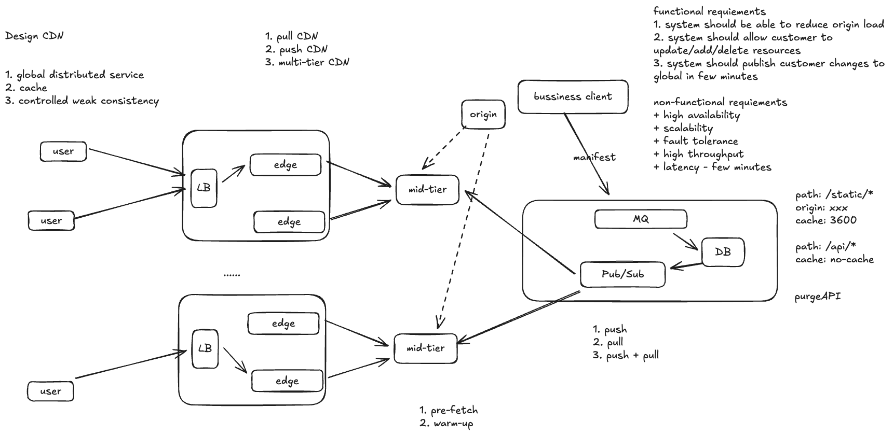
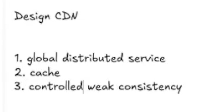
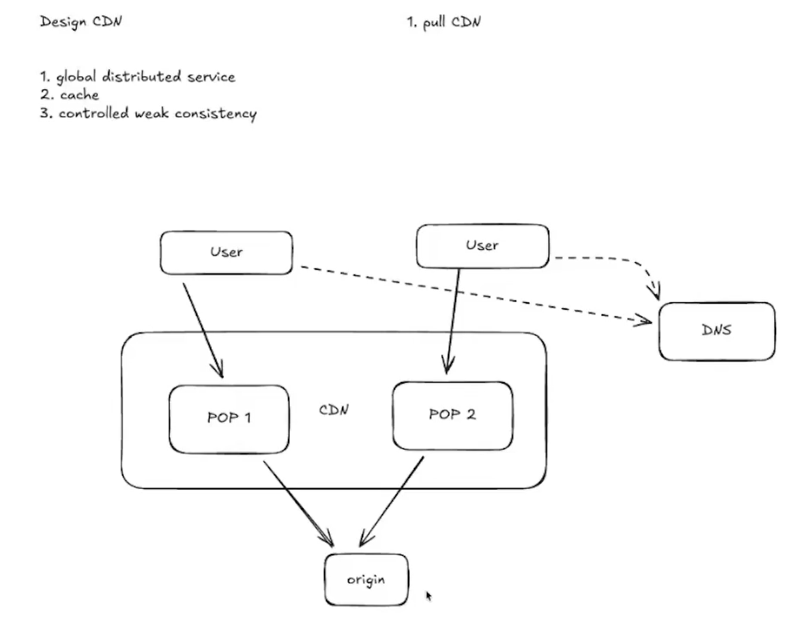
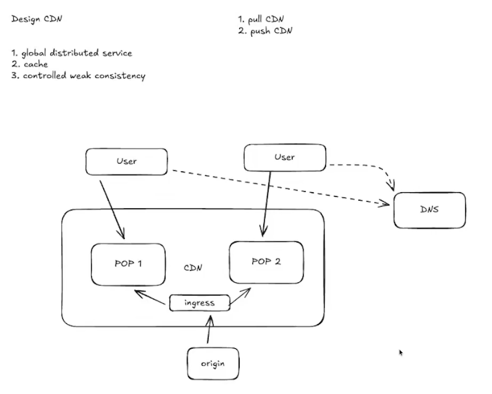

# Cloudflare: Design a CDN（多层缓存设计案例）

> 这是根据题图整理的 **Cloudflare 风格 CDN 设计练习**，不是对 Cloudflare 内部实现的描述。重点是理解 pull、push、多层缓存，以及内容更新如何传播到全球。

## 原始设计截图



## 1. CDN 是什么？

CDN（Content Delivery Network，内容分发网络）是一组分布在不同网络和地区的服务节点。用户请求图片、视频片段、脚本或其他可缓存内容时，CDN 尽量在附近节点返回，减少用户到源站（origin）的距离、延迟和源站负载。源站仍负责提供权威内容；缓存保存的是可按规则复用的副本。

一个典型请求是：`用户 → CDN 入口 → 附近 POP 的 edge →（缓存未命中时）上游缓存 → origin`。**POP** 是 *Point of Presence*，即 CDN 在某个城市或网络接入点部署的站点；一个 POP 可以有负载均衡器和多台 edge/cache 机器。POP 不是单台缓存服务器。

题图里的三个关键词可以这样理解：



* **全球分布**：许多 POP 靠近不同用户和运营商。
* **缓存**：命中时不访问源站；未命中时回源并按策略填充缓存。
* **受控的弱一致性**：内容更新后，各 POP 的副本不一定同一瞬间更新；系统用 TTL、版本化 URL、主动失效（purge）等机制约束旧内容可能持续的时间。具体新鲜度承诺必须与业务需求匹配，不能默认所有内容都可以短暂过期。

## 2. 用户如何到达 POP：DNS、Anycast、BGP 和 LB

```text
用户查询域名 → DNS 返回 CDN 地址 → 网络将连接送到某个 POP → POP 内 LB 选一台 edge
```

1. 客户把域名接入 CDN；DNS 解析可能经过 CNAME/委派，最终得到 CDN 的服务地址。DNS 也可能按地理位置或健康度选择不同地址。
2. 对 **Anycast** 地址，CDN 在多个 POP 使用同一个服务 IP，向全球 BGP 邻居宣告包含该 IP 的 **IP 前缀**。严格说，BGP 宣告的是路由前缀，不是把每个 IP 单独“写全并广播”。互联网路由将流量送往一个可达 POP；它通常网络距离较近，但不保证地理上最近，也可能因运营商策略或故障切换而变化。
3. 到达 POP 后，站点内部的 **LB（负载均衡器）** 选择一台健康的 edge 服务器。题图中的 `user → LB → edge` 主要表示这一步；LB 不是决定全球路由的唯一组件。

有些 CDN 部署主要使用 DNS 选点，有些组合 DNS 与 Anycast。不要把 DNS、BGP 和 POP 内 LB 画成由同一个组件完成的决定。

## 3. 需求：设计目标与指标

**功能需求**：减少 origin 负载；让客户添加、更新、删除资源；让配置变更、purge 或新版本在全球目标时间内生效。题图写的“几分钟”是**变更传播/生效目标**，不是单次请求的延迟目标。

**非功能需求**：高可用、可扩展、容错、高吞吐、低请求延迟，以及变更传播的可观测性。应分别测量 edge 命中率、mid-tier 命中率、origin 请求率、回源字节量、P95/P99 请求延迟、purge 完成时间和过期内容比例。

缓存策略可由客户配置，例如：

```yaml
- path: /static/*
  origin: https://origin.example.com
  cache_ttl_seconds: 3600
- path: /api/*
  cache: no-cache
```

这只是示意规则；这里的 `cache: no-cache` 表示客户策略要求 **bypass CDN 缓存**。它与 HTTP 响应头 `Cache-Control: no-cache` 不完全相同：后者允许存储副本，但每次使用前必须重新验证。真实缓存键还要考虑 host、路径、规范化后的 query、HTTP method、`Vary` 等。带认证信息或个性化响应不能因路径匹配就直接共享缓存；`Cache-Control`、cookie、授权头和客户策略需一起判断。

## 4. Pull CDN：按需回源



Pull 模式下，客户先在源站发布内容并配置 CDN；CDN 不提前复制所有对象。第一次请求经过某个 POP 时：

1. Edge 查本地缓存；命中且仍新鲜就直接返回。
2. Edge miss 时向上游请求。如果只有一层 CDN，上游直接是 origin。
3. Origin 返回内容及缓存语义；edge 按策略存储副本并返回给用户。
4. 后续请求在 TTL 内命中同一缓存键，就不再回源。

**首次 miss 的代价**：首位用户要等待回源，多个 POP 的首次请求可能分别到达 origin。同一个热对象突然被大量用户请求时，即使已有缓存层，如果各 POP/机器同时 miss、过期或被 purge，回源请求会瞬间增加。

**内容更新不等于必然 miss。** 如果客户只在 origin 覆盖旧文件，而 edge 的旧副本还没过期，用户可能继续看到旧内容。删除旧资源后也可能如此。只有缓存键改变、条目不存在/过期、被 purge，或者重新验证发现已变更时，才会发生需要重新获取内容的路径。

## 5. Push CDN：预先发布或预热



Push 模式下，客户把内容或新版本的发布清单（manifest）主动交给 CDN。CDN 可以经 ingress 接收内容，并在用户请求前预置到目标 POP；也可以根据清单先从 origin 抓取，再把内容预热到缓存。

**为什么能缓解首次 miss？** 如果目标 POP 的 edge 已经持有新版本，首位用户到达时就是 hit，不必在请求路径上等待 origin。因此对已知的热门静态资源，push/pre-warm 能减少冷启动延迟。

**为什么 push 不是总比 pull 好？**

* **放大写入和传输**：每个新对象都推到许多 POP，即使部分 POP 从来没有用户访问；全球预置的带宽和存储成本可能高于按需获取。
* **发布延迟和部分失败**：清单到达不代表内容已在每个 POP 可用。需要追踪目标 POP 的实际完成情况，并定义未完成时是 pull 回源、继续提供旧版，还是返回错误。
* **容量与热度难预测**：长尾资源多，预热所有对象会挤掉真正热门内容。
* **并发预热可能冲击 origin**：若“push”只是通知每个 POP 同时从 origin 拉新对象，成百上千个 POP 会同时回源，形成 thundering herd。若客户直接把字节上传到 CDN ingress，再由 CDN 内部复制，origin 压力可小得多，但 CDN 内部网络和存储仍要承担扩散成本。

因此常用策略是：**push 元数据、失效通知或少量高热内容；其余对象按需 pull**。Push 解决的是“被预置对象在已完成预置的 POP 的首访 miss”，不是所有首次访问或所有更新的一般解法。

## 6. Thundering Herd：为什么源站会被打爆？

Thundering herd（惊群）是许多请求因同一事件同时冲向同一上游。常见触发是热门对象冷启动、统一 TTL 到期、全球 purge、热点版本发布，或某个缓存层故障。假设 200 个 POP 各有 20 台 edge，对同一个对象同时 miss，若没有请求合并，理论上可能瞬间出现约 **4,000 次**针对同一对象的回源请求；真实数量由并发、路由和缓存键决定。

保护手段是分层叠加的：

1. **每节点请求合并（single-flight / coalescing）**：同一 edge 上相同缓存键的并发 miss 只发一个上游请求，其余请求等待结果。
2. **Mid-tier / shield 缓存**：多个 edge 的 miss 汇聚到少量 parent；parent 再合并同一对象的 miss。
3. **按 key 固定 parent（parent hashing）**：同一对象尽量到同一个 parent，以共享缓存和合并机会。
4. **错峰与限速**：TTL 加抖动，预热队列限制并发，origin 连接数和 QPS 设置上限。
5. **可控的过期服务**：业务允许时使用 stale-while-revalidate 或 stale-if-error，先返回旧副本再后台更新；不适用于必须立即撤回的敏感内容。

## 7. Hybrid Multi-tier CDN：理解题图中的 mid-tier

你的理解**基本正确**：新用户的请求先到某个 POP 的 LB，再到 edge；如果 edge miss，就到 mid-tier；如果 mid-tier 也 miss，才去 origin。需要补充两点：用户到 POP 之前通常经过 DNS/Anycast 路由；LB 只在该 POP 内选择 edge。**Mid-tier 本身就是一层缓存**，同时负责汇聚、请求合并和保护 origin。这里的“新用户”不一定意味着 miss：对象可能已经被其他用户请求过，或提前预热到了 edge。

完整路径见[顶部的原始设计截图](assets/cdn-full-design.png)。图中的两组 POP/edge 汇聚到 mid-tier；虚线表示 mid-tier 在需要时访问 origin。

一次完全冷启动的请求按 `User → POP LB → Edge → Mid-tier → Origin` 走；若响应允许缓存，就反向回填 `Origin → Mid-tier → Edge → User`。下一位同 POP 用户可能命中 edge；另一 POP 的 edge 即使 miss，也可能命中共享的 mid-tier，省去 origin 访问。Mid-tier 可以是区域级 shield，也可以是按对象/租户映射的一组 parent；并非全球只有一台中间服务器。

### Parent hashing 到底做什么？

若一个区域有多个 parent，edge 不能每次随机挑选，否则同一对象分散到很多 parent，每个 parent 都会各自 miss。对 `tenant + cache key` 做一致性哈希或 rendezvous hashing，让同一对象稳定落在同一 parent（或一小组 parent），于是：

* 不同 edge 的 miss 在同一个 parent 汇合，提高 L2 命中率。
* Parent 对同一 key 做 single-flight，把大量 edge miss 压缩成一次或少量 origin 请求。
* Parent 故障或扩缩容时，哈希方案只需重映射部分 key；仍要有健康检查和备选 parent。

Parent hashing 是**选择上游缓存节点的路由策略**，mid-tier 是**执行缓存、汇聚和回源的实际服务层**。两者不是同一概念。选择 parent 时还要兼顾地理距离、租户隔离、容量和故障域；不应为了同一 key 而让所有地区跨洋访问单个 parent。

### 用一个对象走一遍

假设客户发布 `/static/app-v2.js`，两个 POP 的 edge 都没有它，但它们映射到同一区域 parent：

1. POP A 的首位用户 miss；parent 也 miss，于是 parent 从 origin 获取一次并回填。
2. POP B 的首位用户在本地 edge miss，但同一个 parent 已缓存该对象，因此从 parent 获取，不访问 origin。
3. POP A/B 的后续用户命中本地 edge。
4. 若 A、B 同时到达，parent 对相同 key 合并并发 miss，仍尽量只向 origin 发一个请求。

## 8. 更新、删除与全球传播：控制面如何配合数据面

题图右侧的 business client、manifest、MQ、DB、Pub/Sub 和 purge API 属于**发布/控制路径**；用户、LB、edge、mid-tier、origin 属于**请求/数据路径**。两者相交于配置下发、预热和失效。

一个可行的控制流程是：

1. **客户提交 manifest 或调用 API**：声明 `/static/*` 的 origin 与 TTL、`/api/*` 不缓存，并指定需要预热或 purge 的资源。API 校验租户、路径和权限，生成带版本号的变更。
2. **持久化配置**：DB 保存当前配置和变更记录；MQ 缓冲发布任务。控制服务把目标 POP/parent 的工作拆分为可重试任务。
3. **Pub/Sub 广播信号**：各区域/POP 订阅配置版本、purge 指令或预热任务。节点收到后校验版本并执行；离线节点恢复时可从持久配置补齐，不应只依赖瞬时广播。
4. **执行与回报**：edge/parent 清除旧 key、加载新规则或预热内容，并回报 applied version。控制面统计每个区域的进度、失败和传播延迟。

**删除旧资源并上传新资源**可采用两类策略：

* **版本化 URL（推荐静态构建产物）**：把 `/app.js` 改为 `/app-v2.js` 或内容哈希 URL。新 URL 天然 miss，拿到新内容后可长期缓存；页面/manifest 切换引用。旧对象可在安全窗口后删除。这里的 miss 是**新 key 的首次访问**，不是旧 key 被自动刷新。
* **原地覆盖 URL**：源站更新同一路径后，调用 purge API 清除 edge 和 mid-tier 旧副本，或等待 TTL/重新验证。Purge 期间不同 POP 可能短暂看到不同版本；如果业务不允许，需加版本切换屏障或更严格协议。

“全球几分钟生效”需要明确验收口径：是配置已送达、节点已执行 purge，还是用户已不可能读到旧内容？这三者不同。对于紧急撤回，不能仅依赖 TTL；应使用高优先级 purge、传播确认与必要的保守回源/阻断策略。

## 9. 一个合理的组合方案

* **常规读取用 pull**：L1 edge 和 L2 mid-tier 按需填充，减少无用预置。
* **发布时有限 push**：主动下发配置、版本和 purge；只对已知热门对象或重点区域做预热，控制并发。
* **读路径保护 origin**：edge 与 parent 做请求合并、限流和背压；parent hashing 提高共享命中率。
* **控制弱一致性的窗口**：静态资源优先版本化 URL；同 URL 更新配合 purge、TTL、版本号及回报监控。
* **按层观测**：分别看 POP 命中、parent 命中、origin 负载和全球传播延迟，才能知道瓶颈发生在哪里。

**核心结论**：Mid-tier 确实是缓存层。新用户在 edge 与 mid-tier 都 miss 时才回源；push 预热能减少部分首访 miss，但可能浪费资源或因并发拉取造成惊群。将选择性的 push 与多层 pull 缓存结合，是更稳妥的设计。
