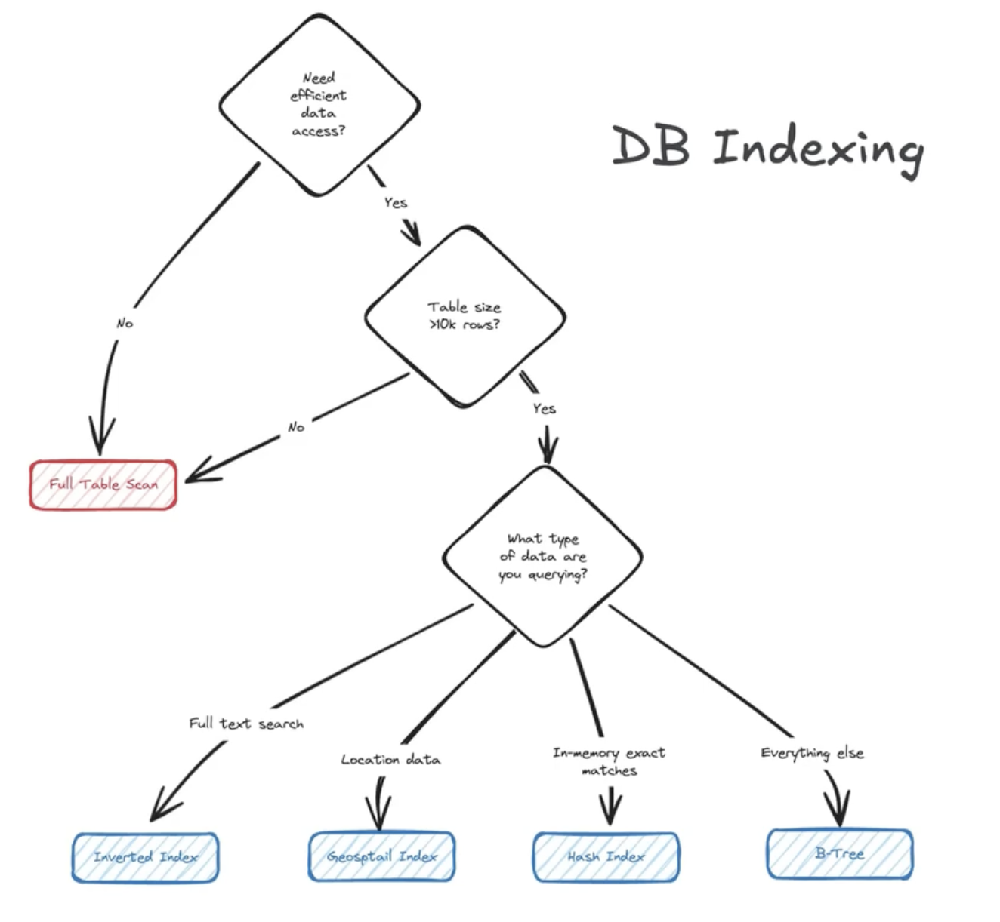
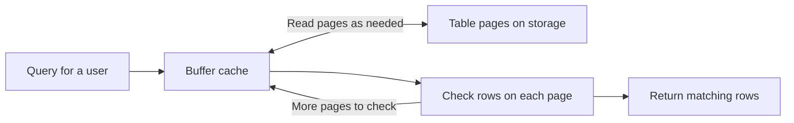
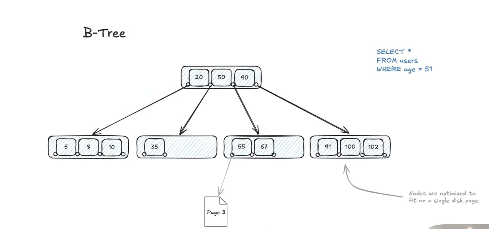
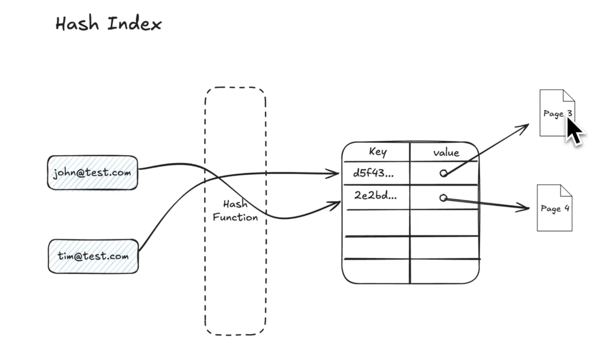
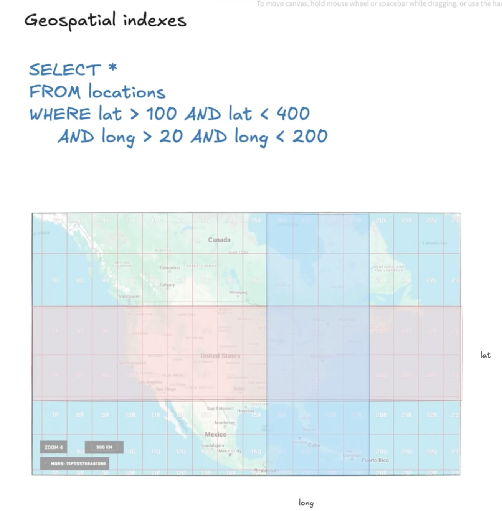
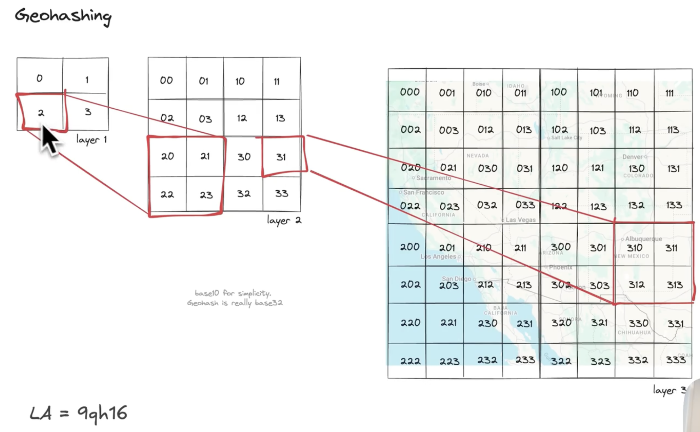
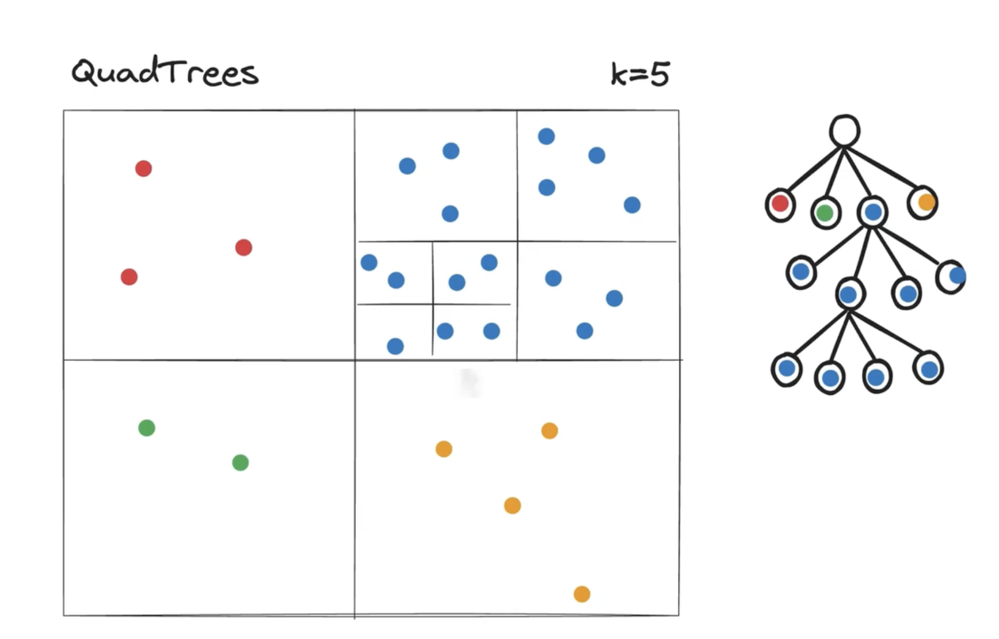
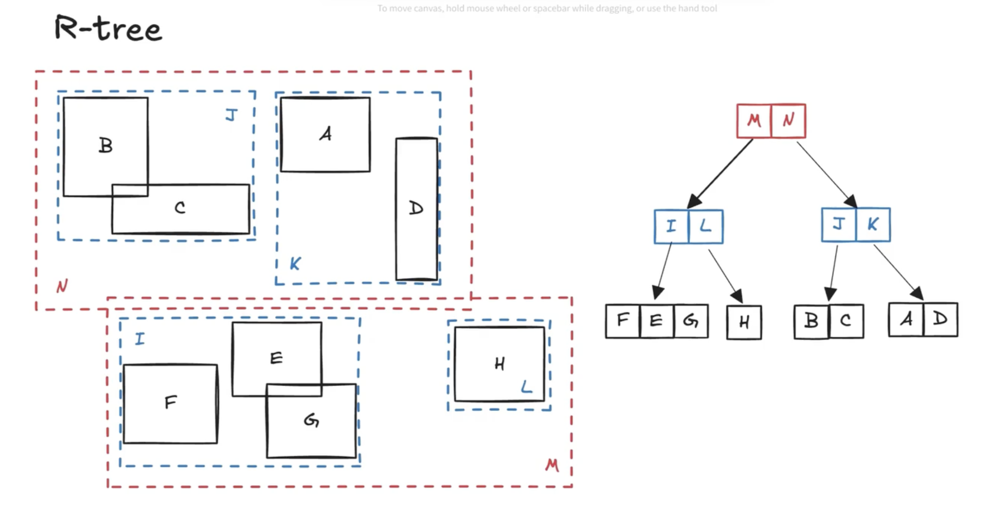
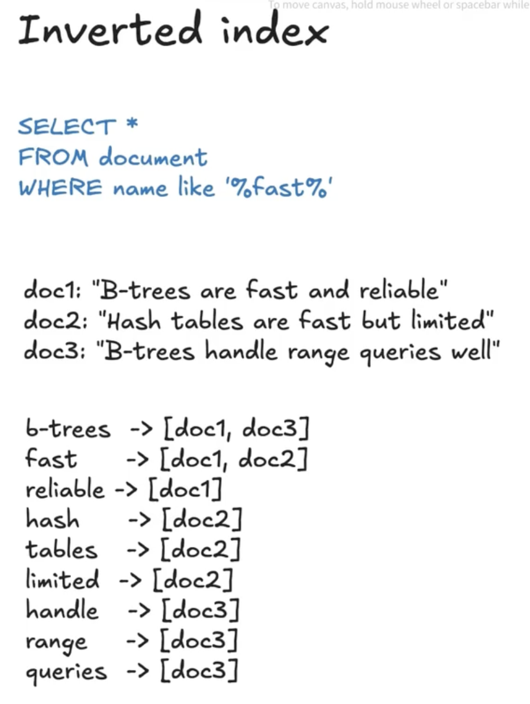

# Indexing

A database index is a data structure that helps an engine locate matching records without reading every table page. An index can also return entries in an order the query needs or contain enough data to answer a query directly. Choose indexes for the queries your system runs frequently, including their filters, sort order, and limits.

## Choose an access path



| Query pattern | Starting point | Brief example |
| --- | --- | --- |
| Small table or a query that reads most rows | Sequential scan | Export every user |
| Equality, range, or ordered reads over ordinary columns | B-tree | Users aged 51, users above 51, or the latest 20 orders for one user |
| Exact key lookup in memory | Hash table or hash index | Find a user by their email address |
| Nearby points or intersecting regions | Geospatial index | Find businesses within 2 km of a location |
| Words, phrases, or relevance search | Inverted index | Find documents containing the word `fast` |
| Arbitrary substrings | Trigram or other n-gram index supported by the engine | Find business names containing `pizza` anywhere |

The chart's 10,000-row cutoff is a rough heuristic. A planner weighs how many pages it expects to read, how selective the filter is, how much data is cached, and whether an index can avoid a sort. A scan can also be the right plan on a large table when a query needs a large fraction of its pages. [PostgreSQL index types](https://www.postgresql.org/docs/current/indexes-types.html) · [Using EXPLAIN](https://www.postgresql.org/docs/current/using-explain.html)

## From scanning pages to looking up rows

Databases typically store table and index data in fixed-size **pages**. PostgreSQL normally uses 8 KiB pages. The database checks its buffer cache first and reads missing pages from storage. A sequential scan reads table pages and evaluates the condition on their rows. A query that returns every matching row usually needs to keep scanning after the first match. [PostgreSQL page layout](https://www.postgresql.org/docs/current/storage-page-layout.html)



In the transcript's example, **100 million users ÷ about 100 rows per page ≈ 1 million pages**. At an assumed 100 microseconds per read, one million serialized page reads would take about **100 seconds**. Prefetching, sequential I/O, cached pages, and parallelism change the time substantially. Page size and rows per page also vary by engine and schema.

With a suitable index, the engine looks up the requested key and uses the resulting row identifiers to fetch the relevant data pages. A B-tree can traverse only the index pages it needs, with frequently used pages often already in memory. Depending on the engine, some queries can return values directly from a covering index. Every additional index uses storage and adds maintenance to inserts, deletes, and updates that affect its contents. [Storage and caching overview](../../data-retrieval-caching-and-indexing/overview.md)

## B-tree indexes



A B-tree keeps keys in sorted order. Its internal pages hold separator keys and child pointers. A page can point to many children, keeping the tree shallow. In a common B+ tree layout, leaf pages contain the searchable entries and are linked in key order. Leaf entries may contain row identifiers, primary keys, or the row data itself, depending on the engine and index type.

```sql
CREATE INDEX users_age_idx ON users (age);

SELECT * FROM users WHERE age = 51;
SELECT * FROM users WHERE age > 51;
```

For `age = 51`, the sketch follows the branch between separator keys 50 and 90, then the pointer for the interval below 55, toward page 3. In a real index, the engine checks leaf entries for the exact key. If several users are 51, their row references may lead to multiple table pages. For `age > 51`, the engine can seek to the first key above 51 and scan forward in key order. Both queries benefit most when the matching rows or pages are a small part of the table.

### Composite indexes match query shape

```sql
CREATE INDEX orders_user_recent_idx
    ON orders (user_id, created_at DESC, order_id DESC);

SELECT order_id, created_at
FROM orders
WHERE user_id = 42
ORDER BY created_at DESC, order_id DESC
LIMIT 20;
```

The equality filter puts one user's orders in a contiguous key range. The next columns match the requested sort, and `order_id` breaks timestamp ties. The engine can start at that user's newest order and stop after 20 rows. A query filtered by `created_at` alone has a different access pattern because this index groups entries by `user_id` first. [PostgreSQL multicolumn indexes](https://www.postgresql.org/docs/current/indexes-multicolumn.html)

## Hash indexes



A hash index maps an exact key to a bucket holding candidate entries. In the transcript's example, hashing `john@test.com` leads to an entry that points to John's row on page 4. Different keys can hash to the same bucket, so the lookup must verify the original key. A well-sized in-memory hash table gives expected constant-time bucket lookup. A disk-backed hash index can still need storage reads for the bucket and matching rows.

Hashing discards key order, so it fits `email = 'john@test.com'` and provides no ordered access for ranges or sorting. A B-tree often serves equality lookups well while supporting other ordered queries. Use a hash index when the engine supports it and measurement shows a benefit for the exact-match workload. [PostgreSQL index types](https://www.postgresql.org/docs/current/indexes-types.html)

## Geospatial indexes



Latitude and longitude describe a two-dimensional search. With separate B-tree indexes, a database might read a wide latitude strip and a wide longitude strip, then intersect the results. A composite B-tree orders the first coordinate before the second, so a broad range on the first coordinate can still produce many candidates. The screenshot uses illustrative grid bounds. For real latitude and longitude queries, use valid coordinates and distinguish a rectangular search area from a radius on Earth.

### Geohash



A geohash turns coordinates into a string whose longer prefixes represent smaller rectangular cells. The sketch demonstrates the hierarchy with cell `2` splitting into `20`, `21`, `22`, and `23`. Real geohashes interleave longitude and latitude bits and encode them in base 32. An ordered index can retrieve entries for a prefix using an appropriate prefix or range lookup.

For a nearby-business search, cover the requested area with geohash cells, look up the corresponding prefixes, and calculate distance for the candidates. Two close points can sit on opposite sides of a cell boundary and have different prefixes. Include all intersecting cells. Coarser cells require fewer cell lookups and bring in more candidates. Finer cells do the reverse. Redis GEO is a practical option for frequently updated points and uses a geospatial encoding in a sorted set. [Redis GEOADD](https://redis.io/docs/latest/commands/geoadd/)

### Quadtree



A quadtree divides a region into four quadrants. The transcript's Yelp example treats each business as a point and splits a leaf when it exceeds five points. Dense areas become smaller cells, while sparse areas remain larger. A radius or bounding-box query visits each overlapping branch and skips branches outside the search area, then checks the remaining candidates. An in-memory quadtree is a useful option for mostly stable points when you can rebuild it from a durable source. [Yelp design case](../../data-retrieval-caching-and-indexing/design-yelp.md)

### R-tree



An R-tree groups objects under minimum bounding rectangles. Internal nodes bound their children, and sibling rectangles can overlap. A spatial query follows the rectangles that intersect its search area and checks candidate shapes precisely at the end. In the sketch, one traversal goes from group `M` to group `I` and then to objects such as `F`. The structure works for both points and shapes such as buildings or delivery zones.

PostGIS commonly uses R-tree-style spatial indexing through GiST. For a `locations.position` column of type `geography(Point, 4326)`, this query can use a GiST index to narrow candidates for a 2,000-meter search. `ST_MakePoint` takes longitude first and latitude second. [PostGIS ST_DWithin](https://postgis.net/docs/ST_DWithin.html)

```sql
CREATE INDEX locations_position_idx ON locations USING gist (position);

SELECT id, name
FROM locations
WHERE ST_DWithin(
    position,
    ST_SetSRID(ST_MakePoint(-118.2437, 34.0522), 4326)::geography,
    2000
);
```

## Inverted indexes



An inverted index maps each normalized term to a **postings list** of documents that contain it. Depending on the search engine, postings can also store positions or term frequencies for phrase search or ranking. The transcript illustrates this with three documents.

```text
doc1  B-trees are fast and reliable.
doc2  Hash tables are fast but limited.
doc3  B-trees handle range queries well.
```

| Term | Matching documents |
| --- | --- |
| `b-trees` | `doc1`, `doc3` |
| `fast` | `doc1`, `doc2` |
| `reliable` | `doc1` |

Searching for `fast` returns documents 1 and 2. Searching for `fast AND reliable` intersects the two postings lists and returns document 1. The exact indexed tokens depend on the analyzer's rules for punctuation, case, stemming, and stop words. PostgreSQL full-text search can use a GIN inverted index, and Lucene-based engines such as Elasticsearch support inverted indexes for text. [PostgreSQL full-text indexes](https://www.postgresql.org/docs/current/textsearch-indexes.html)

```sql
CREATE INDEX documents_body_fts_idx
    ON documents USING gin (to_tsvector('english', body));

SELECT id
FROM documents
WHERE to_tsvector('english', body)
      @@ to_tsquery('english', 'fast & reliable');
```

The transcript's pizza example illustrates three search requirements. A name that **starts with** `pizza` (`LIKE 'pizza%'`) can use an appropriate B-tree prefix search, depending on the database and collation. A search for the **word** `pizza` can use full-text indexing. A search for a **substring anywhere** in a name (`LIKE '%pizza%'`) can use a trigram index such as PostgreSQL's `pg_trgm`. [PostgreSQL index types](https://www.postgresql.org/docs/current/indexes-types.html) · [PostgreSQL pg_trgm](https://www.postgresql.org/docs/current/pgtrgm.html)

## Verify the index against the workload

Start with a slow or frequent query and write down its filters, expected result size, sort, and limit. In PostgreSQL, compare the plan with `EXPLAIN (ANALYZE, BUFFERS)` on representative data. It executes the query and reports actual rows and buffer usage, so try it on a representative read or in a safe environment. Compare read performance with the cost of maintaining the index under realistic write traffic. [Using EXPLAIN](https://www.postgresql.org/docs/current/using-explain.html)

## Source and transcript timestamps

The supplied transcript covers page scans and index lookup at 0:27, B-trees at 2:18, hash indexes at 4:01, geospatial indexes at 5:15, inverted indexes at 10:53, and the decision chart at 13:02. The page-scan diagram above is redrawn from the supplied illustration. [Video](https://www.bilibili.com/video/BV13DdpYYE3w/) · [Hello Interview indexing guide](https://www.hellointerview.com/learn/system-design/core-concepts/db-indexing)
