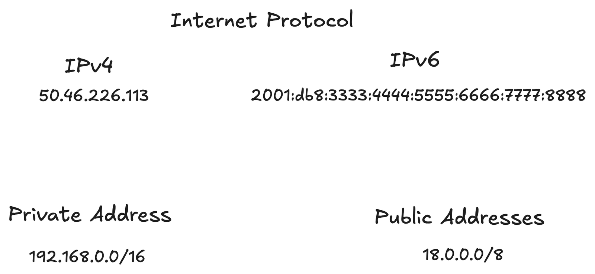

# Internet Protocol (IP)

IP moves packets between networks using source and destination addresses. Routers forward each packet toward the destination using their routing tables. IP provides best-effort delivery. A packet can be dropped, duplicated, delayed, or received out of order, so delivery guarantees come from higher layers when needed.

## Addresses, ports, and prefixes

| Concept | Example | Meaning |
| --- | --- | --- |
| IPv4 | `203.0.113.10` | A 32-bit address usually written as four decimal octets |
| IPv6 | `2001:db8::10` | A 128-bit address written in hexadecimal groups, with zero compression |
| TCP endpoint | `203.0.113.10:443` | IP address plus a TCP port. UDP has its own port namespace |
| CIDR prefix | `10.20.4.0/24` | The first 24 IPv4 bits identify the network, which spans 256 addresses before reservations |
| IPv6 prefix | `2001:db8:1::/64` | The first 64 bits identify the prefix |

The public-looking examples above use reserved documentation ranges. A hostname is a separate identifier. DNS can map one hostname to multiple IPv4 or IPv6 addresses, and an application can use the hostname to select a TLS identity or an HTTP virtual host. [IPv6 specification](https://www.rfc-editor.org/rfc/rfc8200.html)

## Routing, public reachability, and NAT

**Longest prefix match.** When a destination matches several routes, the router forwards using the most specific matching prefix. A route to `10.20.4.0/24` takes priority over `10.20.0.0/16` for destination `10.20.4.25`. A default route such as `0.0.0.0/0` or `::/0` matches when a more specific route is unavailable.

**Private IPv4.** The private blocks are `10.0.0.0/8`, `172.16.0.0/12`, and `192.168.0.0/16`. Organizations can reuse these ranges on independent networks. Overlapping private ranges complicate routing when those networks later connect. A globally routable address also needs correct routes and access rules for inbound traffic to reach a service. [RFC 1918](https://www.rfc-editor.org/rfc/rfc1918.html)

**Network address translation.** A typical IPv4 egress gateway uses address and port translation to let many private clients share a public address. It tracks mappings so return traffic reaches the original client. If an external client needs to start an inbound connection, it typically uses a public load balancer, an explicitly configured forwarding rule, or another reachable intermediary. Translation also affects which peer addresses and ports are usable for direct communication. [WebRTC](12-webrtc.md)

## Design example

Put an Internet-facing load balancer in front of application servers on private subnets. Public clients resolve the service hostname and reach the balancer. The balancer forwards to healthy private endpoints. A separate egress path, such as a NAT gateway, can give those servers outbound IPv4 access when required. Routing and firewall rules determine which hops can communicate.
