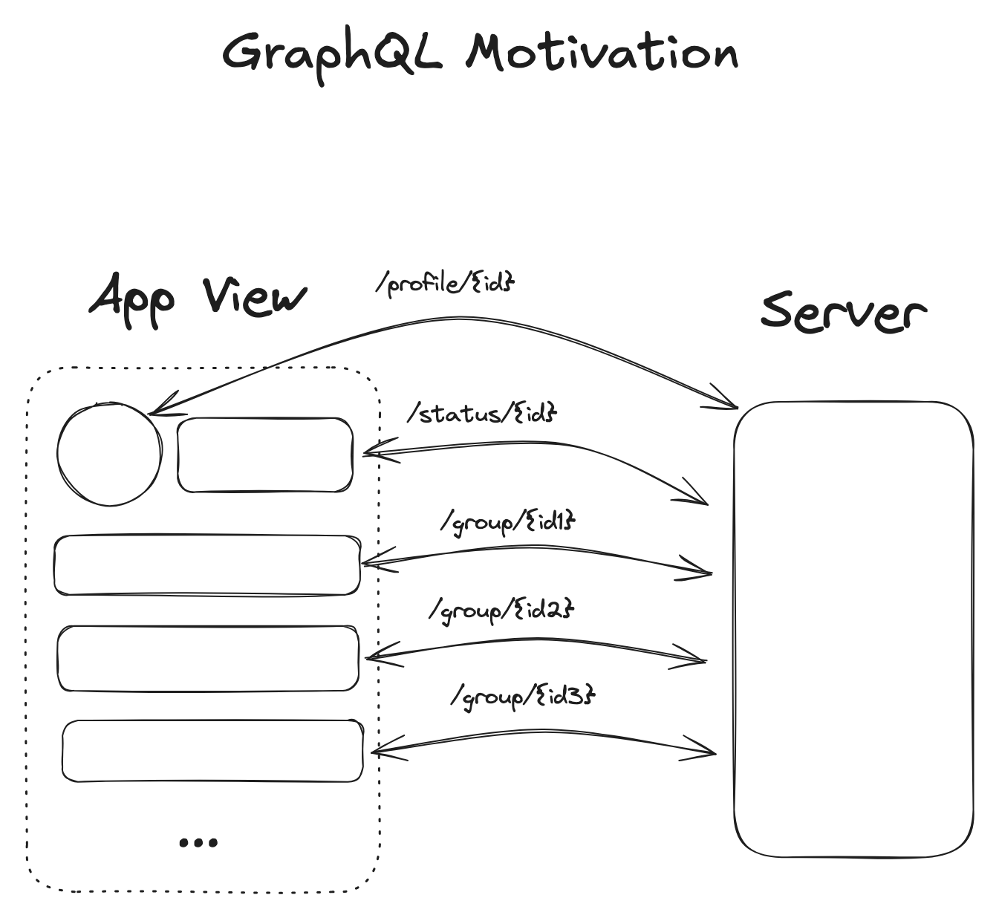
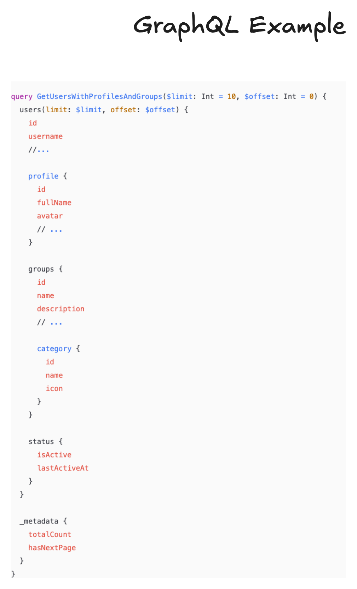

# GraphQL

GraphQL defines a typed schema and a language clients use to select fields. A query reads data, a mutation requests a change, and a subscription describes a stream of results. A web app can send GraphQL queries and mutations to a GraphQL endpoint with the browser's standard `fetch()` API.



## How a query executes

A profile screen needs a name and three recent posts. It can declare exactly those fields in one operation.

```graphql
query Profile($id: ID!) {
  user(id: $id) {
    name
    posts(first: 3) {
      nodes {
        id
        title
      }
    }
  }
}
```

The server validates the operation against its schema and runs field resolvers. A resolver can read a database, call another service, or use data already loaded by a parent resolver. The result has a shape that follows the selected fields. Depending on schema nullability and where an execution error occurs, a response may contain both partial `data` and `errors`. [GraphQL specification](https://spec.graphql.org/)



## What browsers support and what you build

A browser can send the operation as JSON over HTTPS. For example, with the `Profile` query above stored in `profileQuery`, a same-origin web app can call its own GraphQL endpoint like this. [GraphQL over HTTP draft](https://graphql.github.io/graphql-over-http/draft/)

```js
const response = await fetch("/graphql", {
  method: "POST",
  headers: {
    "Content-Type": "application/json",
    Accept: "application/graphql-response+json, application/json",
  },
  body: JSON.stringify({
    query: profileQuery,
    variables: { id: "user_42" },
  }),
});

if (!response.ok) {
  throw new Error(`GraphQL request failed: ${response.status}`);
}

const { data, errors } = await response.json();
```

The UI should inspect `errors` even for a successful HTTP response, since it may have partial data. For a cross-origin endpoint, configure CORS for the frontend origin, the JSON request, and any credentials or authorization headers the app uses.

Adopting GraphQL adds work in the API and the application. The server needs a schema, resolvers, authorization, execution limits, and schema evolution. Browser clients can use plain `fetch()`. Teams may add code generation, a GraphQL client library, or an entity cache as their needs grow. A GraphQL subscription also needs a streaming transport and a matching implementation on both ends, such as GraphQL over WebSocket or an SSE-based transport.

For an existing REST app that only needs generated text to appear progressively, a streaming HTTP endpoint can serve that feature directly. GraphQL becomes more relevant when multiple screens or clients need different views of related data and a shared schema is worth maintaining. [Server-Sent Events](10-server-sent-events.md)
## Costs to plan for

| Design concern | Handling |
| --- | --- |
| N+1 backend calls | Batch lookups by key, such as loading authors for a page of posts in one query. Scope any loader cache to the request or an appropriate authorization boundary |
| Expensive or deeply nested operations | Enforce pagination bounds, cost and depth limits, and execution deadlines. Use persisted operations for known clients where appropriate |
| Authorization | Check access at the resource or field boundary. Two callers can select the same fields and have different permissions |
| Caching | Use normalized entity caching on the client where appropriate. Eligible read queries using GET and persisted identifiers can use a CDN with a suitable cache key and cache policy |
| Partial failure | Decide which fields can be nullable, surface per-field errors, and handle degraded views deliberately on the client |

## Design example

An app with several mobile screens can share a schema while each screen requests a different subset of profile, post, and relationship fields. Batching can keep backend work bounded even when clients select nested lists. For a single stable product screen, an HTTP endpoint that returns a precomposed view can also avoid client round trips and can make caching and load prediction straightforward.
