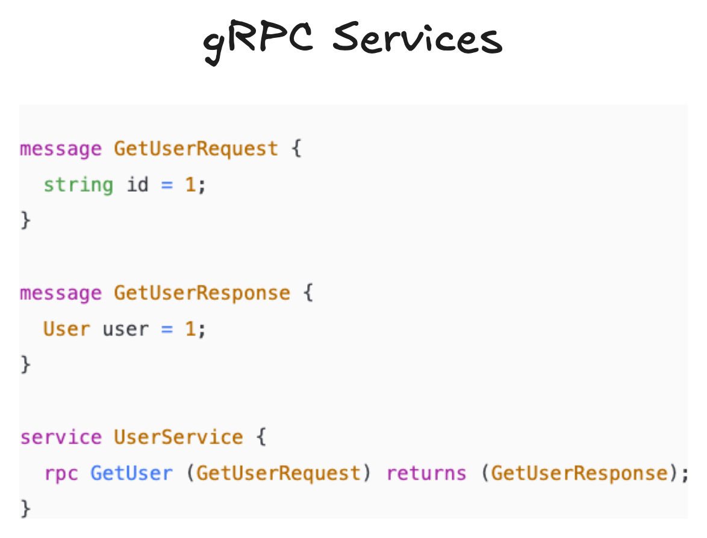
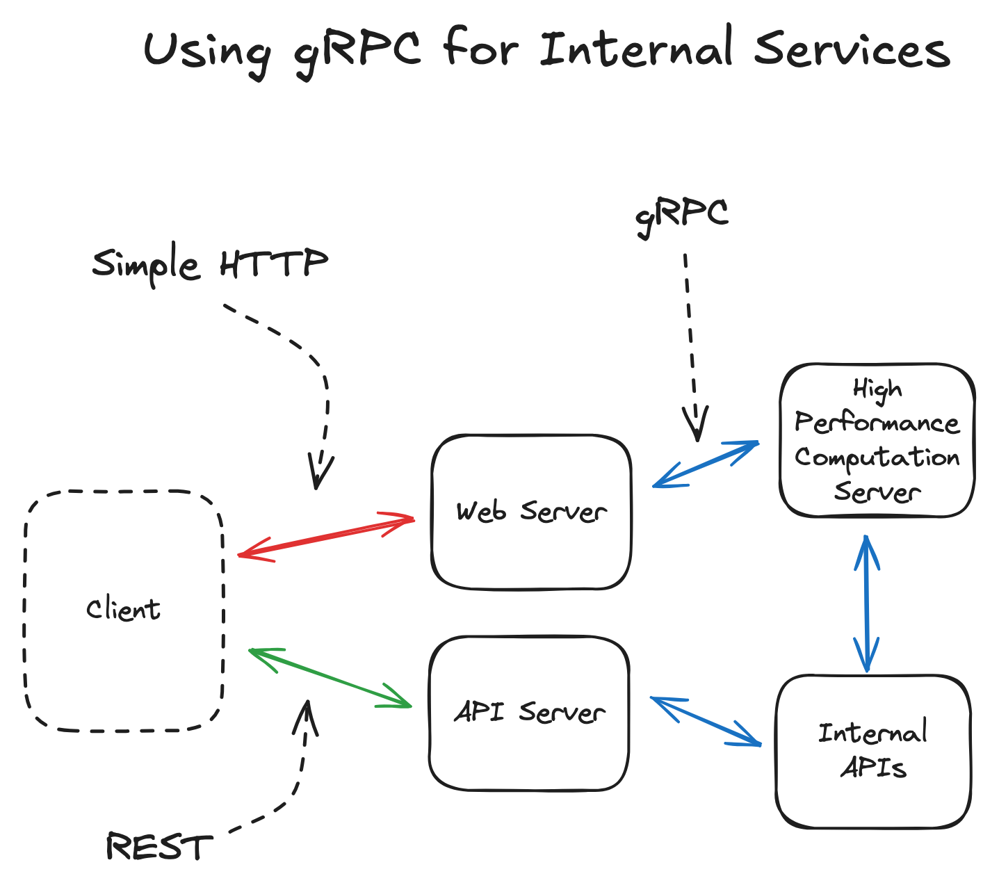

# gRPC

gRPC lets one service call methods exposed by another service through a typed RPC contract. Standard gRPC uses HTTP/2 and commonly uses Protocol Buffers (Protobuf) for schemas and binary serialization. Teams generate client and server code from a `.proto` file so both sides share method and message definitions.

## Define the contract



```proto
syntax = "proto3";

service Inventory {
  rpc GetStock(GetStockRequest) returns (GetStockResponse);
  rpc WatchStock(GetStockRequest) returns (stream GetStockResponse);
}

message GetStockRequest {
  string sku = 1;
}

message GetStockResponse {
  int32 available = 1;
}
```

The numbers are wire field identifiers. Preserve them across compatible schema changes and reserve numbers and names for removed fields to prevent accidental reuse. The binary encoding often reduces payload size for structured messages. Actual performance depends on message shape, compression, allocation, and network conditions. [Protobuf language guide](https://protobuf.dev/programming-guides/proto3/)

## Call patterns and operations

| RPC shape | Example |
| --- | --- |
| Unary | Fetch stock for one SKU |
| Server streaming | Watch stock updates after sending a filter |
| Client streaming | Upload chunks and receive a final result |
| Bidirectional streaming | Exchange telemetry and control messages during one call |

Set a deadline for calls and propagate the remaining budget downstream. Servers should stop work when cancellation is observed where feasible. A `DEADLINE_EXCEEDED` response for a mutation can still leave the outcome uncertain. Define application idempotency before retrying a write. For streaming, plan for flow control, cancellation, and reconnect behavior. [gRPC core concepts](https://grpc.io/docs/what-is-grpc/core-concepts/) · [gRPC deadlines](https://grpc.io/docs/guides/deadlines/)

HTTP/2 lets multiple RPCs share a connection. If an L4 balancer pins that connection to one backend, many RPCs can pile onto one replica. A gRPC-aware client that balances across resolved endpoints, or an L7 proxy that can distribute RPCs, can spread new calls. A long-lived stream still stays with its selected backend until it ends. Browser-facing deployments commonly use a gateway or gRPC-Web for browser compatibility. [Load Balancing](13-load-balancing.md)

## Design example



A checkout service calls `GetStock` to display current availability and uses a separate reservation operation to enforce the stock limit at write time. The lookup can use a short deadline and a bounded retry for eligible failures. A retried reservation needs a stable request ID and deduplication at the inventory service because the previous attempt might have reserved stock before the client timed out. [Timeouts and Retries](15-timeouts-retries-backoff-and-jitter.md)
