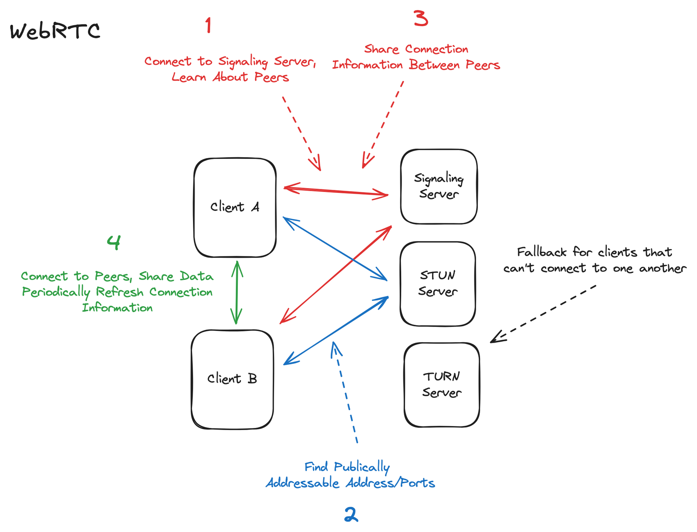
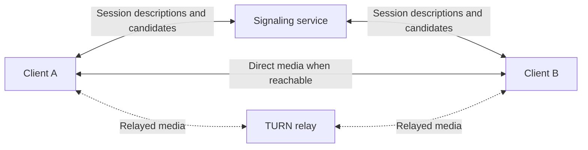

# WebRTC

Web Real-Time Communication (WebRTC) lets browsers and other clients exchange encrypted audio, video, and application data with low latency. It can use a direct peer connection when reachable or exchange media with a relay or media server. An application supplies its own signaling channel, often HTTPS or WebSockets.

## How two endpoints connect

1. **Signaling.** The peers exchange an offer and answer containing session descriptions, such as media types, codecs, and transport parameters. They also exchange ICE candidates.
2. **ICE candidate gathering.** Interactive Connectivity Establishment collects possible paths. These include local addresses, addresses learned through a STUN server, and relay addresses allocated from a TURN server.
3. **Connectivity checks.** ICE tests candidate pairs and selects a working path. STUN helps an endpoint discover the address and port a server sees through its NAT. TURN can relay traffic when peers cannot establish a usable direct path.
4. **Secure media and data.** WebRTC media is protected using SRTP with keys established through DTLS. Data channels use SCTP over DTLS and can be configured for ordered or unordered delivery, with full or partial reliability.

The diagram shows two possible media paths. ICE establishes which path is usable for a given connection. TURN relay capacity and placement matter because relayed media consumes bandwidth and adds a hop. [WebRTC specification](https://www.w3.org/TR/webrtc/) · [ICE specification](https://www.rfc-editor.org/rfc/rfc8445.html) · [TURN specification](https://www.rfc-editor.org/rfc/rfc8656.html)

## Design example

A one-to-one video call can attempt a direct path and use TURN when needed. For a larger meeting, a full mesh makes each participant upload to every other participant. A Selective Forwarding Unit (SFU) receives media from each publisher and forwards selected tracks or quality layers to subscribers. This reduces per-client upload requirements while moving bandwidth and failure concerns into the media infrastructure. Clients may still need TURN to connect to the SFU from restricted networks.

Track call setup success, time to first media, relay usage, packet loss, and bitrate. Place TURN servers and SFUs based on participant locations and available capacity. A geographically distributed call may use a single well-placed SFU or interconnect several SFUs when the scale and latency goals justify the added complexity.
