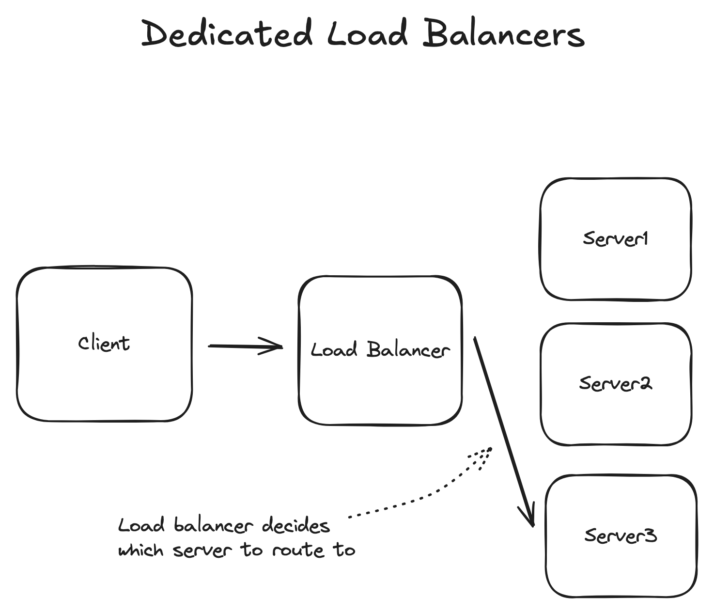
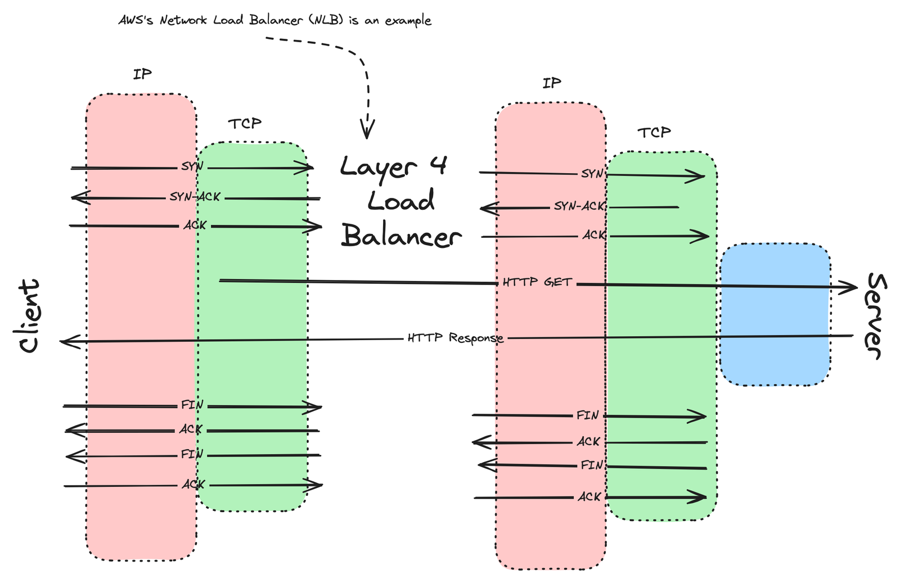
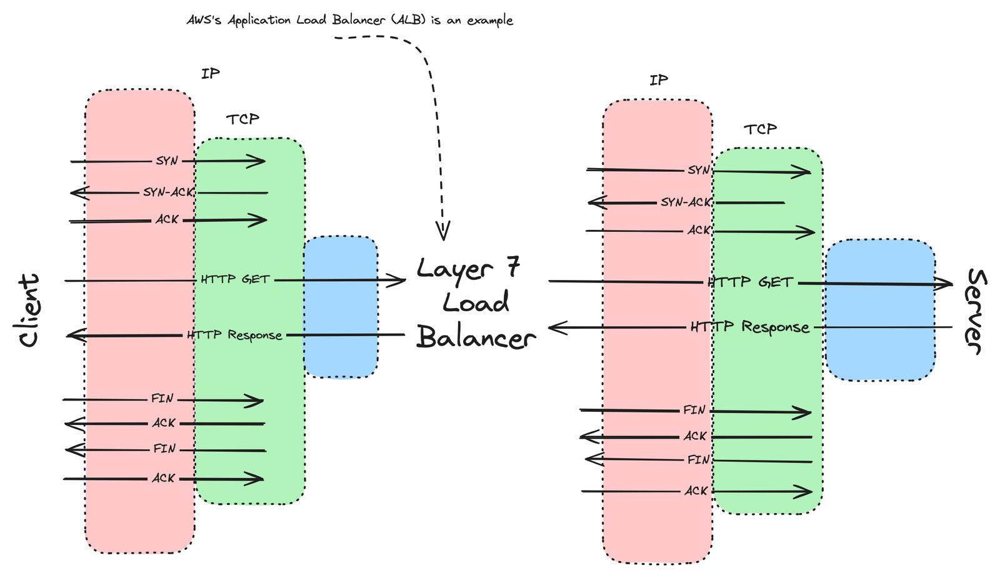

# Load Balancing

Vertical scaling gives an instance more resources. Horizontal scaling adds instances and needs a way to direct traffic among them. Load balancing selects an eligible backend based on endpoint discovery, health, and a routing policy.

## Choose where balancing happens

| Approach | Usual routing unit | What it enables | Operational concern |
| --- | --- | --- | --- |
| Client-side | Connection or request, depending on the client | The client selects from discovered endpoints and can balance calls across its own connections | Every client needs compatible discovery, health information, and balancing behavior |
| L4 balancer | TCP connection or UDP flow | Forwarding based on the network and transport tuple, often with TLS passed through | Multiplexed or long-lived flows can concentrate work on one backend |
| L7 reverse proxy | Application request or stream, depending on the protocol | Route by HTTP host, path, or headers, and apply request-level policies | Requires protocol support and usually TLS termination for HTTPS inspection |

L4 products can forward packets, translate addresses, or proxy connections depending on implementation. An L7 proxy can terminate client TLS and use a separately encrypted hop to the backend. Balance the unit that carries the work. A few connections can carry many gRPC calls, while a WebSocket established for an hour can consume resources even when its request count stays low. [gRPC](09-grpc.md) · [WebSockets](11-websockets.md)

## Backend selection and lifecycle

- **Round robin and weights.** Rotate across endpoints to distribute similar work. Give higher-capacity or newly deployed backends explicit weights to control their share.
- **Least connections or least requests.** Prefer endpoints with less active work where duration varies. Track a metric that fits the protocol and workload, since one multiplexed connection can carry many requests.
- **Hashing and affinity.** Select by a stable key when cache locality or session routing matters. Consistent hashing can reduce remapping as endpoints change. Hot keys can still produce skew.
- **Health and draining.** Use readiness checks for new traffic, and consider passive signals such as repeated connection failures. Remove an instance from new selection before terminating it, and give active work a bounded drain period. Size the remaining fleet to absorb unavailable capacity.

## Design example

An API edge uses one public hostname. An L7 proxy routes `/api` to an application pool and `/images` to an image pool. Each pool can scale independently. A separate gRPC-aware balancing policy spreads internal RPCs, and the WebSocket gateway pool is sized by open connections and fan-out throughput. Observe backend error rates, latency, pool saturation, and distribution across instances. [Cloud load balancing note](<../../web development/云负载均衡详解.md>)
