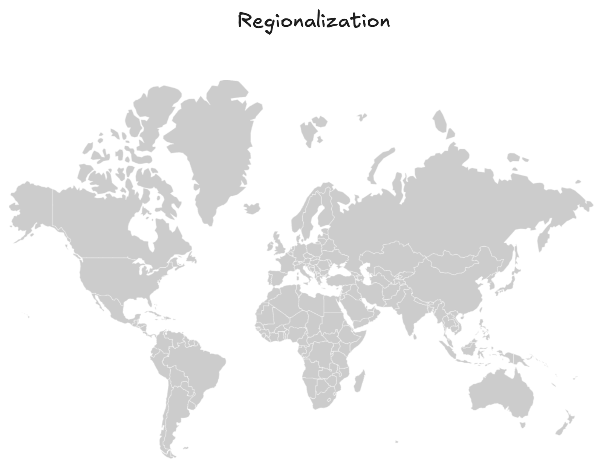

# Regionalization and Multi-Region Design

A region is a geographic deployment area. A region often contains several availability zones, which provide separate failure domains within that region. Serving users from multiple regions can reduce network round-trip time, contain regional failures, and support data residency requirements. Those benefits depend on how traffic, state, and dependencies are placed.

## Route traffic to a suitable region

Global routing can use DNS responses or a global proxy. DNS can select endpoints by health, policy, or geography, but cached answers and existing connections delay some failovers. A global proxy can apply routing decisions when it accepts traffic, subject to how it maintains connections and obtains health information. When a regional failure breaks an established stream, the client can reconnect through the global endpoint and recover its session from a durable cursor or snapshot.

A region needs enough healthy capacity, the right data, and working dependencies. Nearest by map distance can differ from lowest network latency. A nearby frontend that calls an origin or database across an ocean on every request still pays that cross-region round trip.

For geographically scoped work, partition data by the location that owns the operation. A rider searching for nearby drivers in Miami can reach the service and spatial index for that market. Driver matching stays local, while global account or billing data can follow a separate ownership policy. Route by pickup location when it determines the market. [Ride-matching design](<../../Instant Messaging System/design-uber.md>) · [Sharding](../sharding/README.md)

## How a CDN works at each edge location

A **content delivery network (CDN)** runs servers at many edge locations called **points of presence (PoPs)**. A PoP usually has multiple edge servers and can serve as a nearby entry point for users. The **origin** is the application server or storage service that supplies the content. A deployment can have dozens of PoPs in front of an origin in one region, or it can route from its PoPs to origins in several regions.

### Follow a request from the browser

1. **Reach a PoP.** The browser resolves the site's hostname to a CDN address. DNS-based steering, anycast routing, or both direct the connection to a reachable PoP. With anycast, multiple PoPs advertise the same IP prefix, and network routing selects a path. Network policies and health can affect which PoP the browser reaches. Inside the PoP, the CDN directs the request to an edge server.
2. **Look up the response.** The edge typically terminates HTTPS, applies the site's cache policy, and looks in its cache using a key based on the host, path, and any configured variants. For example, if a query parameter changes the size of an image, the key needs to distinguish those sizes.
3. **Handle a hit or a miss.** On a fresh hit, the edge returns the response without contacting the origin. On a miss, it requests the object from an optional **regional cache**, also called an **origin shield**, or goes directly to the origin. A shield lets nearby PoPs share cached objects and can combine concurrent requests for the same object before they reach the origin. On an expired entry, the CDN can revalidate it with the origin using an `ETag` and reuse the stored bytes if the origin returns `304 Not Modified`.
4. **Fill the cache.** When the upstream returns a cacheable response, the edge stores it and returns it to the browser. Other PoPs fill their caches as requests arrive, so the same request can hit in one location and miss in another. A **time to live (TTL)** limits how long a cached response stays fresh. Use versioned URLs for new static assets and purge cached copies when a response at the same URL must be refreshed before its TTL expires. [HTTP caching](06-http.md) · [CDN design case](<../../Layered Architecture/Cloudflare-Design-CDN.md>)

### Connect the edge to application regions

| Request | How the CDN and regions handle it |
| --- | --- |
| Public image or versioned JavaScript | The PoP serves a fresh cached copy when available. On a miss, a shield or a healthy origin with the same asset supplies it |
| Public listing with changing details | The PoP can use a short shared TTL if brief staleness is acceptable. Use revalidation or purge for updates that need to appear sooner |
| Personalized read | The PoP typically bypasses shared caching and forwards the request to an authorized regional origin. For sensitive responses, use a cache policy such as `Cache-Control: private` or `no-store`, depending on whether browser storage is appropriate |
| Reservation or payment write | The edge can forward the request, and the application routes the write to the region that owns the data or can safely coordinate the update |

For example, a Toronto browser may download a venue image directly from a Toronto PoP. A Montréal PoP that lacks the image can fetch it from a shared eastern Canada shield. If both layers miss, the request reaches the regional origin. The same browser's seat reservation can pass through the Toronto edge to the inventory writer in the event's home region. The image path saves a trip to the application when cached. The reservation path still needs the authoritative inventory service.

**Plan for edge and origin failures separately.** If a PoP loses reachability, subsequent connections can go to another PoP that may have a colder cache. If an origin region fails, edges can continue serving fresh cached objects. Where the content policy permits it, `stale-if-error` can let a supporting CDN serve an expired copy temporarily. Route misses and uncached traffic to a healthy origin with the required data and capacity. Writes still follow the application's failover policy. If data residency applies, check where CDN responses and request logs can be stored or processed as well as where the origin runs.

## Choose how regions serve and own data

| Model | How it works | Trade-off |
| --- | --- | --- |
| Active-passive | One region serves primary traffic and a standby takes over when necessary | Simpler write ownership. Recovery depends on standby readiness and replica freshness |
| Active-active serving with a home region for writes | Multiple regions serve traffic. Each record or tenant has an assigned write region | Regional reads can be fast. Writes from another region and failover add coordination |
| Multi-region writes for the same data | More than one region can accept writes under a coordination or conflict-resolution policy | Cross-region coordination adds latency. Asynchronous concurrent writes require conflict semantics |

Synchronous cross-region replication can add round trips to writes. Asynchronous replication keeps those round trips off the write path but allows replication lag and possible loss of recent acknowledged writes if the primary is destroyed before replication. A **recovery time objective (RTO)** bounds the targeted recovery time. A **recovery point objective (RPO)** bounds acceptable data loss measured in time. State both objectives and check what the design can actually achieve.

## Design example

For a ticketing service, cache public listings in several regions and give each event one authoritative inventory writer so seat reservations enforce the same invariant. Replicate confirmed state for recovery. During regional failover, fence the old writer so it cannot continue accepting reservations, establish replica freshness or the recovery point, promote a new writer, and reroute traffic. If write ownership or state cannot be established safely, serve degraded reads and temporarily pause reservations. Test failover, failback, and peak traffic capacity in the surviving region. [AWS disaster recovery strategies](https://docs.aws.amazon.com/whitepapers/latest/disaster-recovery-workloads-on-aws/disaster-recovery-options-in-the-cloud.html)
