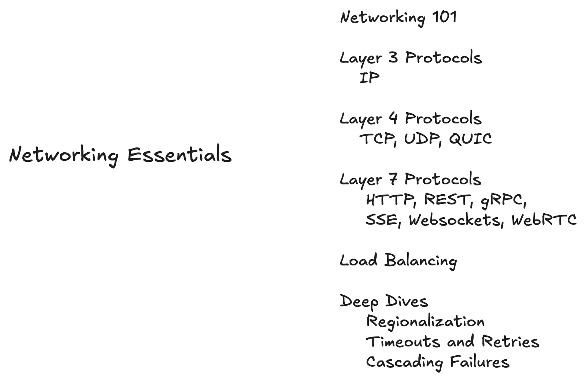

# Networking Fundamentals for System Design

This guide follows a request from the network to the application, then looks at how to route traffic and handle failures. Each note includes a cropped figure from the original networking reference, a design example, and trade-offs.

## Reading order

| Topic | What you should be able to explain |
| --- | --- |
| [1. OSI Model](01-osi-model.md) | How application data is encapsulated and where L3, L4, and L7 decisions happen |
| [2. Internet Protocol](02-internet-protocol.md) | How IP addressing, CIDR, routing, and NAT fit together |
| [3. TCP](03-tcp.md) | When a reliable byte stream, retransmission, and ordering matter |
| [4. UDP](04-udp.md) | When independent datagrams and control over delivery semantics matter |
| [5. QUIC](05-quic.md) | How independent streams, integrated TLS, and connection migration support HTTP/3 |
| [6. HTTP and HTTPS](06-http.md) | Request semantics, caching, connection reuse, and HTTP version differences |
| [7. REST APIs](07-rest-apis.md) | Resource design, pagination, concurrent updates, and idempotency |
| [8. GraphQL](08-graphql.md) | How GraphQL works in browsers and what it adds to the frontend and backend |
| [9. gRPC](09-grpc.md) | How typed contracts, deadlines, and streaming shape service-to-service calls |
| [10. Server-Sent Events](10-server-sent-events.md) | How to stream generated text, job progress, and other server updates over HTTP |
| [11. WebSockets](11-websockets.md) | How topic subscriptions, message brokers, and bidirectional browser messaging fit together |
| [12. WebRTC](12-webrtc.md) | How signaling, ICE, STUN, TURN, and SFUs support real-time media |
| [13. Load Balancing](13-load-balancing.md) | How L4, L7, and client-side balancing distribute traffic |
| [14. Regionalization](14-regionalization.md) | How CDN edge locations serve content, route to regional origins, and handle failover |
| [15. Timeouts, Retries, Backoff, and Jitter](15-timeouts-retries-backoff-and-jitter.md) | How to retry safely within a deadline while limiting extra load |
| [16. Circuit Breakers and Cascading Failures](16-circuit-breakers.md) | How to contain a failing dependency and admit traffic as it recovers |

## Common use cases

| Requirement | Starting point | Design consideration |
| --- | --- | --- |
| Public API for uploading and retrieving files | HTTPS with REST-style resources | Resume interrupted uploads without duplicating data |
| A mobile screen combines a profile, posts, and relationships | GraphQL or an HTTP endpoint that aggregates the view | Bound the number of backend calls per request |
| Browser receives progress updates for an asynchronous job | SSE plus HTTP requests for actions | Recover events after a disconnect |
| Chat UI displays an AI reply as it is generated | A streaming POST response with SSE framing | Render text deltas and distinguish completion from a dropped connection |
| Interactive chat with messages and typing indicators | WebSockets plus durable message history | Choose which messages need acknowledgment, deduplication, or replay |
| Group video call | WebRTC with an SFU | Support restricted networks and place media servers near users |
| Typed calls between internal services | gRPC | Distribute calls when several share a connection |
| Checkout during a downstream slowdown | Deadline, idempotency key, bounded retries, and circuit breaker | Define which operations can fail fast and how to resolve an uncertain charge |
