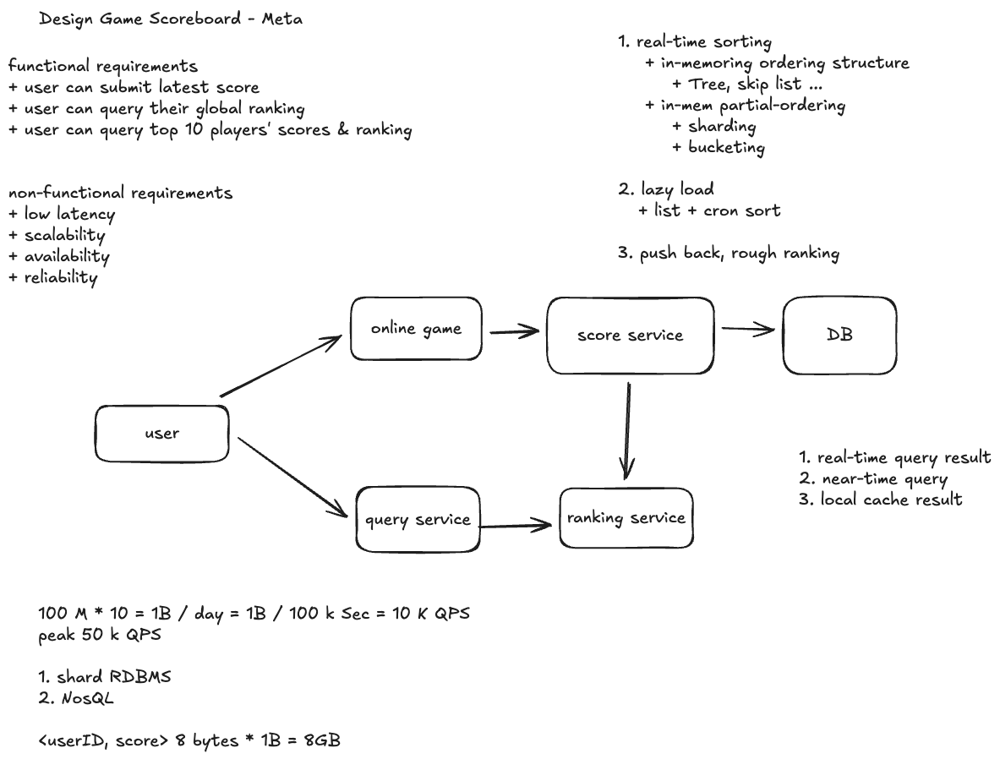
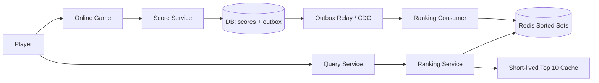

# 案例分析：设计游戏排行榜（Design Game Scoreboard — Meta）

> 根据你提供的 Meta 面试题笔记、手绘架构图和 Q&A 整理。容量与延迟数字用于设计练习；先明确业务语义，再讨论数据结构、分片与一致性、持久化与容灾、性能与热点。

## 1. 范围与需求

**功能需求**

- 玩家提交最新分数。
- 玩家查询自己的全局排名与分数。
- 查询全球 Top 10 玩家的分数与排名。

**非功能需求**：低延迟、可扩展、高可用、可靠。这里采用“分数提交成功后可靠保存，排行榜允许短暂延迟”的假设，例如查询延迟目标为几十毫秒、榜单通常在秒级内更新；具体 SLO 需与面试官确认，不能把这些示例数字当成题目已给条件。

必须先澄清三件事：

1. **分数是什么？** 最新分数、历史最高分、累计积分是三种不同写入语义。本案例默认每个玩家在一个赛季内保存最新有效分数；如果业务只保留最高分，需要改成取最大值。
2. **同分如何排名？** 默认采用唯一序位 `1, 2, 3…`，同分按稳定规则排序。若业务要求 `1, 1, 3` 的竞赛排名，应计算“严格高于自己分数的人数 + 1”；若要求 `1, 1, 2`，则还需要不同分值的计数索引。
3. **实时到什么程度？** 更新已持久化与更新已反映在全局榜单上是两个时刻。精确排名也不等于强一致排名：某个索引版本的排名可以精确，但比最新提交稍旧。

写入应来自受信任的游戏服务，或经服务端验证。客户端可以提交比赛结果标识，不能任意指定别人的 `player_id` 或直接修改排行榜。

## 2. 架构与主流程



原图展示了 `User → Online Game → Score Service → DB` 的提交链路，以及 `User → Query Service → Ranking Service` 的查询链路。图中 `Score Service → Ranking Service` 是逻辑更新关系；落地时必须处理数据库与 Redis 双写失败的问题。

一种可演进的实现如下。初期可以用 Outbox 轮询，不必立即引入独立消息系统：



1. **提交分数**：Score Service 验证身份、比赛结果和幂等键，在同一数据库事务中更新玩家分数与版本，并插入 Outbox 记录；事务成功后返回提交成功。
2. **更新排名**：Relay 读取已提交的 Outbox，直接投递给 Ranking Consumer，或经过持久化消息流投递。Consumer 将结果应用到 Redis 后确认处理；失败则重试。CDC 也可以从已提交的数据库变更中捕获更新。
3. **查询**：Query Service 调用 Ranking Service，后者读取 Redis 排名索引；Top 10 可通过短 TTL 缓存或定期发布的快照分摊读取。玩家昵称、头像等资料另行批量查询或缓存。
4. **故障恢复**：Redis 是可重建的排名索引，DB 是本方案的 source of truth。更新丢失、索引损坏或故障切换后，通过重放和对账恢复。

如果采用“持久化事件日志先提交，再派生 DB 与排行榜”的架构，日志也可以成为 source of truth；关键是**已持久化、可重放且有明确提交边界**。数据库不是唯一可能的真相来源，但单独的 RPC 调用和易失内存不能承担这个职责。

## 3. 数据模型与 API

| 对象 | 关键字段 | 用途 |
| --- | --- | --- |
| `scores` | `(season_id, player_id)`、`score`、`version`、`updated_at` | 保存每位玩家的当前有效分数；主键包含赛季 |
| `score_submissions` | `submission_id`、`player_id`、`match_id`、处理结果 | 持久化业务幂等键，防止比赛结果重复计分 |
| `outbox` | `event_id`、`season_id`、`player_id`、`score`、`version`、投递状态 | 与分数同事务写入，支持重试投递 |
| Redis ZSET | `leaderboard:{season_id}`，member 为 `player_id`，score 为分数 | 提供有序查询；不是全部业务字段的存储 |
| 索引版本信息 | 玩家已应用的 `version`、构建代次、checkpoint | 拒绝旧更新并支持恢复；实现时与分数原子更新 |

示例接口：

```text
POST /seasons/{season_id}/scores
     { submission_id, match_id, score }
GET  /seasons/{season_id}/leaderboard?limit=10
GET  /seasons/{season_id}/players/{player_id}/rank
```

写接口从认证上下文解析玩家身份，返回已提交的分数和版本；读接口返回分数、排名，以及适用时的快照时间或索引版本。新玩家尚未进入索引时应返回“排名更新中”或“未上榜”，不能把不存在的 rank 当成第一名。

## 4. 数据结构：为什么是 Sorted Set？

HashMap 能快速查玩家分数，但无法快速回答有序 Top 10 和排名。每次把所有玩家重新排序成本太高；大小为 10 的 Heap 能维护 Top 10，却不足以查询任意玩家的全局排名。

需要同时支持“按玩家查分数”和“按分数查顺序”。可以用 HashMap + 带子树大小的平衡树，或带跨度信息的 Skip List。普通平衡树或 Skip List 如果没有排名所需的统计信息，不会自动得到高效 rank 查询。

Redis **Sorted Set（有序集合）**封装了这些能力：member 唯一，每个 member 关联一个 score，自动按分数排序。大规模 ZSET 常用哈希表与 Skip List 组合；小集合可能使用紧凑编码，具体取决于 Redis 版本与配置。除了排行榜，它也适用于优先级队列和二级索引。

### 关键命令

下面用独立演示 key 展示命令；生产写入还需配合下一节的版本和幂等控制。

```redis
# 添加玩家，或把已有玩家的分数替换为最新值
ZADD leaderboard:demo 1200 player:42

# 累计积分：原子增加 50 分，不需要先 GET 再计算
ZINCRBY leaderboard:demo 50 player:42

# Redis 6.2+：按分数从高到低返回前 10 名及分数
ZRANGE leaderboard:demo 0 9 REV WITHSCORES

# 旧写法，便于阅读教程和存量代码
ZREVRANGE leaderboard:demo 0 9 WITHSCORES

# 倒序排名，0 表示第一名；展示时加 1
ZREVRANK leaderboard:demo player:42

# 查询某位玩家分数
ZSCORE leaderboard:demo player:42

# 历史最高分场景：仅在新分数更高时更新，或插入新成员
ZADD leaderboard:demo GT 1300 player:42
```

`ZRANGE` 默认从低到高；`REV` 或 `ZREVRANGE` 从高到低。范围的 stop 是闭区间，所以 Top 10 用 `0 9`。

| 操作 | 常见复杂度 | 说明 |
| --- | --- | --- |
| `ZADD` / `ZINCRBY` | 单 member 为 `O(log N)` | 更新分数并维护排序 |
| Top K | `O(log N + K)` | 输出结果本身需要 `O(K)` |
| `ZREVRANK` | `O(log N)` | 返回唯一序位的零基索引 |
| `ZSCORE` | `O(1)` | 按 member 查分数 |

**同分规则**：Redis 默认在同分时按 member 字节字典序排列，倒序查询时字典序也反转；这不是数值形式的玩家 ID 排序，也不是“先达到分数者优先”。如果要求后者，应显式设计复合排序索引。不要随意把分数与时间拼成一个巨大浮点数：Redis score 使用双精度浮点数，整数精确表示范围受约 `2^53` 限制。

## 5. 一致性：可靠提交、异步派生、幂等应用

### 为什么不能只“先写 DB，再调 Redis”？

DB 提交后服务崩溃，Redis 更新可能永远没发生；反过来先写 Redis，DB 写入失败又会显示不存在的成绩。仅调整双写顺序无法消除这个窗口。

Outbox 把“分数变更”和“待更新排名的事实”放入同一个事务。投递和消费通常是至少一次，因此还要解决重复与乱序：

- **业务提交幂等**：同一个 `submission_id` 或 `match_id` 只能产生一次计分效果；并发更新时由 DB 事务、条件更新或行锁保证分数与版本一致。
- **事件携带绝对分数与版本**：例如 `(player:42, score=1300, version=8)`。Consumer 在 Redis 内原子比较版本，只有版本更大才更新 ZSET 和版本记录；重复或更旧的事件直接忽略。
- **原子性边界**：可通过 Lua 脚本或 Redis Function 完成比较与更新；在 Redis Cluster 中，脚本涉及的 ZSET 和版本 key 必须位于同一 hash slot。版本元数据也需要纳入内存与恢复预算。
- **增量事件需要额外去重**：直接重试 `ZINCRBY +50` 会重复加分。累计积分也可以先在 DB 中正确累加，再发布最新绝对分数；若传递增量，则必须原子记录事件去重信息，并明确去重保留期与重放边界。

“最新分数”允许下降，因此不能用 `ZADD GT` 代替版本控制；只有最高分语义才适合取最大值。按玩家分区的消息流有助于保持同一玩家的更新顺序，但不能代替业务幂等与恢复设计。

### 排名、分数和读己之写

玩家可能在提交成功后短暂看到旧排名。一般可以返回“分数已保存，排名更新中”，并监控提交到索引可见的延迟。若必须读己之写，可让客户端带上提交版本，Ranking Service 有界等待索引追上；超时返回 pending 或旧快照及其状态。跨分片实时全局排名的保证仍需单独定义。

如果需要同一时刻的分数和排名，单独执行 `ZSCORE`、`ZREVRANK` 可能读到两次更新之间的结果；可在同一 Redis 分片上用脚本原子读取。Top 10 用一次带分数的范围查询获取。周期快照则应带共同的快照版本。

分布式事务可以提供更强的跨存储提交保证，但增加协调、延迟和可用性成本。普通游戏排行榜通常更适合最终一致、有限重试、失败告警与定期对账。

## 6. 容量估算：请求次数与玩家数量分开算

手绘图假设 `100 M` 玩家、每人每天 `10` 次操作：

```text
100,000,000 × 10 = 1,000,000,000 次操作 / 天
平均 QPS = 1,000,000,000 / 86,400 ≈ 11,574
按一天约 100,000 秒粗算 ≈ 10,000 QPS
峰值假设 ≈ 50,000 QPS
```

需要进一步拆分提交、个人排名查询和 Top 10 查询的比例。若每次更新导致多个赛季榜、地区榜和活动榜更新，还要计算写放大。

图中的 `<userID, score> 8 bytes × 1B = 8GB` 只能视为简化的裸数据估算：

- 排名索引按**唯一玩家数**计数。若有 1 亿玩家，一个全局榜约有 1 亿个 member；每天 10 亿次更新不等于 10 亿个 member。
- 如果玩家 ID 和分数各占 8 字节，1 亿条裸数据约为 `1.6 GB`；即使二者合计只有 8 字节，也约为 `0.8 GB`。
- Redis 还要保存 member、哈希表、Skip List 节点、指针、分配器开销和版本信息；加上副本、持久化与重建空间后，实际预算显著高于裸数据。

应使用真实长度的 ID 与代表性数据做内存采样和负载测试，观察 `MEMORY USAGE`、进程 RSS、CPU、查询延迟及更新吞吐。单个 ZSET 能否承载这个规模必须实测，不能仅凭 Big-O 判断。

## 7. 分片：Top K 容易合并，全局排名更难

### 方案 A：一个榜单一个 Sorted Set

这是最清晰的基线：所有排名与更新都在同一有序集合中完成。可按游戏、赛季、地区或模式拆成独立榜单，但这改变或细分了查询范围，不能自动替代全球榜。

**Redis Cluster 按 key 分片，不会自动把一个巨大 ZSET 拆到多台机器。** 一个全球排行榜大 key 仍受单分片内存和 CPU 限制。增加 Ranking Service 实例也不会消除这个存储热点。

### 方案 B：按 player_id 哈希分片

同一玩家始终进入一个分片，更新负载比较均匀，扩缩容需要路由与迁移：

- **全局 Top K**：每个分片返回自己的 Top K，聚合后再取全局 Top K；若有 `S` 个分片，最多收集 `S × K` 个候选。同分必须使用一致的全局比较规则。
- **某玩家的全局名次**：先取得玩家分数，再向所有分片统计排在该玩家之前的人数，最后加 1。竞赛排名可用 `ZCOUNT key (score +inf` 统计严格高分者；Redis 的 `(` 表示开区间。唯一序位还要计算同分且按 tie-breaker 排在前面的玩家，不能只加高分人数。
- **成本与一致性**：个人排名需要跨所有分片 fan-out，放大 QPS 并受慢分片影响。各分片在不同时间读取，结果不一定对应同一个全局时刻；需要精确快照时，采用有版本的周期物化结果或额外协调。

哈希分片解决写分布问题，但不会免费提供低延迟、强一致的任意全局排名。

### 方案 C：按分数区间分桶

例如按 `[0, 1000)`、`[1000, 2000)` 分桶，每桶维护有序集合与人数：

```text
全局名次 = 所有更高分桶的人数 + 桶内名次
```

桶计数可用前缀和结构、Fenwick Tree 或 Segment Tree 加速；但跨桶移动时，需要保证移出、移入与计数变更的协调。同分不能任意拆开，否则还需补充同分排序规则。分数分布偏斜会形成热门桶，动态拆桶也增加复杂度。

若允许近似排名，可以用分数直方图返回“前 5%”或排名区间，降低维护精确顺序的成本。若必须精确，需明确跨桶事务或单写入协调、迁移中的去重与读版本，而不是简单地把各桶计数相加。

## 8. 持久化、恢复与重新构建

- **持久化**：DB 负责本方案的可靠提交；Redis RDB 快照、AOF 和副本可以缩短恢复时间，但不替代真相源。Redis 异步复制在故障切换时仍可能丢失最近的索引更新。
- **服务重启**：Ranking Service 重启通常不影响独立运行的 Redis；不应每个服务实例启动都全量扫描 DB。Redis 重启也可先从自身持久化恢复，再补齐差异。
- **重放**：记录消费 checkpoint，并结合日志保留期恢复。已消费的数据若随 Redis 故障丢失，直接从最新 checkpoint 继续并不能补回；需要回退到可恢复位置重放，或从 DB 对账。
- **全量重建**：读取 DB 一致性快照到新一代 ZSET，在扫描期间捕获并补放增量，使用玩家版本拒绝旧数据；追平后校验人数、分数抽样和 Top K，再切换读取代次。保留旧代次供短期回滚，并预留双份内存。
- **切换边界**：写入需要覆盖切换窗口，避免新索引切流后漏掉仍在更新旧索引的事件；多分片切换需要统一的路由代次。单机原子改名不能直接解决跨分片切换。
- **对账**：定期按玩家范围或分区比较 DB 与索引的分数、版本和成员数量，修复遗漏。玩家删除、作弊撤分和赛季关闭也要作为带版本的变更处理，避免旧事件把已删除玩家重新加入。

恢复目标应区分 RPO（能接受丢失多少已提交数据）与 RTO（多久恢复服务）。本方案希望已提交分数不丢；排行榜短暂落后或降级可接受。DB 自身也需要备份、复制与恢复演练。

## 9. 性能、热点与降级

| 问题 | 应对方式 | 代价与边界 |
| --- | --- | --- |
| Top 10 被反复读取 | Ranking Service 本地缓存、共享缓存或周期发布快照 | TTL 内可见旧结果；返回快照时间 |
| 全球榜单大 key 写热点 | 先测单分片上限，再选择玩家分片或分数分桶 | 查询和迁移复杂度增加 |
| 同一玩家频繁更新 | 限流，必要时合并待应用更新 | 最新分数保留最新版本；累计分数必须正确累加 |
| 多次 Redis 往返 | 批量查询、pipeline；需一致读取时用脚本 | pipeline 降低网络开销，但不提供原子性 |
| 某个分片超时 | 返回上次完整快照或显式标记不可用 | 不能把缺少分片的 Top K 当成完整全球榜 |
| Redis 暂时不可用 | 继续可靠保存分数，积压排名更新；读取旧快照 | 告知延迟并监控 backlog；避免全量查询压垮 DB |

核心监控包括提交与查询的 p95 / p99 延迟、DB 提交到排名可见的延迟、Outbox / 消费积压、失败重试、各分片 CPU 与内存、复制延迟、对账差异和重建耗时。排名索引不适合被普通缓存淘汰策略随机移除成员或关键元数据；应独立规划容量，内存不足时告警并明确处理写失败。

## 10. 实时排序、定期排序与近似排名如何选？

手绘图列出三条路线，对应不同需求：

| 路线 | 实现思路 | 适用条件 |
| --- | --- | --- |
| 实时维护顺序 | 有序树 / Skip List，必要时分片 | 秒级更新，频繁查 Top K 与个人排名 |
| 延迟排序（Lazy / Batch） | 持久化分数，定时批量排序并发布快照 | 可接受分钟级延迟；希望跨玩家查询同一快照 |
| 近似排名 | 分桶计数、直方图、分位数估计 | 只需排名区间或百分位，允许误差 |

定期排序每轮有扫描与排序成本，需要评估数据量、刷新周期和发布开销；它不一定总是更便宜。实时索引也不意味着每次查询都必须读最新数据：Top 10 的短期快照缓存可以与实时更新同时存在。

## 11. 常见追问（Q&A）

### Q1：Ranking Service 的数据直接来自 Score Service 吗？source of truth 是谁？

Score Service 是业务写入入口；本方案的 DB 是 source of truth，Redis 是派生索引。把同步 RPC 加进主路径会增加耦合和双写失败窗口。应先可靠提交，再通过 Outbox / CDC 等机制让 Ranking Service 获取可重试的变更。

### Q2：先更新 DB 再更新排名？DB 和 Redis 不一致怎么办？一定要加 Stream 吗？

本方案先提交 DB。Outbox / CDC 提供可靠传播，消费端负责幂等和版本控制，定期 reconcile 修补遗漏。Stream 有利于解耦、削峰、多消费者和重放，也增加组件、运维与保留期管理成本。

规模小、允许较长延迟时，定期重建或可靠的增量扫描也可以满足需求；增量扫描必须处理并发写入、删除和游标推进，不能把简单的 `updated_at > last_time` 当成天然无遗漏的变更日志。选择依据是数据量、更新频率、可接受延迟和恢复时间。

### Q3：Ranking Service 启动时需要从 DB 加载所有数据吗？

不一定。服务重启不等于 Redis 清空；Redis 自身可从持久化恢复，消费者可从 checkpoint 重放。DB 全量扫描是兜底或新索引构建方式，通常配合后台构建、蓝绿代次切换与增量追平。滚动更新应用服务可以降低发布影响，但不能单独恢复已丢失的索引数据。

### Q4：面试时怎样组织答案？

按“分数语义与同分规则 → 访问模式与数据结构 → 可靠提交和幂等更新 → 单 key 边界与全局分片查询 → 恢复、热点和降级”展开。Redis 是实现工具，真正要说明的是每项需求如何落实，以及规模或一致性要求变化时需要付出什么代价。

## 参考与延伸阅读

- [Redis Sorted Sets Explained（视频）](https://youtu.be/MUKlxdBQZ7g)：你提供的教程链接，用排行榜理解 Sorted Set。
- [Redis Sorted Sets 官方文档](https://redis.io/docs/latest/develop/data-types/sorted-sets/)：数据类型与命令示例。
- [Data Retrieval: A System Design Approach](data-retrieval-system-design-approach.md)：按查询需求选择数据结构。
- [异步处理与消息系统](../Asychronous/asynchronous-processing.md)：消息投递、重试、幂等与日志重放。
