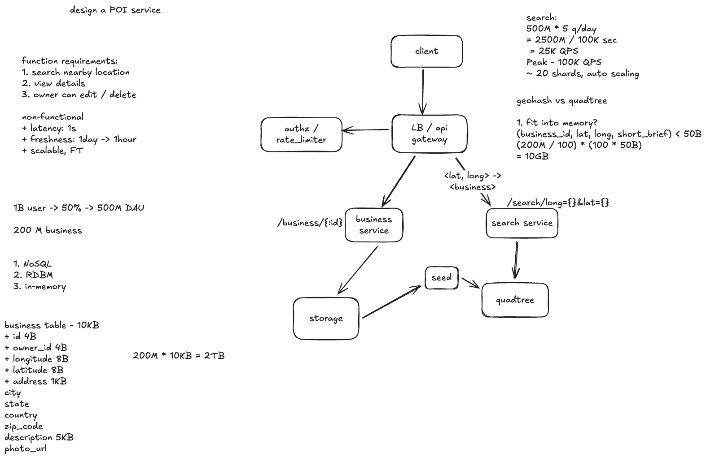

# Design Yelp / 大众点评: Nearby Business Search

> Based on the provided POI service sketch and notes. This case focuses on finding nearby businesses, using an in-memory QuadTree as the main design and GeoHash as an alternative.

## 1. Requirements

**Functional requirements**

- Search for businesses within a radius of a location.
- View business details.
- Allow owners to add, edit, and delete their businesses.

**Non-functional requirements**

- Search latency below approximately one second.
- Business changes become searchable within approximately one hour.
- Scale to a large number of businesses and searches.
- Keep serving searches when an index server fails.

Reviews, recommendations, and advertising are outside this case. The database is the source of truth; the spatial index is a smaller, rebuildable representation used for search.

## 2. Capacity Estimates

The sketch assumes 1 billion registered users, 500 million daily active users, 5 searches per active user per day, and 200 million businesses.

| Item | Estimate |
| --- | --- |
| Daily searches | `500M × 5 = 2.5B` |
| Average search traffic | About `29K QPS`, or `25K QPS` using 100,000 seconds per day |
| Peak search traffic | Approximately `100K QPS` |
| Full business records | `200M × 10 KB ≈ 2 TB`, excluding replicas and indexes |
| Compact spatial entries | `200M × 50 bytes ≈ 10 GB`, before tree and runtime overhead |

The useful observation is that **full business records may take terabytes, while a compact spatial index may fit in memory**. Keep only the business ID, coordinates, and possibly a few small fields in the index. Descriptions, addresses, and photo references stay in the database.

The 10 GB estimate is a starting point. Tree nodes, pointers, memory allocation, replicas, and space for rebuilding increase the actual requirement. The sketch's roughly 20 shards is also an initial sizing assumption that needs load testing.

## 3. Architecture



- **API Gateway / Load Balancer:** Routes requests and applies authentication and rate limits.
- **Business Service:** Handles business details and owner-authorized changes.
- **Search Service:** Finds nearby business IDs through the spatial index, then fetches business details in a batch.
- **Database:** Stores the complete business records.
- **Index Builder / Seed:** Builds and publishes a reusable snapshot of the spatial index from database records.
- **QuadTree servers:** Load the snapshot into memory and serve nearby searches.

Example APIs:

```text
GET    /search?lat=...&lon=...&radius=...
GET    /businesses/{business_id}
POST   /businesses
PATCH  /businesses/{business_id}
DELETE /businesses/{business_id}
```

A simplified data model:

```text
business(
  business_id,
  owner_id,
  latitude,
  longitude,
  address,
  city,
  state,
  country,
  zip_code,
  description,
  photo_url,
  status
)
```

## 4. Main Design: In-Memory QuadTree

### How the tree stores businesses

A QuadTree divides a geographic area into four smaller areas. When an area contains too many businesses, it splits again. Dense city centers get smaller cells; sparse areas can remain larger.

Leaf nodes hold compact business entries. Set a maximum depth or minimum cell size so that businesses at the same coordinates do not cause endless splitting.

### Nearby search

1. Build a bounding box around the user's search circle.
2. Traverse tree nodes whose geographic areas overlap the box.
3. Collect candidate businesses from matching leaves.
4. Calculate each candidate's actual distance using the Haversine formula.
5. Keep businesses within the requested radius, sort by distance, and paginate.
6. Batch-fetch details for the selected business IDs.

The bounding box is only a coarse filter. Exact distance filtering removes businesses outside the circle. Apply relevant business filters before selecting the final page.

### Hourly rebuilds and freshness

Business locations change relatively infrequently, so a simple periodic rebuild can satisfy the one-hour freshness target:

1. Read a consistent database snapshot and build a new tree in the background.
2. Save the complete tree snapshot as a versioned seed artifact in durable storage.
3. Load and validate the new version on index servers.
4. Switch searches to the new version after it is ready; keep the previous version briefly for rollback.

Searches continue using the old tree while the new one loads. Reserve enough memory for both versions during the switch.

**Recovery means loading the complete saved snapshot, not copying only the root node.** A root pointer alone cannot recover tree nodes lost with a process's memory. A replacement server loads the latest seed and joins the serving pool after it is ready.

An hourly rebuild schedule can produce staleness of up to roughly one hour **plus build and rollout time**. If one hour is a firm limit, start builds more frequently or add incremental updates. The periodic approach keeps the initial design simple without requiring a streaming pipeline.

Edits to descriptions can appear immediately through the Business Service even while the location index is older. Before returning search results, check current business status so deleted or closed businesses are not shown just because they remain in an older tree.

## 5. Alternative: GeoHash in the Database

### GeoHash intuition

GeoHash converts latitude and longitude into a string representing a rectangular cell:

1. Start with longitude `[-180, 180]` and latitude `[-90, 90]`.
2. Split longitude in half and record `0` or `1` for the half containing the point.
3. Split latitude in half and record another bit.
4. Repeat, alternating longitude and latitude.
5. Group the bits into sets of five and encode them with a Base32 alphabet.

The result looks like `wx4g0s`. A longer string identifies a smaller cell. As rough examples near the equator, length 5 is about 5 km wide, length 6 about 1 km, and length 7 about 150 m. Cell dimensions vary with latitude and are not always square.

Points sharing a prefix lie in the same larger cell. Nearby points can still have different prefixes when they sit across a cell boundary.

### Data model and writes

Add a fixed-precision `geohash` field to the business table and index it:

```sql
CREATE INDEX idx_geohash ON business (geohash);
```

Whenever a business is created or its coordinates change, compute its GeoHash and save both coordinates and GeoHash in the same transaction. The database maintains the index automatically. Store enough precision for the smallest supported search area; shorter prefixes can serve wider searches.

### Nearby search

1. Choose a query precision based on the radius and local business density.
2. Find all GeoHash cells covering the search area's bounding box.
3. Query those prefixes using the database index.
4. Deduplicate candidates, calculate exact distances, and keep only those within the radius.
5. Apply filters, sort, and paginate.

For example, one cell can be queried with:

```sql
SELECT business_id, latitude, longitude
FROM business
WHERE geohash LIKE 'wx4g0%';
```

Use parameterized queries in application code. Prefix range scans are another option. In a NoSQL store, keys can take the form `geohash_prefix#business_id`, with the scan bounds following that store's key-ordering rules.

**The center cell plus its eight neighbors is sufficient only when those cells cover the entire search area.** Smaller cells or larger radii require more cells. Missing cells cannot be repaired by exact distance filtering afterward. Similarly, an arbitrary database `LIMIT` before distance filtering can discard valid or closer businesses; fetch enough candidates or continue scanning to produce the requested page correctly.

### Freshness

The GeoHash index changes as part of the database write, so it avoids waiting for an hourly tree rebuild. Searches against the primary can see committed changes immediately; searches against replicas depend on replication lag. Measure that lag rather than assuming a fixed delay.

## 6. QuadTree vs. GeoHash

| Aspect | QuadTree | GeoHash |
| --- | --- | --- |
| Index location in this design | Dedicated in-memory index servers | Database field and index |
| Search path | Tree lookup → business IDs → details | Prefix scans → candidates → details |
| Geographic partitioning | Adapts to business density | Fixed cells at each precision |
| Updates | Periodic rebuild in the baseline design | Maintained with database writes |
| Recovery | Load a saved tree snapshot | Use database recovery and replication |
| Main engineering work | Building, loading, and serving tree versions | Cell coverage, candidate filtering, and database scaling |

Use the QuadTree baseline when a compact index fits in memory and hourly freshness is acceptable. GeoHash is a straightforward alternative when database-managed indexing and fresher location updates are useful. QuadTrees can also support incremental updates; batch rebuilding is a choice made for this case.

## 7. Scaling, Caching, and Regions

**Sharding:** Partition QuadTrees by geographic area and replicate busy partitions. For GeoHash, assign prefix ranges to shards. Dense city centers can become hotspots, so split hot ranges more finely or explicitly distribute a hot cell across multiple partitions. Simply adding a random suffix does not spread traffic if routing still uses only the original prefix; distributing a cell also means querying its partitions.

**Caching:** Add a short-lived cache if repeated searches create meaningful database or index load. A key can include the geographic cell, radius, and filters. Cache a candidate set covering the whole cell's possible queries, then calculate distance and sort for the actual user location. Two users in the same cell can have different nearby results, so they should not blindly share an exact final result list. Business details can be cached separately by ID.

**Multiple regions:** Keep regional datasets and indexes near the businesses they cover. Route by the requested search coordinates, since a user may search a city far from their current location. Queries near a regional boundary may need both regions. Regional isolation limits the impact of failures; failover still requires replicas or recoverable snapshots elsewhere.

At the assumed `100K` peak QPS, measure candidate counts, memory usage, replica lag, and p95 / p99 latency before deciding how many shards or caches are needed. An index improves the access path, but does not by itself prove that a cluster can handle the target traffic.

## 8. Interview Takeaway

Start with a durable business database and a compact QuadTree for nearby search. If an hourly delay is acceptable, periodic builds and reusable seed snapshots provide a simple update and recovery path. Then discuss GeoHash as an alternative that turns geographic lookup into indexed prefix scans, followed by exact distance filtering. Scale according to regional traffic and business density.
