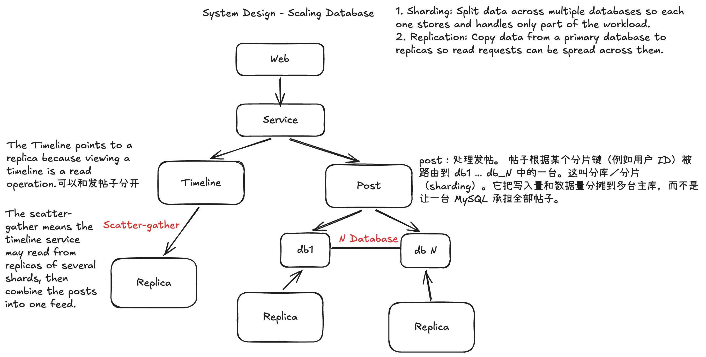

# Database Partition / Sharding：思维模型

**Sharding（分片）**是按规则把同一类数据分布到多个独立数据库中，每个分片只保存和处理其中一部分数据。它适合解决单库承受不了的写入量、数据量或索引规模，但会让查询和运维变复杂。**Replication（复制）**则是为同一份数据建立副本，主要用于分担读流量和提高可用性；副本不能分摊主库的写入，也不会减少每份副本需要存储的数据量。

## 1. 先问：单库的瓶颈是什么？

不要看到流量增长就直接提出分片。先测量峰值 QPS（queries per second，每秒查询数）、读写比例、查询延迟、CPU、内存、磁盘 I/O、数据库大小、索引大小，以及这些指标的增长速度，再判断限制在哪里。

| 瓶颈 | 先尝试什么 | 何时考虑分片 |
| --- | --- | --- |
| 读 QPS 高 | 优化 SQL 和索引、缓存热点数据、增加只读副本 | 副本和缓存仍无法以合理成本承担读流量，或查询本身需要拆分数据集 |
| 写 QPS 高 | 减少无效写入、批量写入、优化索引和事务、升级机器 | 单个主库的 CPU、I/O 或锁竞争已限制写入，副本无法分担写入 |
| 存储或索引过大 | 清理或归档旧数据、调整索引、升级磁盘和内存 | 数据及索引持续增长，单机容量、备份恢复时间或查询性能无法满足要求 |

所以通常先利用**垂直扩展（更强的机器）、正确的索引、读写分离／只读副本和缓存**。这些方法接近性能或成本上限，且确认瓶颈能通过拆分数据解决时，再引入分片。这里的“先”是排查顺序，并不要求把每一种手段都用尽。

## 2. 再问：按什么键、用什么规则分？

**分片键（sharding key）要根据主要访问模式选择。**理想情况下，一次高频请求能直接定位到一个分片，同时写入和数据量分布比较均匀。

以帖子 `posts` 为例：

- **按 `user_id` 分片**：同一用户的帖子在同一分片，查某个用户的帖子很方便；但聚合多个关注用户的时间线可能需要查询多个分片，再合并排序（scatter-gather）。大 V 的写入或访问量也可能形成热点。
- **按 `post_id` / `item_id` 分片**：按帖子 ID 查单篇帖子容易定位；但查某个用户的全部帖子需要额外索引，或向多个分片查询。如果 ID 随时间递增，直接按 ID 范围分片还可能使新写入集中到最新分片。

确定分片键后，还要选择路由策略：

| 策略 | 路由方式 | 主要取舍 |
| --- | --- | --- |
| 直接取模 | `hash(user_id) % N` | 实现简单；`N` 改变时，大量数据的目标分片会变化，扩容迁移成本高 |
| 一致性哈希 | 将键和分片映射到哈希环 | 增减分片时通常只需迁移部分数据；需要维护路由与虚拟节点，且仍不能自动解决单个热门键的热点 |

例如，选择 `user_id` 并使用 16 个分片时，可以把 `hash(user_id) % 16` 作为初始路由。需要扩容时，要提前设计数据迁移、路由切换以及迁移期间的读写一致性；不能只把 `16` 改成 `32`。

## 3. 最后说明收益与代价

**收益：**每个分片承担一部分写入、存储和索引；如果访问能按分片键定位，系统可以通过增加分片扩大容量和吞吐量。

**代价与处理办法：**

1. **跨分片查询和 JOIN：**数据库很难像单库一样直接完成 JOIN、排序和分页。尽量让经常一起访问的数据落在同一分片；其他情况可在服务层并行查询后合并，或维护专门的查询索引／预计算结果。向所有分片发请求会增加总工作量，响应时间也容易受最慢分片影响。
2. **跨分片事务：**一次操作涉及多个分片时，单库事务不再够用。优先调整数据归属，使需要原子更新的数据位于同一分片；无法避免时，再根据一致性要求选择分布式事务或最终一致性的工作流，并处理重试和补偿。
3. **热点与再均衡：**某个大客户、热门用户或时间范围可能让一个分片过载，即使总体分布均匀也会发生。需要监控每个分片的流量和大小；可拆分热点数据、调整路由或增加缓存。扩容后的数据迁移应分批进行，并验证新旧路由切换期间的数据正确性。

## 面试时可以这样回答

> 我会先确认单库瓶颈是读 QPS、写 QPS，还是存储和索引规模，并尝试索引优化、升级机器、缓存和只读副本。如果单个主库仍然无法满足写入或容量需求，我会根据主要查询选择分片键，例如按 `user_id` 分帖子，让单用户查询落到一个分片；时间线查询则可能需要跨分片聚合。路由可以先用取模，但扩容时数据迁移较多；一致性哈希能减少迁移范围。最后我会说明跨分片查询与事务、热点和再均衡的处理方式。
