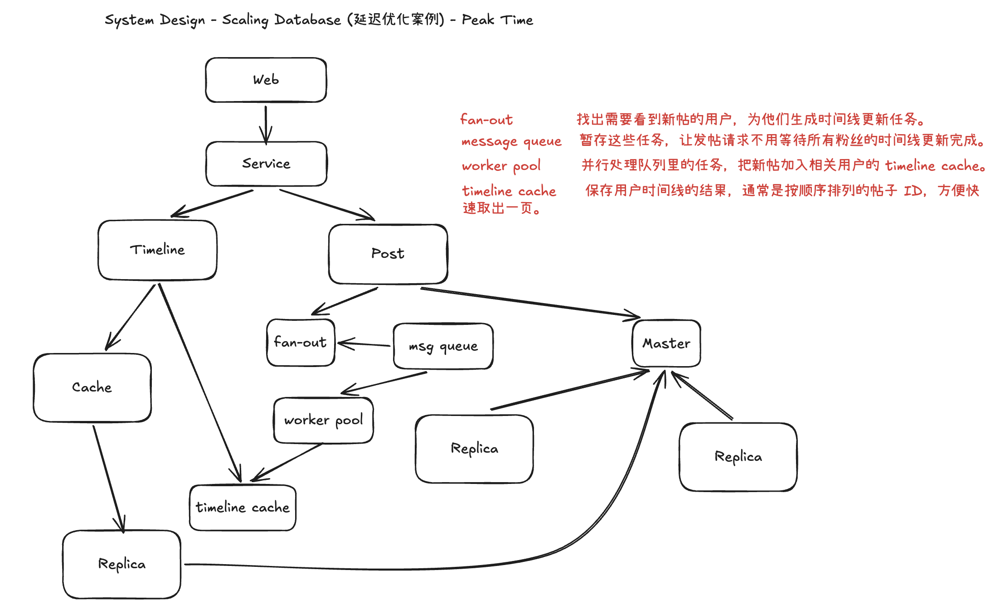

# 延迟优化案例：高峰时段的社交时间线

## 核心流程

1. **发帖：**`Post` 先把帖子写入主库（Master）；写入成功后生成粉丝时间线更新任务，放入消息队列。发帖请求不必等待所有粉丝的时间线更新完成。
2. **异步更新：**`worker pool` 并行处理任务，将新帖加入相关用户的 `timeline cache`。这个缓存通常保存按顺序排列的帖子 ID。
3. **读取时间线：**`Timeline` 优先读取 `timeline cache`；获取帖子内容时先查普通 `Cache`，未命中再查只读副本（Replica），减少主库的读负载。

**高峰时段的注意点：** 大 V 发帖会产生大量 fan-out 任务，队列可能积压。可以对这类账号采用读取时拉取或推拉结合的方式，并监控队列延迟和时间线缓存的新鲜度。

图中数据库副本指向主库的箭头只是示意连接关系；通常的数据复制方向是**主库 → 副本**。异步任务的逻辑顺序是 **fan-out → message queue → worker pool**。
