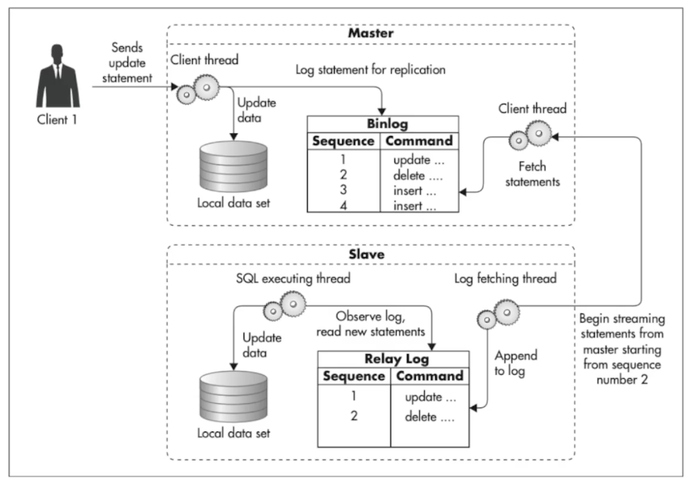
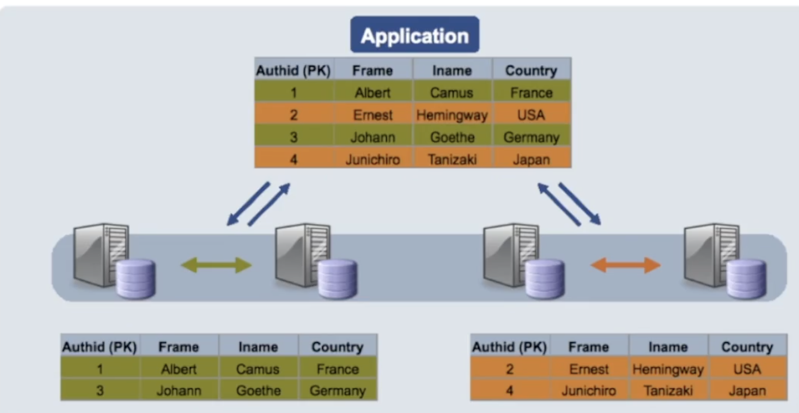

# 数据复制和分区

数据库横向扩展有两个不同的方向：**分片（sharding）拆分数据的归属，复制（replication）增加同一份数据的副本**。两者可以组合使用，但解决的问题不同。

| | 分片 Sharding | 复制 Replication |
| --- | --- | --- |
| 数据如何分布 | 按分片键将不同记录放到不同分片 | 将同一份数据复制到多个节点 |
| 主要解决什么 | 分摊写入、存储和索引规模 | 分担读取、提高可用性 |
| 写入如何路由 | 根据分片键找到负责该记录的分片 | 先写可写节点，再将变更同步给副本 |

## 分片：不同节点负责不同的数据

例如按 `item_id` 分片，应用可以用 `hash(item_id) % N` 算出目标分片，并把该条记录的写入路由过去。每个分片保存数据集的一部分，可以是一个独立的数据库集群。

在**每个分片只有一个主库**的常见设计中，一条记录只归属于一个分片，由这个分片的主库负责接受写入。其他分片的主库负责别的记录，不会相互复制整套数据。

## 复制：多个节点保存同一份数据

- **单主复制**：写入主库（primary），再将变更同步到副本（replica）。副本通常承担读请求，也可在故障转移时被提升为新主库。
- **主–主复制（多主复制）**：多个节点可以接受同一份数据的写入，并将变更同步给其他节点。因此，每个节点最终都要应用这些写入；并发修改同一条记录时，还需要处理冲突。

下图展示单主复制：主库记录 binlog，副本获取变更并写入 relay log，再应用到本地数据集。



所以，看到系统里有多个 `master`，不能立刻判断它是分片还是主–主复制。**要问：这些主库负责的是不同的数据，还是同一份数据？**前者是分片，后者是多主复制。

“提交一条记录会被写入几次”容易误导：即使一条记录只属于一个分片，该分片内也可能有多个副本，最终会保存多份。更准确的问题是：**哪一个分片对这条记录负责，以及同一份数据被复制到哪些节点？**

## 两种方案可以同时使用

下图按 `Authid` 将奇数和偶数记录分到两个分片；每个分片内的两台服务器再复制同一部分数据。



```text
分片维度：不同分片保存不同数据

Shard 0：Primary 0 ──复制──→ Replica 0a、Replica 0b
Shard 1：Primary 1 ──复制──→ Replica 1a
Shard 2：Primary 2 ──复制──→ Replica 2a、Replica 2b

每一行内部复制相同数据；不同行之间按分片键划分数据。
```

这里的 `Primary 0`、`Primary 1`、`Primary 2` 都是主库，但各自负责不同分片。每个主库的副本保存的是**该分片**的数据，而不是其他分片的数据。单主和多主描述的是一个数据集的写入方式；分片描述的是数据如何拆分，因此两者是独立的设计选择。

旧术语 `master/slave` 在这里分别对应 `primary/replica`（主库／副本）。副本不等于备份：副本会同步删除和错误写入，也可能有复制延迟；仍需单独考虑备份与恢复。
