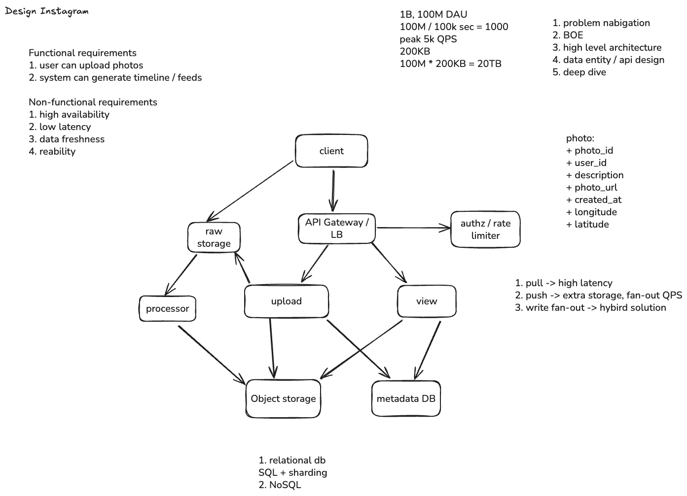

# User Generated Content Case：Design Instagram

这张图用“上传照片 + 查看 News Feed”练习用户生成内容（UGC）系统。以下数字只是设计假设，不是 Instagram 的真实流量。

## 先看需求和数量级

- **Functional requirements**：上传照片、生成并查看 timeline / feed。
- **Non-functional requirements**：高 availability（可用性）、低 latency（延迟）、足够新的内容（data freshness）和 reliability（可靠性）。
- **Back-of-the-envelope（粗估）**：图中假设 1B 用户、100M DAU、照片约 200 KB。若每天新增 100M 张照片，原图约 **20 TB/day**；若按后文“每人每天发 2 帖”估算，则是 200M 帖/day，约 **40 TB/day**。这还没算副本、缩略图和索引。图里的 `100M / 100k sec ≈ 1k QPS` 是粗算；按 86,400 秒/天计算约为 **1.2k QPS**，峰值要另估。

## 图中组件

- **Client → Raw Storage**：客户端可在 Upload Service 授权后直接上传原图，避免大文件经过 API 服务器。
- **API Gateway / LB + Authz / Rate Limiter**：统一入口，负责路由、权限检查和限流。
- **Upload Service + Processor**：Upload Service 创建照片记录；Processor 异步生成缩略图、压缩图等版本，再写入 Object Storage。
- **Object Storage + Metadata DB**：前者存照片文件，后者存 `photo_id`、`user_id`、描述、文件 URL、时间和位置等元数据。View Service 根据元数据找到文件。
- **Follow 关系**：需要单独存“谁关注了谁”。这张上传/查看草图没有画出 Follow Store、Fan-out Service 或 Timeline Store；下面的 Feed 设计是在图上继续扩展。

## News Feed：Pull、Push 与 Hybrid

- **Pull（读时聚合）**：用户打开 Feed 时，查询其关注的人并合并他们的新帖。发帖便宜，但读 Feed 可能需要大量查询和排序，读延迟较高。
- **Push / fan-out-on-write（写时分发）**：有人发帖后，Fan-out Service 异步查该作者的 **followers（粉丝）**，把 `photo_id` 写入每位粉丝的预建 timeline。读 Feed 快，但每次发帖会产生多次写入。
- **Hybrid（混合）**：普通作者采用 push；粉丝极多的作者采用 pull，用户读 Feed 时再合并其新帖，避免一次发帖触发海量写入。Timeline 通常只存 ID 和排序信息，照片仍在 Object Storage。

## Cache 放在哪里？

- **CDN 缓存照片**：`Object Storage（源站）→ CDN → Client`。热门照片和缩略图在靠近用户的边缘节点直接返回，减少源站流量和图片加载时间；CDN 不负责存 Follow 关系或生成 Feed。原图没有画 CDN，这是实际方案中可补的一层。
- **Redis 缓存小数据**：放在 View Service 与 Metadata DB / Timeline Store 之间，缓存热门照片元数据或用户最近的 timeline ID，减少重复读。缓存未命中时读后端存储；Redis 不是照片文件的主要存储，也不能代替持久化的 Timeline Store。
- **Follow 关系按需缓存**：只有测到 Fan-out 反复读取热点 followers list 成为瓶颈时，再考虑用 Redis 缓存。Follow / Unfollow 时更新或失效缓存，否则可能把帖子推给旧粉丝，或漏掉新粉丝。

## Q&A：Fan-out 要查 Follow Store 吗？需要 Cache 吗？

**要查什么？** Push 时必须知道“谁关注了这位作者”，所以 Fan-out Service 要读 **followers list**。用户打开 pull 型 Feed 时，才需要读“我关注了谁”的 **following list**。这两个查询方向不要弄反。

**压力在哪里？** 假设 100M 用户、每人每天发 2 帖：约 **200M 帖/day ≈ 2.3k 发帖/s**。如果平均有 100 位粉丝，约产生 **230k timeline writes/s**（未计峰值与热门作者）。Follow Store 约承担每帖一次粉丝列表查询，但每次会返回许多 ID；因此不能只比较查询 QPS，还要看返回的 follower 总数、热门账号和存储吞吐。通常应先测量，别直接加 Cache。

**80 GB 能说明什么？** `100M × 200 × 4 bytes ≈ 80 GB` 只是“每人 200 条、每个 ID 4 字节”的原始数据量。索引、对象开销、副本、缓存双向关系和 ID 实际大小会让真实占用更高。是否缓存全部关系，取决于热点和成本。

**Cache 会不会永远不更新？** 不会只能靠 cache miss。Follow / Unfollow 时可以 invalidate（失效）或更新对应缓存，再配合 TTL（过期时间）和变更事件；这样能控制陈旧数据窗口。缓存会增加一致性与维护成本，适合在 Follow Store 读延迟或吞吐成为实际瓶颈后引入。Follow 关系也不一定必须放在 graph database；按 `user_id` 或 `author_id` 查询邻接列表的 KV / wide-column 存储也是常见选择。

**复习重点**：Pull 把代价放在读 Feed；Push 把代价转成写 timeline。Fan-out 异步执行，练习中可先假设允许约 30 秒的 Feed freshness 延迟，再验证产品是否接受；同时要决定 Follow / Unfollow 后，旧 timeline 如何清理或补齐。
