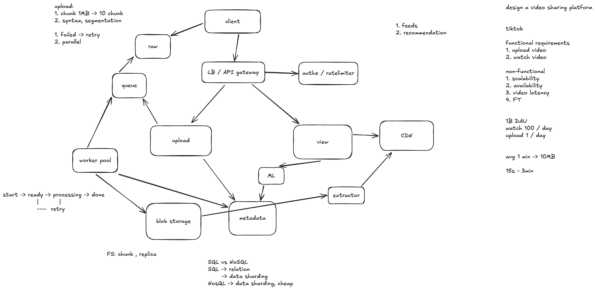
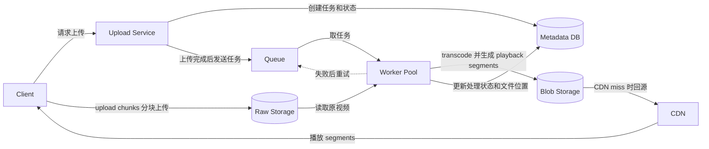

# 案例分析：Design TikTok

这是一张短视频平台的系统设计练习图，重点是区分**上传、异步处理和观看**三条路径。图中的规模数字是练习时的假设，不代表 TikTok 的真实数据或内部架构。

> **图中箭头更正**：正常处理方向是 **Queue → Worker Pool**，表示 worker 从队列取任务。图里的 **Worker Pool → Queue** 只有在表示失败后 retry / re-enqueue（重新入队）时才合理；如果表示主流程，就是画反了。

**两种“分块”放在不同位置**：upload chunks（上传分块）发生在 **Client → Raw Storage**；Worker Pool 处理原视频后生成 playback segments（播放切片），存入 **Blob Storage**，再由 **CDN → Client** 分段传给播放器。Upload Service 负责上传任务和权限，客户端可以拿到授权地址后直接上传文件数据。

## 需求与规模假设

- **Functional requirements（功能需求）**：上传视频、观看视频；Feed（信息流）和 recommendation（推荐）决定用户看到什么。
- **Non-functional requirements（非功能需求）**：scalability（可扩展性）、availability（可用性）、低 video latency（播放延迟）和 fault tolerance（容错）。
- **图中的假设**：10 亿 DAU（日活用户），每人每天观看 100 个视频、上传 1 个视频；平均视频约 1 分钟、10 MB，时长范围约 15 秒到 3 分钟。设计时要据此估算请求量、带宽和存储量，尤其注意观看量远高于上传量。

## 各组件做什么

| 组件 | 作用 |
| --- | --- |
| **Client（客户端）** | 发起上传、请求 Feed，并从 CDN 播放视频。 |
| **LB / API Gateway（负载均衡器 / 网关）** | 提供统一入口，将请求分发给 Upload 或 View 服务。 |
| **Authz / Rate Limiter（授权 / 限流）** | 检查用户是否有权限操作，并限制请求频率，保护后端。 |
| **Upload Service（上传服务）** | 创建上传任务、记录状态，并协调视频写入 raw storage。 |
| **Raw Storage（原始文件存储）** | 暂存尚未处理的原视频；与最终供播放的文件分开。 |
| **Queue + Worker Pool（队列 + 工作节点）** | 异步处理上传任务，例如转码、生成不同画质、切分播放片段；高峰期可增加 worker。 |
| **Blob Storage（对象存储）** | 保存处理后的视频、playback segments 和播放清单；replica（副本）帮助提高可靠性。 |
| **Metadata DB（元数据数据库）** | 保存 video ID、作者、上传状态、文件位置等小数据；大视频文件放在对象存储中。SQL 或 NoSQL 的选择取决于查询和数据关系。 |
| **View Service（观看服务）** | 查询视频信息、组织 Feed，并返回播放地址；通常不直接传输大量视频字节。 |
| **ML + Extractor（推荐模型 + 特征提取）** | Extractor 从视频等数据提取特征；ML 用特征和用户行为给候选视频排序。 |
| **CDN（内容分发网络）** | 将热门视频缓存到离用户更近的位置，减少播放等待和源站流量。 |

## 两条主要流程

1. **Upload path（上传）**：Client 发起上传，Upload Service 在 Metadata DB 创建 video ID 和初始状态；原视频进入 Raw Storage。上传完成后，Upload Service 将处理任务放入 Queue，Worker Pool 从 Queue 取任务，处理产物写入 Blob Storage，并更新 Metadata DB 中的状态和文件位置。上传可拆成小 chunk（图中示例为 1 MB × 10）；单块失败时只需 retry（重试）该块，也可 parallel upload（并行上传）。上传 chunk 与播放时的视频切片是两回事。
2. **Watch path（观看）**：Client 请求 Feed 或某个视频；View Service 读取 Metadata DB，并可调用 ML 排序。服务返回视频信息和 CDN 播放地址，Client 再从 CDN 获取视频；CDN 未命中时回源到 Blob Storage。

上传任务的状态可按 **start → ready → processing → done** 理解：`ready` 表示文件已上传、等待处理；处理失败时按策略 retry，并避免重复任务产生重复结果。

**复习时记住**：视频字节走对象存储和 CDN，视频信息走 Metadata DB；耗时的转码走 Queue + Worker，避免让上传请求一直等待。
